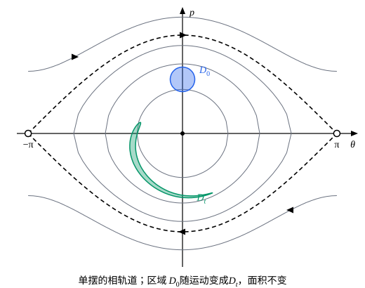

## 这一节要回答的问题

知道了此刻的$q$和$p$，:term[正则方程]{id="physics.analytical-mechanics.hamiltons-equations"}（Hamilton's canonical equations）就定下了以后的全部运动，所以$(q,p)$完整地描述了系统此刻的状态。把所有可能的状态画成一个空间，运动就是其中的一条曲线：这些曲线长什么样？如果初始状态不能精确地知道，只知道它落在一小块区域里，这块区域随着时间会散开、缩小，还是别的样子？

## 讲解

### 相空间与相轨道

先看例子。一维谐振子（harmonic oscillator）的:term[哈密顿量]{id="physics.analytical-mechanics.hamiltonian"}（Hamiltonian）是$H=\frac{p^2}{2m}+\frac12kq^2$，每一时刻的状态是$(q,p)$平面上的一点。$H$不显含时间，所以守恒，这一点始终留在曲线$\frac{p^2}{2m}+\frac12kq^2=E$上：这是一个椭圆，$q$方向的半轴是$\sqrt{2E/k}$，$p$方向的半轴是$\sqrt{2mE}$。:term[正则方程]{id="physics.analytical-mechanics.hamiltons-equations"}给出$\dot q=\frac{p}{m}$，上半平面里$p>0$，点向右走，所以以$q$为横轴、$p$为纵轴时，它沿椭圆顺时针转。

::anchor{id="def-phase-space"}
$n$个:term[自由度]{id="physics.analytical-mechanics.degrees-of-freedom"}（degrees of freedom）的系统，以$q_1,\dots,q_n,p_1,\dots,p_n$为坐标的$2n$维空间叫作:term[相空间]{id="physics.analytical-mechanics.phase-space"}（phase space），其中的每一点代表系统的一个状态，叫作相点（phase point）。系统的一个运动在相空间里画出的曲线叫作:term[相轨道]{id="physics.analytical-mechanics.phase-trajectory"}（phase trajectory）。

为什么这样定义：:term[位形空间]{id="physics.analytical-mechanics.configuration-space"}（configuration space）里只有$q$，同一个位置上可以有不同的速度，经过同一点的运动有很多条，曲线会交叉。相空间里每一点都给出确定的速度$(\dot q,\dot p)=\bigl(\frac{\partial H}{\partial p},-\frac{\partial H}{\partial q}\bigr)$，相点以后怎么走完全确定；$H$不显含时间时，经过每一点的相轨道只有一条，不同的相轨道不相交。边界情况：$H$显含时间（例如受周期驱动的单摆）时，同一点在不同时刻的速度不同，$(q,p)$平面上的相轨道可以交叉；把$t$也当作一个坐标，在$(q,p,t)$空间里它们就不相交了。

### 一个自由度：相轨道就是等值线

一个:term[自由度]{id="physics.analytical-mechanics.degrees-of-freedom"}、$H(q,p)$不显含时间时，$H$守恒，:term[相轨道]{id="physics.analytical-mechanics.phase-trajectory"}落在等值线（level curve）$H(q,p)=E$上。所以画相轨道就是画$H$的等值线，再用:term[正则方程]{id="physics.analytical-mechanics.hamiltons-equations"}标上方向。相点不动的地方是平衡点：$\dot q=\dot p=0$，即$\frac{\partial H}{\partial p}=\frac{\partial H}{\partial q}=0$，它们是$H$的驻点。

::anchor{id="def-center-saddle"}
对$H=\frac{p^2}{2m}+V(q)$，平衡点就是$p=0$、$V'(q)=0$的点。$V$的极小点周围是一圈套一圈的闭曲线，相点绕着它转，叫作中心（center）；$V$的极大点处，经过它的等值线交叉成「×」形，叫作鞍点（saddle point）。穿过鞍点的相轨道把不同类型的运动分开，例 1 会具体画出来。

### 刘维尔定理

::anchor{id="def-phase-flow"}
把每个相点都沿着它的:term[相轨道]{id="physics.analytical-mechanics.phase-trajectory"}走$t$时间，得到的映射$g_t$叫作:term[相流]{id="physics.analytical-mechanics.phase-flow"}（phase flow）：一块区域$D_0$里的所有状态，$t$时间以后占据区域$D_t=g_t(D_0)$。

为什么这样定义：初始状态往往只知道个大概，例如落在$D_0$里；要关心的是这一整块怎样移动，而不是某一条轨道。相点的速度$\vb{v}=\bigl(\frac{\partial H}{\partial p},-\frac{\partial H}{\partial q}\bigr)$是:term[相空间]{id="physics.analytical-mechanics.phase-space"}里的一个向量场，相轨道就是它的流线，相流就像流体被这个速度场带着走。边界情况：$H$显含时间时，速度场随时间变，从$t_0$时刻出发走$t$时间的映射还和$t_0$有关，要写成$g_{t_0,t}$。

::anchor{id="thm-liouville"}
:term[刘维尔定理]{id="physics.analytical-mechanics.liouville-theorem"}（Liouville's theorem）：哈密顿系统的:term[相流]{id="physics.analytical-mechanics.phase-flow"}保持相空间的体积不变，任何一块区域$D_0$随运动变成$D_t$，$D_t$的体积等于$D_0$的体积；$H$显含时间时也成立。

证明的第一步是算速度场$\vb{v}$的散度（divergence）。一个:term[自由度]{id="physics.analytical-mechanics.degrees-of-freedom"}时

$$
\nabla\cdot\vb{v}=\frac{\partial}{\partial q}\Bigl(\frac{\partial H}{\partial p}\Bigr)+\frac{\partial}{\partial p}\Bigl(-\frac{\partial H}{\partial q}\Bigr)=\frac{\partial^2H}{\partial q\,\partial p}-\frac{\partial^2H}{\partial p\,\partial q}=0 ,
$$

这里用了$H$的二阶偏导数连续时，混合偏导数和求导的次序无关。$n$个自由度时，散度是$2n$项之和$\sum_j\bigl(\frac{\partial\dot q_j}{\partial q_j}+\frac{\partial\dot p_j}{\partial p_j}\bigr)$，同样两两相消。$H$显含时间时，每一时刻的速度场的散度照样为零。

第二步说明散度为零为什么意味着体积不变。散度是速度场「源的强度」，量的正是一小块区域随流动时体积的相对变化率；一个自由度时可以直接算。取一个很小的平行四边形，一个顶点在$\vb{x}$，两条边是$\vb{a}$、$\vb{b}$，面积是叉积$A=a_qb_p-a_pb_q$。经过很短的时间$\dd t$，每个顶点移动$\vb{v}\,\dd t$，边$\vb{a}$变成$\vb{a}+\bigl(a_q\frac{\partial\vb{v}}{\partial q}+a_p\frac{\partial\vb{v}}{\partial p}\bigr)\dd t$，边$\vb{b}$同理。

把两条新边代进面积公式，展开到$\dd t$的一次项，含$\frac{\partial v_q}{\partial p}$、$\frac{\partial v_p}{\partial q}$的项都两两相消，剩下

$$
\dv{A}{t}=\Bigl(\frac{\partial v_q}{\partial q}+\frac{\partial v_p}{\partial p}\Bigr)(a_qb_p-a_pb_q)=(\nabla\cdot\vb{v})\,A .
$$

散度为零，每个小平行四边形的面积都不变；任何一块区域都能切成许多小平行四边形，它的面积也就不变。

$2n$维时，把平行四边形换成以$\vb{a}_1,\dots,\vb{a}_{2n}$为棱的小平行多面体，它的体积是以这些棱为列的行列式（determinant）。经过$\dd t$，每条棱变成$\vb{a}_k+J\vb{a}_k\,\dd t$，其中$J$是速度场的$2n$个分量对$2n$个坐标的偏导数排成的矩阵，所以新的平行多面体是旧的经过线性变换$I+J\,\dd t$（$I$是单位矩阵）得到的，体积乘上$\det(I+J\,\dd t)$。

行列式对每一列都是线性的，把$I+J\,\dd t$逐列展开，$\dd t$的一次项是「把单位矩阵的第$k$列换成$J$的第$k$列」的$2n$个行列式之和，其中第$k$个正好等于$J_{kk}$。于是$\det(I+J\,\dd t)=1+(J_{11}+\dots+J_{2n,2n})\,\dd t+O(\dd t^2)=1+(\nabla\cdot\vb{v})\,\dd t+O(\dd t^2)$，体积的变化率同样是散度乘体积；散度为零，相空间的体积不变。

反例：有阻力时就不对了。单摆受阻力$-bp$时（取$m=l=g=1$），$\dot\theta=p$，$\dot p=-\sin\theta-bp$，$\nabla\cdot\vb{v}=-b<0$，面积满足$\dv{A}{t}=-bA$，即$A=A_0e^{-bt}$。所有相点螺旋着落向最低点，一块区域最后缩成一个点，而哈密顿系统不可能这样（p5）。

## 几何图像

取$m=l=g=1$，$H=\frac{p^2}{2}-\cos\theta$。细线是:term[相轨道]{id="physics.analytical-mechanics.phase-trajectory"}：中间的闭曲线是来回摆，上下两条是绕悬点转圈，虚线是穿过鞍点的分界线（例 1）。蓝色的圆$D_0$是一团初始状态，经过$t=25$（时间以$\sqrt{l/g}$为单位）变成绿色的$D_t$：外圈的状态能量大、周期长，落在后面，这团状态被拉成一条弯带，面积却和$D_0$一样（数值算得都是$0.1963$）。

:::anim{component="phase-portrait"}
system: { theta: "p", p: "-sin(theta) - b*p" }
range: { theta: [-3.3, 3.3], p: [-2.2, 2.2] }
dt: 0.01
initial:
  - [0.25, 1.1]
  - [0.217, 1.225]
  - [0.125, 1.317]
  - [0, 1.35]
  - [-0.125, 1.317]
  - [-0.217, 1.225]
  - [-0.25, 1.1]
  - [-0.217, 0.975]
  - [-0.125, 0.883]
  - [0, 0.85]
  - [0.125, 0.883]
  - [0.217, 0.975]
sliders:
  - name: b
    min: 0
    max: 0.5
    step: 0.05
    default: 0
    label: |
      阻尼系数$b$
:::

12 个点一开始排在$D_0$的边界上，横轴是$\theta$（图上写作 theta），纵轴是$p$。$b=0$时它们沿着各自的相轨道顺时针转，越转越错开，正是图上那条弯带；拖动阻尼系数$b$，所有点都螺旋着落向原点，围成的面积按$e^{-bt}$缩小，这时已经不是哈密顿系统了。

## 例题

### 例 1　单摆的相图

摆长$l$、质量$m$的单摆，$H=\frac{p^2}{2ml^2}-mgl\cos\theta$，其中$p=ml^2\dot\theta$。找出平衡点，说明相图的样子，并求穿过鞍点的那条:term[相轨道]{id="physics.analytical-mechanics.phase-trajectory"}。摆球在最低点的角速度多大时能转过最高点？

**为什么想到这么做**：一个:term[自由度]{id="physics.analytical-mechanics.degrees-of-freedom"}、$H$不显含时间，相轨道就是等值线$H=E$。先找$H$的驻点作为平衡点，再让$E$从小到大，看等值线的形状怎么变；形状突然改变的地方，就在鞍点的能量上。

**推导**：$\frac{\partial H}{\partial p}=\frac{p}{ml^2}=0$，$\frac{\partial H}{\partial\theta}=mgl\sin\theta=0$，平衡点是$(0,0)$和$(\pm\pi,0)$，后两个是同一个位置（摆球竖直朝上）。$(0,0)$处$H$取最小值$-mgl$，是中心；$(\pm\pi,0)$处$H=mgl$，沿$\theta$方向$H$取极大、沿$p$方向取极小，是鞍点。

等值线$\frac{p^2}{2ml^2}=E+mgl\cos\theta$要求右边不小于零。$-mgl<E<mgl$时，$\theta$只能在$\cos\theta\ge-\frac{E}{mgl}$的范围里，相轨道是闭曲线，摆球来回摆；$E>mgl$时任何$\theta$都可以，$p$永不为零，相轨道是上下两条波浪线，摆球绕悬点转圈。$E=mgl$时

$$
p^2=2m^2gl^3(1+\cos\theta)=4m^2gl^3\cos^2\frac{\theta}{2},\qquad p=\pm2ml^2\sqrt{\frac{g}{l}}\cos\frac{\theta}{2}.
$$

这两条曲线穿过两个鞍点，把来回摆和转圈两类运动分开，叫作分界线（separatrix）。最低点处它对应的角速度是$\dot\theta=\frac{p}{ml^2}=2\sqrt{g/l}$：比它大就转过最高点，比它小就来回摆；恰好等于它时相点落在分界线上，要无限长的时间才接近最高点（见 p8）。

### 例 2　直接验证面积守恒

（1）质点受恒力$F$作直线运动，$H=\frac{p^2}{2m}-Fq$。（2）质点在直线上运动，只受阻力$-\gamma\dot q$（$\gamma>0$）。两种情形下，相平面上的矩形$q_0\le q\le q_0+a$、$p_0\le p\le p_0+b$经过时间$t$后变成什么区域，面积多大？

**为什么想到这么做**：两种运动都能直接解出来，而且$q(t)$、$p(t)$都是初始值$q_0$、$p_0$的一次函数，所以矩形变成平行四边形，用两条边的叉积就能算出面积。

**推导**：（1）:term[正则方程]{id="physics.analytical-mechanics.hamiltons-equations"}是$\dot q=\frac{p}{m}$、$\dot p=F$，所以$p=p_0+Ft$，$q=q_0+\frac{p_0t}{m}+\frac{Ft^2}{2m}$。矩形沿$q$方向的边$(a,0)$还是$(a,0)$，沿$p$方向的边$(0,b)$变成$\bigl(\frac{bt}{m},\ b\bigr)$，面积是$ab-0\cdot\frac{bt}{m}=ab$。矩形被剪切成平行四边形，$p$大的状态跑得快，可面积不变。

（2）方程是$\dot q=\frac{p}{m}$、$\dot p=-\frac{\gamma}{m}p$，这不是正则方程。解是$p=p_0e^{-\gamma t/m}$，$q=q_0+\frac{p_0}{\gamma}\bigl(1-e^{-\gamma t/m}\bigr)$，边$(a,0)$不变，边$(0,b)$变成$\bigl(\frac{b}{\gamma}(1-e^{-\gamma t/m}),\ be^{-\gamma t/m}\bigr)$，面积是$abe^{-\gamma t/m}$，按指数缩小。这和$\dv{A}{t}=(\nabla\cdot\vb{v})A$一致：这里$\nabla\cdot\vb{v}=\frac{\partial}{\partial p}\bigl(-\frac{\gamma}{m}p\bigr)=-\frac{\gamma}{m}$。

## 常见误区

- 「:term[刘维尔定理]{id="physics.analytical-mechanics.liouville-theorem"}说的是能量守恒。」它对显含时间的$H$也成立：受周期驱动的单摆能量在变，:term[相空间]{id="physics.analytical-mechanics.phase-space"}的面积照样不变。它靠的是:term[正则方程]{id="physics.analytical-mechanics.hamiltons-equations"}的特殊形式，速度场的散度为零。
- 「面积不变，形状也就差不多不变。」形状可以被拉得又长又细，几何图像里的$D_t$就是这样，不变的只是面积。
- 「在$(q,\dot q)$平面上面积也守恒。」刘维尔定理说的是$(q,p)$。$p$不是$\dot q$乘一个常数时（例如$L=\frac12a(q)\dot q^2$，$p=a(q)\dot q$），从$(q,p)$换到$(q,\dot q)$要把面积乘上$\frac{1}{a(q)}$，区域移到$a$不同的地方，这个倍数就变了。
- 「有阻力时刘维尔定理照样成立，只是能量不守恒。」有阻力时运动不满足正则方程，面积会缩小（例 2）。
