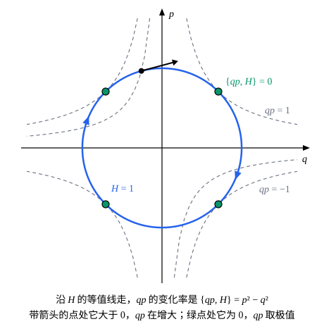

## 这一节要回答的问题

有了:term[正则方程]{id="physics.analytical-mechanics.hamiltons-equations"}（Hamilton's canonical equations），任何一个随运动变化的量，比如角动量$L_z=xp_y-yp_x$，它的变化率都能算出来。能不能把这个计算写成一个统一的式子，不解运动方程就看出它守不守恒？手里已经有两个守恒量时，能不能由它们造出第三个？

## 讲解

### 泊松括号

先看例子。一维运动，$H=\frac{p^2}{2m}+V(q)$，看$f=qp$怎样变。沿着运动，由链式法则和:term[正则方程]{id="physics.analytical-mechanics.hamiltons-equations"}

$$
\dv{f}{t}=\frac{\partial f}{\partial q}\dot q+\frac{\partial f}{\partial p}\dot p=\frac{\partial f}{\partial q}\frac{\partial H}{\partial p}-\frac{\partial f}{\partial p}\frac{\partial H}{\partial q}=p\cdot\frac{p}{m}-q\,V'(q).
$$

$f$的变化率只由$f$和:term[哈密顿量]{id="physics.analytical-mechanics.hamiltonian"}（Hamiltonian）的偏导数决定，不用先解出运动。$n$个:term[自由度]{id="physics.analytical-mechanics.degrees-of-freedom"}（degrees of freedom）、$f(q,p,t)$也可能显含时间时，同样的计算给出$\dv{f}{t}=\sum_j\bigl(\frac{\partial f}{\partial q_j}\frac{\partial H}{\partial p_j}-\frac{\partial f}{\partial p_j}\frac{\partial H}{\partial q_j}\bigr)+\frac{\partial f}{\partial t}$。

::anchor{id="def-poisson-bracket"}
对以$q$、$p$（也可以再加上$t$）为自变量的两个函数$f$、$g$，$\pb{f}{g}=\sum_j\bigl(\frac{\partial f}{\partial q_j}\frac{\partial g}{\partial p_j}-\frac{\partial f}{\partial p_j}\frac{\partial g}{\partial q_j}\bigr)$叫作它们的:term[泊松括号]{id="physics.analytical-mechanics.poisson-bracket"}（Poisson bracket）。于是沿着运动，$\dv{f}{t}=\pb{f}{H}+\frac{\partial f}{\partial t}$。

为什么这样定义：$\pb{f}{H}$把「$H$推着系统走」对$f$的影响装进了一个式子，正则方程本身也变成$\dot q_j=\pb{q_j}{H}$、$\dot p_j=\pb{p_j}{H}$。括号对两个函数一视同仁地定义，不只用在$H$上，下面会看到它有很好的代数性质。有的书把括号里的两项反过来写，差一个负号，读别的书时要留意。

边界情况：$\pb{f}{H}=0$只在$f$不显含时间时才等于「$f$守恒」。自由质点$H=\frac{p^2}{2m}$，$f=q-\frac{pt}{m}$显含时间，$\pb{f}{H}=\frac{p}{m}\neq0$，可$\frac{\partial f}{\partial t}=-\frac{p}{m}$，两者相加为零：$f$守恒，它就是$t=0$时的位置。

### 基本泊松括号和运算规则

坐标和动量之间的括号可以直接由定义算出来。

::anchor{id="def-fundamental-brackets"}
:term[基本泊松括号]{id="physics.analytical-mechanics.fundamental-poisson-brackets"}（fundamental Poisson brackets）：$\pb{q_i}{q_j}=0$，$\pb{p_i}{p_j}=0$，$\pb{q_i}{p_j}=\delta_{ij}$，其中$\delta_{ij}$在$i=j$时为$1$、否则为$0$，叫作克罗内克符号（Kronecker delta）。

例如$\pb{q_i}{p_j}=\sum_k\bigl(\frac{\partial q_i}{\partial q_k}\frac{\partial p_j}{\partial p_k}-\frac{\partial q_i}{\partial p_k}\frac{\partial p_j}{\partial q_k}\bigr)=\sum_k\delta_{ik}\delta_{jk}=\delta_{ij}$。计算括号时很少直接套定义，而是用下面三条规则，把复杂的函数拆到基本括号上。设$f$、$g$、$h$是函数，$a$、$b$是常数：

1. 反对称：$\pb{f}{g}=-\pb{g}{f}$，特别地$\pb{f}{f}=0$。
2. 线性：$\pb{af+bg}{h}=a\pb{f}{h}+b\pb{g}{h}$。
3. 乘积法则：$\pb{fg}{h}=f\pb{g}{h}+\pb{f}{h}\,g$。

它们都从定义直接得到：交换$f$、$g$，两项对调、变号；偏导数是线性的，乘积的偏导数满足乘积法则。由求导的链式法则还有$\pb{\phi(f)}{h}=\phi'(f)\pb{f}{h}$，例如$\pb{f^2}{h}=2f\pb{f}{h}$。

::anchor{id="thm-jacobi"}
括号还满足:term[雅可比恒等式]{id="physics.analytical-mechanics.jacobi-identity"}（Jacobi identity）：$\pb{f}{\pb{g}{h}}+\pb{g}{\pb{h}{f}}+\pb{h}{\pb{f}{g}}=0$。

证明：把左边按定义展开，每一项都是一个二阶偏导数乘两个一阶偏导数。只看含$f$的二阶偏导数的那些项，它们来自$\pb{g}{\pb{h}{f}}+\pb{h}{\pb{f}{g}}=\pb{g}{\pb{h}{f}}-\pb{h}{\pb{g}{f}}$。把$D_g$记作「对一个函数$u$求$\pb{g}{u}$」，它是$\sum_k\bigl(\frac{\partial g}{\partial q_k}\frac{\partial}{\partial p_k}-\frac{\partial g}{\partial p_k}\frac{\partial}{\partial q_k}\bigr)$这样的一阶求导，于是这两项是$D_g(D_hf)-D_h(D_gf)$。

$D_g(D_hf)$里含$f$的二阶偏导数的部分是$\sum c_kd_l\frac{\partial^2f}{\partial x_k\partial x_l}$（$x$泛指$q$、$p$，$c$、$d$是$D_g$、$D_h$的系数），$D_h(D_gf)$里是$\sum d_lc_k\frac{\partial^2f}{\partial x_l\partial x_k}$。混合偏导数和次序无关，两者相等，相减抵消。所以左边不含$f$的二阶偏导数；同理也不含$g$、$h$的二阶偏导数，而每一项都含一个二阶偏导数，左边只能是零。

### 判断守恒

$f$不显含时间时，$\dv{f}{t}=\pb{f}{H}$，所以$f$沿每一个运动都守恒，当且仅当处处$\pb{f}{H}=0$。$H$本身就是例子：由反对称$\pb{H}{H}=0$，$H$不显含时间时守恒，这和讲:term[正则方程]{id="physics.analytical-mechanics.hamiltons-equations"}时的结论一致。判断守恒只要算一个括号，不用解方程，也不用先找到合适的坐标。

::anchor{id="thm-poisson"}
:term[泊松定理]{id="physics.analytical-mechanics.poisson-theorem"}（Poisson's theorem）：设$H$、$f$、$g$都不显含时间，$f$和$g$都守恒，那么$\pb{f}{g}$也守恒。

证明：:term[雅可比恒等式]{id="physics.analytical-mechanics.jacobi-identity"}给出$\pb{f}{\pb{g}{H}}+\pb{g}{\pb{H}{f}}+\pb{H}{\pb{f}{g}}=0$。$f$、$g$守恒，$\pb{g}{H}=0$，$\pb{H}{f}=-\pb{f}{H}=0$，前两项都是和零的括号，等于零。所以$\pb{H}{\pb{f}{g}}=0$，即$\pb{\pb{f}{g}}{H}=0$，$\pb{f}{g}$守恒。造出来的新守恒量也可能是常数，或者只是旧守恒量的函数，并不总有新信息（p8）。

## 几何图像

取$H=\frac12(q^2+p^2)$，运动沿着$H$的等值线（蓝色的圆）顺时针走。:term[泊松括号]{id="physics.analytical-mechanics.poisson-bracket"}$\pb{qp}{H}=p^2-q^2$就是$qp$沿这条路的变化率：在带箭头的那一点，圆横穿过$qp=-\frac12$那条虚线，$qp$在变；在四个绿点处圆和虚线相切，括号为零，$qp$取最大值$1$或最小值$-1$。$f$守恒，就是运动的路线始终不穿过$f$的等值线。

## 例题

### 例 1　有心力下角动量守恒

质点在三维空间里受有心力，$H=\frac{p_x^2+p_y^2+p_z^2}{2m}+V(r)$，$r=\sqrt{x^2+y^2+z^2}$。用:term[泊松括号]{id="physics.analytical-mechanics.poisson-bracket"}证明$L_z=xp_y-yp_x$守恒。

**为什么想到这么做**：$L_z$不显含时间，只要证明$\pb{L_z}{H}=0$。$H$由$p^2$和$r^2$的函数组成，先算出$L_z$和$x$、$y$、$p_x$、$p_y$的括号，再用乘积法则和复合函数的规则组装起来。

**推导**：由乘积法则和:term[基本泊松括号]{id="physics.analytical-mechanics.fundamental-poisson-brackets"}，$\pb{L_z}{x}=\pb{xp_y}{x}-\pb{yp_x}{x}=0-y\pb{p_x}{x}=y$。同样地

$$
\pb{L_z}{x}=y,\qquad \pb{L_z}{y}=-x,\qquad \pb{L_z}{p_x}=p_y,\qquad \pb{L_z}{p_y}=-p_x,
$$

而$L_z$和$z$、$p_z$的括号为零。于是$\pb{L_z}{x^2+y^2+z^2}=2x\cdot y+2y\cdot(-x)=0$，$\pb{L_z}{p_x^2+p_y^2+p_z^2}=2p_xp_y-2p_yp_x=0$。由复合函数的规则$\pb{L_z}{V(r)}=\frac{V'(r)}{2r}\pb{L_z}{r^2}=0$，所以$\pb{L_z}{H}=0$，$L_z$守恒。同样的计算对$L_x$、$L_y$也成立。

### 例 2　两个分量守恒，第三个也守恒

设已经知道某个系统的$L_x$和$L_y$都守恒，$H$不显含时间。不去算$\pb{L_z}{H}$，证明$L_z$也守恒。

**为什么想到这么做**：手里有两个守恒量，:term[泊松定理]{id="physics.analytical-mechanics.poisson-theorem"}说它们的括号也守恒。只要算出$\pb{L_x}{L_y}$就是$L_z$。

**推导**：$L_x=yp_z-zp_y$，$L_y=zp_x-xp_z$。按线性展开成四个括号，再用乘积法则：

$$
\pb{yp_z}{zp_x}=y\pb{p_z}{z}p_x=-yp_x,\qquad \pb{zp_y}{xp_z}=x\pb{z}{p_z}p_y=xp_y ,
$$

另外两个$\pb{yp_z}{xp_z}$、$\pb{zp_y}{zp_x}$为零，因为其中没有一对共轭的坐标和动量。所以$\pb{L_x}{L_y}=-yp_x+xp_y=L_z$。由泊松定理，$L_z$守恒：绕两根轴转动都对称的系统，绕第三根轴也必然对称。

## 常见误区

- 「$\pb{f}{H}=0$是$f$守恒的充要条件。」$f$显含时间时不是：$\dv{f}{t}=\pb{f}{H}+\frac{\partial f}{\partial t}$，自由质点的$q-\frac{pt}{m}$守恒，括号却不为零。
- 「:term[泊松括号]{id="physics.analytical-mechanics.poisson-bracket"}和次序无关。」它是反对称的，$\pb{f}{g}=-\pb{g}{f}$；不同的书还可能整体差一个负号，要看清定义。
- 「:term[泊松定理]{id="physics.analytical-mechanics.poisson-theorem"}总能造出新的守恒量。」括号可能是零、常数，或旧守恒量的函数；动量$p_x$、$p_y$都守恒，$\pb{p_x}{p_y}=0$就什么也没给。
- 「算括号要把每个函数都完全展开。」用线性、乘积法则和:term[基本泊松括号]{id="physics.analytical-mechanics.fundamental-poisson-brackets"}，常常几行就算完（例 1、例 2）。
