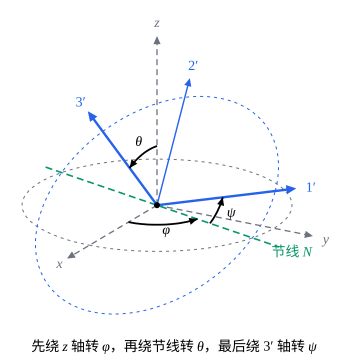

## 这一节要回答的问题

定轴转动（fixed-axis rotation）时，刚体（rigid body）的位置只要一个转角就能确定，:term[角速度]{id="physics.analytical-mechanics.angular-velocity"}（angular velocity）就是转角对时间的导数。陀螺（top）、在空中翻滚的书、绕质心（center of mass）转动的卫星，转轴本身也在变。刚体绕一个固定点转动时，要几个:term[广义坐标]{id="physics.analytical-mechanics.generalized-coordinates"}（generalized coordinates）才能确定它的取向（orientation）？还有没有一个「角速度」，它和这些坐标的变化率是什么关系？

## 讲解

### 转动矩阵

刚体上任意两点间的距离不变，这是一组:term[完整约束]{id="physics.analytical-mechanics.holonomic-constraint"}（holonomic constraint）。刚体的位置由不共线的三个点定下，这三个点的九个坐标之间有三个距离保持不变，剩下六个:term[自由度]{id="physics.analytical-mechanics.degrees-of-freedom"}（degrees of freedom）：三个描述某一点的位置，三个描述绕这一点的取向。这一节只看取向：刚体上的一点$O$固定不动（例如陀螺的支点，pivot），或者取$O$为质心、只看相对质心的转动。

::anchor{id="def-body-axes"}
在空间里取一组固定的右手正交规范基（orthonormal basis）$\vb{e}_1,\vb{e}_2,\vb{e}_3$，叫作空间坐标轴（space axes），也记作$x,y,z$轴；在刚体上固连一组右手正交规范基$\vb{e}'_1,\vb{e}'_2,\vb{e}'_3$，叫作体坐标轴（body axes），也记作$1',2',3'$轴，原点都取在$O$。令$R_{jk}=\vb{e}_j\cdot\vb{e}'_k$，矩阵$R$的第$k$列就是$\vb{e}'_k$在空间坐标轴下的分量。刚体上一点相对$O$的位置矢量写成$\vb{r}=\sum_k\rho_k\vb{e}'_k$，体分量$\rho=(\rho_1,\rho_2,\rho_3)\T$不随时间变；以下矢量也指它在空间坐标轴下的分量列，于是$\vb{r}=R\rho$。

::anchor{id="def-rotation-matrix"}
满足$R\T R=I$、$\det R=1$的$3\times3$实矩阵叫作:term[转动矩阵]{id="physics.analytical-mechanics.rotation-matrix"}（rotation matrix）。上面的$R$就是转动矩阵：它的三列是正交规范的，所以$R\T R=I$；两组基都是右手系（right-handed system），$\det R=\vb{e}'_1\cdot(\vb{e}'_2\times\vb{e}'_3)=1$。反过来，任何转动矩阵的三列都是一组右手正交规范基，可以拿来当体坐标轴；所以刚体绕$O$的每个取向恰好对应一个转动矩阵。

为什么这样定义：$R\T R=I$说明$R$是正交矩阵（orthogonal matrix），它保持点积（dot product），刚体上两点间的距离和夹角都不变。$\det R=1$排除了镜像：把每个矢量反向的$-I$也是正交矩阵，但行列式（determinant）是$-1$，它把右手变成左手，刚体不可能这样「转」过去；刚体从$R=I$出发连续运动时，$\det R$连续变化又只能取$\pm1$，所以始终等于$1$。另外，$R$有九个元素；$R\T R$是对称矩阵（symmetric matrix），$R\T R=I$只有上三角部分的六个方程是独立的，剩下三个自由度，和前面数的一样。

例如，绕$z$轴、绕$x$轴按右手方向转$\alpha$角，转动矩阵分别是

$$
R_z(\alpha)=\begin{pmatrix}\cos\alpha&-\sin\alpha&0\\\sin\alpha&\cos\alpha&0\\0&0&1\end{pmatrix},\qquad R_x(\alpha)=\begin{pmatrix}1&0&0\\0&\cos\alpha&-\sin\alpha\\0&\sin\alpha&\cos\alpha\end{pmatrix}.
$$

### 角速度

刚体转动时$R$随时间变。刚体上一点的$\rho$不变，所以它的速度是$\dot{\vb{r}}=\dot R\rho=\dot RR\T\vb{r}$。记$\Omega=\dot RR\T$；对$RR\T=I$求导得$\dot RR\T+R\dot R\T=0$，即$\Omega\T=-\Omega$，$\Omega$是反对称矩阵（antisymmetric matrix）。反对称矩阵只有三个独立的元素，可以写成

$$
\Omega=\begin{pmatrix}0&-\omega_3&\omega_2\\\omega_3&0&-\omega_1\\-\omega_2&\omega_1&0\end{pmatrix},
$$

直接乘出来可以验证，对任何矢量$\vb{r}$都有$\Omega\vb{r}=\boldsymbol{\omega}\times\vb{r}$，其中$\boldsymbol{\omega}=(\omega_1,\omega_2,\omega_3)\T$。

::anchor{id="thm-angular-velocity"}
定理：刚体绕固定点$O$转动时，每个时刻都有唯一的矢量$\boldsymbol{\omega}$，使固连在刚体上的每一点的速度都是$\vb{v}=\boldsymbol{\omega}\times\vb{r}$，$\vb{r}$是从$O$到这一点的矢量。

证明：存在性就是上面的计算。若$\tilde{\boldsymbol{\omega}}$也满足要求，取$\vb{r}$为体坐标轴上的两个单位矢量$\vb{e}'_1$、$\vb{e}'_2$，得$(\boldsymbol{\omega}-\tilde{\boldsymbol{\omega}})\times\vb{e}'_1=(\boldsymbol{\omega}-\tilde{\boldsymbol{\omega}})\times\vb{e}'_2=0$。一个矢量同时平行于两个不共线的矢量，只能是零，所以$\tilde{\boldsymbol{\omega}}=\boldsymbol{\omega}$。

::anchor{id="def-angular-velocity"}
定理里的$\boldsymbol{\omega}$叫作刚体的:term[角速度矢量]{id="physics.analytical-mechanics.angular-velocity"}（angular velocity vector），常简称角速度。过$O$、沿$\boldsymbol{\omega}$方向的直线上，各点此刻的速度都是零，这条直线叫作瞬时转轴（instantaneous axis of rotation）；其他点此刻都在绕它转，速度大小是$|\boldsymbol{\omega}|$乘这一点到瞬时转轴的距离。

为什么这样定义：绕$z$轴的定轴转动$R=R_z(\theta(t))$给出$\Omega=\dot\theta\begin{pmatrix}0&-1&0\\1&0&0\\0&0&0\end{pmatrix}$，$\boldsymbol{\omega}=\dot\theta\,\vb{e}_3$，正是定轴转动里沿转轴、大小为$\dot\theta$的角速度。一般情况下$\boldsymbol{\omega}$的方向随时间变，瞬时转轴也跟着变，刚体在一段时间里并不绕一根固定的轴转。边界情况：$\boldsymbol{\omega}$不是任何「角度矢量」的导数，因为有限的转动不能交换次序：一本书先绕$x$轴转$90^\circ$、再绕$y$轴转$90^\circ$，和先绕$y$轴、后绕$x$轴，最后的取向不同（p7）。

要从具体的坐标算出角速度，常用下面的组合公式，它要用到:term[转动矩阵]{id="physics.analytical-mechanics.rotation-matrix"}保持叉积（cross product）。记$(\vb{a},\vb{b},\vb{c})$为以$\vb{a},\vb{b},\vb{c}$为列的矩阵，三重积（triple product）等于它的行列式，所以对任何矢量$\vb{c}$，$(R\vb{a}\times R\vb{b})\cdot R\vb{c}=\det\bigl(R(\vb{a},\vb{b},\vb{c})\bigr)=\det R\,\det(\vb{a},\vb{b},\vb{c})=(\vb{a}\times\vb{b})\cdot\vb{c}=R(\vb{a}\times\vb{b})\cdot R\vb{c}$，最后一步用了$R$保持点积。$R\vb{c}$可以是任何矢量，所以$R\vb{a}\times R\vb{b}=R(\vb{a}\times\vb{b})$。

::anchor{id="thm-angular-velocity-addition"}
定理（角速度的组合）：设$R(t)=R_1(t)R_2(t)$，$R_1$、$R_2$都是转动矩阵，由$\dot R_1R_1\T$、$\dot R_2R_2\T$定出的角速度分别是$\boldsymbol{\omega}_1$、$\boldsymbol{\omega}_2$，那么$R$的角速度是$\boldsymbol{\omega}=\boldsymbol{\omega}_1+R_1\boldsymbol{\omega}_2$。

证明：$\dot RR\T=(\dot R_1R_2+R_1\dot R_2)R_2\T R_1\T=\dot R_1R_1\T+R_1(\dot R_2R_2\T)R_1\T$。第二项作用在$\vb{r}$上是$R_1\bigl(\boldsymbol{\omega}_2\times R_1\T\vb{r}\bigr)=R_1\boldsymbol{\omega}_2\times\vb{r}$（用了转动矩阵保持叉积），所以$\dot RR\T\vb{r}=(\boldsymbol{\omega}_1+R_1\boldsymbol{\omega}_2)\times\vb{r}$。

$\boldsymbol{\omega}$在体坐标轴上的分量$\omega'=R\T\boldsymbol{\omega}$也常用，即$\boldsymbol{\omega}=\sum_k\omega'_k\vb{e}'_k$。它对应的反对称矩阵是$R\T\dot R$：$R\T\dot R\rho=R\T(\boldsymbol{\omega}\times R\rho)=R\T\boldsymbol{\omega}\times\rho=\omega'\times\rho$，这里$R\T$也是转动矩阵，同样保持叉积。讲刚体的动力学时，许多量在体坐标轴下写最简单，用的正是$\omega'$。

### 欧拉角

:term[转动矩阵]{id="physics.analytical-mechanics.rotation-matrix"}有九个元素，却只有三个:term[自由度]{id="physics.analytical-mechanics.degrees-of-freedom"}；要把取向当作:term[广义坐标]{id="physics.analytical-mechanics.generalized-coordinates"}来用，需要三个独立的参数。最常用的是下面这组角，这里用的是物理书里常见的$z$-$x$-$z$约定。

::anchor{id="def-euler-angles"}
把转动矩阵写成$R=R_z(\varphi)R_x(\theta)R_z(\psi)$，$0\le\varphi<2\pi$，$0\le\theta\le\pi$，$0\le\psi<2\pi$，这三个角叫作:term[欧拉角]{id="physics.analytical-mechanics.euler-angles"}（Euler angles）。单位矢量$\vb{e}_N=R_z(\varphi)\vb{e}_1$所在的直线叫作节线（line of nodes）。

记绕单位矢量$\vb{n}$按右手方向转$\alpha$角的转动矩阵为$R_{\vb{n}}(\alpha)$，那么绕$R_1\vb{n}$转$\alpha$角的转动矩阵是$R_1R_{\vb{n}}(\alpha)R_1\T$：它不动$R_1\vb{n}$，在垂直于$R_1\vb{n}$的平面里转$\alpha$角。把刚体整个转一个$Q$，各列$\vb{e}'_k$变成$Q\vb{e}'_k$，取向从$R$变成$QR$；设刚体原来和空间坐标轴重合，先绕$z$轴转$\varphi$，$1'$轴转到节线上，再绕$1'$轴（节线）转$\theta$，取向变成$\bigl(R_z(\varphi)R_x(\theta)R_z(\varphi)\T\bigr)R_z(\varphi)=R_z(\varphi)R_x(\theta)$，$3'$轴从$z$轴倾斜$\theta$角；同理，最后绕新的$3'$轴转$\psi$，取向就是$R$。所以$\varphi$是$xy$平面里从$x$轴到节线的角，$\theta$是$z$轴和$3'$轴的夹角，$\psi$是$1'2'$平面里从节线到$1'$轴的角；节线同时垂直于$z$轴和$3'$轴，是$xy$平面和$1'2'$平面的交线。

::anchor{id="thm-euler-angles"}
定理：每个转动矩阵都能写成$R_z(\varphi)R_x(\theta)R_z(\psi)$。$0<\theta<\pi$时三个角是唯一的；$\theta=0$时只有$\varphi+\psi$确定，$\theta=\pi$时只有$\varphi-\psi$确定。

证明：设刚体的$3'$轴不沿$z$轴，即$\vb{e}'_3\ne\pm\vb{e}_3$。取$\vb{e}_N=\vb{e}_3\times\vb{e}'_3/|\vb{e}_3\times\vb{e}'_3|$，令$\varphi$是$xy$平面里从$\vb{e}_1$转到$\vb{e}_N$的角，$\theta\in(0,\pi)$是$\vb{e}_3$和$\vb{e}'_3$的夹角，$\psi$是$1'2'$平面里从$\vb{e}_N$转到$\vb{e}'_1$的角，转向都按右手法则（right-hand rule）。按上面的几何意义，$R_z(\varphi)R_x(\theta)R_z(\psi)$把$\vb{e}_1$变到$\vb{e}'_1$、把$\vb{e}_3$变到$\vb{e}'_3$（第二步绕$\vb{e}_N$转$\theta$恰好把$\vb{e}_3$转到$\vb{e}'_3$，因为$\vb{e}_N$和$\vb{e}_3\times\vb{e}'_3$同向），$\vb{e}_2=\vb{e}_3\times\vb{e}_1$随之变到$\vb{e}'_3\times\vb{e}'_1=\vb{e}'_2$；三列都和$R$相同，所以它就是$R$。三个角是唯一的：节线要同时垂直于$z$轴和$3'$轴，只能沿$\pm\vb{e}_N$，取$-\vb{e}_N$会使$\theta$变成负的。

$\vb{e}'_3=\vb{e}_3$时，$R$的第三列是$(0,0,1)\T$，正交矩阵的行也是单位向量，所以第三行也是$(0,0,1)$，左上角是行列式为$1$的$2\times2$正交矩阵，$R=R_z(\beta)$；取$\theta=0$，$R_z(\varphi)R_z(\psi)=R_z(\varphi+\psi)$，只要$\varphi+\psi=\beta$。$\vb{e}'_3=-\vb{e}_3$时，对$RR_x(\pi)$用同样的论证，$R=R_z(\beta)R_x(\pi)=R_z(\varphi)R_x(\pi)R_z(\psi)$，只要$\varphi-\psi=\beta$（用到$R_x(\pi)R_z(\psi)=R_z(-\psi)R_x(\pi)$）。

为什么这样定义：每次只绕一根坐标轴转，三次正好对应三个自由度；先后绕$z$轴、节线、$3'$轴转，$\varphi$管$3'$轴的方位，$\theta$管它的倾斜，$\psi$管刚体绕$3'$轴自转，正好是描述陀螺最自然的三个量。边界情况：$\theta=0$或$\pi$时节线不确定，三个角不再一一对应于取向，就像原点处的极角（polar angle）没有意义，下一段会看到它在:term[角速度]{id="physics.analytical-mechanics.angular-velocity"}上的表现。

### 用欧拉角写角速度

由组合公式（用两次），$R=R_z(\varphi)\bigl[R_x(\theta)R_z(\psi)\bigr]$的:term[角速度]{id="physics.analytical-mechanics.angular-velocity"}是$\dot\varphi\vb{e}_3+R_z(\varphi)\bigl(\dot\theta\vb{e}_1+R_x(\theta)\dot\psi\vb{e}_3\bigr)$，因为绕固定轴$\vb{e}_3$、$\vb{e}_1$的转动的角速度就是转角的导数乘这根轴。$R_z(\varphi)\vb{e}_1=\vb{e}_N$，$R_z(\varphi)R_x(\theta)\vb{e}_3=R\vb{e}_3=\vb{e}'_3$，所以

$$
\boldsymbol{\omega}=\dot\varphi\,\vb{e}_3+\dot\theta\,\vb{e}_N+\dot\psi\,\vb{e}'_3 ,
$$

三项分别是绕$z$轴、节线、$3'$轴的转动。$R\T\vb{e}_3$是$R$的第三行，等于$(\sin\theta\sin\psi,\sin\theta\cos\psi,\cos\theta)\T$；$R\T\vb{e}_N=R_z(-\psi)R_x(-\theta)\vb{e}_1=(\cos\psi,-\sin\psi,0)\T$；$R\T\vb{e}'_3=\vb{e}_3$。由此得到体坐标轴下的分量：

$$
\begin{aligned}
\omega'_1&=\dot\varphi\sin\theta\sin\psi+\dot\theta\cos\psi,\\
\omega'_2&=\dot\varphi\sin\theta\cos\psi-\dot\theta\sin\psi,\\
\omega'_3&=\dot\varphi\cos\theta+\dot\psi .
\end{aligned}
$$

$\vb{e}_3$和$\vb{e}_N$垂直，$\vb{e}_N$和$\vb{e}'_3$垂直，$\vb{e}_3\cdot\vb{e}'_3=\cos\theta$，所以$|\boldsymbol{\omega}|^2=\dot\varphi^2+\dot\theta^2+\dot\psi^2+2\dot\varphi\dot\psi\cos\theta$。三根轴一般不互相垂直，$(\dot\varphi,\dot\theta,\dot\psi)$不是$\boldsymbol{\omega}$在哪组坐标轴下的分量。

::anchor{id="def-gimbal-lock"}
$\theta=0$或$\pi$这样使坐标不再一一对应于取向的点，叫作坐标的奇点（singularity）。$\theta=0$时$\vb{e}'_3=\vb{e}_3$，$\boldsymbol{\omega}=(\dot\varphi+\dot\psi)\vb{e}_3+\dot\theta\vb{e}_N$只能落在一个平面里：绕水平面里垂直于节线的轴的转动，用有限的$\dot\varphi,\dot\theta,\dot\psi$表示不出来。用三个框架依次实现这三次转动的万向支架（gimbal），在这里会失去一个转动方向，这种现象叫作万向节锁（gimbal lock）。

为什么这样定义：这是:term[欧拉角]{id="physics.analytical-mechanics.euler-angles"}这组坐标的毛病，不是运动本身有什么特别，就像极坐标（polar coordinates）在原点、经纬度在南北极一样。边界情况：奇点只有$\theta=0$、$\pi$两处，换一组欧拉角（比如以别的轴为$z$轴），原来的奇点就成了普通的点（p8）。

## 几何图像

灰色虚线是空间坐标轴，蓝色是体坐标轴，绿色虚线是节线；两个虚线圆分别在$xy$平面和刚体的$1'2'$平面里，它们的交线就是节线。三段弧标出三个:term[欧拉角]{id="physics.analytical-mechanics.euler-angles"}，弧上的箭头是转动的方向：$\varphi$在$xy$平面里从$x$轴量到节线，$\theta$从$z$轴量到$3'$轴，$\psi$在$1'2'$平面里从节线量到$1'$轴。$\theta$变小时两个圆越来越贴近，$\theta=0$时重合，交线不再确定，这就是欧拉角的奇点。

## 例题

### 例 1　规则进动的角速度

:term[欧拉角]{id="physics.analytical-mechanics.euler-angles"}满足$\theta=\beta$不变，$\dot\varphi=\Omega$、$\dot\psi=s$都是常数，这样的运动叫作规则进动（regular precession）：$3'$轴以固定的倾角绕$z$轴匀速转，刚体同时绕$3'$轴匀速自转。求$\boldsymbol{\omega}$在空间坐标轴和体坐标轴下的分量，并说明$\boldsymbol{\omega}$在空间里、在刚体里各怎样运动。

**为什么想到这么做**：欧拉角的变化率已经给出，直接代进$\boldsymbol{\omega}=\dot\varphi\vb{e}_3+\dot\theta\vb{e}_N+\dot\psi\vb{e}'_3$。空间分量要用$\vb{e}'_3$的空间分量，也就是$R$的第三列；体分量直接用讲解里的公式。

**推导**：$\dot\theta=0$，$\boldsymbol{\omega}=\Omega\vb{e}_3+s\vb{e}'_3$。乘出来，$R$的第三列是$\vb{e}'_3=(\sin\varphi\sin\beta,-\cos\varphi\sin\beta,\cos\beta)\T$，所以

$$
\boldsymbol{\omega}=\bigl(s\sin\beta\sin\varphi,\ -s\sin\beta\cos\varphi,\ \Omega+s\cos\beta\bigr)\T,\qquad \varphi=\Omega t+\varphi_0 ,
$$

$$
\omega'=\bigl(\Omega\sin\beta\sin\psi,\ \Omega\sin\beta\cos\psi,\ \Omega\cos\beta+s\bigr)\T,\qquad \psi=st+\psi_0 .
$$

$|\boldsymbol{\omega}|^2=\Omega^2+s^2+2\Omega s\cos\beta$不变。在空间里，$\boldsymbol{\omega}$的$z$分量不变，水平部分长$|s|\sin\beta$、以:term[角速度]{id="physics.analytical-mechanics.angular-velocity"}$\Omega$绕$z$轴转，$\boldsymbol{\omega}$扫出一个绕$z$轴的圆锥，叫作空间锥（space cone）。在刚体里，$\omega'_3$不变，$1'2'$平面里的部分长$|\Omega|\sin\beta$、以角速度$-s$绕$3'$轴转，扫出一个绕$3'$轴的圆锥，叫作本体锥（body cone）。

### 例 2　在桌面上纯滚动的圆锥

半顶角（half-apex angle）为$\alpha$的正圆锥，顶点固定在水平桌面上的$O$点，侧面贴着桌面纯滚动（rolling without slipping），接触线（line of contact，圆锥和桌面相接的那条直线）以:term[角速度]{id="physics.analytical-mechanics.angular-velocity"}$\Omega$绕过$O$的竖直线转动。求圆锥的角速度$\boldsymbol{\omega}$，以及它绕自身对称轴（symmetry axis）自转的$\dot\psi$。

**为什么想到这么做**：把$3'$轴取在圆锥的对称轴上，它和竖直方向的夹角不变，方位角随接触线一起匀速增加，正是例 1 的规则进动，只是$s$未知。纯滚动的条件是接触线上各点的速度为零（见[约束与广义坐标](lesson:physics.analytical-mechanics.constraints)），所以接触线就是瞬时转轴，$\boldsymbol{\omega}$沿接触线，这个条件定出$s$。

**推导**：对称轴高出桌面$\alpha$角，$\theta=\frac\pi2-\alpha$，$\dot\varphi=\Omega$，$\dot\theta=0$。由例 1，$\omega_z=\Omega+s\cos\theta=\Omega+s\sin\alpha$；接触线是水平的，$\omega_z=0$，所以

$$
\dot\psi=s=-\frac{\Omega}{\sin\alpha},\qquad |\boldsymbol{\omega}|^2=\Omega^2+s^2+2\Omega s\cos\theta=\Omega^2+\frac{\Omega^2}{\sin^2\alpha}-2\Omega^2=\Omega^2\cot^2\alpha ,
$$

$|\boldsymbol{\omega}|=|\Omega|\cot\alpha$。检验方向：由例 1，$\boldsymbol{\omega}$的水平部分是$s\cos\alpha\,(\sin\varphi,-\cos\varphi,0)\T$；对称轴的水平投影、也就是接触线，正沿$(\sin\varphi,-\cos\varphi,0)\T$，两者确实在一条直线上。圆锥越尖（$\alpha$越小），绕自身对称轴转得越快。

## 常见误区

- 「$\dot\varphi$、$\dot\theta$、$\dot\psi$就是:term[角速度]{id="physics.analytical-mechanics.angular-velocity"}的三个分量。」它们是沿$z$轴、节线、$3'$轴三个方向的分量，这三个方向一般不互相垂直；体坐标轴下的分量要用讲解里的公式算，$|\boldsymbol{\omega}|^2$还有交叉项$2\dot\varphi\dot\psi\cos\theta$。
- 「角速度是矢量，所以有限的转角也能当矢量相加。」有限的转动不能交换次序，两次转动的结果和先后有关；能相加的是角速度，而且要按组合公式$\boldsymbol{\omega}_1+R_1\boldsymbol{\omega}_2$加。
- 「正交矩阵都能描述刚体的取向。」行列式为$-1$的正交矩阵含有镜像，刚体不可能连续地转过去；:term[转动矩阵]{id="physics.analytical-mechanics.rotation-matrix"}还要求$\det R=1$。
- 「瞬时转轴上的点一直不动。」它们只是此刻速度为零；$\boldsymbol{\omega}$的方向一般随时间变，例 2 里接触线在桌面上一直转，落在接触线上的点一个换一个。
