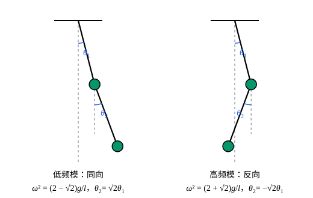

## 这一节要回答的问题

双摆（double pendulum）、几个用弹簧连起来的物块、分子里的原子，在稳定的平衡位置（equilibrium position）附近轻轻一碰，各部分的运动看起来杂乱无章。讲耦合振子（coupled oscillators）时，两个物块的运动能拆成两个简正模（normal mode）的叠加；:term[自由度]{id="physics.analytical-mechanics.degrees-of-freedom"}（degrees of freedom）更多、用的是摆角这样的:term[广义坐标]{id="physics.analytical-mechanics.generalized-coordinates"}（generalized coordinates）时，还能这样拆吗？能不能从:term[拉格朗日量]{id="physics.analytical-mechanics.lagrangian"}（Lagrangian）出发，按固定的步骤求出所有的振动频率？

## 讲解

### 平衡点附近的拉格朗日量

先看单摆（simple pendulum）。$L=\frac12ml^2\dot\theta^2+mgl\cos\theta$，摆角很小时$\cos\theta\approx1-\frac{\theta^2}{2}$，于是$L\approx\frac12ml^2\dot\theta^2-\frac12mgl\theta^2$加一个常数。:term[拉格朗日方程]{id="physics.analytical-mechanics.lagrange-equations"}（Lagrange's equations）给出$\ddot\theta=-\frac gl\theta$，是角频率（angular frequency）$\sqrt{g/l}$的简谐运动（simple harmonic motion）。做法是把$L$里的每一项都只保留到$\theta$、$\dot\theta$的二次项。

一般地，设:term[约束]{id="physics.analytical-mechanics.constraint"}（constraint）都是:term[定常约束]{id="physics.analytical-mechanics.scleronomic-constraint"}（scleronomic constraint），$n$个:term[自由度]{id="physics.analytical-mechanics.degrees-of-freedom"}的系统各质点的位置是$\vb{r}_i(q)$，势能是$V(q)$。速度$\dot{\vb{r}}_i=\sum_k\frac{\partial\vb{r}_i}{\partial q_k}\dot q_k$，所以动能是$T=\frac12\sum_{j,k}a_{jk}(q)\dot q_j\dot q_k$，其中$a_{jk}=\sum_im_i\frac{\partial\vb{r}_i}{\partial q_j}\cdot\frac{\partial\vb{r}_i}{\partial q_k}$。$q^0$是平衡位置（系统可以一直静止在那里），当且仅当所有$\frac{\partial V}{\partial q_j}(q^0)=0$：静止时拉格朗日方程里含$\dot q$、$\ddot q$的项都是零，剩下的正是$\frac{\partial V}{\partial q_j}=0$。

记$\eta=q-q^0$。由多元泰勒公式（Taylor's formula），$V(q)=V(q^0)+\frac12\sum_{j,k}V_{jk}\eta_j\eta_k+\cdots$，一次项因为$\frac{\partial V}{\partial q_j}(q^0)=0$而消失，$V_{jk}=\frac{\partial^2V}{\partial q_j\partial q_k}(q^0)$是黑塞矩阵（Hessian matrix）。动能本来就是$\dot\eta$的二次式，把系数$a_{jk}(q)$换成$a_{jk}(q^0)$，舍掉的是三次以上的小量。

::anchor{id="def-small-oscillations"}
在平衡位置$q^0$附近，保留到二阶的$L_2=\frac12\dot\eta\T T\dot\eta-\frac12\eta\T V\eta$叫作小振动（small oscillations）的:term[拉格朗日量]{id="physics.analytical-mechanics.lagrangian"}，其中$T=\bigl(a_{jk}(q^0)\bigr)$、$V=\bigl(V_{jk}\bigr)$是常数对称矩阵（symmetric matrix），$\eta$是位移排成的列向量（column vector）。它给出的运动方程是线性的：$T\ddot\eta+V\eta=0$。

为什么这样定义：常数项不影响方程，一次项在平衡位置为零，二次项是最低的不为零的项；只要$\eta$和$\dot\eta$都小，三次以上的项比它们小得多。$T$总是正定（positive definite）的：$\dot\eta\neq0$时，自由度彼此独立，总有质点在动，动能大于零。边界情况：倒立摆（inverted pendulum）的$L_2=\frac12ml^2\dot\eta^2+\frac12mgl\eta^2$给出$\ddot\eta=\frac gl\eta$，位移按指数增长，很快就不再小，这个近似只能描述它刚开始倒下的那一段。$V$的黑塞矩阵正定时平衡稳定，附近是小振动；有负的特征值（eigenvalue）时不稳定；只是半正定（positive semidefinite）时要看更高阶的项（p7）。

### 简正坐标

::anchor{id="thm-normal-coordinates"}
定理：设$T$正定、$V$对称，那么存在线性换元$\eta=A\Theta$，使$L_2=\frac12\sum_k\bigl(\dot\Theta_k^2-\omega_k^2\Theta_k^2\bigr)$，其中$\omega_1^2,\dots,\omega_n^2$是方程$\det(V-\omega^2T)=0$的根；$V$正定时它们都大于零。

证明分两步。第一步把动能变成平方和：由谱定理（spectral theorem），$T=ODO\T$，$O$是正交矩阵（orthogonal matrix），$D$是对角元都为正的对角矩阵（diagonal matrix）；令$\xi=D^{1/2}O\T\eta$，则$\dot\eta\T T\dot\eta=\dot\xi\T\dot\xi$，而$\eta\T V\eta=\xi\T M\xi$，$M=D^{-1/2}O\T VOD^{-1/2}$仍是对称矩阵。第二步再用一次谱定理：$M=P\Omega P\T$，$P$正交，$\Omega$是对角矩阵；令$\Theta=P\T\xi$，正交变换（orthogonal transformation）不改变平方和，$\dot\xi\T\dot\xi=\dot\Theta\T\dot\Theta$，而$\xi\T M\xi=\Theta\T\Omega\Theta$。

$\Omega$的对角元是$M$的特征值，即$\det(M-\omega^2I)=0$的根。$M-\omega^2I=D^{-1/2}O\T(V-\omega^2T)OD^{-1/2}$，两边的行列式（determinant）只差一个不为零的因子，所以它们也是$\det(V-\omega^2T)=0$的根。$V$正定时，$\xi\T M\xi=\eta\T V\eta>0$对所有$\xi\neq0$成立，$M$正定，特征值都为正。

::anchor{id="def-normal-coordinates"}
定理里的$\Theta_1,\dots,\Theta_n$叫作:term[简正坐标]{id="physics.analytical-mechanics.normal-coordinates"}（normal coordinates），$\omega_k$叫作简正频率（normal frequency）。每个$\Theta_k$各自做简谐运动$\Theta_k=C_k\cos(\omega_kt+\varphi_k)$；只有一个$\Theta_k$不为零的运动叫作简正模，这时所有坐标以同一个频率振动，比例由$A$的第$k$列$a^{(k)}$定出，它满足$(V-\omega_k^2T)a^{(k)}=0$。

为什么这样定义：在简正坐标里，$n$个:term[自由度]{id="physics.analytical-mechanics.degrees-of-freedom"}变成$n$个互不相干的简谐振子（harmonic oscillator），一般的小振动就是各个简正模的叠加。实际计算时不必真的去做两次换元：解$\det(V-\omega^2T)=0$得到频率，再对每个$\omega_k^2$解$(V-\omega_k^2T)a=0$得到振动的样子。边界情况：$V$只是半正定时，会出现$\omega_k=0$的简正坐标，它不振动，而是匀速变化，例如整个系统一起平移（例 2）。

## 几何图像

这是例 1 的两个简正模。左边两个摆角同向，下面的摆角是上面的$\sqrt2$倍，频率较低；右边两个摆角反向，频率较高。任何一次小振动，都是这两种样子按各自的频率振动、再叠加起来。

:::anim{component="oscillator"}
masses: [1, 1, 1]
springs: [1, 1, 1, 1]
initial: [1, s, c]
dt: 0.01
sliders:
  - name: s
    min: -1.5
    max: 1.5
    step: 0.01
    default: 1.41
    label: |
      中间物块的初始位移$s$
  - name: c
    min: -1
    max: 1
    step: 0.1
    default: 1
    label: |
      右边物块的初始位移$c$
:::

三个相同的物块用四根相同的弹簧连在两堵墙之间，左边的物块一开始都拉开$1$。按$\det(V-\omega^2T)=0$求，它的三个简正模是$(1,\sqrt2,1)$、$(1,0,-1)$、$(1,-\sqrt2,1)$。默认$s=1.41\approx\sqrt2$、$c=1$，几乎是第一个简正模，三个物块步调一致；拖到$s=0$、$c=-1$或$s=-1.41$、$c=1$，是另外两个简正模；别的取值是几个简正模的叠加，曲线忽大忽小。

## 例题

### 例 1　双摆的小振动

两根长$l$的轻杆和两个质量$m$的摆球组成双摆，摆角$\theta_1$、$\theta_2$都从竖直向下量起。求竖直平衡位置附近的简正频率和简正模。

**为什么想到这么做**：先写出精确的$L$，再在$\theta_1=\theta_2=0$处展开到二阶，读出$T$、$V$两个矩阵。动能里$\dot\theta_1\dot\theta_2$的交叉项带着$\cos(\theta_1-\theta_2)$，到二阶只要取它在平衡位置的值$1$。

**推导**：第二个摆球的速度平方是$l^2\bigl[\dot\theta_1^2+\dot\theta_2^2+2\cos(\theta_1-\theta_2)\dot\theta_1\dot\theta_2\bigr]$，势能是$-2mgl\cos\theta_1-mgl\cos\theta_2$。展开到二阶，$T=ml^2\dot\theta_1^2+\frac12ml^2\dot\theta_2^2+ml^2\dot\theta_1\dot\theta_2$，$V=mgl\theta_1^2+\frac12mgl\theta_2^2$加常数，所以

$$
T=ml^2\begin{pmatrix}2&1\\1&1\end{pmatrix},\qquad V=mgl\begin{pmatrix}2&0\\0&1\end{pmatrix}.
$$

记$\omega_0^2=\frac gl$，$\det(V-\omega^2T)=0$约去$ml^2$得$(2\omega_0^2-2\omega^2)(\omega_0^2-\omega^2)-\omega^4=0$，即$2(\omega_0^2-\omega^2)^2=\omega^4$，$\sqrt2(\omega_0^2-\omega^2)=\pm\omega^2$。所以$\omega^2=(2-\sqrt2)\omega_0^2$或$(2+\sqrt2)\omega_0^2$。由$(V-\omega^2T)a=0$的第二行$-\omega^2a_1+(\omega_0^2-\omega^2)a_2=0$，低频模$\frac{a_2}{a_1}=\sqrt2$，高频模$\frac{a_2}{a_1}=-\sqrt2$。

### 例 2　三原子线性分子

质量$m$、$M$、$m$的三个原子排成一条直线，相邻两个之间是劲度系数（spring constant）$k$的弹簧，只看沿这条直线的振动。求简正频率，并说明频率为零的那个:term[简正坐标]{id="physics.analytical-mechanics.normal-coordinates"}是什么。

**为什么想到这么做**：三个原子都能沿直线动，三个:term[自由度]{id="physics.analytical-mechanics.degrees-of-freedom"}，用三个位移$x_1$、$x_2$、$x_3$作坐标。没有墙，整个分子一起平移时势能不变，可以预料有一个零频率。

**推导**：$T=\frac12m\dot x_1^2+\frac12M\dot x_2^2+\frac12m\dot x_3^2$，$V=\frac12k(x_2-x_1)^2+\frac12k(x_3-x_2)^2$，两者本来就是二次式。

$$
\det(V-\omega^2T)=\begin{vmatrix}k-m\omega^2&-k&0\\-k&2k-M\omega^2&-k\\0&-k&k-m\omega^2\end{vmatrix}=\omega^2(k-m\omega^2)\bigl(Mm\omega^2-kM-2km\bigr)=0 .
$$

三个根是$\omega_1=0$，$\omega_2=\sqrt{k/m}$，$\omega_3=\sqrt{\frac km\bigl(1+\frac{2m}{M}\bigr)}$。$\omega_1=0$的简正模是$(1,1,1)$：整个分子一起平移，没有回复力（restoring force），它对应的简正坐标正比于质心（center of mass）坐标，匀速运动。$\omega_2$的简正模是$(1,0,-1)$，中间的原子不动、两边对称地伸缩；$\omega_3$的简正模是$\bigl(1,-\frac{2m}{M},1\bigr)$，两边一起向一个方向、中间反向，质心保持不动。

## 常见误区

- 「展开时动能也要对$\eta$展开到二阶。」动能本来就是$\dot\eta$的二次式，系数取平衡位置的值就够了；系数里含$\eta$的修正是三阶小量。
- 「简正模就是让每个坐标单独动。」一般是几个坐标按固定比例一起动；例 1 里单独拉开上面的摆，两个简正模都会被激发。
- 「只要找到平衡位置，附近就是小振动。」平衡还要稳定，$V$的黑塞矩阵要正定；倒立摆在平衡位置附近不振动，而是倒下。
- 「简正频率是$T^{-1}$和$V$各自的特征值算出来的。」要解的是$\det(V-\omega^2T)=0$，两个矩阵要一起考虑；只有$T$正比于单位矩阵（identity matrix）时，才是$V$的特征值除以质量。
