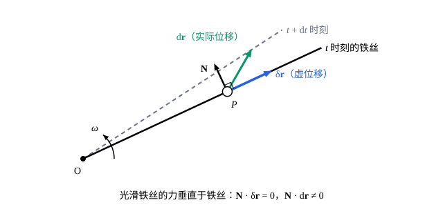

## 这一节要回答的问题

用牛顿定律解平衡问题，每个物体都要列受力平衡，绳子、铰链、支持面的力全都会出现，最后还得想办法把它们消掉。可这些力有个共同点：沿着它们允许的方向挪动物体，它们不做功。能不能利用这一点，从一开始就不让这些力出现？动力学问题能不能也这样做？

## 讲解

### 虚位移

先看两个例子。单摆在某一时刻，摆球只能沿圆周的切线方向挪动一点点。套在转动铁丝上的珠子，在某一时刻只能沿铁丝挪动；可在一小段时间$\dd t$里，珠子沿铁丝走了一段，铁丝自己也转了一点，所以珠子实际走过的位移并不沿着铁丝（见几何图像）。

::anchor{id="def-virtual-displacement"}
在某一时刻$t$把时间冻结，让各质点的位置做一个和此刻的:term[约束]{id="physics.analytical-mechanics.constraint"}（constraint）相容的无穷小改变$\delta\vb{r}_1,\dots,\delta\vb{r}_N$，叫作系统的:term[虚位移]{id="physics.analytical-mechanics.virtual-displacement"}（virtual displacement）。用:term[广义坐标]{id="physics.analytical-mechanics.generalized-coordinates"}（generalized coordinates）写，就是在$\vb{r}_i=\vb{r}_i(q_1,\dots,q_n,t)$里只让$q_j$变、$t$不变：$\delta\vb{r}_i=\sum_j\frac{\partial\vb{r}_i}{\partial q_j}\delta q_j$，其中$\delta q_1,\dots,\delta q_n$可以任意取。

为什么这样定义：「虚」是说它不是实际发生的运动，而是一种用来试探力的假想挪动。冻结时间是关键：实际位移$\dd\vb{r}_i=\sum_j\frac{\partial\vb{r}_i}{\partial q_j}\dd q_j+\frac{\partial\vb{r}_i}{\partial t}\dd t$比虚位移多出最后一项，那是约束自己在动造成的。:term[定常约束]{id="physics.analytical-mechanics.scleronomic-constraint"}（scleronomic constraint）下$\vb{r}_i$不显含$t$，实际位移就是虚位移中的一个；:term[非定常约束]{id="physics.analytical-mechanics.rheonomic-constraint"}（rheonomic constraint）下实际位移一般不是虚位移，转动的铁丝就是例子。

### 虚功与理想约束

::anchor{id="def-applied-force"}
作用在质点上的力里，:term[约束力]{id="physics.analytical-mechanics.constraint-force"}（constraint force）以外的力叫作:term[主动力]{id="physics.analytical-mechanics.applied-force"}（applied force），例如重力、弹簧的弹力和给定的外力。主动力是位置、速度和时间的已知函数，约束力的大小事先不知道。

::anchor{id="def-virtual-work"}
力在:term[虚位移]{id="physics.analytical-mechanics.virtual-displacement"}上做的功叫作:term[虚功]{id="physics.analytical-mechanics.virtual-work"}（virtual work）。记第$i$个质点受的主动力为$\vb{F}_i$、约束力为$\vb{R}_i$，主动力的虚功是$\delta W=\sum_i\vb{F}_i\cdot\delta\vb{r}_i$，约束力的虚功是$\sum_i\vb{R}_i\cdot\delta\vb{r}_i$。

先算两种常见:term[约束]{id="physics.analytical-mechanics.constraint"}的约束力的虚功。光滑的固定曲面：支持力垂直于曲面，虚位移沿着曲面，虚功为零。刚性轻杆连着两个质点：杆对它们的力大小相等、方向相反、沿着杆，写成$\vb{R}_1=\lambda(\vb{r}_1-\vb{r}_2)$、$\vb{R}_2=-\lambda(\vb{r}_1-\vb{r}_2)$；杆长不变，$|\vb{r}_1-\vb{r}_2|^2=l^2$的一阶改变给出$(\vb{r}_1-\vb{r}_2)\cdot(\delta\vb{r}_1-\delta\vb{r}_2)=0$，所以

$$
\vb{R}_1\cdot\delta\vb{r}_1+\vb{R}_2\cdot\delta\vb{r}_2=\lambda(\vb{r}_1-\vb{r}_2)\cdot(\delta\vb{r}_1-\delta\vb{r}_2)=0 .
$$

两个力各自做虚功，但两者正好相消。跨过光滑滑轮的不可伸长的轻绳也一样：两端拉力相等，两端的虚位移沿绳子大小相等、一进一出。

::anchor{id="def-ideal-constraint"}
约束力在任何虚位移上的总虚功都为零，即$\sum_i\vb{R}_i\cdot\delta\vb{r}_i=0$，这样的约束叫作:term[理想约束]{id="physics.analytical-mechanics.ideal-constraint"}（ideal constraint）。光滑的面和曲线（固定的或运动的）、刚性的杆、不可伸长的绳和纯滚动都是理想约束。

为什么这样定义：这是一条物理假设，不是定理。「光滑」「刚性」「不可伸长」「不打滑」这些说法的力学内容，正是约束力不做虚功，每种约束要单独验证。纯滚动时静摩擦力作用在接触点上，接触点此刻速度为零、虚位移也为零，所以不做虚功。反例：在粗糙面上滑动的木块，滑动摩擦力和运动方向相反，虚功不为零，不是理想约束，只能把它当作主动力处理。

### 虚功原理

系统平衡时每个质点受力为零：$\vb{F}_i+\vb{R}_i=\vb{0}$。用$\delta\vb{r}_i$点乘后对$i$求和，得$\sum_i\vb{F}_i\cdot\delta\vb{r}_i+\sum_i\vb{R}_i\cdot\delta\vb{r}_i=0$；:term[理想约束]{id="physics.analytical-mechanics.ideal-constraint"}的第二项为零，于是

$$
\delta W=\sum_i\vb{F}_i\cdot\delta\vb{r}_i=0 .
$$

::anchor{id="def-virtual-work-principle"}
:term[虚功原理]{id="physics.analytical-mechanics.virtual-work-principle"}（principle of virtual work）：受定常的理想约束的系统在某个位置保持静止，当且仅当在这个位置上，:term[主动力]{id="physics.analytical-mechanics.applied-force"}在任何:term[虚位移]{id="physics.analytical-mechanics.virtual-displacement"}上的:term[虚功]{id="physics.analytical-mechanics.virtual-work"}都为零。

上面推出了「只有当」的一半，那里没有用到:term[约束]{id="physics.analytical-mechanics.constraint"}定常。反过来，设在某个位置上$\delta W$对任何虚位移都为零，系统从静止开始，让:term[约束力]{id="physics.analytical-mechanics.constraint-force"}取$\vb{R}_i=-\vb{F}_i$：它的虚功$\sum_i\vb{R}_i\cdot\delta\vb{r}_i=-\delta W=0$，正是理想约束能提供的那种力，就像光滑面能提供任意大小的法向力、杆能提供任意大小的拉力或压力。约束不随时间变，「一直待在这个位置」才和约束相容；这时每个质点受力为零，「一直静止」满足牛顿定律，而系统的运动由初始状态唯一确定，所以它就一直静止。

约束随时间变时，后一半不成立。转动铁丝上的珠子就是反例：铁丝在水平面内转，重力垂直于铁丝，主动力在任何虚位移上的虚功都是零，可珠子不可能停在原处，因为铁丝本身就转走了。

把$\delta\vb{r}_i=\sum_j\frac{\partial\vb{r}_i}{\partial q_j}\delta q_j$代进$\delta W$，交换求和次序：

$$
\delta W=\sum_{j=1}^{n}Q_j\,\delta q_j,\qquad Q_j=\sum_{i=1}^{N}\vb{F}_i\cdot\frac{\partial\vb{r}_i}{\partial q_j} .
$$

::anchor{id="def-generalized-force"}
$Q_j$叫作对应:term[广义坐标]{id="physics.analytical-mechanics.generalized-coordinates"}$q_j$的:term[广义力]{id="physics.analytical-mechanics.generalized-force"}（generalized force）。

为什么这样定义：$\delta q_j$可以任意取，所以「$\delta W$对任何虚位移为零」等价于$Q_1=\dots=Q_n=0$，$n$个方程定$n$个广义坐标，约束力一个也不出现。广义力的量纲随坐标而变：平面上用极坐标$(r,\varphi)$时，$\frac{\partial\vb{r}}{\partial r}=\uv{r}$、$\frac{\partial\vb{r}}{\partial\varphi}=r\,\hat{\boldsymbol{\varphi}}$，所以$Q_r=F_r$是力，$Q_\varphi=rF_\varphi$却是力乘以长度。

主动力都是保守力时，它们做的功等于势能$V$的减少，在虚位移上也一样：$\delta W=-\delta V=-\sum_j\frac{\partial V}{\partial q_j}\delta q_j$。所以$Q_j=-\frac{\partial V}{\partial q_j}$，平衡位置就是$V(q_1,\dots,q_n)$的驻点：$\frac{\partial V}{\partial q_j}=0$，$j=1,\dots,n$。

### 达朗贝尔原理

运动的系统里每个质点满足$m_i\ddot{\vb{r}}_i=\vb{F}_i+\vb{R}_i$，移项写成$(\vb{F}_i-m_i\ddot{\vb{r}}_i)+\vb{R}_i=\vb{0}$。

::anchor{id="def-inertial-force"}
把$-m_i\ddot{\vb{r}}_i$看成作用在第$i$个质点上的一个力，叫作这个质点的达朗贝尔惯性力（d'Alembert inertial force），下面简称惯性力。它就是在跟着这个质点一起平动加速的参考系里看到的惯性力：在那个参考系里质点静止，真实的力和它正好平衡。

这样每个质点都像「平衡」了一样。对$i$求和，重复上面的推导，:term[理想约束]{id="physics.analytical-mechanics.ideal-constraint"}的:term[约束力]{id="physics.analytical-mechanics.constraint-force"}又一次消失。

::anchor{id="def-dalembert"}
:term[达朗贝尔原理]{id="physics.analytical-mechanics.dalembert-principle"}（d'Alembert's principle）：受理想约束的系统在运动的每一时刻，:term[主动力]{id="physics.analytical-mechanics.applied-force"}和惯性力一起在任何:term[虚位移]{id="physics.analytical-mechanics.virtual-displacement"}上的:term[虚功]{id="physics.analytical-mechanics.virtual-work"}为零：$\sum_i(\vb{F}_i-m_i\ddot{\vb{r}}_i)\cdot\delta\vb{r}_i=0$。

为什么有用：用:term[广义坐标]{id="physics.analytical-mechanics.generalized-coordinates"}展开，它变成$\sum_j\bigl(Q_j-\sum_i m_i\ddot{\vb{r}}_i\cdot\frac{\partial\vb{r}_i}{\partial q_j}\bigr)\delta q_j=0$；$\delta q_j$任意，所以每个$j$都有

$$
\sum_{i=1}^{N}m_i\ddot{\vb{r}}_i\cdot\frac{\partial\vb{r}_i}{\partial q_j}=Q_j,\qquad j=1,\dots,n .
$$

这是$n$个不含约束力的运动方程，方程个数恰好等于:term[自由度]{id="physics.analytical-mechanics.degrees-of-freedom"}（degrees of freedom）。它的左边还不好算，下一节会把它改写成动能的导数，那就是:term[拉格朗日方程]{id="physics.analytical-mechanics.lagrange-equations"}（Lagrange's equations）。反例：有滑动摩擦时，摩擦力要算进$\vb{F}_i$，它的大小$\mu N$又把支持力带了回来，原理仍然成立，只是失去了不用管约束力的好处。

## 几何图像

铁丝绕$O$匀速转动。在$t$时刻冻结时间，珠子只能沿铁丝挪动，这是:term[虚位移]{id="physics.analytical-mechanics.virtual-displacement"}$\delta\vb{r}$；实际在$\dd t$里铁丝也转了一点，实际位移$\dd\vb{r}$是沿铁丝的一段加上垂直于铁丝的一段。光滑铁丝的力$\vb{N}$垂直于铁丝，$\vb{N}\cdot\delta\vb{r}=0$，所以它是:term[理想约束]{id="physics.analytical-mechanics.ideal-constraint"}；可$\vb{N}\cdot\dd\vb{r}\ne0$，它实际上一直在做功，推着珠子转。

:::anim{component="function-plot"}
range: { x: [-3.2, 3.2], y: [-1.6, 2.6] }
functions:
  - expr: "0.5*K*x^2 + cos(x)"
    label: |
      $V/(mgl)$
  - expr: "sin(x) - K*x"
    label: |
      $Q/(mgl)$
sliders:
  - name: K
    min: 0.2
    max: 2
    step: 0.05
    default: 0.6
    label: |
      $K=\kappa/(mgl)$
:::

第二张图是一个倒立摆：长$l$的轻杆下端铰接在一个固定的支点上（杆可以转到水平以下），上端有质量$m$的小球，铰链里的扭簧在杆偏离竖直$\theta$时储存势能$\frac12\kappa\theta^2$。横轴是$\theta$，两条曲线是总势能$V=\frac12\kappa\theta^2+mgl\cos\theta$和:term[广义力]{id="physics.analytical-mechanics.generalized-force"}$Q=-\frac{\dd V}{\dd\theta}=mgl\sin\theta-\kappa\theta$（都除以$mgl$）。$Q$的零点就是$V$的驻点，也就是平衡位置：拖动$K$，看$K$小于$1$时$\theta=0$两侧怎样冒出两个新的平衡位置。

## 例题

### 例 1　靠在光滑墙上的梯子

长$l$、质量$m$的均匀梯子斜靠在光滑的竖直墙上，下端放在光滑的水平地面上。在下端加多大的水平推力$F$（指向墙），梯子才能在和墙成$\theta$角的位置静止？

**为什么想到这么做**：用牛顿定律要处理墙和地面的两个支持力，还要保证梯子不转起来。这两个支持力来自光滑面，是:term[理想约束]{id="physics.analytical-mechanics.ideal-constraint"}的:term[约束力]{id="physics.analytical-mechanics.constraint-force"}，在:term[虚功原理]{id="physics.analytical-mechanics.virtual-work-principle"}里根本不出现。梯子只有一个:term[自由度]{id="physics.analytical-mechanics.degrees-of-freedom"}$\theta$，只要写出重力和推力的:term[虚功]{id="physics.analytical-mechanics.virtual-work"}。

**推导**：取墙脚为原点，$x$轴水平离开墙，$y$轴竖直向上。梯子下端在$x_B=l\sin\theta$，质心高$y_C=\frac{l}{2}\cos\theta$，它们的:term[虚位移]{id="physics.analytical-mechanics.virtual-displacement"}是$\delta x_B=l\cos\theta\,\delta\theta$、$\delta y_C=-\frac{l}{2}\sin\theta\,\delta\theta$。重力$(0,-mg)$作用在质心，推力$(-F,0)$作用在下端，虚功

$$
\delta W=-mg\,\delta y_C-F\,\delta x_B=\Bigl(\frac12 mgl\sin\theta-Fl\cos\theta\Bigr)\delta\theta .
$$

$\delta\theta$可以任意取，所以$F=\frac12 mg\tan\theta$。检验：$\theta\to0$时梯子竖直，不需要推力；$\theta$越大推力越大，$\theta\to\frac{\pi}{2}$时要无穷大的推力才撑得住。

### 例 2　阿特伍德机

轻绳跨过光滑的定滑轮，两端挂着质量$m_1$、$m_2$的物块，滑轮和绳的质量不计。求物块的加速度。

**为什么想到这么做**：绳子的拉力是:term[约束力]{id="physics.analytical-mechanics.constraint-force"}，跨过光滑滑轮的不可伸长的轻绳是:term[理想约束]{id="physics.analytical-mechanics.ideal-constraint"}。用:term[达朗贝尔原理]{id="physics.analytical-mechanics.dalembert-principle"}，拉力不出现；系统只有一个:term[自由度]{id="physics.analytical-mechanics.degrees-of-freedom"}，一个方程就够了。

**推导**：用$y_1$、$y_2$表示两个物块在滑轮轴下方的距离，向下为正。绳长不变，$y_1+y_2$是常数，所以$\delta y_2=-\delta y_1$，$\ddot y_2=-\ddot y_1$。重力向下，达朗贝尔原理给出

$$
(m_1g-m_1\ddot y_1)\,\delta y_1+(m_2g-m_2\ddot y_2)\,\delta y_2=\bigl[(m_1-m_2)g-(m_1+m_2)\ddot y_1\bigr]\delta y_1=0 .
$$

$\delta y_1$可以任意取，所以$\ddot y_1=\frac{m_1-m_2}{m_1+m_2}\,g$，$m_1>m_2$时$m_1$加速下降。要求拉力，再对$m_1$单独用牛顿定律：$T=m_1(g-\ddot y_1)=\frac{2m_1m_2}{m_1+m_2}\,g$。

## 常见误区

- 「:term[虚位移]{id="physics.analytical-mechanics.virtual-displacement"}就是物体在$\dd t$里实际走过的位移。」虚位移冻结了时间；:term[约束]{id="physics.analytical-mechanics.constraint"}在动时两者不同，转动铁丝上的珠子就是例子。
- 「:term[理想约束]{id="physics.analytical-mechanics.ideal-constraint"}的:term[约束力]{id="physics.analytical-mechanics.constraint-force"}不做功。」它不做:term[虚功]{id="physics.analytical-mechanics.virtual-work"}，实际的功却可以不为零：转动的光滑铁丝一直在对珠子做功。
- 「有摩擦就不能用:term[虚功原理]{id="physics.analytical-mechanics.virtual-work-principle"}。」纯滚动时的静摩擦力作用在速度为零的接触点上，虚功为零；只有滑动摩擦力要当作:term[主动力]{id="physics.analytical-mechanics.applied-force"}处理。
- 「虚功原理只能求平衡位置，求不出约束力。」把要求的那个约束拿掉、换成大小未知的力，系统多出一种虚位移，这个力就出现在虚功里了（见 p5）。
