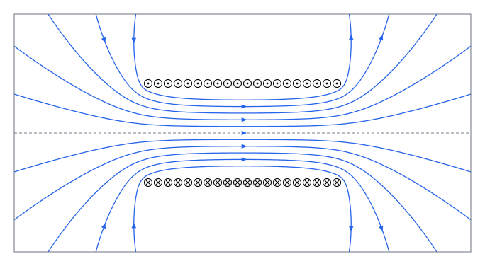

## 这一节要回答的问题

:term[电荷]{id="physics.electromagnetism.electric-charge"}（electric charge）分布有对称性时，[高斯定律](lesson:physics.electromagnetism.gauss-law)几乎不用积分就能求出:term[电场]{id="physics.electromagnetism.electric-field"}（electric field）。:term[电流]{id="physics.electromagnetism.electric-current"}（electric current）分布有对称性时，:term[磁场]{id="physics.electromagnetism.magnetic-field"}（magnetic field）也有这样的捷径吗？静磁场的散度和旋度是什么，和静电场的有什么不同？

## 讲解

### 安培环路定理

长直导线的:term[磁场]{id="physics.electromagnetism.magnetic-field"}是$\frac{\mu_0I}{2\pi s}$，沿一个以导线为轴、半径为$s$的圆周积分，得$\frac{\mu_0I}{2\pi s}\cdot2\pi s=\mu_0I$，和半径无关。下面的定理说，对任何形状的闭合回路和任何:term[恒定电流]{id="physics.electromagnetism.steady-current"}（steady current）都是这样。它以安培（André-Marie Ampère）的名字命名，这个形式是麦克斯韦（James Clerk Maxwell）在 1850 年代写出的。

::anchor{id="thm-ampere"}
定理（:term[安培环路定理]{id="physics.electromagnetism.ampere-law"}，Ampère's circuital law）：对恒定电流的磁场，沿任一闭合回路$C$，$\oint_C\vb B\cdot\dd\vb l=\mu_0I_{\text{穿}}$，$I_{\text{穿}}$是穿过以$C$为边界的曲面的:term[电流]{id="physics.electromagnetism.electric-current"}；按右手定则，四指沿$C$的绕行方向弯曲时，沿拇指方向穿过的电流为正。

证明思路：先看一根长直导线：$\vb B=\frac{\mu_0I}{2\pi s}\uv\psi$，回路上$\vb B\cdot\dd\vb l=\frac{\mu_0I}{2\pi}\dd\psi$，$\psi$是绕导线转过的角。回路绕导线一圈，$\psi$增加$2\pi$，积分是$\mu_0I$；不绕导线，$\psi$回到原值，积分是零。

一般地，先看一个闭合电流环。以它为边界任取一个曲面$S$，令$\Omega(\vb r)=\int_S\frac{(\vb r'-\vb r)\cdot\dd\vb a'}{|\vb r'-\vb r|^3}$，它是$S$对场点$\vb r$张的:term[立体角]{id="physics.electromagnetism.solid-angle"}（solid angle）。面元$\dd\vb a'$的方向和电流按右手定则对应：四指沿电流方向弯曲，拇指指向$\dd\vb a'$；场点在拇指所指的一侧时，$(\vb r'-\vb r)\cdot\dd\vb a'<0$，$\Omega$为负。

把场点移动$\delta\vb r$，等于把电流环和曲面反方向移动$\delta\vb r$，$\Omega$的改变就是电流环扫过的窄带对场点张的立体角。窄带上的一小块是$\dd\vb l'\times\delta\vb r$，由混合积（scalar triple product）的轮换，它张的立体角是$\frac{(\vb r'-\vb r)\cdot(\dd\vb l'\times\delta\vb r)}{|\vb r'-\vb r|^3}=\delta\vb r\cdot\frac{\dd\vb l'\times(\vb r-\vb r')}{|\vb r-\vb r'|^3}$。沿环加起来，对照:term[毕奥-萨伐尔定律]{id="physics.electromagnetism.biot-savart-law"}（Biot–Savart law），正是$\frac{4\pi}{\mu_0I}\vb B\cdot\delta\vb r$，即$\vb B=\frac{\mu_0I}{4\pi}\nabla\Omega$。

沿回路$C$积分，结果是$\frac{\mu_0I}{4\pi}$乘以$\Omega$沿途连续变化的总量。回路不穿过那个曲面时，$\Omega$回到原值，积分为零；穿过一次时，$\Omega$在曲面上拇指所指的一侧趋于$-2\pi$、另一侧趋于$2\pi$，绕一圈连续变化了$4\pi$，积分是$\mu_0I$。恒定电流满足$\divg\vb J=0$，电流沿闭合的路径流动，可以看成许多闭合电流环叠加，定理对每一个都成立，相加即得。

::anchor{id="def-amperian-loop"}
用安培环路定理求磁场时选的回路，叫作安培回路（Amperian loop），作用和:term[高斯面]{id="physics.electromagnetism.gaussian-surface"}（Gaussian surface）一样：电流分布有对称性时，选一个磁场沿着它大小不变、方向和它平行或垂直的回路，积分就变成乘法。

边界情况：定理只对恒定电流成立。给:term[电容器]{id="physics.electromagnetism.capacitor"}（capacitor）充电时，用同一个回路，曲面穿过导线时$I_{\text{穿}}=I$，从两块极板之间穿过时$I_{\text{穿}}=0$，两种说法矛盾，要加上麦克斯韦的位移电流（displacement current）才能统一（见[位移电流与麦克斯韦方程组](lesson:physics.electromagnetism.maxwell-equations)）。

### 静磁场的散度和旋度

::anchor{id="thm-ampere-differential"}
定理（:term[静磁场]{id="physics.electromagnetism.magnetic-field"}的散度和旋度）：:term[恒定电流]{id="physics.electromagnetism.steady-current"}的磁场满足$\curl\vb B=\mu_0\vb J$和$\divg\vb B=0$。

证明思路：用斯托克斯公式（Stokes' theorem），$\oint_C\vb B\cdot\dd\vb l=\int_S(\curl\vb B)\cdot\dd\vb a$；:term[安培环路定理]{id="physics.electromagnetism.ampere-law"}说它等于$\mu_0\int_S\vb J\cdot\dd\vb a$，对任意小的曲面都成立，被积函数连续，只能处处相等（和[高斯定律的微分形式](lesson:physics.electromagnetism.gauss-differential#thm-gauss-differential)的推理一样）。散度：每个:term[电流元]{id="physics.electromagnetism.current-element"}（current element）的磁场都绕着电流元所在的直线转，以这条直线为$z$轴，它的形式是$g(s,z)(-y,x,0)$，$g$只通过$s=\sqrt{x^2+y^2}$依赖$x$、$y$。求散度，$\partial_x(-gy)+\partial_y(gx)=-y\,g_s\frac xs+x\,g_s\frac ys=0$。场点在:term[电流]{id="physics.electromagnetism.electric-current"}外面时被积函数光滑，散度可以移进积分号（[积分号下求导](lesson:math.analysis.parameter-integrals#thm-leibniz-rule)），各个电流元的贡献相加，散度仍是零；在电流里面时被积函数有奇点，但奇点可积，结论仍然成立，这里不证。

和:term[静电场]{id="physics.electromagnetism.electric-field"}对照：静电场$\divg\vb E=\frac{\rho}{\varepsilon_0}$、$\curl\vb E=0$，源是:term[电荷]{id="physics.electromagnetism.electric-charge"}，:term[电场线]{id="physics.electromagnetism.field-line"}（electric field line）从电荷出发，不绕圈；静磁场$\divg\vb B=0$、$\curl\vb B=\mu_0\vb J$，没有「源」，:term[磁场线]{id="physics.electromagnetism.magnetic-field-line"}（magnetic field line）绕着电流转圈。$\curl\vb B=\mu_0\vb J$还要求$\divg\vb J=\frac{1}{\mu_0}\divg(\curl\vb B)=0$（旋度的散度恒为零，见[向量微分恒等式](lesson:math.vector-calculus.vector-identities)），正是恒定电流的条件。

::anchor{id="def-magnetic-flux"}
磁场穿过一个曲面$S$的通量$\Phi=\int_S\vb B\cdot\dd\vb a$叫作:term[磁通量]{id="physics.electromagnetism.magnetic-flux"}（magnetic flux），单位是韦伯（weber），记作$\mathrm{Wb}$，$1\,\mathrm{Wb}=1\,\mathrm{T\,m^2}$。由$\divg\vb B=0$和高斯公式（divergence theorem），穿过任何闭合曲面的磁通量都是零。

为什么这样定义：穿过闭合曲面的磁通量为零，说的是:term[磁场线]{id="physics.electromagnetism.magnetic-field-line"}从哪里穿进去，就会从哪里穿出来，不会在曲面里开始或终止。所以穿过以同一条闭合曲线为边界的任意两个曲面的磁通量相同，可以说「穿过这条曲线的磁通量」；讲电磁感应时要用到这一点（见[法拉第电磁感应定律](lesson:physics.electromagnetism.faraday-law)）。边界情况：磁铁里面也有磁场，磁场线在磁铁外从 N 极到 S 极，在里面从 S 极回到 N 极。

::anchor{id="def-monopole"}
能单独发出或吸收磁场线的「磁荷」（magnetic charge），叫作:term[磁单极子]{id="physics.electromagnetism.magnetic-monopole"}（magnetic monopole）。$\divg\vb B=0$说的正是没有磁单极子：把一根磁铁截成两段，得到的是两根各有 N 极和 S 极的短磁铁，而不是单独的 N 极和 S 极。

为什么这样定义：$\divg\vb E=\frac{\rho}{\varepsilon_0}$里电荷是电场的源，如果自然界有磁荷，它就会出现在$\divg\vb B$的右边。1931 年狄拉克（Paul Dirac）指出，只要宇宙中有一个磁单极子，所有的电荷就都必须是某个最小单位的整数倍；可是实验至今没有找到磁单极子。

### 对称电流的磁场

::anchor{id="thm-thick-wire"}
定理（粗导线的:term[磁场]{id="physics.electromagnetism.magnetic-field"}）：半径为$a$的长直圆柱导线里，:term[电流]{id="physics.electromagnetism.electric-current"}$I$均匀分布在横截面上。离轴$s$处的磁场沿$\uv\psi$，导线外$B=\frac{\mu_0I}{2\pi s}$，导线内$B=\frac{\mu_0Is}{2\pi a^2}$。

证明思路：电流分布绕轴转动、沿轴平移都不变，磁场的大小只和$s$有关；用:term[毕奥-萨伐尔定律]{id="physics.electromagnetism.biot-savart-law"}可以看出它只有$\uv\psi$分量：每个:term[电流元]{id="physics.electromagnetism.current-element"}的磁场都垂直于$\uv z$，$\uv s$分量在关于「轴线和这一点所在的平面」对称的两个电流元之间抵消。取以轴为心、半径为$s$的圆作安培回路，$\oint\vb B\cdot\dd\vb l=2\pi sB$。导线外穿过的电流是$I$，导线内是$I\frac{s^2}{a^2}$，代入:term[安培环路定理]{id="physics.electromagnetism.ampere-law"}即得。

::anchor{id="thm-solenoid"}
定理（长线圈内外的磁场）：导线密绕成的长圆筒形线圈叫作:term[螺线管]{id="physics.electromagnetism.solenoid"}（solenoid）。每单位长度绕$n$匝导线、通有电流$I$的无限长螺线管，管内的磁场沿轴、处处等于$\mu_0nI$，和到轴的距离无关；管外的磁场为零。

证明思路：把螺线管看成许多紧挨着的圆形电流，它们绕轴转动、沿轴平移都不变，由毕奥-萨伐尔定律可以看出磁场沿轴，大小只和$s$有关。取一个矩形安培回路，两条边平行于轴、长为$l$：两条边都在管外时，回路里没有电流，两边的磁场相等，而离管很远处磁场趋于零，所以管外处处为零；一条边在管内、一条在管外时，穿过的电流是$nlI$，$Bl=\mu_0nlI$。

::anchor{id="thm-toroid"}
定理（螺绕环的磁场）：$N$匝导线均匀地绕在一个环上，做成螺绕环（toroid），通有电流$I$。环内离对称轴$s$处的磁场沿环的方向，大小是$\frac{\mu_0NI}{2\pi s}$；环外的磁场为零。

证明思路：取以对称轴为心、半径为$s$的圆作安培回路。在环内，回路穿过$N$匝导线，每匝电流$I$，所以$2\pi sB=\mu_0NI$；在环外（$s$比环小或比环大），穿过回路的电流一进一出，代数和为零。环的截面比$s$小得多时，环内的磁场近似均匀，$B\approx\mu_0nI$，$n=\frac{N}{2\pi s}$，就像弯成环的螺线管。

## 几何图像

图里是一个长度是半径$4$倍、绕$20$匝的有限长:term[螺线管]{id="physics.electromagnetism.solenoid"}，画的是过轴线的截面上的:term[磁场线]{id="physics.electromagnetism.magnetic-field-line"}，由:term[毕奥-萨伐尔定律]{id="physics.electromagnetism.biot-savart-law"}对$20$匝线圈逐一求和算出。上排导线截面里的:term[电流]{id="physics.electromagnetism.electric-current"}垂直纸面向外，下排向里，管内的:term[磁场]{id="physics.electromagnetism.magnetic-field"}向右。管内中段的磁场线几乎是等距的平行线，磁场均匀；磁场线从右端出来，在管外散开，绕回左端进去，伸出画框的部分在框外绕回来。管外的磁场线稀疏得多，管越长，管外的磁场越弱，无限长时就是零。

:::anim{component="vector-field-2d"}
field: { x: "-y / max(x^2 + y^2, R^2)", y: "x / max(x^2 + y^2, R^2)" }
range: { x: [-3, 3], y: [-3, 3] }
dt: 0.02
particles: 300
sliders:
  - name: R
    min: 0.5
    max: 2
    step: 0.25
    default: 1
    label: |
      导线的半径$R$
:::

动画画的是一根电流均匀分布的粗导线在横截面上的:term[磁场]{id="physics.electromagnetism.magnetic-field"}，电流垂直屏幕向外，总电流不随滑块变。导线里，磁场和离轴的距离$s$成正比，粒子绕得越来越快：每往外一圈，就多包住一些:term[电流]{id="physics.electromagnetism.electric-current"}，$\curl\vb B=\mu_0\vb J$不为零。导线外，磁场按$\frac1s$减弱，一圈的周长按$s$增长，沿每一圈的积分都是$\mu_0I$，$\curl\vb B=0$。把它和[高斯定律的微分形式](lesson:physics.electromagnetism.gauss-differential)一节里带电圆柱的:term[电场]{id="physics.electromagnetism.electric-field"}对比：同样的大小，电场沿半径向外，磁场绕着轴转。

## 例题

### 例 1　同轴电缆的磁场

同轴电缆中间是一根半径为$a$的实心圆柱:term[导体]{id="physics.electromagnetism.conductor"}（conductor），:term[电流]{id="physics.electromagnetism.electric-current"}$I$均匀分布在它的横截面上；外面是半径为$b$的薄导体圆筒，带着大小相同、方向相反的电流。求各处的:term[磁场]{id="physics.electromagnetism.magnetic-field"}。

**为什么想到这么做**：电流分布有轴对称，磁场沿$\uv\psi$、大小只和$s$有关，以轴为心的圆是合适的安培回路，只要数清楚每个回路穿过多少:term[电流]{id="physics.electromagnetism.electric-current"}。

**推导**：$s<a$时，穿过的电流是$I\frac{s^2}{a^2}$，$B=\frac{\mu_0Is}{2\pi a^2}$；$a<s<b$时，穿过$I$，$B=\frac{\mu_0I}{2\pi s}$；$s>b$时，内外导体的电流一正一负，穿过的电流是零，$B=0$。所以同轴电缆的磁场全部关在两个导体之间，不干扰外面，外面的磁场也不会在电缆里引起干扰。

### 例 2　无限大的平面电流

无限大的平面上有均匀的:term[面电流密度]{id="physics.electromagnetism.current-density"}（surface current density）$\vb K$，即每单位宽度的:term[电流]{id="physics.electromagnetism.electric-current"}是$K$。求平面两侧的:term[磁场]{id="physics.electromagnetism.magnetic-field"}。

**为什么想到这么做**：取平面为$xy$平面，电流沿$x$方向。由:term[毕奥-萨伐尔定律]{id="physics.electromagnetism.biot-savart-law"}，磁场垂直于电流，没有$z$分量（场点两侧对称的两股电流，产生的$z$分量互相抵消），所以沿$\pm y$方向；平面上方和下方方向相反。取一个跨过平面的矩形安培回路，两条边平行于$y$轴、长为$l$。

**推导**：回路穿过的电流是$Kl$，两条边上的磁场大小相同、方向相反，积分是$2Bl$，所以$B=\frac{\mu_0K}{2}$，和到平面的距离无关；用右手定则，平面上方的磁场沿$-y$方向，下方沿$+y$方向。两块平行的平面，电流大小相同、方向相反时，中间的磁场相加，是$\mu_0K$，外面抵消为零：这正是把:term[螺线管]{id="physics.electromagnetism.solenoid"}压扁后的样子，$K=nI$。

## 常见误区

- 「:term[安培环路定理]{id="physics.electromagnetism.ampere-law"}里的:term[磁场]{id="physics.electromagnetism.magnetic-field"}只由回路包住的:term[电流]{id="physics.electromagnetism.electric-current"}产生。」回路上每一点的磁场由所有的电流产生；只是外面的电流对磁场沿整个回路的积分没有贡献。
- 「$\oint\vb B\cdot\dd\vb l=0$，所以回路上的磁场处处为零。」积分为零只说明正负抵消，例如回路不包住一根直导线时，回路上的磁场并不为零。
- 「用安培环路定理总能求出磁场。」要有足够的对称性，使磁场沿回路大小不变、方向和回路平行或垂直；求一个圆线圈轴线外的磁场就做不到。
- 「:term[螺线管]{id="physics.electromagnetism.solenoid"}外的磁场严格为零。」有限长的螺线管外有磁场（几何图像）；导线一圈圈地绕，沿轴还有净电流$I$，管外还有一个像直导线那样的磁场$\frac{\mu_0I}{2\pi s}$。
