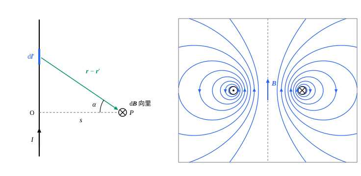

## 这一节要回答的问题

奥斯特的实验说明，:term[电流]{id="physics.electromagnetism.electric-current"}（electric current）会在周围产生:term[磁场]{id="physics.electromagnetism.magnetic-field"}（magnetic field）。一根长直导线旁边的磁场有多强、朝哪个方向？任意形状的电流产生的磁场怎样计算？两根通电的导线之间为什么会有力？

## 讲解

### 毕奥-萨伐尔定律

奥斯特的发现在 1820 年 9 月 11 日由阿拉戈（François Arago）在巴黎科学院演示，几个星期之内，那里的物理学家就做出了一连串结果。安培（André-Marie Ampère）在 9 月发现两根平行导线通同向:term[电流]{id="physics.electromagnetism.electric-current"}时互相吸引，通反向电流时互相排斥。10 月 30 日，毕奥（Jean-Baptiste Biot）和萨伐尔（Félix Savart）报告：长直导线对磁极的作用和到导线的距离成反比；拉普拉斯（Pierre-Simon Laplace）把它分解成每一小段电流的贡献，得到下面的定律。

::anchor{id="def-biot-savart"}
:term[恒定电流]{id="physics.electromagnetism.steady-current"}（steady current）在$\vb r$处产生的:term[磁场]{id="physics.electromagnetism.magnetic-field"}是$\vb B(\vb r)=\frac{\mu_0}{4\pi}\oint\frac{I\,\dd\vb l'\times(\vb r-\vb r')}{|\vb r-\vb r'|^3}$，积分沿电流所在的整个闭合回路，$I\,\dd\vb l'$是$\vb r'$处的:term[电流元]{id="physics.electromagnetism.current-element"}（current element）。这叫作:term[毕奥-萨伐尔定律]{id="physics.electromagnetism.biot-savart-law"}（Biot–Savart law），其中$\mu_0$叫作:term[真空磁导率]{id="physics.electromagnetism.permeability"}（vacuum permeability），$\mu_0=1.25663706127\times10^{-6}\,\mathrm{N/A^2}$。电流分布在体内时，把$I\,\dd\vb l'$换成$\vb J(\vb r')\,\dd V'$。

为什么这样定义：和[库仑定律](lesson:physics.electromagnetism.coulomb-law#def-coulomb-law)一样，这是从实验总结出来的定律：每个电流元的贡献和电流元成正比，和距离的平方成反比，方向垂直于电流元和它到场点的连线，各个电流元的贡献直接相加。$\mu_0$和$4\pi\times10^{-7}\,\mathrm{N/A^2}$相差不到一百亿分之二，计算时取$\frac{\mu_0}{4\pi}=10^{-7}\,\mathrm{N/A^2}$就足够了；以后会看到$\mu_0\varepsilon_0=\frac1{c^2}$（见[真空中的电磁波](lesson:physics.electromagnetism.em-waves)）。

边界情况：单独的一个电流元不能单独存在，它两端的:term[电荷]{id="physics.electromagnetism.electric-charge"}（electric charge）会越积越多，不是:term[恒定电流]{id="physics.electromagnetism.steady-current"}。所以定律只对整个闭合回路积分才有确定的意义，实验也只能检验积分后的结果（第 7 题）。

以速度$\vb v$运动的:term[点电荷]{id="physics.electromagnetism.point-charge"}（point charge）$q$，相当于电流元$I\,\dd\vb l'=\dd q\,\frac{\dd\vb l'}{\dd t}$换成$q\vb v$：$v\ll c$时，它在$\vb r$处产生的磁场近似是$\frac{\mu_0}{4\pi}\frac{q\vb v\times(\vb r-\vb r')}{|\vb r-\vb r'|^3}$。速度接近光速时要用精确的公式（见[运动点电荷的场](lesson:physics.electromagnetism.lienard-wiechert)）。

### 直导线和圆线圈

::anchor{id="thm-straight-wire"}
定理（直导线的:term[磁场]{id="physics.electromagnetism.magnetic-field"}）：通有:term[电流]{id="physics.electromagnetism.electric-current"}$I$的一段直导线，在离它$s$处的点$P$产生的磁场大小是$B=\frac{\mu_0I}{4\pi s}(\sin\alpha_2-\sin\alpha_1)$，$\alpha_1$、$\alpha_2$是$P$到导线起点、终点的连线和$P$到导线的垂线所成的角，偏向电流方向的为正。无限长直导线在离它$s$处产生的磁场是$\vb B=\frac{\mu_0I}{2\pi s}\uv\psi$，:term[磁场线]{id="physics.electromagnetism.magnetic-field-line"}（magnetic field line）是以导线为轴的圆。

这里$\uv\psi$是绕导线转的方位方向（azimuthal direction）的单位矢量，方向按右手定则：拇指指向电流，四指弯曲的方向就是$\uv\psi$。

证明思路：取导线为$z$轴，$P$在$z=0$处，离轴$s$。$z'$处的:term[电流元]{id="physics.electromagnetism.current-element"}$I\,\dd z'\,\uv z$到$P$的矢量是$s\uv s-z'\uv z$，叉积是$I\,\dd z'\,s\uv\psi$，所以每一段的贡献都沿$\uv\psi$，$B=\frac{\mu_0I}{4\pi}\int\frac{s\,\dd z'}{(s^2+z'^2)^{3/2}}$。代换$z'=s\tan\alpha$，被积式变成$\frac{\cos\alpha\,\dd\alpha}{s}$，积分得$\frac{\mu_0I}{4\pi s}(\sin\alpha_2-\sin\alpha_1)$；无限长时$\alpha$从$-\frac\pi2$到$\frac\pi2$，得$\frac{\mu_0I}{2\pi s}$。

磁场和$s$成反比，正是毕奥和萨伐尔测到的。每个电流元的贡献都是平方反比，整根导线却给出一次方反比：离得越远，能起作用的那段导线越长，就像均匀带电的长直线的:term[电场]{id="physics.electromagnetism.electric-field"}（electric field）一样。

::anchor{id="thm-loop-axis"}
定理（圆线圈轴线上的磁场）：半径为$R$、通有电流$I$的圆线圈，在轴线上离圆心$z$处的磁场沿着轴线，大小是$B=\frac{\mu_0IR^2}{2(R^2+z^2)^{3/2}}$；圆心处是$\frac{\mu_0I}{2R}$。方向按右手定则：四指沿电流的方向弯曲，拇指所指的就是磁场的方向。

证明思路：每个电流元到轴上那一点的距离都是$\sqrt{R^2+z^2}$，电流元和连线垂直，贡献的大小是$\frac{\mu_0}{4\pi}\frac{I\,\dd l'}{R^2+z^2}$，方向垂直于连线。绕一圈，垂直于轴的分量两两抵消，沿轴的分量是它的$\frac{R}{\sqrt{R^2+z^2}}$倍，$\dd l'$加起来是$2\pi R$，于是得到上式。

离线圈很远（$z\gg R$）时，$B\approx\frac{\mu_0IR^2}{2z^3}=\frac{\mu_0}{4\pi}\frac{2m}{z^3}$，$m=I\pi R^2$是线圈的:term[磁矩]{id="physics.electromagnetism.magnetic-moment"}（magnetic dipole moment）。这和[电偶极子](lesson:physics.electromagnetism.electric-dipole)在轴线上的电场$\frac{1}{4\pi\varepsilon_0}\frac{2p}{z^3}$形式相同（见[磁偶极子](lesson:physics.electromagnetism.magnetic-dipole)）。

### 平行导线之间的力

::anchor{id="thm-parallel-wires"}
定理（平行导线之间的力）：两根相距$d$的无限长平行直导线，分别通有:term[电流]{id="physics.electromagnetism.electric-current"}$I_1$、$I_2$，每一根上长为$L$的一段受另一根的力大小是$\frac{\mu_0I_1I_2L}{2\pi d}$；电流同向时互相吸引，反向时互相排斥。

证明思路：导线 1 在导线 2 处产生的:term[磁场]{id="physics.electromagnetism.magnetic-field"}大小是$\frac{\mu_0I_1}{2\pi d}$，方向垂直于导线 2，也垂直于两根导线所在的平面。导线 2 上长为$L$的一段受力$I_2LB$（见[电流受到的磁力](lesson:physics.electromagnetism.magnetic-force-on-currents#thm-force-current)），方向在两根导线所在的平面里、垂直于导线；按右手定则，电流同向时指向导线 1。反过来算导线 1 受的力，大小相同、方向相反。

1948 年到 2019 年，安培就是用这个力定义的：真空中相距$1\,\mathrm m$的两根平行长导线通同样的电流，每米受力$2\times10^{-7}\,\mathrm N$时，电流就是$1\,\mathrm A$，这使$\mu_0$恰好等于$4\pi\times10^{-7}\,\mathrm{N/A^2}$。2019 年改用:term[元电荷]{id="physics.electromagnetism.elementary-charge"}（elementary charge）定义安培以后，$\mu_0$成了要测量的量，只是测出来的值和原来几乎一样。

## 几何图像

左图是定理里直导线的几何：:term[电流元]{id="physics.electromagnetism.current-element"}$I\,\dd\vb l'$竖直向上，$\vb r-\vb r'$从它指向场点$P$，两者的叉积垂直纸面向里，所以$P$处的$\dd\vb B$向里；导线上每一段的贡献都向里，只是大小不同。右图是圆线圈过轴线的截面上的:term[磁场线]{id="physics.electromagnetism.magnetic-field-line"}，由:term[毕奥-萨伐尔定律]{id="physics.electromagnetism.biot-savart-law"}精确算出：左边的截面里:term[电流]{id="physics.electromagnetism.electric-current"}垂直纸面向外，右边向里。紧挨着导线的磁场线几乎是圆，像直导线的一样；离得越远，线圈各部分的贡献合在一起，磁场线从线圈中间穿过，绕到外面再回来。伸出画框的磁场线，在框外绕回来，又从框的另一处进来。

:::anim{component="vector-field-2d"}
field: { x: "-y / max((x - 1)^2 + y^2, 0.05) - k * y / max((x + 1)^2 + y^2, 0.05)", y: "(x - 1) / max((x - 1)^2 + y^2, 0.05) + k * (x + 1) / max((x + 1)^2 + y^2, 0.05)" }
range: { x: [-3, 3], y: [-3, 3] }
dt: 0.02
particles: 300
sliders:
  - name: k
    min: -1
    max: 1
    step: 0.25
    default: 1
    label: |
      左边导线的电流与右边导线的电流之比
:::

动画画的是两根垂直于屏幕的平行长直导线在横截面上的:term[磁场]{id="physics.electromagnetism.magnetic-field"}，导线在$(\pm1,0)$处，右边导线的电流垂直屏幕向外。两根导线的电流同向（比值为正）时，磁场线在远处绕着两根导线一起转，中间有一个磁场为零的点；电流反向时，两根导线之间的磁场加强，远处的磁场彼此抵消得很快。比值为零时就是一根导线的磁场：一圈圈的同心圆。

:::anim{component="function-plot"}
range: { x: [-2, 2], y: [0, 2.2] }
functions:
  - expr: "1/(1 + (x - d/2)^2)^1.5 + 1/(1 + (x + d/2)^2)^1.5"
    label: |
      两个线圈轴线上的磁场
sliders:
  - name: d
    min: 0.5
    max: 2
    step: 0.25
    default: 1
    label: |
      两个线圈的间距$d$（以半径$R$为单位）
:::

这个动画画的是两个同轴、同样的圆线圈通同向电流时轴线上的磁场，横轴是到两线圈正中间的距离（以$R$为单位，图上写作$x$），纵轴以一个线圈圆心处的磁场$\frac{\mu_0I}{2R}$为单位。间距小于$R$时中间有一个峰，大于$R$时中间凹下去；间距恰好等于$R$时，中间一大段几乎是平的，这就是亥姆霍兹线圈（Helmholtz coil），实验室里常用它产生均匀的磁场（第 5 题）。

## 例题

### 例 1　发夹形导线

一根导线从很远处沿直线过来，绕着点$O$弯成半径为$R$的半圆，再沿平行的直线回到很远处，通有:term[电流]{id="physics.electromagnetism.electric-current"}$I$。求$O$处的:term[磁场]{id="physics.electromagnetism.magnetic-field"}。

**为什么想到这么做**：导线分成三段：两段半无限长的直线和一个半圆，各自的磁场都能用定理求出，再相加；三段在$O$处的磁场方向相同。

**推导**：半圆在圆心处的磁场是整圆的一半，$\frac{\mu_0I}{4R}$。每段半无限长直线，$O$到它的垂足恰好在端点，$\alpha$从$0$到$\frac\pi2$，磁场是$\frac{\mu_0I}{4\pi R}$。三段的方向都垂直于导线所在的平面、指向同一侧，所以$B=\frac{\mu_0I}{4R}+\frac{\mu_0I}{2\pi R}=\frac{\mu_0I}{4R}\Bigl(1+\frac2\pi\Bigr)$。

### 例 2　原子核处的磁场

按玻尔模型，氢原子里的电子以速率$v=2.19\times10^6\,\mathrm{m/s}$在半径$a_0=5.29\times10^{-11}\,\mathrm m$的圆周上运动。求它在原子核处产生的:term[磁场]{id="physics.electromagnetism.magnetic-field"}。

**为什么想到这么做**：$\frac vc\approx\frac1{137}$，可以用低速运动:term[点电荷]{id="physics.electromagnetism.point-charge"}的磁场公式；电子的速度和它到核的连线垂直。

**推导**：$B=\frac{\mu_0}{4\pi}\frac{ev}{a_0^2}=10^{-7}\times\frac{1.602\times10^{-19}\times2.19\times10^6}{(5.29\times10^{-11})^2}\,\mathrm T\approx12.5\,\mathrm T$。这比实验室里一般的强磁铁还强：原子内部的磁场很强，原子核的:term[磁矩]{id="physics.electromagnetism.magnetic-moment"}和电子的磁矩在里面相互作用，使原子的能级发生细小的分裂。

## 常见误区

- 「:term[电流元]{id="physics.electromagnetism.current-element"}产生的:term[磁场]{id="physics.electromagnetism.magnetic-field"}沿着电流元的方向。」磁场垂直于电流元，也垂直于电流元到场点的连线；在电流元的延长线上，它的贡献是零。
- 「每个电流元的磁场都和距离的平方成反比，所以直导线的磁场也是。」无限长直导线的磁场和距离的一次方成反比。
- 「两根平行导线通同向:term[电流]{id="physics.electromagnetism.electric-current"}时互相排斥，就像同号:term[电荷]{id="physics.electromagnetism.electric-charge"}互相排斥。」同向的电流互相吸引，反向的互相排斥，和电荷的规律恰好相反。
- 「:term[磁场线]{id="physics.electromagnetism.magnetic-field-line"}从磁铁的 N 极出发，到 S 极终止。」磁场线在磁铁外面从 N 极到 S 极，在磁铁里面从 S 极回到 N 极，连成闭合的曲线（见[安培环路定理](lesson:physics.electromagnetism.ampere-law)）。
