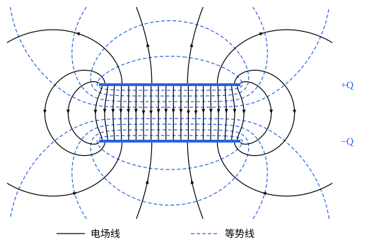

## 这一节要回答的问题

两块靠得很近的金属板分别接到电池的两极，会带上等量异号的:term[电荷]{id="physics.electromagnetism.electric-charge"}（electric charge）。电荷越多，两板之间的:term[电势差]{id="physics.electromagnetism.potential-difference"}（potential difference）越大：两者成正比吗？比值由什么决定？充好电的这一对:term[导体]{id="physics.electromagnetism.conductor"}（conductor）储存了多少能量？

## 讲解

### 电容

把两个彼此绝缘的:term[导体]{id="physics.electromagnetism.conductor"}之一上的:term[电荷]{id="physics.electromagnetism.electric-charge"}一点点搬到另一个上，它们就带上等量异号的电荷，两者之间有了:term[电场]{id="physics.electromagnetism.electric-field"}（electric field）和:term[电势差]{id="physics.electromagnetism.potential-difference"}。最早能储存大量电荷的这种装置是莱顿瓶（Leyden jar）：1745 年前后，克莱斯特（Ewald Georg von Kleist）和莱顿的穆申布鲁克（Pieter van Musschenbroek）各自发现了它，后来通行的样子是内外都贴着金属箔的玻璃瓶。

::anchor{id="def-capacitor"}
两个彼此绝缘的导体分别带上:term[电荷]{id="physics.electromagnetism.electric-charge"}$+Q$和$-Q$，就组成一个:term[电容器]{id="physics.electromagnetism.capacitor"}（capacitor），两个导体叫作它的极板（plate）；它的:term[电容]{id="physics.electromagnetism.capacitance"}（capacitance）定义为$C=\frac{Q}{\Delta\varphi}$，其中$\Delta\varphi=\varphi_+-\varphi_-$是带正电的极板和带负电的极板之间的:term[电势差]{id="physics.electromagnetism.potential-difference"}。电容的单位是法拉（farad），记作$\mathrm F$，$1\,\mathrm F=1\,\mathrm{C/V}$。

为什么这样定义：下面三种电容器都能直接算出$\Delta\varphi$和$Q$成正比，比值只由几何形状决定。一般形状的导体也是这样：把每处的电荷都乘以$2$，导体内部的:term[电场]{id="physics.electromagnetism.electric-field"}仍然为零，仍是:term[静电平衡]{id="physics.electromagnetism.electrostatic-equilibrium"}（electrostatic equilibrium），以后会证明平衡的分布只有这一种（见[唯一性定理与镜像法](lesson:physics.electromagnetism.images-uniqueness)），于是电场和电势差都加倍。所以电容是电容器本身的性质，和它带多少电荷无关。边界情况：单个孤立导体也有电容，相当于另一个极板在无穷远，$C=\frac{Q}{\varphi}$，$\varphi$以无穷远为参考点。

例如半径为$R$的孤立导体球，$\varphi=\frac{1}{4\pi\varepsilon_0}\frac{Q}{R}$，电容是$4\pi\varepsilon_0R$。$1\,\mathrm F$是很大的电容：要让孤立导体球的电容达到$1\,\mathrm F$，半径要约$9\times10^9\,\mathrm m$。$\varepsilon_0$的单位也可以写成$\mathrm{F/m}$。

### 三种电容器

::anchor{id="thm-parallel-plate"}
定理（:term[平行板电容器]{id="physics.electromagnetism.capacitor"}）：两块面积为$A$、相距$d$的平行:term[导体]{id="physics.electromagnetism.conductor"}板，$d$远小于板的长和宽时，忽略边缘的:term[电场]{id="physics.electromagnetism.electric-field"}，:term[电容]{id="physics.electromagnetism.capacitance"}是$C=\frac{\varepsilon_0A}{d}$。

证明思路：板的长和宽远大于$d$，两板上的:term[电荷]{id="physics.electromagnetism.electric-charge"}几乎都均匀分布在相对的两个面上，:term[面电荷密度]{id="physics.electromagnetism.charge-density"}（surface charge density）是$\pm\frac{Q}{A}$。按[两块平行的带电平面](lesson:physics.electromagnetism.gauss-applications)的结果，两板之间的:term[电场]{id="physics.electromagnetism.electric-field"}是匀强的，大小$\frac{Q}{\varepsilon_0A}$，板外为零。所以$\Delta\varphi=Ed=\frac{Qd}{\varepsilon_0A}$。

::anchor{id="thm-spherical-capacitor"}
定理（球形电容器）：半径为$a$的导体球外面套一个同心的导体球壳，球壳的内半径为$b$，电容是$C=4\pi\varepsilon_0\frac{ab}{b-a}$。

证明思路：里面的球带$+Q$，球壳的内表面带$-Q$。按球对称，$a<r<b$处的电场是$\frac{1}{4\pi\varepsilon_0}\frac{Q}{r^2}$，从$a$积到$b$，$\Delta\varphi=\frac{Q}{4\pi\varepsilon_0}\Bigl(\frac1a-\frac1b\Bigr)$。

::anchor{id="thm-cylindrical-capacitor"}
定理（圆柱形电容器）：半径为$a$的长导体圆柱外面套一个同轴的导体圆筒，圆筒的内半径为$b$，长为$L\gg b$时，忽略两端的电场，电容是$C=\frac{2\pi\varepsilon_0L}{\ln(b/a)}$。

证明思路：单位长度的电荷是$\lambda=\frac QL$，按轴对称，两者之间离轴$s$处的电场是$\frac{\lambda}{2\pi\varepsilon_0s}$，从$a$积到$b$，$\Delta\varphi=\frac{\lambda}{2\pi\varepsilon_0}\ln\frac ba$。

三种公式的共同点：电容和$\varepsilon_0$成正比，和极板的大小成正比、和间隔大致成反比。间隔很小时，球形、圆柱形电容器都回到平行板的公式：$b-a\ll a$时，$4\pi\varepsilon_0\frac{ab}{b-a}\approx\frac{\varepsilon_0\cdot4\pi a^2}{b-a}$，$\ln\frac ba\approx\frac{b-a}{a}$。

### 电容器的能量

:term[电容器]{id="physics.electromagnetism.capacitor"}上已有:term[电荷]{id="physics.electromagnetism.electric-charge"}$q$时，两板的:term[电势差]{id="physics.electromagnetism.potential-difference"}是$\frac qC$；再把$\dd q$从负极板搬到正极板，外力要做功$\frac qC\dd q$。从$0$充到$Q$，外力做的功全部变成:term[电势能]{id="physics.electromagnetism.potential-energy"}（electric potential energy），总共是$\int_0^Q\frac qC\dd q=\frac{Q^2}{2C}$。

::anchor{id="thm-capacitor-energy"}
定理（电容器储存的能量）：:term[电容]{id="physics.electromagnetism.capacitance"}为$C$、带电$Q$、电势差为$\Delta\varphi$的:term[电容器]{id="physics.electromagnetism.capacitor"}，储存的能量是$U=\frac{Q^2}{2C}=\frac12C(\Delta\varphi)^2=\frac12Q\,\Delta\varphi$。

证明思路：上一段的积分给出第一个式子，用$Q=C\Delta\varphi$换掉$Q$或$C$得另外两个。系数$\frac12$是因为充电过程中电势差从$0$涨到$\Delta\varphi$，搬每一份电荷时平均只经过$\frac12\Delta\varphi$。

平行板电容器的能量还可以写成$\frac{Q^2}{2C}=\frac{\varepsilon_0}{2}\Bigl(\frac{Q}{\varepsilon_0A}\Bigr)^2\cdot Ad=\frac{\varepsilon_0}{2}E^2\cdot Ad$：好像能量储存在两板之间体积为$Ad$的:term[电场]{id="physics.electromagnetism.electric-field"}里，单位体积$\frac{\varepsilon_0}{2}E^2$。这不是巧合（见[静电场的能量](lesson:physics.electromagnetism.electrostatic-energy)）。

## 几何图像

图里是一对宽为$w$、相距$0.4w$、在垂直纸面方向上很长的平行:term[导体]{id="physics.electromagnetism.conductor"}板，:term[电场线]{id="physics.electromagnetism.field-line"}（electric field line，实线）和:term[等势面]{id="physics.electromagnetism.equipotential-surface"}（equipotential surface）与纸面的交线（虚线）是用计算机数值求解后画出的。两板之间的:term[电场]{id="physics.electromagnetism.electric-field"}几乎是匀强的；靠近边缘，电场线向外弯，还有少数电场线从极板的外侧面出发、绕过边缘回到另一块板上。这就是「忽略边缘的电场」略去的部分：板越宽、间隔越小，这部分越不重要。

:::anim{component="function-plot"}
range: { x: [1, 4], y: [0, 5] }
functions:
  - expr: "1/ln(x)"
    label: |
      圆柱形电容器
  - expr: "1/(x - 1)"
    label: |
      按平行板公式估算
:::

动画画的是长为$L$的:term[圆柱形电容器]{id="physics.electromagnetism.capacitor"}的:term[电容]{id="physics.electromagnetism.capacitance"}，以$2\pi\varepsilon_0L$为单位，横轴是外半径和内半径之比$\frac ba$（图上写作$x$）。另一条曲线把圆柱面摊平，按平行板的公式估算，极板面积取$2\pi aL$、间隔取$b-a$。$\frac ba$接近$1$时两者几乎重合；缝越宽，平行板公式越不准。

## 例题

### 例 1　电容器的并联和串联

两个:term[电容器]{id="physics.electromagnetism.capacitor"}$C_1$、$C_2$并联（两个正极板连在一起，两个负极板连在一起）或串联（$C_1$的负极板连$C_2$的正极板）后，整体的:term[电容]{id="physics.electromagnetism.capacitance"}各是多少？

**为什么想到这么做**：连在一起的:term[导体]{id="physics.electromagnetism.conductor"}是同一个等势体。并联时两个电容器的:term[电势差]{id="physics.electromagnetism.potential-difference"}相同，:term[电荷]{id="physics.electromagnetism.electric-charge"}相加；串联时中间那对相连的极板原来不带电、又和外面绝缘，它们的电荷等量异号，所以两个电容器带的电荷相同，电势差相加。

**推导**：并联时$Q=Q_1+Q_2=(C_1+C_2)\Delta\varphi$，整体的电容$C=C_1+C_2$。串联时每个电容器都带$Q$，$\Delta\varphi=\frac{Q}{C_1}+\frac{Q}{C_2}$，所以$\frac1C=\frac{1}{C_1}+\frac{1}{C_2}$，比两个中较小的那一个还小。

### 例 2　拉开极板要做多少功

:term[平行板电容器]{id="physics.electromagnetism.capacitor"}带电$Q$后与电源断开，极板面积为$A$。把两板的间隔从$d$慢慢拉到$2d$，外力要做多少功？两板之间的吸引力是多大？

**为什么想到这么做**：断开电源后两板的:term[电荷]{id="physics.electromagnetism.electric-charge"}不变，能量用$U=\frac{Q^2}{2C}$算最方便。慢慢拉，动能不变，外力做的功全部变成电容器储存的能量。

**推导**：$C$从$\frac{\varepsilon_0A}{d}$变成$\frac{\varepsilon_0A}{2d}$，$U=\frac{Q^2x}{2\varepsilon_0A}$随间隔$x$线性增大，外力做功$\frac{Q^2d}{2\varepsilon_0A}$。外力和吸引力等大，$F=\dv{U}{x}=\frac{Q^2}{2\varepsilon_0A}$，和间隔无关。它只是$Q$乘两板之间的:term[电场]{id="physics.electromagnetism.electric-field"}$\frac{Q}{\varepsilon_0A}$的一半，因为推动一块板的只是另一块板的电场，大小$\frac{Q}{2\varepsilon_0A}$；这和[导体与静电平衡](lesson:physics.electromagnetism.conductors)第 6 题里:term[导体]{id="physics.electromagnetism.conductor"}表面受力用的是一半的电场是同一回事。

## 常见误区

- 「:term[电容]{id="physics.electromagnetism.capacitance"}和:term[电容器]{id="physics.electromagnetism.capacitor"}带的:term[电荷]{id="physics.electromagnetism.electric-charge"}成正比。」电荷加倍，:term[电势差]{id="physics.electromagnetism.potential-difference"}也加倍，电容不变；它只由极板的形状、大小和相对位置决定。
- 「孤立的:term[导体]{id="physics.electromagnetism.conductor"}没有电容。」以无穷远为另一个极板，半径为$R$的导体球的电容是$4\pi\varepsilon_0R$。
- 「:term[平行板电容器]{id="physics.electromagnetism.capacitor"}的:term[电场]{id="physics.electromagnetism.electric-field"}只在两板之间。」边缘处电场会伸到板外（几何图像），$\frac{\varepsilon_0A}{d}$是忽略这一部分的近似。
- 「电容器储存的能量是$Q\,\Delta\varphi$。」是它的一半，因为充电时电势差是从零慢慢涨上去的。
