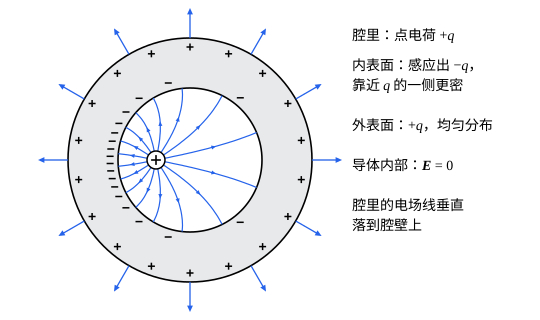

## 这一节要回答的问题

金属里有大量能自由移动的电子。把一块金属放进:term[电场]{id="physics.electromagnetism.electric-field"}（electric field），或者给它带上:term[电荷]{id="physics.electromagnetism.electric-charge"}（electric charge），电子会怎样移动，最后停在哪里？金属壳里面的东西，为什么不受外面电场的影响？

## 讲解

### 导体和静电平衡

金属里每个原子最外层的电子不属于某一个原子，可以在整块金属里自由移动；玻璃、塑料里的电子则被束缚在各自的分子上。在:term[电场]{id="physics.electromagnetism.electric-field"}里，前者会成群地移动，后者不会。

::anchor{id="def-conductor"}
内部有大量能自由移动的:term[电荷]{id="physics.electromagnetism.electric-charge"}的物体，叫作:term[导体]{id="physics.electromagnetism.conductor"}（conductor），例如金属、电解质溶液（electrolyte solution）；电荷几乎不能移动的物体，叫作:term[绝缘体]{id="physics.electromagnetism.insulator"}（insulator），例如玻璃、橡胶、干燥的空气。

为什么这样定义：静电学（electrostatics）里关心的是电荷能不能移动。导体里的电荷会在电场的作用下重新分布，直到电场不再推动它们；绝缘体上的电荷放在哪里就留在哪里。边界情况：半导体（semiconductor）的导电能力介于两者之间；空气平时是绝缘体，电场超过约$3\times10^6\,\mathrm{V/m}$时会被击穿而导电。

::anchor{id="def-electrostatic-equilibrium"}
导体里的电荷不再宏观地移动的状态，叫作:term[静电平衡]{id="physics.electromagnetism.electrostatic-equilibrium"}（electrostatic equilibrium）。

为什么这样定义：导体放进电场，里面的自由电荷先被推动，堆积到某些地方，它们产生的电场抵消外电场，直到导体内部的电荷不再受力；对金属，这个过程极快，下面说的都是达到平衡以后的情形。边界情况：导体里一直有电流的状态，例如接在电池两极上的导线，不是静电平衡，导线里有电场（见[电流与欧姆定律](lesson:physics.electromagnetism.current-density)）。

### 静电平衡的性质

::anchor{id="thm-conductor"}
定理（:term[静电平衡]{id="physics.electromagnetism.electrostatic-equilibrium"}的:term[导体]{id="physics.electromagnetism.conductor"}）：静电平衡时，（1）导体内部的:term[电场]{id="physics.electromagnetism.electric-field"}处处为零；（2）导体内部没有净:term[电荷]{id="physics.electromagnetism.electric-charge"}，净电荷都分布在表面上；（3）整个导体是一个等势体，表面是:term[等势面]{id="physics.electromagnetism.equipotential-surface"}（equipotential surface）；（4）紧贴导体表面的外侧，电场垂直于表面，大小是$\frac{\sigma}{\varepsilon_0}$，$\sigma$是那里的:term[面电荷密度]{id="physics.electromagnetism.charge-density"}（surface charge density）。

证明思路：（1）内部的电场不为零，自由电荷就会受力移动，那就不是平衡。（2）在导体内部任取一个闭合曲面，面上电场为零，由:term[高斯定律]{id="physics.electromagnetism.gauss-law"}（Gauss's law），面内净电荷为零；曲面可以取得任意小，所以内部处处没有净电荷。（3）内部任意两点之间的:term[电势差]{id="physics.electromagnetism.potential-difference"}（potential difference）是电场的曲线积分，电场为零，电势差也为零。（4）表面是等势面，电场垂直于它；取一个跨过表面的扁圆柱面作:term[高斯面]{id="physics.electromagnetism.gaussian-surface"}（Gaussian surface），导体里那一侧电场为零，外侧的:term[电通量]{id="physics.electromagnetism.electric-flux"}（electric flux）是$EA$，等于$\frac{\sigma A}{\varepsilon_0}$。

（4）和无穷大带电平面两侧各$\frac{\sigma}{2\varepsilon_0}$并不矛盾。贴近表面的那一小块电荷，自己在两侧各产生$\frac{\sigma}{2\varepsilon_0}$；导体上其余的电荷在这一点附近又产生$\frac{\sigma}{2\varepsilon_0}$，方向向外。两者在里侧相消，在外侧相加。

### 电荷在表面上怎样分布

一个孤立的:term[导体]{id="physics.electromagnetism.conductor"}球，按对称性，:term[电荷]{id="physics.electromagnetism.electric-charge"}均匀分布在球面上。形状不规则的导体，表面各处的:term[电势]{id="physics.electromagnetism.electric-potential"}（electric potential）相同，曲率大（尖）的地方:term[面电荷密度]{id="physics.electromagnetism.charge-density"}大，那里的:term[电场]{id="physics.electromagnetism.electric-field"}也强（例 1）。电场太强时，尖端周围的空气会被击穿，电荷从尖端漏走，所以要保持高电压的导体都做得又大又圆滑。

### 空腔和静电屏蔽

::anchor{id="thm-cavity"}
定理（空的:term[导体]{id="physics.electromagnetism.conductor"}空腔）：导体里有一个空腔，腔里没有:term[电荷]{id="physics.electromagnetism.electric-charge"}时，:term[静电平衡]{id="physics.electromagnetism.electrostatic-equilibrium"}下腔里的:term[电场]{id="physics.electromagnetism.electric-field"}处处为零，腔的内表面上也没有电荷，不论导体外面有什么电荷和电场。

证明思路：在导体内部取一个包住空腔的闭合曲面，面上电场为零，所以内表面上的净电荷为零。如果内表面上有的地方带正电、有的地方带负电，腔里就会有一条从正电荷出发、终止在负电荷上的:term[电场线]{id="physics.electromagnetism.field-line"}（electric field line），沿它积分，两处的:term[电势]{id="physics.electromagnetism.electric-potential"}不相等；可整个导体是等势体，矛盾（完整的论证见 p5，那里用电势的极值代替电场线）。所以内表面上处处没有电荷，腔里也就没有电场。

::anchor{id="def-shielding"}
导体壳把外面的电场挡在外面，使里面的空腔不受外面电荷的影响，这叫作:term[静电屏蔽]{id="physics.electromagnetism.electrostatic-shielding"}（electrostatic shielding）。

为什么这样定义：这是导体最有用的性质之一，精密的测量仪器装在金属外壳里，就不受外面电场的干扰。1836 年，法拉第（Michael Faraday）做了一个贴满金属箔的房间，让静电起电机（electrostatic generator）在房间外面放电，用验电器（electroscope）查房间的内壁，上面没有电荷。边界情况：金属网也能屏蔽，只要网孔比要保护的东西小得多；反过来，腔里有电荷时，外面就感受得到（下面）。

::anchor{id="def-induced-charge"}
导体在外电场或附近电荷的作用下，自由电荷重新分布，表面上出现的电荷叫作:term[感应电荷]{id="physics.electromagnetism.induced-charge"}（induced charge）。

为什么这样定义：导体整体可以是中性的，表面上却有正有负，这些电荷不是外加的，而是被「感应」出来的，它们的电场正好抵消导体内部的外电场。边界情况：导体接地时，感应电荷可以和大地交换，不再只是正负相等。

腔里放一个电荷$q$，在导体内部取一个包住空腔的闭合曲面，面内净电荷为零，所以腔的内表面带$-q$的感应电荷；导体原来是中性的，外表面就带$+q$。1843 年，法拉第用金属桶做的冰桶实验（ice pail experiment）显示的正是这一点：把带电的金属球放进金属桶里，桶上感应出和球等量的电荷。所以导体壳挡得住外面的电场，却挡不住腔里电荷的电场；要让外面也不受影响，得把壳接地，让外表面的$+q$流走。

## 几何图像

图里是一个中性的:term[导体]{id="physics.electromagnetism.conductor"}球壳的截面，腔里偏离中心放着$+q$。腔里的:term[电场线]{id="physics.electromagnetism.field-line"}从$q$出发，弯过去垂直落到腔壁上（腔壁是:term[等势面]{id="physics.electromagnetism.equipotential-surface"}）；内壁上的:term[感应电荷]{id="physics.electromagnetism.induced-charge"}总共是$-q$，靠近$q$的一侧更密。导体里面没有:term[电场]{id="physics.electromagnetism.electric-field"}；外表面上的$+q$均匀分布，外面的电场和$q$在腔里的哪个位置无关。

## 例题

### 例 1　用细导线连起来的两个导体球

半径$R_1=10\,\mathrm{cm}$和$R_2=2.0\,\mathrm{cm}$的两个:term[导体]{id="physics.electromagnetism.conductor"}球离得很远，用一根细导线连起来，总共带电$24\,\mathrm{nC}$。求两球各带多少电，以及两个球面上的:term[电场]{id="physics.electromagnetism.electric-field"}之比。取$\frac{1}{4\pi\varepsilon_0}=8.988\times10^9\,\mathrm{N\,m^2/C^2}$。

**为什么想到这么做**：连起来以后，两个球和导线是一个导体，:term[电势]{id="physics.electromagnetism.electric-potential"}相等。两球离得很远，各自的电势只由自己的:term[电荷]{id="physics.electromagnetism.electric-charge"}决定，像孤立的导体球，$\varphi_i=\frac{1}{4\pi\varepsilon_0}\frac{Q_i}{R_i}$。

**推导**：$\frac{Q_1}{R_1}=\frac{Q_2}{R_2}$，$Q_1+Q_2=24\,\mathrm{nC}$，得$Q_1=20\,\mathrm{nC}$，$Q_2=4.0\,\mathrm{nC}$：大球分到的电荷多。表面的电场$E_i=\frac{1}{4\pi\varepsilon_0}\frac{Q_i}{R_i^2}=\frac{\varphi}{R_i}$，所以$\frac{E_2}{E_1}=\frac{R_1}{R_2}=5$：$E_1=8.988\times10^9\times\frac{20\times10^{-9}}{0.10^2}\,\mathrm{V/m}\approx1.8\times10^4\,\mathrm{V/m}$，$E_2\approx9.0\times10^4\,\mathrm{V/m}$。小球的电荷少，表面的电场却强，这就是导体尖的地方电场强的道理。

### 例 2　导体球壳中心的点电荷

中性的:term[导体]{id="physics.electromagnetism.conductor"}球壳内半径为$a$、外半径为$b$，中心放一个:term[点电荷]{id="physics.electromagnetism.point-charge"}（point charge）$q>0$。求各处的:term[电场]{id="physics.electromagnetism.electric-field"}，以及球壳的:term[电势]{id="physics.electromagnetism.electric-potential"}（取无穷远为零）。

**为什么想到这么做**：:term[电荷]{id="physics.electromagnetism.electric-charge"}分布球对称，用同心球面作:term[高斯面]{id="physics.electromagnetism.gaussian-surface"}；先由导体内部电场为零定出两个表面上的电荷。

**推导**：在球壳内部（$a<r<b$）取同心球面，面上电场为零，面内净电荷为零，所以内表面带$-q$；球壳中性，外表面带$+q$，都均匀分布。由球对称的定理：$r<a$时$E=\frac{1}{4\pi\varepsilon_0}\frac{q}{r^2}$，$a<r<b$时$E=0$，$r>b$时$E=\frac{1}{4\pi\varepsilon_0}\frac{q}{r^2}$。从无穷远积分到外表面，球壳的电势是$\frac{1}{4\pi\varepsilon_0}\frac qb$，整个球壳都是这个电势。

## 常见误区

- 「:term[导体]{id="physics.electromagnetism.conductor"}里面:term[电场]{id="physics.electromagnetism.electric-field"}为零，是因为里面没有:term[电荷]{id="physics.electromagnetism.electric-charge"}。」导体里有大量正负电荷，只是净电荷为零；电场为零是自由电荷重新分布的结果。
- 「导体表面上的电荷总是均匀分布的。」只有孤立的导体球才是均匀的；尖的地方电荷更密（例 1）。
- 「导体壳能挡住一切，腔里放电荷，外面也感觉不到。」外表面会带上等量的电荷，外面照样有电场；要挡住，得把壳接地。
- 「导体是等势体，所以它的:term[电势]{id="physics.electromagnetism.electric-potential"}是零。」导体上各处电势相同，但这个值不一定是零。
