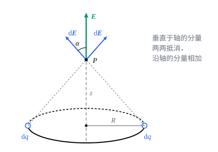

## 这一节要回答的问题

一根摩擦过的塑料尺、一个均匀带电的金属圆环，:term[电荷]{id="physics.electromagnetism.electric-charge"}（electric charge）连续地分布在一块地方，不能看成一个:term[点电荷]{id="physics.electromagnetism.point-charge"}（point charge）。它们的:term[电场]{id="physics.electromagnetism.electric-field"}（electric field）怎样算？离得很近和离得很远时，结果各像什么？

## 讲解

### 电荷密度

宏观的带电体上有极多的电子，像质量一样，:term[电荷]{id="physics.electromagnetism.electric-charge"}可以看成连续分布的。要描述它，就要说清每一小块上有多少电荷。

::anchor{id="def-charge-density"}
电荷连续分布时，每一小块上有多少电荷，由:term[电荷密度]{id="physics.electromagnetism.charge-density"}（charge density）描述：沿一条线分布时，长为$\dd l$的一小段上的电荷是$\dd q=\lambda\,\dd l$，$\lambda$叫作线电荷密度（linear charge density）；分布在一个面上时$\dd q=\sigma\,\dd a$，$\sigma$叫作面电荷密度（surface charge density）；分布在一块体积里时$\dd q=\rho\,\dd V$，$\rho$叫作体电荷密度（volume charge density）。它们的单位分别是$\mathrm{C/m}$、$\mathrm{C/m^2}$、$\mathrm{C/m^3}$。

为什么这样定义：这和质量的线密度、体密度是同一个想法。把带电体分成许多小块，每一块小到可以看成:term[点电荷]{id="physics.electromagnetism.point-charge"}，又大到里面有许多电子，电荷就可以当作连续函数来积分。边界情况：均匀带电时密度是常数，例如长为$L$、带电$Q$的细棒，$\lambda=\frac QL$；密度可以有正有负，一根棒的两半可以带异号的电荷。

### 用积分求电场

::anchor{id="thm-continuous-field"}
定理（连续分布:term[电荷]{id="physics.electromagnetism.electric-charge"}的:term[电场]{id="physics.electromagnetism.electric-field"}）：电荷连续分布时，$\vb r$处的电场是$\vb E(\vb r)=\frac{1}{4\pi\varepsilon_0}\int\frac{\vb r-\vb r'}{|\vb r-\vb r'|^3}\,\dd q$，其中$\dd q$是$\vb r'$处一小块的电荷（$\lambda\,\dd l$、$\sigma\,\dd a$或$\rho\,\dd V$），积分遍及所有电荷。

证明思路：每一小块看成:term[点电荷]{id="physics.electromagnetism.point-charge"}，它的电场由点电荷的公式给出；按:term[叠加原理]{id="physics.electromagnetism.superposition-principle"}（superposition principle），总电场是所有小块的电场的矢量和。小块分得越来越细，和就成了积分。

这个积分是矢量的积分，要按分量算，例如$E_x=\frac{1}{4\pi\varepsilon_0}\int\frac{x-x'}{|\vb r-\vb r'|^3}\,\dd q$。动手之前先看对称性：如果电荷分布绕某条轴对称，场点又在轴上，每一小块都有一块对着它的，两者的电场垂直于轴的分量抵消，只要算沿轴的分量。

::anchor{id="thm-ring"}
定理（均匀带电圆环轴线上的电场）：半径为$R$、均匀带电$Q$的细圆环，在它的轴上离环心$z$处的电场沿着轴，$E_z=\frac{1}{4\pi\varepsilon_0}\frac{Qz}{(z^2+R^2)^{3/2}}$。

证明思路：环上每一小段到场点的距离都是$\sqrt{z^2+R^2}$，它的电场和轴的夹角$\alpha$满足$\cos\alpha=\frac{z}{\sqrt{z^2+R^2}}$。按对称性只要把沿轴的分量加起来：$E_z=\frac{1}{4\pi\varepsilon_0}\int\frac{\cos\alpha}{z^2+R^2}\,\dd q$，被积式对每一小段都一样，积出来就是乘上$Q$。

两头的情况可以核对一下：$z=0$（环心）时电场为零，各小段的电场两两抵消；$z\gg R$时$E_z\approx\frac{1}{4\pi\varepsilon_0}\frac{Q}{z^2}$，远处的圆环像一个点电荷。

## 几何图像

圆环上任取一小段，总有一段和它关于轴对称；两者在轴上$P$点的:term[电场]{id="physics.electromagnetism.electric-field"}大小相同、和轴的夹角相同，合起来只剩沿轴的分量。整个圆环的电场就是这些沿轴分量之和。

:::anim{component="function-plot"}
range: { x: [0, 8], y: [0, 1.1] }
functions:
  - expr: "1 - x/sqrt(x^2 + R^2)"
    label: |
      均匀带电的圆盘
  - expr: "R^2/(2*x^2)"
    label: |
      电荷相同的点电荷
  - expr: "1"
    label: |
      无穷大的平面
sliders:
  - name: R
    min: 0.5
    max: 2
    step: 0.25
    default: 1
    label: |
      圆盘的半径$R$
:::

动画画的是例 2 的圆盘轴线上的电场，纵轴以$\frac{\sigma}{2\varepsilon_0}$为单位，横轴是到盘心的距离$z$，图上写作$x$。离盘很近时，圆盘的电场接近无穷大平面的值；离盘比$R$远得多时，它和:term[电荷]{id="physics.electromagnetism.electric-charge"}相同的:term[点电荷]{id="physics.electromagnetism.point-charge"}的电场几乎重合。圆盘越大，「像平面」的那一段越长。

## 例题

### 例 1　有限长的均匀带电细棒

长为$2L$、:term[线电荷密度]{id="physics.electromagnetism.charge-density"}为$\lambda>0$的均匀带电细棒，求它的中垂线上离棒$s$处的:term[电场]{id="physics.electromagnetism.electric-field"}；再看$L\to\infty$的极限。

**为什么想到这么做**：取棒的中点为原点、棒沿$x$轴，$x$处长为$\dd x$的一小段带电$\lambda\,\dd x$。$x$和$-x$两小段关于中垂线对称，沿棒方向的分量抵消，只要算垂直于棒的分量。

**推导**：一小段到场点的距离是$\sqrt{s^2+x^2}$，它的电场垂直于棒的分量是$\frac{1}{4\pi\varepsilon_0}\frac{\lambda s\,\dd x}{(s^2+x^2)^{3/2}}$。$\frac{x}{s^2\sqrt{s^2+x^2}}$对$x$求导正好是$\frac{1}{(s^2+x^2)^{3/2}}$，所以$E=\frac{\lambda s}{4\pi\varepsilon_0}\Bigl[\frac{x}{s^2\sqrt{s^2+x^2}}\Bigr]_{-L}^{L}=\frac{1}{4\pi\varepsilon_0}\frac{2\lambda L}{s\sqrt{s^2+L^2}}$，方向垂直于棒、背离它。$L\to\infty$时$E\to\frac{\lambda}{2\pi\varepsilon_0s}$，无限长的带电直线的电场和距离成反比；反过来$s\gg L$时$E\approx\frac{1}{4\pi\varepsilon_0}\frac{2\lambda L}{s^2}$，正是:term[电荷]{id="physics.electromagnetism.electric-charge"}$2\lambda L$的:term[点电荷]{id="physics.electromagnetism.point-charge"}的电场。

### 例 2　均匀带电圆盘的轴线上

半径为$R$、:term[面电荷密度]{id="physics.electromagnetism.charge-density"}为$\sigma>0$的均匀带电薄圆盘，求它的轴上离盘心$z$处（$z>0$）的:term[电场]{id="physics.electromagnetism.electric-field"}；再看$R\to\infty$的极限。

**为什么想到这么做**：圆盘可以看成一圈圈同心的细圆环，每个圆环轴线上的电场已经知道，而且都沿着轴，直接相加就行。

**推导**：半径为$s$、宽为$\dd s$的圆环面积约为$2\pi s\,\dd s$，带电$\dd q=2\pi\sigma s\,\dd s$，由圆环的结果，它在$z$处的电场是$\frac{1}{4\pi\varepsilon_0}\frac{2\pi\sigma sz\,\dd s}{(z^2+s^2)^{3/2}}$。从$0$积到$R$，$\frac{s}{(z^2+s^2)^{3/2}}$的原函数是$-\frac{1}{\sqrt{z^2+s^2}}$，得$E=\frac{\sigma}{2\varepsilon_0}\Bigl(1-\frac{z}{\sqrt{z^2+R^2}}\Bigr)$，沿轴背离圆盘。$R\to\infty$时$E\to\frac{\sigma}{2\varepsilon_0}$，无穷大的均匀带电平面两侧的电场和到平面的距离无关（为什么会这样，见 p7）。

## 常见误区

- 「把每一小块:term[电场]{id="physics.electromagnetism.electric-field"}的大小加起来，就是总电场的大小。」电场是矢量，要按分量相加；方向不同的小块会互相抵消。
- 「无限长的带电直线的电场和距离的平方成反比。」它和距离的一次方成反比（例 1）；只有离得比线长远得多时，才像:term[点电荷]{id="physics.electromagnetism.point-charge"}那样随距离的平方衰减。
- 「圆环中心离:term[电荷]{id="physics.electromagnetism.electric-charge"}最近，那里的电场最强。」中心的电场是零，各小段的电场在那里两两抵消。
- 「无穷大平面的电场是$\frac{\sigma}{\varepsilon_0}$。」带电平面两侧各有$\frac{\sigma}{2\varepsilon_0}$，方向都背离平面（$\sigma>0$）。
