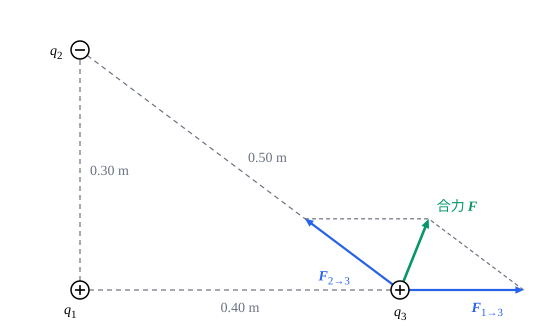

## 这一节要回答的问题

用丝绸摩擦过的玻璃棒能吸起碎纸屑，两根这样的玻璃棒挂起来会互相推开。这种力是怎么来的？它和距离有什么关系？三个以上的带电体放在一起时，每一个受的力又怎样算？

## 讲解

### 电荷

摩擦过的物体能吸引轻小的物体，这时说它带了电。实验发现带电的物体只有两类：同类的互相排斥，异类的互相吸引。富兰克林（Benjamin Franklin）用正、负来区分这两类，现在约定丝绸摩擦过的玻璃棒带正电。原子里的质子带正电，电子带负电，物体带电是因为它的电子多了或少了。

::anchor{id="def-electric-charge"}
物体带电的多少和正负用一个带符号的数$q$表示，叫作它带的:term[电荷]{id="physics.electromagnetism.electric-charge"}（electric charge），也叫电荷量；$q>0$时说它带正电，$q<0$时带负电。电荷的单位是库仑（coulomb），记作$\mathrm C$。

为什么这样定义：两类电可以互相抵消，带等量正电和负电的两个物体放在一起，对外就不显电性，所以用正负号把它们放进同一个数里，抵消就是相加。边界情况：电荷为零的物体并不是里面没有电荷，而是正负电荷一样多；它照样会被带电体吸引（见常见误区）。

::anchor{id="def-elementary-charge"}
实验测得，任何带电体的电荷都是$e=1.602176634\times10^{-19}\,\mathrm C$的整数倍：质子的电荷是$e$，电子的是$-e$。$e$叫作:term[元电荷]{id="physics.electromagnetism.elementary-charge"}（elementary charge），电荷只能取它的整数倍，这叫作电荷的量子化（charge quantization）。

为什么这样定义：$e$是能单独存在的最小的电荷，拿它作单位，带电体的电荷就是数出来的电子数。2019 年起，国际单位制（SI）把$e$定为精确值，库仑反过来由它定义。边界情况：夸克（quark）带$\pm\frac13e$、$\pm\frac23e$的电荷，但从来没有单独出现过；宏观的带电体，$1\,\mathrm{nC}$里就有约$6\times10^9$个$e$，电荷看起来是连续的。

1909 年起，密立根（Robert Millikan）用带电的小油滴测量$e$，1913 年发表了主要结果。他得到的值是$1.592\times10^{-19}\,\mathrm C$，比现在的值小约 0.6%。

::anchor{id="def-charge-conservation"}
和外界没有电荷交换的系统，正负电荷的代数和保持不变，这叫作:term[电荷守恒]{id="physics.electromagnetism.charge-conservation"}（conservation of charge）。

为什么这样定义：摩擦起电（triboelectric effect）只是把电子从一个物体搬到另一个物体上，两者带上等量异号的电荷。即使有粒子产生或消失，守恒也成立：一个高能的光子（photon）在原子核附近可以变成一个电子和一个正电子（positron），两者的电荷加起来是零。边界情况：守恒的是代数和，正电荷、负电荷各自的多少可以变。

::anchor{id="def-point-charge"}
带电体的大小比它到其他带电体的距离小得多时，可以把它看成一个带电的点，叫作:term[点电荷]{id="physics.electromagnetism.point-charge"}（point charge）。

为什么这样定义：和力学里的质点一样，这时带电体的形状、电荷在上面怎样分布都无关紧要，只用位置和电荷两个量描述。边界情况：两个半径$1\,\mathrm{mm}$的带电小球相距$1\,\mathrm m$时可以看成点电荷，相距$3\,\mathrm{mm}$时就不行，小球上各处到对方的距离差别太大。

### 库仑定律

1785 年，库仑（Charles-Augustin de Coulomb）用扭秤（torsion balance）测量两个带同号:term[电荷]{id="physics.electromagnetism.electric-charge"}的小球之间的斥力：悬丝扭得越厉害，扭回来的作用越强，由扭转的角度就能读出斥力的大小。他在法国科学院（Académie Royale des Sciences）的论文集里报告，三次测量表明斥力和距离的平方成反比。在他之前，普里斯特利（Joseph Priestley）1767 年由「带电金属杯里的小球不受电力」，和万有引力（gravitation）类比，推测过这个规律；卡文迪什（Henry Cavendish）在 1770 年代初也得出了它，但没有发表。

::anchor{id="def-coulomb-law"}
:term[库仑定律]{id="physics.electromagnetism.coulomb-law"}（Coulomb's law）：真空中两个静止的:term[点电荷]{id="physics.electromagnetism.point-charge"}，$q_1$在$\vb r_1$处，$q_2$在$\vb r_2$处，$q_1$对$q_2$的作用力是$\vb F_{1\to2}=\frac{1}{4\pi\varepsilon_0}\frac{q_1q_2}{|\vb r_2-\vb r_1|^3}(\vb r_2-\vb r_1)$；其中$\varepsilon_0=8.8541878188\times10^{-12}\,\mathrm{C^2/(N\,m^2)}$是一个常量，叫作:term[真空介电常量]{id="physics.electromagnetism.permittivity"}（vacuum permittivity）。

为什么写成这样：$\vb r_2-\vb r_1$除以它的长度，是从$q_1$指向$q_2$的单位矢量，所以力的大小是$F=\frac{1}{4\pi\varepsilon_0}\frac{|q_1q_2|}{r^2}$（$r$是两个电荷的距离），方向沿两者的连线：$q_1q_2>0$时是斥力，$q_1q_2<0$时是引力。交换 1 和 2，力反向、大小不变，这正是牛顿第三定律（Newton's third law）。系数写成$\frac{1}{4\pi\varepsilon_0}$而不是一个简单的常数，是为了让以后的:term[高斯定律]{id="physics.electromagnetism.gauss-law"}（Gauss's law）里不出现$4\pi$；它的值约为$8.988\times10^9\,\mathrm{N\,m^2/C^2}$。

边界情况：库仑定律只对静止的点电荷成立。电荷运动时，它们之间还有磁力（见[磁场与洛伦兹力](lesson:physics.electromagnetism.lorentz-force)）；带电体不能看成点电荷时，要把它分成许多小块，再把各块的力加起来（见[连续分布电荷的电场](lesson:physics.electromagnetism.continuous-charge)）。

平方反比这一点检验得极其精确。卡文迪什估计，指数和$2$相差超过$\frac{1}{50}$就会被他察觉；1877 年，麦卡利斯特（Donald MacAlister）用麦克斯韦（James Clerk Maxwell）设计的装置重做这个实验，把界缩小到$\frac{1}{21600}$。

### 叠加原理

三个:term[点电荷]{id="physics.electromagnetism.point-charge"}放在一起时，$q_3$同时受$q_1$和$q_2$的力。实验表明，$q_1$对$q_3$的力不因为旁边多了$q_2$而改变。

::anchor{id="def-superposition"}
几个点电荷同时作用在点电荷$q$上时，$q$受的力等于每个:term[电荷]{id="physics.electromagnetism.electric-charge"}单独存在时对$q$的库仑力的矢量和：$\vb F=\sum_i\vb F_{i\to q}$。这叫作:term[叠加原理]{id="physics.electromagnetism.superposition-principle"}（superposition principle）。

为什么这样定义：有了它，任意多个点电荷之间的力都能由两两之间的:term[库仑定律]{id="physics.electromagnetism.coulomb-law"}算出来，两者合起来就是静电学（electrostatics）的出发点。叠加原理也是实验事实，不能由库仑定律推出来。边界情况：电荷能在带电体上移动时，旁边多了一个电荷，原来的电荷会重新分布，这时「单独存在时的力」要按重新分布以后的电荷来算。

## 几何图像

图里是例 1 的三个:term[点电荷]{id="physics.electromagnetism.point-charge"}。$q_3$受的两个力分别由:term[库仑定律]{id="physics.electromagnetism.coulomb-law"}算出，按平行四边形相加，对角线就是合力；箭头的长短按力的大小画。合力既不沿$q_1$到$q_3$的连线，也不沿$q_2$到$q_3$的连线，要按分量算才定得下来。

## 例题

### 例 1　平面上三个点电荷的合力

$q_1=+2.0\,\mu\mathrm C$在原点，$q_2=-3.0\,\mu\mathrm C$在$(0,\,0.30\,\mathrm m)$，$q_3=+1.0\,\mu\mathrm C$在$(0.40\,\mathrm m,\,0)$。求$q_3$受的合力，取$\frac{1}{4\pi\varepsilon_0}=8.988\times10^9\,\mathrm{N\,m^2/C^2}$。

**为什么想到这么做**：按:term[叠加原理]{id="physics.electromagnetism.superposition-principle"}，先用:term[库仑定律]{id="physics.electromagnetism.coulomb-law"}分别求出$q_1$、$q_2$对$q_3$的力，再把两个矢量按分量相加。两个力不在一条直线上，直接把大小相加是错的。

**推导**：$q_1$、$q_3$相距$0.40\,\mathrm m$，$F_{1\to3}=8.988\times10^9\times\frac{2.0\times10^{-6}\times1.0\times10^{-6}}{0.40^2}\,\mathrm N\approx0.112\,\mathrm N$，同号相斥，沿$+x$方向。$q_2$、$q_3$相距$\sqrt{0.30^2+0.40^2}\,\mathrm m=0.50\,\mathrm m$，$F_{2\to3}=8.988\times10^9\times\frac{3.0\times10^{-6}\times1.0\times10^{-6}}{0.50^2}\,\mathrm N\approx0.108\,\mathrm N$，异号相吸，方向从$q_3$指向$q_2$，单位矢量是$(-0.80,\,0.60)$。合力$\vb F\approx(0.112-0.0863,\ 0.0647)\,\mathrm N\approx(0.0261,\ 0.0647)\,\mathrm N$，大小约$0.0698\,\mathrm N$，和$+x$轴成约$68^\circ$。

### 例 2　放在哪里不受力

$+q$在$x=0$处，$+4q$在$x=d$处，$q>0$。第三个:term[点电荷]{id="physics.electromagnetism.point-charge"}$Q$放在$x$轴上什么地方，受的合力为零？结果和$Q$的正负、大小有没有关系？

**为什么想到这么做**：合力为零，两个力要大小相等、方向相反。在两个:term[电荷]{id="physics.electromagnetism.electric-charge"}的外侧，两个力同向（都推开或都拉近），不可能抵消，所以$Q$只能在两者之间。

**推导**：设$Q$在$x$处，$0<x<d$。两个力大小相等：$\frac{1}{4\pi\varepsilon_0}\frac{q|Q|}{x^2}=\frac{1}{4\pi\varepsilon_0}\frac{4q|Q|}{(d-x)^2}$，得$(d-x)^2=4x^2$，即$d-x=2x$，$x=\frac d3$。$|Q|$在两边约掉了，结果和$Q$的正负、大小都无关：离电荷小的那个近一些，近的距离正好补上电荷的差别。

## 常见误区

- 「:term[电荷]{id="physics.electromagnetism.electric-charge"}大的那个受力大。」两个:term[点电荷]{id="physics.electromagnetism.point-charge"}受的力大小相等、方向相反，和它们各自的电荷大小无关（牛顿第三定律）。
- 「不带电的物体不受电力。」带电的梳子能吸起碎纸屑：纸里的电荷被推开一点，靠近梳子的一侧带上异号电荷，吸引比排斥强（见[电偶极子](lesson:physics.electromagnetism.electric-dipole)）。
- 「两个带电的小球，:term[库仑定律]{id="physics.electromagnetism.coulomb-law"}里的距离取球心距离就行。」只有能看成点电荷时才行；靠得很近的两个带电体，各处到对方的距离差别大，要分成小块计算。
- 「库仑定律对运动的电荷也成立。」它只管静止的电荷，运动的电荷之间还有磁力。
