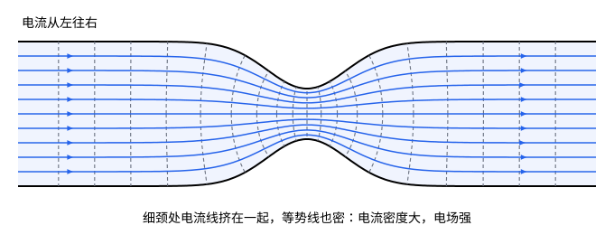

## 这一节要回答的问题

到目前为止，:term[电荷]{id="physics.electromagnetism.electric-charge"}（electric charge）都是静止的。把一根金属导线接到电池的两极，导线里的电荷会持续地流动：怎样描述各处的电荷往哪里流、流得多快？:term[电荷守恒]{id="physics.electromagnetism.charge-conservation"}（conservation of charge）在每一点上怎样写？是什么推动导线里的电荷，流得多快又由什么决定？

## 讲解

### 电流与电流密度

1800 年，伏打（Alessandro Volta）把锌片、铜片和浸了盐水的布片一层层叠起来，做成电堆（voltaic pile），第一次得到了持续流动的:term[电荷]{id="physics.electromagnetism.electric-charge"}。电荷在导线里流动，很像水在管子里流动：要描述的是每秒有多少电荷穿过某个截面，以及各处的电荷往哪个方向流。

::anchor{id="def-current"}
单位时间里穿过一个曲面的:term[电荷]{id="physics.electromagnetism.electric-charge"}，叫作穿过这个曲面的:term[电流]{id="physics.electromagnetism.electric-current"}（electric current）：$I=\dv Qt$，其中$\dd Q$是$\dd t$时间里沿选定的方向穿过曲面的电荷，反方向穿过的算负的。电流的单位是安培（ampere），记作$\mathrm A$，$1\,\mathrm A=1\,\mathrm{C/s}$。

为什么这样定义：正电荷向右穿过和负电荷向左穿过，都使右边的电荷增加，按定义给出同号的电流。所以电流是一个有正负的数，正负只表示相对于选定方向的流向；平常说的「电流的方向」，指正电荷流动的方向。边界情况：电荷的流动不一定在金属导线里，电子束、离子束都是电流；电解液里正离子和负离子朝相反方向移动，两者的电流同号，要加起来。

2019 年起，国际单位制（SI）直接把:term[元电荷]{id="physics.electromagnetism.elementary-charge"}（elementary charge）规定为$e=1.602176634\times10^{-19}\,\mathrm C$，安培就由它定义：$1\,\mathrm A$是每秒流过约$6.24\times10^{18}$个元电荷。

::anchor{id="def-current-density"}
:term[电流密度]{id="physics.electromagnetism.current-density"}（current density）是一个矢量场$\vb J$：在每一点，它的方向是那里正电荷流动的方向，大小是穿过与这个方向垂直的单位面积的:term[电流]{id="physics.electromagnetism.electric-current"}，单位是$\mathrm{A/m^2}$。穿过任一曲面$S$的电流是$I=\int_S\vb J\cdot\dd\vb a$。电流只在一层很薄的表面上流动时，改用面电流密度（surface current density）$\vb K$，它的大小是穿过表面上与流向垂直的单位长度的电流，单位是$\mathrm{A/m}$。

为什么这样定义：电流只说明穿过一个截面的总量，电流密度还说明它在截面上怎样分布。电流在导线的横截面上可以不均匀（见几何图像）；在大块的:term[导体]{id="physics.electromagnetism.conductor"}（conductor）里，例如大地里，电流还会朝各个方向散开，这时只有电流密度能描述它。$\int_S\vb J\cdot\dd\vb a$是$\vb J$穿过$S$的通量（flux）：面元斜着放时，只有$\vb J$垂直于它的分量把电荷送过去。

::anchor{id="thm-drift"}
定理（电流密度与粒子的运动）：每单位体积里有$n$个能移动的带电粒子，叫作:term[载流子]{id="physics.electromagnetism.charge-carrier"}（charge carrier），每个带电$q$，它们的平均速度$\vb v_{\mathrm d}$叫作:term[漂移速度]{id="physics.electromagnetism.drift-velocity"}（drift velocity），那么$\vb J=nq\vb v_{\mathrm d}$；有几种载流子时，把各自的$nq\vb v_{\mathrm d}$加起来。

证明思路：先设每个载流子的速度都是$\vb v$。$\dd t$时间里穿过面元$\dd\vb a$的，正是以$\dd\vb a$为底、以$\vb v\,\dd t$为斜棱的小柱体里的载流子，柱体的体积是$\vb v\cdot\dd\vb a\,\dd t$，所以穿过的电荷是$nq\vb v\cdot\dd\vb a\,\dd t$，电流密度是$nq\vb v$。速度各不相同时，按速度分组，各组分别这样算再相加，结果是$q$乘以各组的$n\vb v$之和，也就是$nq\vb v_{\mathrm d}$：杂乱的热运动平均起来抵消，只剩下漂移速度。

对一种载流子，$nq$就是它的:term[电荷密度]{id="physics.electromagnetism.charge-density"}（charge density）$\rho$，$\vb J=\rho\vb v_{\mathrm d}$；狭义相对论的[四维电流](lesson:physics.special-relativity.covariant-maxwell#def-four-current)（four-current）就是用这个式子定义的。金属里能移动的是电子，$q=-e$，$\vb v_{\mathrm d}$和$\vb J$方向相反。

### 连续性方程

:term[电荷守恒]{id="physics.electromagnetism.charge-conservation"}说，和外界没有:term[电荷]{id="physics.electromagnetism.electric-charge"}交换的系统，正负电荷的代数和不变。实验表明它在每一处都成立：电荷不会在一处消失、同时在远处出现，一块区域里的电荷减少了，一定是从这块区域的边界流了出去。

::anchor{id="thm-continuity"}
定理（:term[连续性方程]{id="physics.electromagnetism.continuity-equation"}，continuity equation）：对任一固定的闭合曲面$S$和它包围的区域$V$，$\oint_S\vb J\cdot\dd\vb a=-\dv{}{t}\int_V\rho\,\dd V$，$\dd\vb a$朝外；$\rho$、$\pdv\rho t$和$\vb J$的一阶偏导数都连续时，这等价于$\pdv\rho t+\divg\vb J=0$。

证明思路：左边是每秒从$V$流出的净电荷，右边是$V$里的电荷每秒减少的量，两者相等，正是电荷守恒在这块区域上的说法。用高斯公式（divergence theorem）把左边写成$\int_V\divg\vb J\,\dd V$；$V$固定、$\pdv\rho t$连续，求导可以移进积分号（[积分号下求导](lesson:math.analysis.parameter-integrals#thm-leibniz-rule)在有界区域上的直接推广），于是$\int_V\bigl(\pdv\rho t+\divg\vb J\bigr)\dd V=0$。假如某点处括号里的量不为零，它连续，在这点周围一个小球里同号，取$V$为这个小球，积分就不为零，矛盾；所以它处处为零。反过来，把微分形式在$V$上积分，就回到积分形式。

名字来自流体力学：流体的密度和流速满足同样形式的方程，说的是质量守恒。$\divg\vb J$是单位体积每秒流出的电荷，方程说它恰好等于那里:term[电荷密度]{id="physics.electromagnetism.charge-density"}减少的速率。

::anchor{id="def-steady-current"}
各处的:term[电流密度]{id="physics.electromagnetism.current-density"}和:term[电荷密度]{id="physics.electromagnetism.charge-density"}都不随时间变化时，:term[电流]{id="physics.electromagnetism.electric-current"}叫作:term[恒定电流]{id="physics.electromagnetism.steady-current"}（steady current）。这时连续性方程给出$\divg\vb J=0$：穿过任一闭合曲面的净电流为零，流进多少就流出多少。

为什么这样定义：电池接通后极短的时间里，导线各处的电流就稳定下来，以后的直流电路和:term[静磁场]{id="physics.electromagnetism.magnetic-field"}（magnetostatic field）说的都是这种情形。用一段导线的两个横截面和它们之间的侧面围成闭合曲面，侧面没有电流穿过，所以穿过两个横截面的电流相同，「导线里的电流」才有确定的值。边界情况：给:term[电容器]{id="physics.electromagnetism.capacitor"}（capacitor）充电时，极板上的电荷在增加，穿过包住一个极板的闭合曲面的净电流不为零，这不是恒定电流。

### 欧姆定律

[静电平衡](lesson:physics.electromagnetism.conductors#def-electrostatic-equilibrium)时，:term[导体]{id="physics.electromagnetism.conductor"}内部没有:term[电场]{id="physics.electromagnetism.electric-field"}（electric field），:term[电荷]{id="physics.electromagnetism.electric-charge"}也不动。导线接到电池两极上，电池让两端一直保持:term[电势差]{id="physics.electromagnetism.potential-difference"}（potential difference），导线里就一直有电场推动电荷，这不是:term[静电平衡]{id="physics.electromagnetism.electrostatic-equilibrium"}（electrostatic equilibrium）。电场越强，:term[电流密度]{id="physics.electromagnetism.current-density"}越大；对许多材料，两者成正比。1827 年，欧姆（Georg Simon Ohm）在《伽伐尼电路的数学研究》（Die galvanische Kette, mathematisch bearbeitet）一书里系统地给出了这条规律，写法和今天的不同。

::anchor{id="def-ohm"}
对许多导体，温度一定时电流密度和电场成正比：$\vb J=\sigma\vb E$。这叫作:term[欧姆定律]{id="physics.electromagnetism.ohms-law"}（Ohm's law），比例系数$\sigma$叫作这种材料的:term[电导率]{id="physics.electromagnetism.conductivity"}（electrical conductivity），单位是西门子每米（$\mathrm{S/m}$，$1\,\mathrm S=1\,\mathrm{A/V}$）。

为什么这样定义：$\vb J=\sigma\vb E$不是像:term[库仑定律]{id="physics.electromagnetism.coulomb-law"}（Coulomb's law）那样的基本规律，而是许多材料的性质，和[线性电介质](lesson:physics.electromagnetism.electric-displacement#def-linear-dielectric)里:term[极化强度]{id="physics.electromagnetism.polarization"}（polarization density）和电场成正比是同一类说法。金属、电解液在很大的范围里满足它；半导体二极管、气体放电管里:term[电流]{id="physics.electromagnetism.electric-current"}和电场不成正比，不满足欧姆定律。$20\,^\circ\mathrm C$时铜的电导率约为$5.96\times10^7\,\mathrm{S/m}$，是最好的导体之一。

电场对每个电子都施力，为什么电子不越跑越快、电流不越来越大？1900 年德鲁德（Paul Drude）给出的图像是：电子在电场里加速，又不断和晶格（lattice）的振动、杂质碰撞，每次碰撞后速度的方向变得杂乱，定向的速度从零重新积累。设平均每隔时间$\tau$碰撞一次，定向速度平均积累到$\frac{q\vb E}{m}\tau$，所以$\vb v_{\mathrm d}=\frac{q\tau}{m}\vb E$。

于是$\vb J=nq\vb v_{\mathrm d}=\frac{nq^2\tau}{m}\vb E$，电导率$\sigma=\frac{nq^2\tau}{m}$和电场无关，这就是欧姆定律。对铜，由$\sigma$和例 1 算出的$n$得$\tau\approx2.5\times10^{-14}\,\mathrm s$。

::anchor{id="def-resistance"}
电流$I$从一段导体的一端$a$流进、另一端$b$流出，两端的:term[电势差]{id="physics.electromagnetism.potential-difference"}$\varphi_a-\varphi_b$与$I$之比$R=\frac{\varphi_a-\varphi_b}{I}$，叫作这段导体的:term[电阻]{id="physics.electromagnetism.resistance"}（resistance），单位是欧姆（ohm），记作$\Omega$，$1\,\Omega=1\,\mathrm{V/A}$。

为什么这样定义：导体满足欧姆定律时，$R$和电流的大小无关。把各处的电场都乘以$2$，电流密度也都乘以$2$，仍然满足$\divg\vb J=0$和侧面上没有电流穿出的条件，于是电流和电势差同时加倍；$R$只由导体的形状、大小和材料决定，就像[电容](lesson:physics.electromagnetism.capacitors#def-capacitor)和:term[电容器]{id="physics.electromagnetism.capacitor"}带多少电荷无关一样。边界情况：灯丝的电阻随温度升高而变大，电流越大灯丝越热，这时$\varphi_a-\varphi_b$和$I$不成正比，但每个时刻仍可以用这个比值定义电阻。

::anchor{id="thm-wire-resistance"}
定理（均匀导线的电阻）：长为$L$、横截面积为$A$的均匀直导线，:term[电导率]{id="physics.electromagnetism.conductivity"}为$\sigma$，电流沿导线流动时，:term[电阻]{id="physics.electromagnetism.resistance"}是$R=\frac{L}{\sigma A}$；$\frac1\sigma$叫作这种材料的:term[电阻率]{id="physics.electromagnetism.resistivity"}（resistivity），单位是$\Omega\,\mathrm m$。

证明思路：导线均匀，电流均匀分布在横截面上，$J=\frac IA$；电场沿着导线，大小$E=\frac J\sigma=\frac{I}{\sigma A}$，处处相同。沿导线从$a$积到$b$，$\varphi_a-\varphi_b=EL=\frac{IL}{\sigma A}$，除以$I$即得。电阻和长度成正比、和横截面积成反比，这正是欧姆在实验里看到的。

::anchor{id="thm-joule"}
定理（:term[焦耳热]{id="physics.electromagnetism.joule-heating"}，Joule heating）：电流通过导体时，电场每秒对单位体积里的:term[载流子]{id="physics.electromagnetism.charge-carrier"}做功$\vb J\cdot\vb E$，满足欧姆定律时它是$\sigma E^2$。对一段电阻为$R$、通过电流$I$的导体，电场每秒做功$P=I(\varphi_a-\varphi_b)=I^2R$。这些功不使载流子越跑越快，而是在碰撞中交给晶格，变成导体的内能，导体发热。

证明思路：一个载流子受力$q\vb E$，每秒做功$q\vb E\cdot\vb v$；对单位体积里的所有载流子求和，得$nq\vb v_{\mathrm d}\cdot\vb E=\vb J\cdot\vb E$。对均匀导线，乘以体积$AL$得$\frac IA\cdot\frac{I}{\sigma A}\cdot AL=I^2R$。也可以这样看：每秒有电荷$I$从$a$移到$b$，:term[电势能]{id="physics.electromagnetism.potential-energy"}（electric potential energy）减少$I(\varphi_a-\varphi_b)$。焦耳（James Prescott Joule）在 1841 年发表的实验里测出，导线放出的热和电流的平方成正比。

## 几何图像

图里是一块厚度均匀、中间有一段细颈的:term[导体]{id="physics.electromagnetism.conductor"}薄片，:term[电流]{id="physics.electromagnetism.electric-current"}从左往右流。实线是电流线（current line），处处和:term[电流密度]{id="physics.electromagnetism.current-density"}相切，相邻两条之间的:term[电流]{id="physics.electromagnetism.electric-current"}都是总电流的十分之一；虚线是:term[等势面]{id="physics.electromagnetism.equipotential-surface"}（equipotential surface）与纸面的交线，相邻两条的:term[电势差]{id="physics.electromagnetism.potential-difference"}相等。两组曲线是用计算机数值求解后画出的：:term[恒定电流]{id="physics.electromagnetism.steady-current"}时$\divg\vb J=0$，:term[欧姆定律]{id="physics.electromagnetism.ohms-law"}给出$\vb E=\frac{\vb J}{\sigma}$，绝缘的边界上没有电流穿出。

远离细颈的地方，电流线均匀分布，等势线是等距的竖线，和均匀导线一样。细颈处电流线挤在一起，电流密度大；那里的等势线也密，:term[电场]{id="physics.electromagnetism.electric-field"}强，单位体积的:term[焦耳热]{id="physics.electromagnetism.joule-heating"}$\sigma E^2$最大。保险丝做成中间有一段细的样子，电流过大时先在那里熔断，就是这个道理。

## 例题

### 例 1　铜导线里电子的漂移速度

横截面积为$2.5\,\mathrm{mm^2}$的铜导线里通过$10\,\mathrm A$的:term[恒定电流]{id="physics.electromagnetism.steady-current"}。铜里每个原子贡献一个能移动的电子；铜的密度是$8.96\,\mathrm{g/cm^3}$，摩尔质量是$63.55\,\mathrm{g/mol}$。求电子的:term[漂移速度]{id="physics.electromagnetism.drift-velocity"}。

**为什么想到这么做**：$\vb J=nq\vb v_{\mathrm d}$把漂移速度和:term[电流密度]{id="physics.electromagnetism.current-density"}联系起来；电流密度由:term[电流]{id="physics.electromagnetism.electric-current"}和截面积给出，$n$由「每个原子一个电子」和铜的密度算出。

**推导**：每立方米铜的物质的量是$\frac{8.96\times10^6\,\mathrm g}{63.55\,\mathrm{g/mol}}\approx1.41\times10^5\,\mathrm{mol}$，所以$n\approx1.41\times10^5\times6.022\times10^{23}\,\mathrm{m^{-3}}\approx8.49\times10^{28}\,\mathrm{m^{-3}}$。漂移速度的大小是$v_{\mathrm d}=\frac{I}{neA}$，代入数值约为$2.9\times10^{-4}\,\mathrm{m/s}$，每秒不到$0.3\,\mathrm{mm}$，方向和电流相反。

电子杂乱运动的速率约为$1.6\times10^6\,\mathrm{m/s}$，是漂移速度的$5\times10^9$倍左右：电流只是在杂乱的运动上叠加的一点点定向漂移。

### 例 2　半球形接地电极的电阻

半径为$a$的金属半球埋在地下，平的一面朝上、和地面齐平。:term[电流]{id="physics.electromagnetism.electric-current"}$I$从这个电极流入大地，大地的:term[电导率]{id="physics.electromagnetism.conductivity"}是$\sigma$，电流在大地里向四面八方散开，流到很远的地方。求电极和很远处之间的:term[电阻]{id="physics.electromagnetism.resistance"}。

**为什么想到这么做**：电流从半球面沿半径方向散开，地面以上没有电流，问题有半个球的对称性。:term[恒定电流]{id="physics.electromagnetism.steady-current"}时，穿过每个同心半球面的:term[电流]{id="physics.electromagnetism.electric-current"}都是$I$，由此得到:term[电流密度]{id="physics.electromagnetism.current-density"}，再用:term[欧姆定律]{id="physics.electromagnetism.ohms-law"}得到:term[电场]{id="physics.electromagnetism.electric-field"}，积分得:term[电势差]{id="physics.electromagnetism.potential-difference"}。

**推导**：离球心$r$（$r>a$）处，电流均匀穿过面积为$2\pi r^2$的半球面，$J=\frac{I}{2\pi r^2}$，沿半径向外。电场$E=\frac J\sigma=\frac{I}{2\pi\sigma r^2}$，从$a$积到无穷远，得电势差$\frac{I}{2\pi\sigma a}$，所以$R=\frac{1}{2\pi\sigma a}$。电阻主要来自电极附近：$\int_a^{2a}\frac{\dd r}{r^2}=\frac{1}{2a}$，从$a$到$2a$这一层就占了一半。

## 常见误区

- 「:term[电流]{id="physics.electromagnetism.electric-current"}有方向，所以电流是矢量。」电流是穿过一个曲面的:term[电荷]{id="physics.electromagnetism.electric-charge"}流量，是一个有正负的数，正负只表示相对于选定的方向；描述各处流向的矢量是:term[电流密度]{id="physics.electromagnetism.current-density"}。几根导线在一点汇合时，电流按数相加，不按平行四边形法则相加。
- 「导线里的电子跑得飞快，所以开关一合灯就亮。」:term[漂移速度]{id="physics.electromagnetism.drift-velocity"}每秒不到一毫米（例 1）；灯立刻亮，是因为:term[电场]{id="physics.electromagnetism.electric-field"}几乎同时在整个电路里建立起来，各处的电子同时开始漂移。
- 「:term[导体]{id="physics.electromagnetism.conductor"}内部没有电场，所以载流的导线里也没有电场。」那是:term[静电平衡]{id="physics.electromagnetism.electrostatic-equilibrium"}时的结论；导线里有电流时，电场是$\frac{\vb J}{\sigma}$，不为零。
- 「电流流过:term[电阻]{id="physics.electromagnetism.resistance"}会被消耗掉一部分，流出的比流进的少。」:term[恒定电流]{id="physics.electromagnetism.steady-current"}时，穿过一段导线各个截面的电流都相同；消耗的是能量（:term[焦耳热]{id="physics.electromagnetism.joule-heating"}），不是电荷。
