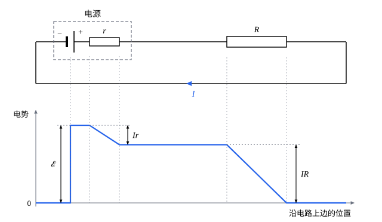

## 这一节要回答的问题

:term[静电场]{id="physics.electromagnetism.electric-field"}（electrostatic field）沿任一闭合回路的积分为零：:term[电荷]{id="physics.electromagnetism.electric-charge"}（electric charge）绕一圈回到原处，电场对它做的总功是零。可是:term[电流]{id="physics.electromagnetism.electric-current"}（electric current）流过:term[电阻]{id="physics.electromagnetism.resistance"}（resistance）时不断发热，这些能量从哪里来？是什么推着电荷在闭合的电路里一圈圈地流？许多电池和电阻连成的电路里，各处的电流怎样求？

## 讲解

### 电动势

电路里有:term[恒定电流]{id="physics.electromagnetism.steady-current"}（steady current）时，各处的:term[电荷]{id="physics.electromagnetism.electric-charge"}分布不随时间变化，它们产生的:term[电场]{id="physics.electromagnetism.electric-field"}$\vb E_{\mathrm s}$是静电场，有单值的:term[电势]{id="physics.electromagnetism.electric-potential"}（electric potential），沿任一闭合回路有$\oint\vb E_{\mathrm s}\cdot\dd\vb l=0$（见[静电场是保守场](lesson:physics.electromagnetism.electric-potential#thm-conservative)）。电荷绕电路一圈，静电场对它做的总功为零，:term[电阻]{id="physics.electromagnetism.resistance"}却一直在放出:term[焦耳热]{id="physics.electromagnetism.joule-heating"}（Joule heating）。所以单靠静电场维持不了闭合电路里的:term[电流]{id="physics.electromagnetism.electric-current"}，电路里一定有别的力推动电荷：电池里是化学反应，发电机里是磁力（见[法拉第电磁感应定律](lesson:physics.electromagnetism.faraday-law)）。

::anchor{id="def-emf"}
电路里除了静电场，还有作用在电荷上的非静电力（non-electrostatic force），单位正电荷受的非静电力记作$\vb f$。把单位正电荷沿电路绕一圈，非静电力做的功$\mathcal E=\oint\vb f\cdot\dd\vb l$叫作这个电路的:term[电动势]{id="physics.electromagnetism.electromotive-force"}（electromotive force，简写 emf），单位是伏特（$\mathrm V$）。电池的$\vb f$只在电池内部不为零，它的电动势就是非静电力把单位正电荷从负极搬到正极所做的功。

为什么这样定义：电动势衡量电源把别的能量变成电能的本领，每有电荷$q$从负极经过电源内部到达正极，就有$q\mathcal E$的能量交给电路。它的名字里有「力」，量的却是单位电荷得到的功，和:term[电势差]{id="physics.electromagnetism.potential-difference"}（potential difference）的单位相同，这个名字是历史留下来的。边界情况：一节干电池的电动势约为$1.5\,\mathrm V$，和电池的大小无关；大电池能放出更多的电荷，电动势并不更高。

::anchor{id="def-internal-resistance"}
电源内部也有电阻，叫作:term[内阻]{id="physics.electromagnetism.internal-resistance"}（internal resistance），记作$r$。在电源里推动:term[载流子]{id="physics.electromagnetism.charge-carrier"}（charge carrier）的，除了电场还有非静电力，:term[欧姆定律]{id="physics.electromagnetism.ohms-law"}（Ohm's law）要写成$\vb J=\sigma(\vb E_{\mathrm s}+\vb f)$。

::anchor{id="thm-terminal"}
定理（电源两极的电势差）：电动势为$\mathcal E$、:term[内阻]{id="physics.electromagnetism.internal-resistance"}为$r$的电源，电流$I$从它的正极流出时，两极之间的电势差是$\varphi_+-\varphi_-=\mathcal E-Ir$；不接任何东西时$I=0$，它就等于电动势。

证明思路：在电源内部从负极到正极积分$\frac{\vb J}{\sigma}=\vb E_{\mathrm s}+\vb f$。左边和[均匀导线的电阻](lesson:physics.electromagnetism.current-density#thm-wire-resistance)一样，积出来是$Ir$；右边第一项是$\varphi_--\varphi_+$，第二项是$\mathcal E$。所以$Ir=\varphi_--\varphi_++\mathcal E$，移项即得。

### 基尔霍夫定律

::anchor{id="def-junction-loop"}
许多电源和:term[电阻]{id="physics.electromagnetism.resistance"}连成的电路里，三条或更多导线相交的点叫作节点（junction），沿导线绕回出发点的路径叫作回路（loop）。1845 年，还是学生的基尔霍夫（Gustav Kirchhoff）发表了计算这种电路的两条定律。

::anchor{id="thm-kirchhoff"}
定理（:term[基尔霍夫定律]{id="physics.electromagnetism.kirchhoff-laws"}，Kirchhoff's circuit laws）：电路里是:term[恒定电流]{id="physics.electromagnetism.steady-current"}时，（1）节点定律（junction rule）：流进任一节点的:term[电流]{id="physics.electromagnetism.electric-current"}之和等于流出的电流之和；（2）回路定律（loop rule）：沿任一回路绕行一圈，各电源的:term[电动势]{id="physics.electromagnetism.electromotive-force"}之和等于各电阻上:term[电势]{id="physics.electromagnetism.electric-potential"}降落之和，$\sum_k\mathcal E_k=\sum_kI_kR_k$。

符号的约定：沿绕行方向穿过电源时，从负极到正极的电动势取正，反之取负；电阻上的电流和绕行方向相同时$I_kR_k$取正，反之取负；电源的:term[内阻]{id="physics.electromagnetism.internal-resistance"}也算作电阻。

证明思路：（1）恒定电流时$\divg\vb J=0$，取一个只包住这个节点的小闭合曲面，流进的:term[电荷]{id="physics.electromagnetism.electric-charge"}等于流出的（见[电流与欧姆定律](lesson:physics.electromagnetism.current-density#def-steady-current)）。（2）:term[静电场]{id="physics.electromagnetism.electric-field"}有单值的电势，沿回路绕一圈回到出发点，电势的总变化为零。顺着电流方向经过电阻$R_k$，电势降低$I_kR_k$；从负极到正极经过电源，电势升高$\mathcal E_k$（内阻上的降落已算进电阻里），各段相加为零即得。

边界情况：回路定律靠的是电势单值。有变化的:term[磁场]{id="physics.electromagnetism.magnetic-field"}（magnetic field）穿过回路时，沿回路的电场积分不再为零，回路定律要改写（见[法拉第电磁感应定律](lesson:physics.electromagnetism.faraday-law)）。

::anchor{id="thm-series-parallel"}
定理（电阻的串联和并联）：电阻$R_1$、$R_2$串联，等效电阻（equivalent resistance）是$R_1+R_2$；并联，等效电阻$R$满足$\frac1R=\frac1{R_1}+\frac1{R_2}$。

证明思路：串联时两个电阻的电流相同，:term[电势差]{id="physics.electromagnetism.potential-difference"}相加，由回路定律，两端的电势差是$I(R_1+R_2)$。并联时两个电阻两端的电势差相同，由节点定律，总电流是$\frac{\Delta\varphi}{R_1}+\frac{\Delta\varphi}{R_2}$。所以并联的等效电阻比两个中较小的还小。

一般的电路，以各支路的电流为未知数，在节点上用节点定律、在回路上用回路定律列方程，得到一个线性方程组，用[高斯消元](lesson:math.linear-algebra.linear-systems)（Gaussian elimination）就能解出。节点有$N$个时，只有$N-1$个节点的方程是独立的，第$N$个是它们的和；平面上的电路，再对每个网眼（mesh，里面不再包含别的回路的小回路）列一个回路方程，方程恰好够用。

### 电功率

::anchor{id="thm-power"}
定理（电源的功率）：:term[电动势]{id="physics.electromagnetism.electromotive-force"}为$\mathcal E$的电源输出:term[电流]{id="physics.electromagnetism.electric-current"}$I$时，非静电力每秒做功$\mathcal EI$；其中$I^2r$变成电源内部的:term[焦耳热]{id="physics.electromagnetism.joule-heating"}，其余$(\varphi_+-\varphi_-)I=(\mathcal E-Ir)I$送到外面的电路。

证明思路：每秒有:term[电荷]{id="physics.electromagnetism.electric-charge"}$I$从负极经过电源到达正极，非静电力对单位电荷做功$\mathcal E$，共$\mathcal EI$。:term[内阻]{id="physics.electromagnetism.internal-resistance"}上每秒放出焦耳热$I^2r$（见[电流与欧姆定律](lesson:physics.electromagnetism.current-density#thm-joule)），由能量守恒，剩下的$\mathcal EI-I^2r$送到外电路，外电路的:term[电阻]{id="physics.electromagnetism.resistance"}上每秒放出的热也正是这么多。

外电路只有一个电阻$R$时，$I=\frac{\mathcal E}{R+r}$，$R$得到的功率是$P=\frac{\mathcal E^2R}{(R+r)^2}$。$R=r$时$P$最大，为$\frac{\mathcal E^2}{4r}$；这时电源输出的能量只有一半到了$R$上，另一半在内阻上变成热。

## 几何图像

上图是一个:term[电动势]{id="physics.electromagnetism.electromotive-force"}为$\mathcal E$、:term[内阻]{id="physics.electromagnetism.internal-resistance"}为$r$的电源和一个:term[外电阻]{id="physics.electromagnetism.resistance"}$R$连成的电路，下图画出沿电路上边从左到右各处的:term[电势]{id="physics.electromagnetism.electric-potential"}（electric potential），取电源负极一侧导线的电势为零。:term[电流]{id="physics.electromagnetism.electric-current"}在电路里绕圈，电势却像过山车一样：在电源里被非静电力抬高$\mathcal E$，在内阻上降低$Ir$，经过外电阻时降低$IR$，在电阻可以忽略的导线上不变。:term[电荷]{id="physics.electromagnetism.electric-charge"}绕一圈回到出发点，电势也回到原来的值，这就是回路定律$\mathcal E=Ir+IR$。

:::anim{component="function-plot"}
range: { x: [0, 5], y: [0, 1.4] }
functions:
  - expr: "x/(x + r)^2"
    label: |
      外电阻得到的功率
  - expr: "x/(x + r)"
    label: |
      效率
sliders:
  - name: r
    min: 0.2
    max: 2
    step: 0.2
    default: 1
    label: |
      内阻$r$（$\Omega$）
:::

动画画的是$\mathcal E=1\,\mathrm V$的电源给外电阻$R$供电：横轴是$R$（以$\Omega$为单位，图上写作$x$），一条曲线是$R$得到的功率（以$\mathrm W$为单位），另一条是效率，即$R$得到的功率占电源输出功率$\mathcal EI$的比例。功率在$R=r$处最大，那里效率是$\frac12$；$R$越大效率越高，功率却越小。内阻越小，功率的峰越高。

## 例题

### 例 1　惠斯通电桥

四个:term[电阻]{id="physics.electromagnetism.resistance"}连成一个四边形$ABCD$：$AB$边上是$R_1$，$BC$边上是$R_2$，$AD$边上是$R_3$，$DC$边上是$R_4$；电源接在$A$、$C$之间，灵敏的检流计（galvanometer）接在$B$、$D$之间。电阻满足什么条件时，检流计里没有:term[电流]{id="physics.electromagnetism.electric-current"}？

**为什么想到这么做**：检流计里没有电流，等于说$B$、$D$两点的:term[电势]{id="physics.electromagnetism.electric-potential"}相同。这时可以把检流计拿掉，$R_1$、$R_2$里是同一个:term[电流]{id="physics.electromagnetism.electric-current"}$I_1$，$R_3$、$R_4$里是同一个电流$I_3$。

**推导**：$B$、$D$的电势相同，从$A$到$B$和从$A$到$D$的电势降落相等，$I_1R_1=I_3R_3$；同理从$B$到$C$和从$D$到$C$也相等，$I_1R_2=I_3R_4$。两式相除，得$\frac{R_1}{R_2}=\frac{R_3}{R_4}$。已知其中三个电阻，调节一个可变电阻使检流计读数为零，就能精确地测出第四个，而且结果和电源的:term[电动势]{id="physics.electromagnetism.electromotive-force"}无关。这种电路最早是克里斯蒂（Samuel Hunter Christie）在 1833 年描述的，惠斯通（Charles Wheatstone）在 1843 年介绍后，以他的名字流传开来。

### 例 2　新旧电池并联

一节新电池（$\mathcal E_1=1.5\,\mathrm V$，$r_1=0.10\,\Omega$）和一节旧电池（$\mathcal E_2=1.2\,\mathrm V$，$r_2=1.0\,\Omega$）正极接正极、负极接负极并联起来，给$R=2.0\,\Omega$的灯泡供电。求流过灯泡和两节电池的:term[电流]{id="physics.electromagnetism.electric-current"}。

**为什么想到这么做**：电路有两个节点、三条支路，以三条支路的电流为未知数，用一个节点方程和两个回路方程。旧电池的:term[电动势]{id="physics.electromagnetism.electromotive-force"}低，它里面的电流方向不能想当然，先假定从正极流出，解出来是负的就说明实际方向相反。

**推导**：设两节电池从正极流出的电流为$I_1$、$I_2$，灯泡里的电流为$I$。节点定律给出$I_1+I_2=I$；沿「电池 1—灯泡」和「电池 2—灯泡」两个回路，回路定律给出$\mathcal E_1=I_1r_1+IR$，$\mathcal E_2=I_2r_2+IR$。由后两式解出$I_1$、$I_2$代入第一式，得$I\Bigl(1+\frac{R}{r_1}+\frac{R}{r_2}\Bigr)=\frac{\mathcal E_1}{r_1}+\frac{\mathcal E_2}{r_2}$，代入数值，$I\approx0.704\,\mathrm A$。

于是$I_1=\frac{\mathcal E_1-IR}{r_1}\approx0.913\,\mathrm A$，$I_2=\frac{\mathcal E_2-IR}{r_2}\approx-0.209\,\mathrm A$：电流从旧电池的正极流进去，新电池在给旧电池「充电」。只用新电池时灯泡的电流是$\frac{\mathcal E_1}{R+r_1}\approx0.714\,\mathrm A$，并上旧电池反而少了一点，还白白消耗了新电池的能量。所以新旧电池不要混用。

## 常见误区

- 「电池提供恒定的:term[电流]{id="physics.electromagnetism.electric-current"}。」电池提供的是:term[电动势]{id="physics.electromagnetism.electromotive-force"}，并有一定的:term[内阻]{id="physics.electromagnetism.internal-resistance"}；电流多大，由整个电路决定。
- 「电动势就是电源两极的:term[电势差]{id="physics.electromagnetism.potential-difference"}。」只有电流为零时两者才相等；电源输出电流时，两极的电势差是$\mathcal E-Ir$，比电动势小。
- 「:term[电阻]{id="physics.electromagnetism.resistance"}并联得越多，总电阻越大。」并联的等效电阻比其中最小的那个还小，并联得越多越小；串联时才越来越大。
- 「回路定律对任何电路都成立。」它依靠:term[电势]{id="physics.electromagnetism.electric-potential"}是单值的，有变化的:term[磁场]{id="physics.electromagnetism.magnetic-field"}穿过回路时就要改写。
