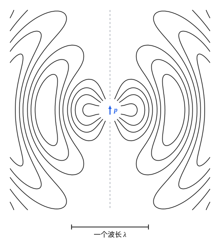

## 这一节要回答的问题

收音机、手机的天线怎样把:term[电磁波]{id="physics.electromagnetism.em-wave"}（electromagnetic wave）发出去，朝哪些方向发得最强？天空为什么是蓝的，日落时太阳为什么发红？这些问题背后是同一个最简单的辐射源：来回振荡的:term[电偶极子]{id="physics.electromagnetism.electric-dipole"}（electric dipole）。

## 讲解

### 振荡的电偶极子

两个小金属球相距$d$，用细导线连起来，:term[电荷]{id="physics.electromagnetism.electric-charge"}（electric charge）在两球之间来回流动，一个球带$q(t)=q_0\cos\omega t$，另一个带$-q(t)$。这一对电荷是一个随时间振荡的:term[电偶极子]{id="physics.electromagnetism.electric-dipole"}：:term[电偶极矩]{id="physics.electromagnetism.dipole-moment"}（electric dipole moment）$\vb p(t)=p_0\cos\omega t\,\uv z$，振幅$p_0=q_0d$；导线里的:term[电流]{id="physics.electromagnetism.electric-current"}（electric current）$I=\dv qt$满足$Id\,\uv z=\dot{\vb p}$。天线里来回振动的电子、被光照射的分子里来回振动的电子云，都可以这样看。

下面设偶极子的大小远小于波长，$d\ll\lambda=\frac{2\pi c}{\omega}$：光走过偶极子的时间远小于周期，偶极子上各处的:term[推迟时间]{id="physics.electromagnetism.retarded-time"}（retarded time）可以当作相同。

::anchor{id="def-radiation-zone"}
离振荡电偶极子的距离$r$远大于波长的区域叫作辐射区（radiation zone），远小于波长的区域叫作近区（near zone）。

为什么这样定义：两种区域里起主要作用的项不同（几何图像里的动画）。近区里场跟着偶极矩同步变化，就是静电偶极子的场，可以用:term[准静态]{id="physics.electromagnetism.quasi-static"}（quasi-static）处理；辐射区里按$\frac1r$减小的:term[辐射场]{id="physics.electromagnetism.radiation-field"}（radiation field）占绝对优势，它以光速向外传播，带走能量。边界情况：$r$和波长相当的过渡区里两类项一样大，要用完整的式子（第 5 题）。

### 辐射区的场和辐射功率

::anchor{id="thm-dipole-fields"}
定理（电偶极辐射的场）：大小远小于波长的振荡:term[电偶极子]{id="physics.electromagnetism.electric-dipole"}$\vb p(t)=p_0\cos\omega t\,\uv z$，在辐射区的场是$\vb E=-\frac{\mu_0p_0\omega^2}{4\pi}\cdot\frac{\sin\theta}{r}\cos\bigl[\omega\bigl(t-\frac rc\bigr)\bigr]\,\uv\theta$，$\vb B=\frac{E_\theta}{c}\,\uv\psi$，$\theta$是场点方向和偶极子轴线的夹角，$\psi$是方位角。

证明思路：矢势由导线里的:term[电流]{id="physics.electromagnetism.electric-current"}给出。$r\gg d$时偶极子上各处到场点的距离都约为$r$，$d\ll\lambda$时:term[推迟时间]{id="physics.electromagnetism.retarded-time"}都约为$t-\frac rc$，由:term[推迟势]{id="physics.electromagnetism.retarded-potentials"}（retarded potentials）得$\vb A=\frac{\mu_0}{4\pi r}\dot{\vb p}\bigl(t-\frac rc\bigr)$。标势由:term[洛伦茨规范]{id="physics.electromagnetism.lorenz-gauge"}（Lorenz gauge）条件$\divg\vb A+\frac{1}{c^2}\pdv\varphi t=0$求出，辐射区里只留按$\frac1r$减小的项，$\varphi=\frac{\cos\theta}{4\pi\varepsilon_0cr}\dot p\bigl(t-\frac rc\bigr)$。求$\vb E=-\nabla\varphi-\pdv{\vb A}t$时只对余弦里的$r$求导（其余的导数多出一个$\frac1r$），两项沿径向的部分正好抵消，剩下沿$\uv\theta$的部分；$\vb B=\curl\vb A$同理。

::anchor{id="thm-dipole-power"}
定理（电偶极辐射的功率）：上面的振荡电偶极子，单位:term[立体角]{id="physics.electromagnetism.solid-angle"}（solid angle）里的平均辐射功率是$\frac{\mu_0p_0^2\omega^4}{32\pi^2c}\sin^2\theta$，总的平均辐射功率是$\langle P\rangle=\frac{\mu_0p_0^2\omega^4}{12\pi c}$。

证明思路：辐射区里$\vb E$、$\vb B$和$\uv r$两两垂直，$\vb S=\frac{E^2}{\mu_0c}\uv r=\frac{\mu_0p_0^2\omega^4\sin^2\theta}{16\pi^2cr^2}\cos^2\bigl[\omega\bigl(t-\frac rc\bigr)\bigr]\uv r$。$\cos^2$的平均是$\frac12$，乘以$r^2$就是单位立体角的平均功率，再对球面积分，$\int\sin^2\theta\,\dd\Omega=\frac{8\pi}{3}$，得$\langle P\rangle$。

辐射沿偶极子的轴线为零，在垂直于轴线的平面里最强：竖直的天线向四周水平地发射，正上方收不到。功率正比于$\omega^4$：:term[电偶极矩]{id="physics.electromagnetism.dipole-moment"}的振幅不变，频率加倍，辐射功率变成$16$倍。:term[辐射场]{id="physics.electromagnetism.radiation-field"}和[拉莫尔公式](lesson:physics.electromagnetism.larmor-formula)里低速:term[电荷]{id="physics.electromagnetism.electric-charge"}的辐射场形式一样，只是$q\vb a$换成了$\ddot{\vb p}$。1887 年到 1888 年，赫兹（Heinrich Hertz）用两根金属棒中间夹一个火花隙做成振荡偶极子，第一次产生并检测到了:term[电磁波]{id="physics.electromagnetism.em-wave"}。

### 天线和天空的颜色

::anchor{id="def-radiation-resistance"}
天线里:term[电流]{id="physics.electromagnetism.electric-current"}的振幅是$I_0$时，平均辐射功率可以写成$\langle P\rangle=\frac12R_{\mathrm{rad}}I_0^2$，$R_{\mathrm{rad}}$叫作天线的辐射电阻（radiation resistance）。

为什么这样定义：对电源来说，天线把能量辐射出去，和:term[电阻]{id="physics.electromagnetism.resistance"}把能量变成热一样，都要消耗功率，$R_{\mathrm{rad}}$就是这个等效的电阻（例 1）。上面的模型里电流沿天线处处相同，$p_0=\frac{I_0d}{\omega}$，$R_{\mathrm{rad}}=\frac{\mu_0d^2\omega^2}{6\pi c}=\frac{2\pi}{3}\sqrt{\frac{\mu_0}{\varepsilon_0}}\Bigl(\frac d\lambda\Bigr)^2\approx789\Bigl(\frac d\lambda\Bigr)^2\,\Omega$。边界情况：真实的短天线两端电流为零，电流沿天线近似线性减小，辐射电阻约为这个值的$\frac14$；天线比波长短得多时辐射电阻很小，电源的功率大多耗在导线的电阻上，所以实用的天线常取半个波长左右的长度。

阳光照到空气分子上，分子里的电子云被阳光的:term[电场]{id="physics.electromagnetism.electric-field"}（electric field）推着振动，每个分子都成了一个小的振荡:term[电偶极子]{id="physics.electromagnetism.electric-dipole"}，把一部分光向四面八方辐射出去，也就是散射（scattering）。可见光的频率远低于分子里电子的共振频率（resonance frequency），:term[电偶极矩]{id="physics.electromagnetism.dipole-moment"}的振幅和频率无关（见[介质的色散](lesson:physics.electromagnetism.dispersion)里的振子模型），散射的功率正比于$\omega^4$：蓝光（$450\,\mathrm{nm}$）的散射约是红光（$700\,\mathrm{nm}$）的$6$倍（例 2），所以晴天的天空是蓝的；太阳落山时阳光斜着穿过很厚的大气，蓝光沿途被散射掉，剩下的光偏红。瑞利（Lord Rayleigh）在 1871 年给出了这个解释。

## 几何图像

图里是$\omega t=\frac\pi4$时，过振荡:term[电偶极子]{id="physics.electromagnetism.electric-dipole"}（electric dipole）轴线的平面里的:term[电场线]{id="physics.electromagnetism.field-line"}（electric field line），偶极子在中心，轴线竖直，中心附近一小块没有画。靠近偶极子的电场线两端连在偶极子上，和静电偶极子的电场线相似；远处的电场线自己闭合成圈，已经和偶极子脱离，以光速向外传播，相邻两层圈的转向相反，相隔半个波长。轴线方向上没有电场线伸出去，那里没有辐射。

:::anim{component="function-plot"}
range: { x: [0, 12], y: [-3, 3] }
functions:
  - expr: "(1 - 1/x^2)*cos(2*pi*s - x) + sin(2*pi*s - x)/x"
    label: |
      赤道面上电场的$z$分量乘以$kr$
  - expr: "cos(2*pi*s - x)"
    label: |
      只有辐射场时
sliders:
  - name: s
    min: 0
    max: 1
    step: 0.05
    default: 0
    label: |
      时间，以周期为单位
:::

横轴是到偶极子的距离乘以$k=\frac{2\pi}\lambda$，$kr=2\pi$就是一个波长；纵轴是赤道面（$\theta=90^\circ$）上:term[电场]{id="physics.electromagnetism.electric-field"}的$z$分量乘以$kr$，以$\frac{p_0k^3}{4\pi\varepsilon_0}$为单位，乘上$kr$是为了让按$\frac1r$减小的:term[辐射场]{id="physics.electromagnetism.radiation-field"}显成等幅的波。远处两条曲线重合，是以光速向外传播的辐射场。近处多出的部分按$\frac1{r^3}$增大，和:term[电偶极矩]{id="physics.electromagnetism.dipole-moment"}同步振动，就是静电偶极子的场（第 5 题）。

## 例题

### 例 1　短天线

一根长$0.50\,\mathrm m$的天线，:term[电流]{id="physics.electromagnetism.electric-current"}的振幅是$2.0\,\mathrm A$，频率$30\,\mathrm{MHz}$，电流沿天线处处相同。求它的:term[辐射电阻]{id="physics.electromagnetism.resistance"}和平均辐射功率。取$\mu_0=4\pi\times10^{-7}\,\mathrm{H/m}$，$c=3.00\times10^8\,\mathrm{m/s}$。

**为什么想到这么做**：波长$\lambda=\frac cf=10\,\mathrm m$，远大于天线的长度，可以当作振荡:term[电偶极子]{id="physics.electromagnetism.electric-dipole"}；电流处处相同时$p_0=\frac{I_0d}{\omega}$。

**推导**：$R_{\mathrm{rad}}=\frac{\mu_0d^2\omega^2}{6\pi c}=\frac{4\pi\times10^{-7}\times0.50^2\times(2\pi\times3.0\times10^7)^2}{6\pi\times3.00\times10^8}\,\Omega\approx1.97\,\Omega$，和$789\times0.05^2\,\Omega$一致。$\langle P\rangle=\frac12R_{\mathrm{rad}}I_0^2\approx3.95\,\mathrm W$。辐射电阻只有约$2\,\Omega$，导线自身的电阻有零点几欧，就会耗掉相当一部分功率；天线做到半个波长长，辐射电阻约为$73\,\Omega$，效率就高多了。

### 例 2　蓝天

空气分子散射阳光的功率正比于$\omega^4$。求波长$450\,\mathrm{nm}$的蓝光和$700\,\mathrm{nm}$的红光，散射功率之比。

**为什么想到这么做**：入射光:term[强度]{id="physics.electromagnetism.intensity"}（intensity）相同时，分子的:term[电偶极矩]{id="physics.electromagnetism.dipole-moment"}振幅和频率无关，散射功率按电偶极辐射正比于$\omega^4$，也就是正比于$\frac1{\lambda^4}$。

**推导**：$\Bigl(\frac{700}{450}\Bigr)^4\approx5.9$。阳光里蓝光比红光被散射得多，从各个方向射到眼睛里的散射光偏蓝，天空就是蓝的。太阳在头顶时阳光穿过的大气短，直射的阳光几乎是白的；日落时阳光斜着穿过的大气长几十倍，蓝光沿途被散射掉，剩下的光偏红。

## 常见误区

- 「天线朝各个方向发射得一样强。」振荡:term[电偶极子]{id="physics.electromagnetism.electric-dipole"}沿轴线不辐射，垂直于轴线最强，角分布正比于$\sin^2\theta$。
- 「电偶极辐射的功率总是正比于频率的四次方。」那是:term[电偶极矩]{id="physics.electromagnetism.dipole-moment"}的振幅不变时；天线里:term[电流]{id="physics.electromagnetism.electric-current"}的振幅不变时$p_0=\frac{I_0d}{\omega}$，功率正比于$\omega^2$（例 1）。
- 「散射正比于$\omega^4$，天空应该是紫色的。」紫光确实散射得更多，可阳光里紫光比蓝光少，人眼对紫光又不敏感，合起来看天空是蓝的。
