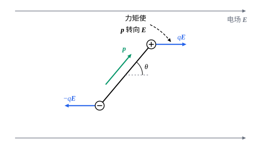

## 这一节要回答的问题

水分子整体不带:term[电荷]{id="physics.electromagnetism.electric-charge"}（electric charge），可是它里面正、负电荷的中心不重合。这样一对电荷，离得稍远，作用就几乎互相抵消，它们的:term[电势]{id="physics.electromagnetism.electric-potential"}（electric potential）和:term[电场]{id="physics.electromagnetism.electric-field"}（electric field）在远处还剩下什么？放进外电场里，它会怎样？

## 讲解

### 电偶极子和电偶极矩

两个等量异号的:term[点电荷]{id="physics.electromagnetism.point-charge"}（point charge）$\pm q$相距$d$，总:term[电荷]{id="physics.electromagnetism.electric-charge"}是零，远处的:term[电场]{id="physics.electromagnetism.electric-field"}却没有完全抵消，只是衰减得比单个点电荷快（见[电场](lesson:physics.electromagnetism.electric-field)例 1）。下面会看到，远处的电场只由$q$和$d$的乘积决定。

::anchor{id="def-electric-dipole"}
相距为$d$的一对等量异号的点电荷$\pm q$，在离它们的距离$r\gg d$的地方看，叫作:term[电偶极子]{id="physics.electromagnetism.electric-dipole"}（electric dipole）；矢量$\vb p=q\vb d$叫作它的:term[电偶极矩]{id="physics.electromagnetism.dipole-moment"}（electric dipole moment），其中$\vb d$是从$-q$指向$+q$的位移，单位是$\mathrm{C\,m}$。

为什么这样定义：$q$加倍、$d$减半，远处看不出差别，用一个矢量$\vb p$就把远处的电场定下来了。一般的电荷分布，电偶极矩是$\vb p=\sum_iq_i\vb r_i$；总电荷为零时，它和原点的选取无关（p5）。边界情况：$r$和$d$差不多时，不能只用$\vb p$，电场的样子和两个电荷各自的位置有关。

水分子的电偶极矩约为$1.85\,\mathrm D$（德拜，debye，$1\,\mathrm D\approx3.336\times10^{-30}\,\mathrm{C\,m}$），即约$6.19\times10^{-30}\,\mathrm{C\,m}$。

### 远处的电势

::anchor{id="thm-dipole-potential"}
定理（:term[电偶极子]{id="physics.electromagnetism.electric-dipole"}的:term[电势]{id="physics.electromagnetism.electric-potential"}）：电偶极子的中心在原点，在$r\gg d$处，$\varphi\approx\frac{1}{4\pi\varepsilon_0}\frac{\vb p\cdot\uv r}{r^2}=\frac{1}{4\pi\varepsilon_0}\frac{p\cos\theta}{r^2}$，$\theta$是$\vb r$和$\vb p$的夹角。

证明思路：$+q$在$\frac{\vb d}{2}$，$-q$在$-\frac{\vb d}{2}$，$\varphi=\frac{q}{4\pi\varepsilon_0}\Bigl(\frac{1}{r_+}-\frac{1}{r_-}\Bigr)$。由余弦定理，$r_\pm=r\sqrt{1\mp\frac dr\cos\theta+\frac{d^2}{4r^2}}$；用泰勒公式（Taylor's formula）$(1+x)^{-1/2}\approx1-\frac x2$，只留$\frac dr$的一次项，$\frac{1}{r_\pm}\approx\frac1r\Bigl(1\pm\frac{d}{2r}\cos\theta\Bigr)$。两者相减，得$\frac{d\cos\theta}{r^2}$。

所以电偶极子的电势随$\frac{1}{r^2}$衰减，比:term[点电荷]{id="physics.electromagnetism.point-charge"}的$\frac1r$快一阶：总:term[电荷]{id="physics.electromagnetism.electric-charge"}为零，最主要的那一项抵消了，剩下的是一阶修正。

### 远处的电场

::anchor{id="thm-dipole-field"}
定理（:term[电偶极子]{id="physics.electromagnetism.electric-dipole"}的:term[电场]{id="physics.electromagnetism.electric-field"}）：在$r\gg d$处，电场沿径向的分量是$E_r=\frac{1}{4\pi\varepsilon_0}\frac{2p\cos\theta}{r^3}$，沿$\theta$增大方向的分量是$E_\theta=\frac{1}{4\pi\varepsilon_0}\frac{p\sin\theta}{r^3}$；写成矢量是$\vb E=\frac{1}{4\pi\varepsilon_0}\frac{3(\vb p\cdot\uv r)\uv r-\vb p}{r^3}$。

证明思路：$\vb E=-\nabla\varphi$，每个分量是沿那个方向的方向导数（directional derivative）取负号。沿$\uv r$走，就是对$r$求导，$E_r=-\pdv{\varphi}{r}$；沿$\theta$增大的方向走一小段，弧长是$r\,\dd\theta$，所以$E_\theta=-\frac1r\pdv{\varphi}{\theta}$。把:term[电势]{id="physics.electromagnetism.electric-potential"}代进去就得到两个分量；再把$\vb p$分解成$p\cos\theta\,\uv r-p\sin\theta\,\uv\theta$（$\uv\theta$是$\theta$增大方向的单位矢量），可以核对矢量形式。

在偶极子的轴上（$\theta=0$），电场沿$\vb p$，大小$\frac{1}{4\pi\varepsilon_0}\frac{2p}{r^3}$；在中垂面上（$\theta=90^\circ$），电场和$\vb p$反向，大小是轴上的一半。远处的电场随$\frac{1}{r^3}$衰减，而且不沿径向。

### 外电场中的偶极子

::anchor{id="thm-dipole-torque"}
定理（匀强:term[电场]{id="physics.electromagnetism.electric-field"}中的:term[电偶极子]{id="physics.electromagnetism.electric-dipole"}）：电偶极子在匀强电场$\vb E$里，受的合力为零，受的力矩（torque）是$\boldsymbol\tau=\vb p\times\vb E$，:term[电势能]{id="physics.electromagnetism.potential-energy"}（electric potential energy）是$U=-\vb p\cdot\vb E$。

证明思路：两个:term[电荷]{id="physics.electromagnetism.electric-charge"}受的力$\pm q\vb E$等大反向，合力为零。对中心取力矩，$\boldsymbol\tau=\frac{\vb d}{2}\times q\vb E+\Bigl(-\frac{\vb d}{2}\Bigr)\times(-q\vb E)=q\vb d\times\vb E=\vb p\times\vb E$（见[力矩与角动量](lesson:physics.newtonian-mechanics.angular-momentum)）。匀强电场里:term[电势]{id="physics.electromagnetism.electric-potential"}是坐标的一次函数，$U=q\varphi(\vb r_+)-q\varphi(\vb r_-)=q\vb d\cdot\nabla\varphi=-\vb p\cdot\vb E$。

力矩总是把$\vb p$转向$\vb E$的方向：两者同向时电势能$-pE$最小，是稳定的平衡；反向时电势能$+pE$最大，平衡不稳定。把$\vb p$从和$\vb E$夹角$\theta_1$转到$\theta_2$，电场的力矩做的功是$-\Delta U=pE(\cos\theta_2-\cos\theta_1)$。

电场不均匀时，两个电荷受的力大小不同，偶极子除了转动，还会被拉向电场强的地方（p6）。

## 几何图像

图里:term[电场]{id="physics.electromagnetism.electric-field"}向右，$\vb p$和$\vb E$夹角为$\theta$。$+q$受的力向右，$-q$受的力向左，大小相同，合力为零；两个力不在一条直线上，组成一对力偶（couple），力矩的大小是$pE\sin\theta$，使$\vb p$转向$\vb E$。

:::anim{component="function-plot"}
range: { x: [0, 5], y: [0, 2] }
functions:
  - expr: "1/sqrt(x^2 - x*cos(th*pi/180) + 0.25) - 1/sqrt(x^2 + x*cos(th*pi/180) + 0.25)"
    label: |
      两个点电荷的电势（精确）
  - expr: "cos(th*pi/180)/x^2"
    label: |
      电偶极子的近似
sliders:
  - name: th
    min: 0
    max: 90
    step: 15
    default: 30
    label: |
      方向和$\vb p$的夹角$\theta$（度）
:::

动画比较$\pm q$相距$d$时，沿一个方向的精确:term[电势]{id="physics.electromagnetism.electric-potential"}和:term[电偶极子]{id="physics.electromagnetism.electric-dipole"}的近似。横轴是到中心的距离$r$与$d$之比（图上写作$x$），纵轴以$\frac{q}{4\pi\varepsilon_0d}$为单位。离中心只有$d$的一两倍时两者差别明显，$r$大于几倍$d$以后几乎重合；$\theta=90^\circ$时两者都是零。

## 例题

### 例 1　电场中的水分子

水分子的:term[电偶极矩]{id="physics.electromagnetism.dipole-moment"}取$6.19\times10^{-30}\,\mathrm{C\,m}$，放在$1.0\times10^6\,\mathrm{N/C}$的匀强:term[电场]{id="physics.electromagnetism.electric-field"}里。它受的力矩最大是多少？从和电场同向转到反向，电场的力矩做多少功？

**为什么想到这么做**：力矩的大小是$pE\sin\theta$，$\theta=90^\circ$时最大；做的功由:term[电势能]{id="physics.electromagnetism.potential-energy"}的变化给出，不必对力矩积分。

**推导**：$\tau_{\max}=pE=6.19\times10^{-30}\times1.0\times10^6\,\mathrm{N\,m}\approx6.2\times10^{-24}\,\mathrm{N\,m}$。电势能从$-pE$变到$+pE$，增加$2pE\approx1.24\times10^{-23}\,\mathrm J$，所以电场的力矩做功$-1.24\times10^{-23}\,\mathrm J$，约$-7.7\times10^{-5}\,\mathrm{eV}$。这个能量非常小，所以分子的热运动很容易把它们打乱，电场只能让分子稍微倾向于沿电场排列。

### 例 2　斜方向上的电场

求:term[电偶极子]{id="physics.electromagnetism.electric-dipole"}在$\theta=45^\circ$方向、距离$r$处的:term[电场]{id="physics.electromagnetism.electric-field"}的大小，以及它和径向的夹角。

**为什么想到这么做**：直接用两个分量$E_r$、$E_\theta$，它们的比值给出电场偏离径向的角度。

**推导**：$\cos45^\circ=\sin45^\circ=\frac{1}{\sqrt2}$，$E_r=\frac{1}{4\pi\varepsilon_0}\frac{\sqrt2p}{r^3}$，$E_\theta=\frac{1}{4\pi\varepsilon_0}\frac{p}{\sqrt2r^3}$。大小$E=\frac{1}{4\pi\varepsilon_0}\frac{p}{r^3}\sqrt{2+\frac12}\approx\frac{1}{4\pi\varepsilon_0}\frac{1.58p}{r^3}$；和径向的夹角$\alpha$满足$\tan\alpha=\frac{E_\theta}{E_r}=\frac12$，$\alpha\approx26.6^\circ$，偏向$\theta$增大的一侧。电场既不沿径向，也不沿$\vb p$。

## 常见误区

- 「总:term[电荷]{id="physics.electromagnetism.electric-charge"}为零，远处就没有:term[电场]{id="physics.electromagnetism.electric-field"}。」:term[电偶极子]{id="physics.electromagnetism.electric-dipole"}的电场随$\frac{1}{r^3}$衰减，衰减得快，但不是零。
- 「匀强电场里的偶极子会被拉着顺电场方向跑。」合力为零，它只转动；电场不均匀时才有合力。
- 「:term[电偶极矩]{id="physics.electromagnetism.dipole-moment"}从正电荷指向负电荷。」它从负电荷指向正电荷，和偶极子在电场里转向的方向一致。
- 「电偶极子的电场和:term[点电荷]{id="physics.electromagnetism.point-charge"}的一样沿径向。」它还有$\theta$方向的分量（例 2）。
