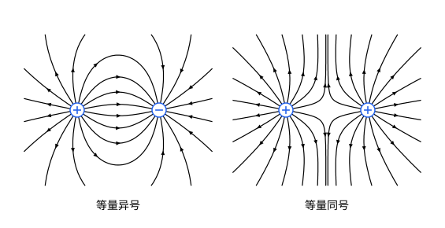

## 这一节要回答的问题

:term[库仑定律]{id="physics.electromagnetism.coulomb-law"}（Coulomb's law）说，两个:term[电荷]{id="physics.electromagnetism.electric-charge"}（electric charge）隔着空间互相作用。能不能先描述一个电荷在它周围的空间里造成了什么，再算任何一个放进来的电荷受多大的力？这种描述怎样画出来？

## 讲解

### 电场

:term[点电荷]{id="physics.electromagnetism.point-charge"}（point charge）$Q$在$\vb r'$处，它对放在$\vb r$处的点电荷$q$的库仑力是$\vb F=\frac{1}{4\pi\varepsilon_0}\frac{Qq}{|\vb r-\vb r'|^3}(\vb r-\vb r')$。这个力和$q$成正比：把$q$换成$2q$，力加倍，方向不变。所以$\frac{\vb F}{q}$只和$Q$、位置$\vb r$有关，和放进来的$q$无关。

::anchor{id="def-electric-field"}
在某点放一个静止的点电荷$q_0$，它受的力是$\vb F$，那一点的:term[电场]{id="physics.electromagnetism.electric-field"}（electric field）定义为$\vb E=\frac{\vb F}{q_0}$，也叫电场强度（electric field strength），单位是$\mathrm{N/C}$。用来探测的$q_0$叫作:term[试探电荷]{id="physics.electromagnetism.test-charge"}（test charge），它的:term[电荷]{id="physics.electromagnetism.electric-charge"}要小到不影响产生电场的那些电荷。

为什么这样定义：$\vb E$只由周围的电荷决定，和放进来的电荷无关；知道了$\vb E$，任何电荷$q$在那里受的力就是$\vb F=q\vb E$，不必再回到每一个产生电场的电荷。边界情况：试探电荷太大时，它会推动周围能移动的电荷（例如金属上的电荷），量到的就不是原来的电场；点电荷所在的那一点，它自己的电场没有定义。

在静电学（electrostatics）里，电场只是换了一种算力的办法。电荷动起来以后就不一样了：一个电荷挪动了，远处的电荷要过一段时间才受到变化了的力，变化以光速传开，这期间带着能量和动量传过去的正是电磁场（electromagnetic field），电场是它的一部分（见[真空中的电磁波](lesson:physics.electromagnetism.em-waves)）。

::anchor{id="thm-point-field"}
定理（点电荷系的电场）：点电荷$Q$在$\vb r'$处，它在$\vb r$处（$\vb r\ne\vb r'$）的电场是$\vb E=\frac{1}{4\pi\varepsilon_0}\frac{Q}{|\vb r-\vb r'|^3}(\vb r-\vb r')$；几个点电荷$Q_i$的电场，是各自电场的矢量和。

证明思路：由:term[库仑定律]{id="physics.electromagnetism.coulomb-law"}，$Q$对$\vb r$处试探电荷$q_0$的力除以$q_0$，就是第一个式子。几个电荷时，由:term[叠加原理]{id="physics.electromagnetism.superposition-principle"}（superposition principle），力是各个力的矢量和，除以$q_0$以后，电场也是矢量和。

点电荷的电场大小是$E=\frac{1}{4\pi\varepsilon_0}\frac{|Q|}{r^2}$，$r$是到它的距离；$Q>0$时背离它，$Q<0$时指向它。

### 电场线

把许多点上:term[电场]{id="physics.electromagnetism.electric-field"}的方向画成小箭头，就看得出电场的走向（几何图像里的动画）。把这些方向接起来，就得到一条条曲线。

::anchor{id="def-field-line"}
处处和电场方向相切、并按电场方向标上箭头的曲线，叫作:term[电场线]{id="physics.electromagnetism.field-line"}（electric field line）。

为什么这样定义：一张电场线图同时给出电场的方向和大致的强弱。按惯例，从:term[电荷]{id="physics.electromagnetism.electric-charge"}为$q$的:term[点电荷]{id="physics.electromagnetism.point-charge"}发出（或汇入它）的电场线条数和$|q|$成正比；单个点电荷发出的$N$条线均匀地穿过半径为$r$的球面，单位面积上有$\frac{N}{4\pi r^2}$条，和电场的大小一样随$\frac{1}{r^2}$变化，所以越密的地方电场越强。边界情况：电场线不是带电粒子的运动轨迹，粒子的加速度沿电场方向，速度却不一定（见常见误区）。

电场线还有几条性质。电场不为零的地方，每一点只有一个电场方向，所以电场线不会相交。在点电荷附近，它自己的电场比别的电荷的强得多，电场线像从它发出（正电荷）或汇入它（负电荷）的射线。电场线从正电荷出发，终止在负电荷上或延伸到无穷远，在没有电荷的地方不会凭空出现或中断（电场为零的个别点上，几条线可以汇合又分开），这一点要到:term[高斯定律]{id="physics.electromagnetism.gauss-law"}（Gauss's law）那一节才能说明。

画电场线的办法：在$xy$平面上，电场线的斜率是$\dv{y}{x}=\frac{E_y}{E_x}$。从电荷附近出发，沿电场方向一小步一小步地走，就能把它画出来，下面的图就是这样用计算机画的。

## 几何图像

左图是等量异号的两个:term[点电荷]{id="physics.electromagnetism.point-charge"}，:term[电场线]{id="physics.electromagnetism.field-line"}从:term[正电荷]{id="physics.electromagnetism.electric-charge"}出发，汇入负电荷，跑出框的线在框外绕一大圈，再从另一侧回来。右图是等量同号的两个正电荷，电场线互相排开，两者连线的中点处:term[电场]{id="physics.electromagnetism.electric-field"}为零。两幅图都只画了纸面上的线，纸面上的疏密只能定性地看（p8）。

:::anim{component="vector-field-2d"}
field: { x: "((x+1)/((x+1)^2+y^2)^1.5 + k*(x-1)/((x-1)^2+y^2)^1.5) / (1 + hypot((x+1)/((x+1)^2+y^2)^1.5 + k*(x-1)/((x-1)^2+y^2)^1.5, y/((x+1)^2+y^2)^1.5 + k*y/((x-1)^2+y^2)^1.5)/3)", y: "(y/((x+1)^2+y^2)^1.5 + k*y/((x-1)^2+y^2)^1.5) / (1 + hypot((x+1)/((x+1)^2+y^2)^1.5 + k*(x-1)/((x-1)^2+y^2)^1.5, y/((x+1)^2+y^2)^1.5 + k*y/((x-1)^2+y^2)^1.5)/3)" }
range: { x: [-3, 3], y: [-2, 2] }
dt: 0.01
particles: 400
sliders:
  - name: k
    min: -2
    max: 2
    step: 0.5
    default: -1
    label: |
      右边电荷与左边电荷之比$q_2/q_1$
:::

动画里左边的点电荷$q_1>0$在$(-1,0)$，右边的$q_2$在$(1,0)$，滑块调$\frac{q_2}{q_1}$。箭头指向电场的方向，小粒子沿电场线移动；电荷附近的电场太强，为了看得清，那里的箭头和粒子的速度都设了上限。$\frac{q_2}{q_1}>0$时，两电荷之间有一个电场为零的点。$\frac{q_2}{q_1}$在$-1$和$0$之间时，正电荷发出的电场线有一部分跑向远处；小于$-1$时，负电荷除了接住正电荷发出的线，还有一部分线从远处汇入。

## 例题

### 例 1　两个等量异号电荷的中垂线上

$+q$在$(-a,0)$，$-q$在$(a,0)$，$q>0$。求两者连线的中垂线上$(0,y)$处的:term[电场]{id="physics.electromagnetism.electric-field"}，并看$y\gg a$时它怎样随$y$变化。

**为什么想到这么做**：两个:term[电荷]{id="physics.electromagnetism.electric-charge"}到$(0,y)$的距离相同，电场的大小相同；按对称性，两个电场的$y$分量抵消，只剩$x$分量相加。

**推导**：两电荷到$(0,y)$的距离都是$\sqrt{a^2+y^2}$。$+q$的电场是$\frac{1}{4\pi\varepsilon_0}\frac{q(a,\,y)}{(a^2+y^2)^{3/2}}$，$-q$的电场是$-\frac{1}{4\pi\varepsilon_0}\frac{q(-a,\,y)}{(a^2+y^2)^{3/2}}$，相加得$\vb E=\frac{1}{4\pi\varepsilon_0}\frac{2qa}{(a^2+y^2)^{3/2}}\uv x$，方向和连线平行、从正电荷指向负电荷那一侧。$y=0$时它是$\frac{1}{4\pi\varepsilon_0}\frac{2q}{a^2}$，两个电场同向相加；$y\gg a$时约为$\frac{1}{4\pi\varepsilon_0}\frac{2qa}{y^3}$，比单个:term[点电荷]{id="physics.electromagnetism.point-charge"}的电场衰减得快，因为两个电荷的电场在远处几乎抵消。

### 例 2　悬停的油滴

两块水平的金属板之间有竖直向下的匀强:term[电场]{id="physics.electromagnetism.electric-field"}（板间的电场为什么是匀强的，见[用高斯定律求对称电场](lesson:physics.electromagnetism.gauss-applications)）。一个半径$1.0\,\mu\mathrm m$、密度$900\,\mathrm{kg/m^3}$的油滴，在电场为$7.69\times10^4\,\mathrm{N/C}$时悬停不动。不计空气的浮力，取$g=9.8\,\mathrm{m/s^2}$，求它带的:term[电荷]{id="physics.electromagnetism.electric-charge"}，并和:term[元电荷]{id="physics.electromagnetism.elementary-charge"}（elementary charge）比较。

**为什么想到这么做**：油滴静止，电场力和重力平衡，$qE=mg$；电场向下而电场力向上，所以油滴带负电。这是密立根测元电荷的实验的简化版。

**推导**：$m=\frac43\pi r^3\rho=\frac43\pi\times(1.0\times10^{-6})^3\times900\,\mathrm{kg}\approx3.77\times10^{-15}\,\mathrm{kg}$，$mg\approx3.69\times10^{-14}\,\mathrm N$。$|q|=\frac{mg}{E}\approx\frac{3.69\times10^{-14}}{7.69\times10^4}\,\mathrm C\approx4.80\times10^{-19}\,\mathrm C$，约是$e$的$3.00$倍，所以$q=-3e$。

## 常见误区

- 「:term[电场线]{id="physics.electromagnetism.field-line"}就是:term[正电荷]{id="physics.electromagnetism.electric-charge"}运动的轨迹。」只有电场线是直线、电荷从静止出发时才是这样。一般地，电荷的加速度沿:term[电场]{id="physics.electromagnetism.electric-field"}方向，速度却会偏离电场线。
- 「:term[试探电荷]{id="physics.electromagnetism.test-charge"}受的力越大，那里的电场越强。」要比较单位电荷受的力：同一点放上电荷加倍的试探电荷，力加倍，电场不变。
- 「没画电场线的地方没有电场。」电场线只是挑出来画的一部分，两条线之间照样有电场。
- 「电场是因为放了试探电荷才有的。」电场由产生它的电荷决定，试探电荷只是用来量它。
