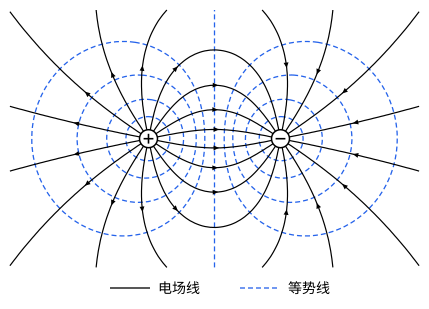

## 这一节要回答的问题

:term[电场]{id="physics.electromagnetism.electric-field"}（electric field）是矢量，求一组:term[电荷]{id="physics.electromagnetism.electric-charge"}（electric charge）的电场，要把各自的电场按分量相加，常常很费事。重力场里有势能，能不能也给电场找一个标量，加起来简单，求导又能得回电场？

## 讲解

### 静电场是保守场

:term[点电荷]{id="physics.electromagnetism.point-charge"}（point charge）$Q$的:term[电场]{id="physics.electromagnetism.electric-field"}沿径向。把:term[试探电荷]{id="physics.electromagnetism.test-charge"}（test charge）$q_0$从$A$沿任意一条路径移到$B$，每一小段位移$\dd\vb l$里只有沿径向的部分$\dd r$做功，电场力做的功是$\int_A^Bq_0\vb E\cdot\dd\vb l=\frac{Qq_0}{4\pi\varepsilon_0}\int_{r_A}^{r_B}\frac{\dd r}{r^2}=\frac{Qq_0}{4\pi\varepsilon_0}\Bigl(\frac{1}{r_A}-\frac{1}{r_B}\Bigr)$。它只和起点、终点到$Q$的距离有关，和走哪条路无关。

::anchor{id="thm-conservative"}
定理（静电场是保守场）：静止的:term[电荷]{id="physics.electromagnetism.electric-charge"}产生的电场，沿任意闭合曲线的曲线积分（line integral）为零，$\oint\vb E\cdot\dd\vb l=0$；等价地，从$A$到$B$的积分$\int_A^B\vb E\cdot\dd\vb l$和路径无关。

证明思路：单个点电荷的情形就是上面那一段算的。一般的静电场是许多点电荷（或连续分布的电荷）的电场叠加而成的，积分也跟着相加，每一项都和路径无关，和也就和路径无关。

### 电势

::anchor{id="def-electric-potential"}
选定一个参考点$O$，$\vb r$处的:term[电势]{id="physics.electromagnetism.electric-potential"}（electric potential）定义为$\varphi(\vb r)=-\int_O^{\vb r}\vb E\cdot\dd\vb l$，单位是伏特（volt），记作$\mathrm V$，$1\,\mathrm V=1\,\mathrm{J/C}$。:term[电荷]{id="physics.electromagnetism.electric-charge"}$q$在$\vb r$处的:term[电势能]{id="physics.electromagnetism.potential-energy"}（electric potential energy）是$U=q\varphi(\vb r)$。

为什么这样定义：:term[静电场]{id="physics.electromagnetism.electric-field"}是保守场（conservative field），积分和路径无关，所以$\varphi$是位置的单值函数；$q\varphi$就是电荷$q$在电场力作用下的势能（见[保守力与势能的梯度](lesson:physics.newtonian-mechanics.conservative-forces)），负号保证正电荷从高电势移到低电势时电场力做正功。参考点常取在无穷远，那里的电势为零。边界情况：换一个参考点，各处的电势都加上同一个常数，电场不变；电荷一直分布到无穷远时（例如无限长的带电直线），不能取无穷远作参考点（p5）。

::anchor{id="def-potential-difference"}
两点电势之差$\varphi_A-\varphi_B=\int_A^B\vb E\cdot\dd\vb l$叫作:term[电势差]{id="physics.electromagnetism.potential-difference"}（potential difference），也叫电压（voltage）。电荷$q$从$A$移到$B$，电场力做的功是$W_{AB}=q(\varphi_A-\varphi_B)$。

为什么这样定义：电势本身随参考点变，电势差不随参考点变，实验上量得到的是它，电压表（voltmeter）量的就是两点之间的电势差。边界情况：电场为零的一块区域里，各点之间的电势差为零，但电势本身不一定是零。

::anchor{id="def-electron-volt"}
电荷为$e$的粒子经过$1\,\mathrm V$的电势差，电场力对它做的功是$1.602176634\times10^{-19}\,\mathrm J$，这个能量叫作$1$:term[电子伏特]{id="physics.electromagnetism.electron-volt"}（electron volt，eV）。

为什么这样定义：原子、分子里的能量常常只有几个电子伏特，用焦耳写，数字太小；粒子经过多大的电势差，就获得多少 eV 的能量，换算也方便。边界情况：eV 是能量的单位，不是电势的单位；电荷为$2e$的粒子经过$1\,\mathrm V$，获得$2\,\mathrm{eV}$。

::anchor{id="thm-point-potential"}
定理（:term[点电荷]{id="physics.electromagnetism.point-charge"}系的电势）：取无穷远为参考点，点电荷$Q$在$\vb r'$处，它在$\vb r$处的电势是$\varphi=\frac{1}{4\pi\varepsilon_0}\frac{Q}{|\vb r-\vb r'|}$；几个点电荷的电势是各自电势的代数和；连续分布的电荷是$\varphi(\vb r)=\frac{1}{4\pi\varepsilon_0}\int\frac{\dd q}{|\vb r-\vb r'|}$。

证明思路：沿径向从无穷远积到距离$r$处，$\varphi=-\int_\infty^r\frac{1}{4\pi\varepsilon_0}\frac{Q}{r'^2}\,\dd r'=\frac{1}{4\pi\varepsilon_0}\frac Qr$。按:term[叠加原理]{id="physics.electromagnetism.superposition-principle"}（superposition principle），电场是各个电荷的电场的矢量和，积分也跟着相加，所以电势是代数和；分得越来越细，和就成了积分。

和求电场相比，求电势只要把标量加起来，不用管方向。

### 由电势求电场

::anchor{id="thm-field-from-potential"}
定理（:term[电场]{id="physics.electromagnetism.electric-field"}是:term[电势]{id="physics.electromagnetism.electric-potential"}的负梯度）：$\vb E=-\nabla\varphi$，即$E_x=-\pdv{\varphi}{x}$，$E_y=-\pdv{\varphi}{y}$，$E_z=-\pdv{\varphi}{z}$。

证明思路：从$\vb r$移到$\vb r+\dd\vb r$，由电势的定义，$\dd\varphi=-\vb E\cdot\dd\vb r$；另一方面$\dd\varphi=\nabla\varphi\cdot\dd\vb r$（见[方向导数与梯度](lesson:math.vector-calculus.gradient)）。两者对任意小位移都相等，所以$\vb E=-\nabla\varphi$，道理和力学里的$\vb F=-\nabla U$一样（见[保守力与势能的梯度](lesson:physics.newtonian-mechanics.conservative-forces)）。

例如均匀带电$Q$、半径为$R$的细圆环，环上每一小段到轴上$z$处的距离都是$\sqrt{z^2+R^2}$，所以那里的电势是$\varphi=\frac{1}{4\pi\varepsilon_0}\frac{Q}{\sqrt{z^2+R^2}}$。按对称性，轴上的电场沿轴，$E_z=-\pdv{\varphi}{z}=\frac{1}{4\pi\varepsilon_0}\frac{Qz}{(z^2+R^2)^{3/2}}$，和[连续分布电荷的电场](lesson:physics.electromagnetism.continuous-charge#thm-ring)里的结果一样，却省掉了分解矢量的麻烦。

### 等势面

::anchor{id="def-equipotential"}
:term[电势]{id="physics.electromagnetism.electric-potential"}相等的点组成的曲面，叫作:term[等势面]{id="physics.electromagnetism.equipotential-surface"}（equipotential surface）。

为什么这样定义：在等势面上移动:term[电荷]{id="physics.electromagnetism.electric-charge"}，:term[电场]{id="physics.electromagnetism.electric-field"}力不做功；由$\vb E=-\nabla\varphi$，电场处处垂直于等势面，指向电势降低的一侧，所以画出等势面，就看出了:term[电场线]{id="physics.electromagnetism.field-line"}（electric field line）的走向。边界情况：:term[点电荷]{id="physics.electromagnetism.point-charge"}的等势面是以它为中心的球面；电场为零的一整块区域里电势处处相等，整块都是等势的，后面讲的:term[导体]{id="physics.electromagnetism.conductor"}（conductor）就是这样。

## 几何图像

图里是等量异号的两个:term[点电荷]{id="physics.electromagnetism.point-charge"}所在平面上的:term[电场线]{id="physics.electromagnetism.field-line"}（实线）和:term[等势面]{id="physics.electromagnetism.equipotential-surface"}与这个平面的交线（虚线，等势线）。两组线处处垂直；靠近:term[电荷]{id="physics.electromagnetism.electric-charge"}时等势线近似是圆，正中间那条竖直线上的:term[电势]{id="physics.electromagnetism.electric-potential"}为零，这条线上的:term[电场]{id="physics.electromagnetism.electric-field"}却不为零。

:::anim{component="function-plot"}
range: { x: [-4, 4], y: [-4, 4] }
functions:
  - expr: "1/abs(x + 1) + k/abs(x - 1)"
    label: |
      电势$\varphi$
  - expr: "(x + 1)/abs(x + 1)^3 + k*(x - 1)/abs(x - 1)^3"
    label: |
      电场的分量$E_x$
sliders:
  - name: k
    min: -2
    max: 2
    step: 0.5
    default: 1
    label: |
      右边电荷与左边电荷之比$q_2/q_1$
:::

动画画的是两个点电荷连线上的电势和电场：$q_1>0$在$x=-a$，$q_2$在$x=a$，横轴以$a$为单位，电势以$\frac{q_1}{4\pi\varepsilon_0a}$为单位，电场以$\frac{q_1}{4\pi\varepsilon_0a^2}$为单位。电场的分量$E_x$是电势曲线斜率的相反数：电势往右上升的地方$E_x<0$。两个电荷同号（$\frac{q_2}{q_1}>0$）时，它们之间的电势有一个最低点，那里$E_x=0$。

## 例题

### 例 1　均匀带电圆盘轴线上的电势

半径为$R$、:term[面电荷密度]{id="physics.electromagnetism.charge-density"}（surface charge density）为$\sigma>0$的均匀带电薄圆盘，求它的轴上离盘心$z$处（$z>0$）的:term[电势]{id="physics.electromagnetism.electric-potential"}，再由电势求:term[电场]{id="physics.electromagnetism.electric-field"}。

**为什么想到这么做**：把圆盘分成一圈圈细圆环，同一个圆环上的:term[电荷]{id="physics.electromagnetism.electric-charge"}到轴上那一点的距离都一样，电势直接相加；电场再由$E_z=-\pdv{\varphi}{z}$求出。

**推导**：半径为$s$、宽为$\dd s$的圆环带电$2\pi\sigma s\,\dd s$，到场点的距离是$\sqrt{z^2+s^2}$。$\varphi=\frac{1}{4\pi\varepsilon_0}\int_0^R\frac{2\pi\sigma s\,\dd s}{\sqrt{z^2+s^2}}=\frac{\sigma}{2\varepsilon_0}\Bigl[\sqrt{z^2+s^2}\Bigr]_0^R=\frac{\sigma}{2\varepsilon_0}\bigl(\sqrt{z^2+R^2}-z\bigr)$。$E_z=-\pdv{\varphi}{z}=\frac{\sigma}{2\varepsilon_0}\Bigl(1-\frac{z}{\sqrt{z^2+R^2}}\Bigr)$，和[连续分布电荷的电场](lesson:physics.electromagnetism.continuous-charge)例 2 的结果一样。

### 例 2　加速和截停电子

（1）电子从静止开始，经过$1.0\,\mathrm{kV}$的:term[电势差]{id="physics.electromagnetism.potential-difference"}加速，获得多少动能？速度多大（不考虑相对论效应）？（2）反过来，动能为$2.0\,\mathrm{eV}$的电子，要逆着多大的电势差前进才会停下？取$e=1.602176634\times10^{-19}\,\mathrm C$，$m_e=9.1093837139\times10^{-31}\,\mathrm{kg}$。

**为什么想到这么做**：:term[电场]{id="physics.electromagnetism.electric-field"}力做的功等于动能的增加，$\Delta K=-q\Delta\varphi$，电子的$q=-e$。用:term[电子伏特]{id="physics.electromagnetism.electron-volt"}，能量直接读出来。

**推导**：（1）电子从低:term[电势]{id="physics.electromagnetism.electric-potential"}跑到高电势，电场力做功$e\times1.0\,\mathrm{kV}=1.0\,\mathrm{keV}\approx1.60\times10^{-16}\,\mathrm J$，这就是它的动能；$v=\sqrt{\frac{2K}{m_e}}\approx1.88\times10^7\,\mathrm{m/s}$，约为光速的$6\%$，不考虑相对论效应误差很小。（2）电子从电势高的$A$处跑向电势低的$B$处，电场力做功$-e(\varphi_A-\varphi_B)$，是负功；要把$2.0\,\mathrm{eV}$的动能消耗完，$\varphi_A-\varphi_B=2.0\,\mathrm V$。量子力学里就用这种「截止电压」测光电子的最大动能（见[光子与光电效应](lesson:physics.quantum-mechanics.photons)）。

## 常见误区

- 「:term[电势]{id="physics.electromagnetism.electric-potential"}为零的地方，:term[电场]{id="physics.electromagnetism.electric-field"}也为零。」等量异号:term[电荷]{id="physics.electromagnetism.electric-charge"}连线的中点电势为零，电场却不为零（几何图像）。
- 「电场为零的地方，电势也为零。」等量同号电荷连线的中点电场为零，电势却是两个电荷的电势之和。
- 「:term[电势能]{id="physics.electromagnetism.potential-energy"}是放进来的那个电荷自己的。」它是这个电荷和产生电场的那些电荷共有的（p8）。
- 「:term[电子伏特]{id="physics.electromagnetism.electron-volt"}是电势的单位。」它是能量的单位，$1\,\mathrm{eV}=1.602176634\times10^{-19}\,\mathrm J$。
