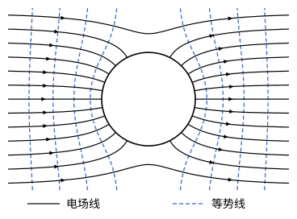

## 这一节要回答的问题

一个不带电的:term[导体]{id="physics.electromagnetism.conductor"}（conductor）球放进匀强:term[电场]{id="physics.electromagnetism.electric-field"}（electric field），:term[电场线]{id="physics.electromagnetism.field-line"}（electric field line）会弯过来，垂直地落到球面上，球面上感应出一边正、一边负的:term[电荷]{id="physics.electromagnetism.electric-charge"}（electric charge）。:term[感应电荷]{id="physics.electromagnetism.induced-charge"}（induced charge）怎样分布事先不知道，:term[镜像法]{id="physics.electromagnetism.method-of-images"}（method of images）也一下想不出像该放在哪里。能不能直接解:term[拉普拉斯方程]{id="physics.electromagnetism.laplace-equation"}（Laplace's equation），把球外的:term[电势]{id="physics.electromagnetism.electric-potential"}（electric potential）求出来？

## 讲解

### 轴对称的通解

在球坐标$(r,\theta,\psi)$里（$\psi$是方位角，$\varphi$留给:term[电势]{id="physics.electromagnetism.electric-potential"}），很多问题绕$z$轴对称，:term[电势]{id="physics.electromagnetism.electric-potential"}不依赖$\psi$。设$\varphi=f(r)\,g(\theta)$，代进:term[拉普拉斯方程]{id="physics.electromagnetism.laplace-equation"}，两个变量分开，就是分离变量法（separation of variables）；要求$g$在$\theta=0$和$\pi$处有限，$g$只能是勒让德多项式（Legendre polynomials）（见[球坐标下的分离变量与勒让德多项式](lesson:math.pde.legendre-polynomials)）。

::anchor{id="thm-axisymmetric"}
定理（轴对称的拉普拉斯方程的通解）：在没有:term[电荷]{id="physics.electromagnetism.electric-charge"}的区域里，不依赖方位角的电势可以写成$\varphi(r,\theta)=\sum_{l=0}^\infty\Bigl(A_lr^l+\frac{B_l}{r^{l+1}}\Bigr)P_l(\cos\theta)$，其中$P_0=1$，$P_1(\cos\theta)=\cos\theta$，$P_2(\cos\theta)=\frac{3\cos^2\theta-1}{2}$……

证明思路：分离变量后，$g(\theta)$满足的方程只有在常数取$l(l+1)$、$l=0,1,2,\dots$时才有在两极有限的解，就是$P_l(\cos\theta)$；对应的$f(r)$满足$\dv{}{r}\Bigl(r^2\dv{f}{r}\Bigr)=l(l+1)f$，两个独立解是$r^l$和$r^{-(l+1)}$。拉普拉斯方程是线性的，把这些解加起来仍是解；任何轴对称的解都能这样展开。

用法是：先按区域定下哪些项可以出现，再用边界条件定系数。区域包含原点时，$\frac{B_l}{r^{l+1}}$在原点发散，只能取$B_l=0$；区域伸到无穷远时，$A_lr^l$随$r$增长，只有远处本来就有的:term[电场]{id="physics.electromagnetism.electric-field"}（如匀强电场）才允许它出现。各个$P_l(\cos\theta)$线性无关，边界上两个这样的和处处相等，系数就一项一项相等；求出的电势满足方程和边界条件，按:term[唯一性定理]{id="physics.electromagnetism.uniqueness-theorem"}（uniqueness theorem）它就是答案。

### 匀强电场里的导体球

半径为$R$、不带电的:term[导体]{id="physics.electromagnetism.conductor"}球，球心在原点，放进沿$z$轴的匀强:term[电场]{id="physics.electromagnetism.electric-field"}$E_0\uv z$。远处的:term[电势]{id="physics.electromagnetism.electric-potential"}趋于$-E_0z=-E_0r\cos\theta$；把$z\to-z$，整个问题变成它的相反数，所以球的电势只能是零。边界条件是：$\varphi(R,\theta)=0$，$r\to\infty$时$\varphi\to-E_0r\cos\theta$。

::anchor{id="thm-sphere-in-field"}
定理（匀强电场里的导体球）：球外的电势是$\varphi=-E_0\Bigl(r-\frac{R^3}{r^2}\Bigr)\cos\theta$；球面上:term[感应电荷]{id="physics.electromagnetism.induced-charge"}的:term[面电荷密度]{id="physics.electromagnetism.charge-density"}（surface charge density）是$\sigma=3\varepsilon_0E_0\cos\theta$；球外的电场等于原来的匀强电场，加上一个位于球心的:term[电偶极子]{id="physics.electromagnetism.electric-dipole"}（electric dipole）的电场，它的:term[电偶极矩]{id="physics.electromagnetism.dipole-moment"}（dipole moment）是$\vb p=4\pi\varepsilon_0R^3E_0\uv z$。

证明思路：远处的条件只含$\cos\theta$，所以只留$l=1$的两项，$A_1=-E_0$。由$\varphi(R,\theta)=\Bigl(-E_0R+\frac{B_1}{R^2}\Bigr)\cos\theta=0$得$B_1=E_0R^3$，这一项正是电偶极矩为$4\pi\varepsilon_0R^3E_0$的电偶极子的电势$\frac{1}{4\pi\varepsilon_0}\frac{p\cos\theta}{r^2}$。紧贴球面外侧，$E_r=-\pdv{\varphi}{r}=E_0\Bigl(1+\frac{2R^3}{r^3}\Bigr)\cos\theta=3E_0\cos\theta$，所以$\sigma=\varepsilon_0E_r=3\varepsilon_0E_0\cos\theta$。

感应电荷在迎着电场的一半（$\theta>\frac\pi2$）是负的，另一半是正的，总量为零。球面两极处的电场是$3E_0$，是原来电场的三倍。

解静电问题的这套办法可以归纳成四步：按对称性选坐标；写出通解；用边界条件定系数；用:term[唯一性定理]{id="physics.electromagnetism.uniqueness-theorem"}确认。

## 几何图像

图里是过球心、沿:term[电场]{id="physics.electromagnetism.electric-field"}方向的截面：:term[电场线]{id="physics.electromagnetism.field-line"}（实线）从左边来，靠近球的那几条弯向球面，垂直地终止在左半个球面的:term[负电荷]{id="physics.electromagnetism.electric-charge"}上；右半个球面上的正电荷又发出同样多的电场线。:term[等势面]{id="physics.electromagnetism.equipotential-surface"}（equipotential surface）与纸面的交线（虚线）在球面附近弯得和球面平行，远处又回到等间距的直线；球面本身和过球心、垂直于电场的平面都是:term[电势]{id="physics.electromagnetism.electric-potential"}为零的等势面。纸面上电场线的疏密只能定性地看。

## 例题

### 例 1　球面上给定的电势

半径为$R$的球面上，:term[电势]{id="physics.electromagnetism.electric-potential"}是$\varphi(R,\theta)=V_0\cos\theta$（例如球面上分布着某种:term[电荷]{id="physics.electromagnetism.electric-charge"}），球里球外都没有别的电荷，无穷远处电势为零。求球里和球外的电势，以及球面上的:term[面电荷密度]{id="physics.electromagnetism.charge-density"}。

**为什么想到这么做**：球里、球外是两个区域，各用一个通解：球里不能有$\frac{B_l}{r^{l+1}}$，球外不能有$A_lr^l$。边界上的电势只含$P_1(\cos\theta)$，两边都只留$l=1$一项。

**推导**：球里$\varphi=A_1r\cos\theta$，由$A_1R=V_0$得$\varphi=V_0\frac rR\cos\theta$；球外$\varphi=\frac{B_1}{r^2}\cos\theta$，由$\frac{B_1}{R^2}=V_0$得$\varphi=V_0\frac{R^2}{r^2}\cos\theta$。球里的电势就是$\frac{V_0}{R}z$，:term[电场]{id="physics.electromagnetism.electric-field"}是匀强的$-\frac{V_0}{R}\uv z$。面电荷密度由球面两侧电场的径向分量之差得出：$\sigma=\varepsilon_0\Bigl(-\pdv{\varphi_{\text{外}}}{r}+\pdv{\varphi_{\text{内}}}{r}\Bigr)\Big|_{r=R}=\varepsilon_0\Bigl(\frac{2V_0}{R}+\frac{V_0}{R}\Bigr)\cos\theta=\frac{3\varepsilon_0V_0}{R}\cos\theta$。

### 例 2　带电的导体球放进匀强电场

:term[导体]{id="physics.electromagnetism.conductor"}球带电$Q$，其余条件和上面的定理一样。求球外的:term[电势]{id="physics.electromagnetism.electric-potential"}和球面上的:term[面电荷密度]{id="physics.electromagnetism.charge-density"}。

**为什么想到这么做**：:term[拉普拉斯方程]{id="physics.electromagnetism.laplace-equation"}是线性的，可以在定理的解上再加一个$l=0$的项$\frac{B_0}{r}$：它在球面上是常数，不破坏等势，又能给球带上:term[电荷]{id="physics.electromagnetism.electric-charge"}。

**推导**：取$\varphi=-E_0\Bigl(r-\frac{R^3}{r^2}\Bigr)\cos\theta+\frac{1}{4\pi\varepsilon_0}\frac Qr$。它满足拉普拉斯方程，远处趋于$-E_0r\cos\theta$，球面上是常数$\frac{1}{4\pi\varepsilon_0}\frac QR$，在包住球的闭合曲面上，:term[电通量]{id="physics.electromagnetism.electric-flux"}（electric flux）是$\frac{Q}{\varepsilon_0}$；按给定导体电荷时的:term[唯一性定理]{id="physics.electromagnetism.uniqueness-theorem"}，这就是答案。面电荷密度是$\sigma=3\varepsilon_0E_0\cos\theta+\frac{Q}{4\pi R^2}$：感应的部分加上均匀分布的部分。

## 常见误区

- 「通解里的每一项在哪个区域都能用。」包含原点的区域里$\frac{B_l}{r^{l+1}}$发散，伸到无穷远的区域里$A_lr^l$（$l\ge1$）发散，要按区域取舍。
- 「:term[导体]{id="physics.electromagnetism.conductor"}球放进:term[电场]{id="physics.electromagnetism.electric-field"}以后，球外的:term[电场]{id="physics.electromagnetism.electric-field"}只是原来的电场。」还要加上:term[感应电荷]{id="physics.electromagnetism.induced-charge"}的电场，它就是一个:term[电偶极子]{id="physics.electromagnetism.electric-dipole"}的电场，靠近球面时不能忽略。
- 「导体球不带电，球面上就没有:term[电荷]{id="physics.electromagnetism.electric-charge"}。」总电荷为零，可:term[面电荷密度]{id="physics.electromagnetism.charge-density"}是$3\varepsilon_0E_0\cos\theta$，一半正、一半负。
- 「边界条件只要在几个点上满足就够了。」要在整个边界上处处满足，系数才能一项一项定出来。
