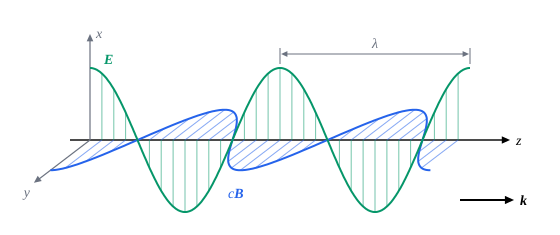

## 这一节要回答的问题

麦克斯韦由他的方程组预言了以光速传播的:term[电磁波]{id="physics.electromagnetism.em-wave"}（electromagnetic wave，见[位移电流与麦克斯韦方程组](lesson:physics.electromagnetism.maxwell-equations)）。怎样由方程组推出电磁波？波里的:term[电场]{id="physics.electromagnetism.electric-field"}（electric field）和:term[磁场]{id="physics.electromagnetism.magnetic-field"}（magnetic field）是什么方向、多大？为什么说光也是电磁波？

## 讲解

### 波动方程

真空里没有:term[电荷]{id="physics.electromagnetism.electric-charge"}（electric charge）和:term[电流]{id="physics.electromagnetism.electric-current"}（electric current）的地方，:term[麦克斯韦方程组]{id="physics.electromagnetism.maxwell-equations"}（Maxwell's equations）是$\divg\vb E=0$、$\divg\vb B=0$、$\curl\vb E=-\pdv{\vb B}t$、$\curl\vb B=\frac{1}{c^2}\pdv{\vb E}t$，其中$c=\frac{1}{\sqrt{\mu_0\varepsilon_0}}$。两个旋度方程把:term[电场]{id="physics.electromagnetism.electric-field"}和:term[磁场]{id="physics.electromagnetism.magnetic-field"}连在一起：一个变化，另一个就有旋度。

::anchor{id="thm-em-wave-equation"}
定理（真空中的波动方程）：没有电荷和电流的地方，电场和磁场的每个分量都满足以速度$c$传播的波动方程（wave equation）：$\lap\vb E=\frac{1}{c^2}\frac{\partial^2\vb E}{\partial t^2}$，$\lap\vb B=\frac{1}{c^2}\frac{\partial^2\vb B}{\partial t^2}$，$c=\frac{1}{\sqrt{\mu_0\varepsilon_0}}$。

证明思路：对:term[法拉第定律]{id="physics.electromagnetism.faraday-law"}（Faraday's law of induction）两边取旋度，左边$\curl(\curl\vb E)=\nabla(\divg\vb E)-\lap\vb E=-\lap\vb E$，右边$-\pdv{}{t}(\curl\vb B)=-\frac{1}{c^2}\frac{\partial^2\vb E}{\partial t^2}$。对:term[安培-麦克斯韦定律]{id="physics.electromagnetism.ampere-maxwell-law"}（Ampère–Maxwell law）取旋度，同样得到$\vb B$的方程。

::anchor{id="def-em-wave"}
方程组的这种解，电场和磁场互相维持、以光速$c$在空间传播，叫作:term[电磁波]{id="physics.electromagnetism.em-wave"}（electromagnetic wave）。

为什么这样定义：波里没有什么介质在振动，振动的就是场本身，它离开了产生它的电荷和电流照样传播，带着能量和动量（见[电磁波的能量与强度](lesson:physics.electromagnetism.em-wave-energy)、[电磁场的动量](lesson:physics.electromagnetism.field-momentum)）。一个电荷挪动以后，远处的电荷要过一段时间才受到变化了的力，就是因为变化以电磁波的形式以$c$传开（见[电场](lesson:physics.electromagnetism.electric-field)第 7 题）。边界情况：频率很低时波长很长，$50\,\mathrm{Hz}$的波长是$6000\,\mathrm{km}$，比实验室里的电路大得多，电路各处的场可以看成同时变化，这正是前面讲直流、交流电路时默认的情形。

代入$\mu_0$和$\varepsilon_0$，$c\approx2.998\times10^8\,\mathrm{m/s}$，正是光速：:term[毕奥-萨伐尔定律]{id="physics.electromagnetism.biot-savart-law"}（Biot–Savart law）那一节提到的$\mu_0\varepsilon_0=\frac{1}{c^2}$说的就是这件事。现在的国际单位制把它倒过来用：1983 年起，米由光速定义，光速取精确值$299\,792\,458\,\mathrm{m/s}$；2019 年修订以后，$\mu_0$和$\varepsilon_0$都是测量值，满足$\mu_0\varepsilon_0c^2=1$。

### 平面电磁波

最简单的解是平面波（plane wave）：场只随一个方向的坐标和时间变化（见[平面波与球面波](lesson:physics.oscillations-waves.waves-in-3d)）。

::anchor{id="thm-plane-wave"}
定理（:term[平面电磁波]{id="physics.electromagnetism.em-wave"}）：沿单位矢量$\uv n$方向传播的平面简谐波$\vb E=\vb E_0\cos(\vb k\cdot\vb r-\omega t)$、$\vb B=\vb B_0\cos(\vb k\cdot\vb r-\omega t)$（$\vb k=k\uv n$是波矢，wave vector）满足真空中的:term[麦克斯韦方程组]{id="physics.electromagnetism.maxwell-equations"}，当且仅当$\omega=ck$，$\vb E_0$和$\vb B_0$都垂直于$\uv n$，并且$\vb B_0=\frac1c\uv n\times\vb E_0$。

证明思路：记$\xi=\vb k\cdot\vb r-\omega t$，$\nabla\cos\xi=-\vb k\sin\xi$，$\pdv{}{t}\cos\xi=\omega\sin\xi$。$\divg\vb E=-\vb k\cdot\vb E_0\sin\xi=0$给出$\vb k\cdot\vb E_0=0$，:term[磁场]{id="physics.electromagnetism.magnetic-field"}同理。:term[法拉第定律]{id="physics.electromagnetism.faraday-law"}左边$\curl\vb E=-(\vb k\times\vb E_0)\sin\xi$，右边$-\pdv{\vb B}t=-\omega\vb B_0\sin\xi$，所以$\vb B_0=\frac1\omega\vb k\times\vb E_0$；代入波动方程得$\omega=ck$，$\frac{\vb k}{\omega}=\frac{\uv n}{c}$。:term[安培-麦克斯韦定律]{id="physics.electromagnetism.ampere-maxwell-law"}给出的是同一个关系。

由定理，$\vb E$、$\vb B$、$\vb k$两两垂直，电磁波是横波（transverse wave）；$\vb E\times\vb B$沿着传播方向，$|\vb B|=\frac{|\vb E|}{c}$；单个行波里:term[电场]{id="physics.electromagnetism.electric-field"}和磁场同时达到最大、同时为零。把$\vb E$换成$c\vb B$、$\vb B$换成$-\frac{\vb E}{c}$，得到的仍是一列满足方程组的平面波，:term[偏振]{id="physics.electromagnetism.wave-polarization"}（polarization）方向转了$90^\circ$：这正是[位移电流与麦克斯韦方程组](lesson:physics.electromagnetism.maxwell-equations)第 7 题说的对称。

### 偏振和电磁波谱

::anchor{id="def-wave-polarization"}
:term[电磁波]{id="physics.electromagnetism.em-wave"}里:term[电场]{id="physics.electromagnetism.electric-field"}振动的方向特性叫作电磁波的:term[偏振]{id="physics.electromagnetism.wave-polarization"}（polarization）；电场始终沿同一条直线振动的平面波叫作线偏振（linear polarization）的，这条直线的方向叫作偏振方向。

为什么这样定义：沿同一个方向传播、频率相同的平面波，电场只能在垂直于传播方向的平面里振动，这个平面里两个互相垂直的方向各自独立，任何一列这样的波都是两列线偏振波的叠加。两列振幅相等、相位差$90^\circ$时，电场的方向匀速转圈（第 5 题）。边界情况：太阳光、灯光由大量原子各自发出，偏振方向快速而杂乱地变化，平均下来哪个方向都一样（见[偏振](lesson:physics.optics.polarization)）。

方程组对频率没有限制，各种频率的电磁波都存在。按频率从低到高，有无线电波、微波、红外线、可见光、紫外线、X 射线和$\gamma$射线：调频广播在$100\,\mathrm{MHz}$附近，波长约$3\,\mathrm m$；微波炉用$2.45\,\mathrm{GHz}$；可见光的波长大约从$400\,\mathrm{nm}$（紫）到$700\,\mathrm{nm}$（红）；X 射线的波长和原子的大小差不多。它们在真空里的速度都是$c$；方程组只给出这一个$c$，没说它是相对什么的速度，这成了狭义相对论光速不变的出发点（见[相对性原理与光速不变](lesson:physics.special-relativity.postulates)）。

## 几何图像

图里画的是:term[线偏振]{id="physics.electromagnetism.wave-polarization"}的平面波在某一时刻沿传播方向的样子：:term[电场]{id="physics.electromagnetism.electric-field"}（绿）沿$x$方向，$c\vb B$（蓝）沿$y$方向（斜着画的那根轴垂直纸面向外），两者同相，$\vb E\times\vb B$沿$+z$。整个图案以速度$c$向右平移；相邻两个波峰相距一个波长$\lambda=\frac{2\pi}{k}=\frac{c}{f}$。

:::anim{component="function-plot"}
range: { x: [0, 2], y: [-2.2, 2.2] }
functions:
  - expr: "cos(2*pi*(x - s)) - r*cos(2*pi*(x + s))"
    label: |
      电场的$x$分量，以$E_0$为单位
  - expr: "cos(2*pi*(x - s)) + r*cos(2*pi*(x + s))"
    label: |
      磁场的$y$分量乘以$c$，以$E_0$为单位
sliders:
  - name: s
    min: 0
    max: 1
    step: 0.05
    default: 0
    label: |
      时间，以周期为单位
  - name: r
    min: 0
    max: 1
    step: 0.25
    default: 0
    label: |
      反向传播的那列波的振幅，以$E_0$为单位
:::

动画画的是沿$z$轴（图上写作$x$，以波长为单位）的电场和$c$乘:term[磁场]{id="physics.electromagnetism.magnetic-field"}。$r=0$时只有一列沿$+z$传播的波，两条曲线重合，拖动时间$s$（以周期为单位），整个波形向右移。$r=1$时加上一列振幅相同、沿$-z$传播的波（例如被一块:term[导体]{id="physics.electromagnetism.conductor"}（conductor）反射回来的），两条曲线不再重合：电场在固定的点上为零，磁场在另一些点上为零，波形不再移动，成了驻波（例 2）。

## 例题

### 例 1　调频广播的电磁波

一个调频电台的频率是$100\,\mathrm{MHz}$，某处:term[电场]{id="physics.electromagnetism.electric-field"}的振幅是$0.10\,\mathrm{V/m}$。求波长、波数和这里:term[磁场]{id="physics.electromagnetism.magnetic-field"}的振幅。

**为什么想到这么做**：真空中$\lambda f=c$，$k=\frac{2\pi}{\lambda}$；平面波里$B_0=\frac{E_0}{c}$。

**推导**：$\lambda=\frac{c}{f}=\frac{3.00\times10^8}{1.00\times10^8}\,\mathrm m=3.00\,\mathrm m$，$k=\frac{2\pi}{\lambda}\approx2.09\,\mathrm{rad/m}$。$B_0=\frac{E_0}{c}=\frac{0.10}{3.00\times10^8}\,\mathrm T\approx3.3\times10^{-10}\,\mathrm T$，比地球的磁场小五个数量级，可它在天线里感应出的:term[电动势]{id="physics.electromagnetism.electromotive-force"}（electromotive force）足以被收音机放大。

### 例 2　驻波

一块平板:term[导体]{id="physics.electromagnetism.conductor"}放在$z=0$处，:term[电场]{id="physics.electromagnetism.electric-field"}为$E_0\cos(kz-\omega t)\,\uv x$的平面波从$z<0$那边射来，被板全部反射，反射波的电场是$-E_0\cos(kz+\omega t)\,\uv x$。求板前面的合电场和:term[合磁场]{id="physics.electromagnetism.magnetic-field"}。

**为什么想到这么做**：反射波沿$-z$传播，它的磁场按$\vb B_0=\frac1c\uv n\times\vb E_0$算，$\uv n=-\uv z$；两列波的场直接相加。

**推导**：合电场$E_0[\cos(kz-\omega t)-\cos(kz+\omega t)]\,\uv x=2E_0\sin kz\sin\omega t\,\uv x$，在板面$z=0$上为零，和导体表面电场的切向分量为零相符。入射波的磁场是$\frac{E_0}{c}\cos(kz-\omega t)\,\uv y$；反射波$\frac1c(-\uv z)\times\bigl(-E_0\cos(kz+\omega t)\uv x\bigr)=\frac{E_0}{c}\cos(kz+\omega t)\,\uv y$，合磁场$\frac{2E_0}{c}\cos kz\cos\omega t\,\uv y$。电场为零的点（$kz=-m\pi$）正是磁场最大的点，相隔半个波长；时间上两者也差四分之一周期，能量在电场和磁场之间来回倒换，像 LC 电路一样。

## 常见误区

- 「:term[电磁波]{id="physics.electromagnetism.em-wave"}要靠某种介质才能传播。」振动的就是:term[电场]{id="physics.electromagnetism.electric-field"}和:term[磁场]{id="physics.electromagnetism.magnetic-field"}，真空里照样传播；19 世纪设想的以太，后来的实验没有找到（第 7 题）。
- 「电磁波里磁场是电场的$\frac1c$，弱得可以不管。」数值小只是单位的缘故，磁场储存的能量和电场的一样多（见[电磁波的能量与强度](lesson:physics.electromagnetism.em-wave-energy)）。
- 「平面波是真实存在的波。」它是理想化的模型，真实的波总有边界；离波源很远、只看不大的一块地方时，球面波近似是平面波。
