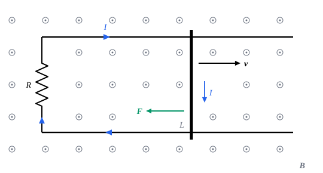

## 这一节要回答的问题

1820 年，奥斯特发现:term[电流]{id="physics.electromagnetism.electric-current"}（electric current）能产生:term[磁场]{id="physics.electromagnetism.magnetic-field"}（magnetic field）；反过来，磁场能不能产生电流？一块磁铁静静地放在线圈旁边，线圈里没有电流，可磁铁一动，电流就出现了。什么时候会产生电流，:term[电动势]{id="physics.electromagnetism.electromotive-force"}（electromotive force）有多大、朝哪个方向？发电机靠的又是什么？

## 讲解

### 电磁感应

1831 年 8 月 29 日，法拉第（Michael Faraday）在一个铁环上绕了两组互相绝缘的线圈，一组接电池，一组接检流计（galvanometer）。他发现电池接通和断开的一瞬间检流计都会摆动，:term[电流]{id="physics.electromagnetism.electric-current"}稳定以后却一动不动；后来又发现，把磁铁插进线圈或从线圈里拔出时，线圈里也有电流。1832 年，美国的亨利（Joseph Henry）独立地发现了同样的现象。关键不在于:term[磁场]{id="physics.electromagnetism.magnetic-field"}强，而在于磁场变。

::anchor{id="def-induction"}
穿过闭合回路的:term[磁通量]{id="physics.electromagnetism.magnetic-flux"}（magnetic flux）变化时，回路里出现:term[电动势]{id="physics.electromagnetism.electromotive-force"}、产生电流，这种现象叫作:term[电磁感应]{id="physics.electromagnetism.electromagnetic-induction"}（electromagnetic induction）；这时的电动势叫作:term[感应电动势]{id="physics.electromagnetism.induced-emf"}（induced electromotive force），电流叫作感应电流（induced current）。

为什么这样定义：法拉第的各种实验，不论是磁铁和线圈相对运动、另一个线圈的电流变化，还是线圈变形、转动，共同的一点都是穿过线圈的磁通量变了；磁通量不变，磁场再强也没有电流。说「电动势」而不只说「电流」，是因为回路的:term[电阻]{id="physics.electromagnetism.resistance"}（resistance）不同，电流也不同，电动势却只由磁通量的变化决定。边界情况：回路不必是导线做的，断开的线圈两端照样有感应电动势，只是没有电流。

### 法拉第定律

::anchor{id="thm-faraday"}
定理（:term[法拉第电磁感应定律]{id="physics.electromagnetism.faraday-law"}，Faraday's law of induction）：闭合回路$C$里的:term[感应电动势]{id="physics.electromagnetism.induced-emf"}是$\mathcal E=-\dv{\Phi}{t}$，$\Phi$是穿过以$C$为边界的曲面的:term[磁通量]{id="physics.electromagnetism.magnetic-flux"}，$\mathcal E$的正方向（沿$C$绕行的方向）和曲面的方向按右手定则对应；$N$匝相同的线圈串在一起，$\mathcal E=-N\dv{\Phi}{t}$。

证明思路：先看:term[磁场]{id="physics.electromagnetism.magnetic-field"}不随时间变、回路在运动的情形。导线里的:term[载流子]{id="physics.electromagnetism.charge-carrier"}（charge carrier）随导线以速度$\vb v$运动，受磁力$q\vb v\times\vb B$（见[磁场与洛伦兹力](lesson:physics.electromagnetism.lorentz-force#def-lorentz-force)），单位:term[正电荷]{id="physics.electromagnetism.electric-charge"}（positive charge）受的非静电力是$\vb v\times\vb B$，所以$\mathcal E=\oint_C(\vb v\times\vb B)\cdot\dd\vb l$（见[电动势](lesson:physics.electromagnetism.dc-circuits#def-emf)）。$\dd t$时间里，线元$\dd\vb l$扫过一小块面积$(\vb v\,\dd t)\times\dd\vb l$，穿过新回路的磁通量比原来多出穿过这一圈窄带的磁通量，$\dd\Phi=\oint_C\vb B\cdot\bigl((\vb v\,\dd t)\times\dd\vb l\bigr)=-\dd t\oint_C(\vb v\times\vb B)\cdot\dd\vb l$（混合积轮换），所以$\mathcal E=-\dv{\Phi}{t}$。

磁场随时间变、回路不动时，导线里的电荷原来不动，磁力是零，推动电荷的是变化的磁场产生的:term[电场]{id="physics.electromagnetism.electric-field"}（electric field，见[感生电场](lesson:physics.electromagnetism.induced-electric-field)）；实验表明，这时$\mathcal E=-\dv{\Phi}{t}$照样成立。法拉第定律用一个式子把两种情形都包括了进去，两种原因同时存在时也成立。

上面用到了：穿过以同一条闭合曲线为边界的任意两个曲面的磁通量相同（见[安培环路定理](lesson:physics.electromagnetism.ampere-law#def-magnetic-flux)），所以「穿过回路的磁通量」有确定的值。有变化的磁通量穿过电路时，基尔霍夫的回路定律要改写：感应电动势和电池的:term[电动势]{id="physics.electromagnetism.electromotive-force"}一样，算进电动势之和里（见[电动势与直流电路](lesson:physics.electromagnetism.dc-circuits#thm-kirchhoff)）。双绞线（twisted pair）每绞半圈，相邻两段回路的方向就反过来，外面的磁场变化在两段里引起的电动势一正一负，互相抵消（见[毕奥-萨伐尔定律](lesson:physics.electromagnetism.biot-savart)第 8 题）。

### 楞次定律

::anchor{id="thm-lenz"}
定理（:term[楞次定律]{id="physics.electromagnetism.lenz-law"}，Lenz's law）：:term[感应电流]{id="physics.electromagnetism.electric-current"}的方向，总是使它自己产生的:term[磁场]{id="physics.electromagnetism.magnetic-field"}阻碍引起感应的:term[磁通量]{id="physics.electromagnetism.magnetic-flux"}的变化。

证明思路：这是:term[法拉第定律]{id="physics.electromagnetism.faraday-law"}里负号的意思。磁通量增加时$\mathcal E<0$，感应电流沿着和曲面的方向按右手定则对应的方向的反方向流，它在回路围成的面上产生的磁场和曲面的方向相反，使磁通量少增加一些；磁通量减少时，感应电流的磁场和原来的磁场同向，使磁通量少减少一些。1833 年 11 月，楞次（Heinrich Lenz）在圣彼得堡科学院宣读了这条判断方向的规则，第二年发表。

楞次定律和能量守恒是一回事。把磁铁的 N 极推向线圈，感应电流使线圈朝向磁铁的一面也像一个 N 极，把磁铁往回推，人要做功，这些功变成线圈里的:term[焦耳热]{id="physics.electromagnetism.joule-heating"}（Joule heating）。如果感应电流反过来帮助磁通量变化，磁铁会被越吸越快，凭空得到能量。

### 发电机

::anchor{id="thm-generator"}
定理（转动线圈的:term[电动势]{id="physics.electromagnetism.electromotive-force"}）：$N$匝面积为$A$的平面线圈在匀强:term[磁场]{id="physics.electromagnetism.magnetic-field"}$\vb B$里，绕垂直于$\vb B$的轴以角速度$\omega$匀速转动，$t=0$时线圈平面垂直于$\vb B$，那么线圈里的:term[感应电动势]{id="physics.electromagnetism.induced-emf"}是$\mathcal E=NBA\omega\sin\omega t$。

证明思路：线圈平面的法线和$\vb B$的夹角是$\omega t$，穿过每一匝的:term[磁通量]{id="physics.electromagnetism.magnetic-flux"}是$BA\cos\omega t$，由:term[法拉第定律]{id="physics.electromagnetism.faraday-law"}，$\mathcal E=-N\dv{}{t}(BA\cos\omega t)=NBA\omega\sin\omega t$。

交流发电机就是这样工作的：电动势按正弦规律变化，峰值$NBA\omega$和转速成正比，接上电路就得到:term[交流电]{id="physics.electromagnetism.alternating-current"}（alternating current，怎样计算见[交流电路与阻抗](lesson:physics.electromagnetism.ac-circuits)）。线圈的导线在磁场里运动，推动:term[电荷]{id="physics.electromagnetism.electric-charge"}的正是磁力$q\vb v\times\vb B$，[电动势与直流电路](lesson:physics.electromagnetism.dc-circuits)一节说「发电机里是磁力」指的就是它。电动机反过来用同一个装置：通电的线圈在磁场里受力矩转动，转动时线圈里也产生感应电动势，方向和外加的电动势相反（见[电流受到的磁力](lesson:physics.electromagnetism.magnetic-force-on-currents)第 6 题）。

## 几何图像

图里两条平行的导轨左端接着:term[电阻]{id="physics.electromagnetism.resistance"}$R$，金属杆架在导轨上以速度$\vb v$向右滑动，匀强:term[磁场]{id="physics.electromagnetism.magnetic-field"}$\vb B$垂直纸面向外。杆里的:term[正电荷]{id="physics.electromagnetism.electric-charge"}受磁力$q\vb v\times\vb B$，沿杆向下，所以:term[电流]{id="physics.electromagnetism.electric-current"}在回路里沿顺时针方向流动。回路围成的面积在增大，向外的:term[磁通量]{id="physics.electromagnetism.magnetic-flux"}在增加；顺时针的感应电流在回路里产生向里的磁场，阻碍磁通量增加，这正是:term[楞次定律]{id="physics.electromagnetism.lenz-law"}。杆受的磁力$I\vb L\times\vb B$向左，阻碍杆的运动（例 1）。

:::anim{component="function-plot"}
range: { x: [-4, 4], y: [-2, 2] }
functions:
  - expr: "1/(1 + (v*x)^2)^1.5"
    label: |
      穿过线圈的磁通量
  - expr: "3*v^2*x/(1 + (v*x)^2)^2.5"
    label: |
      线圈里的感应电动势
sliders:
  - name: v
    min: 0.5
    max: 2
    step: 0.25
    default: 1
    label: |
      磁铁的速度$v$
:::

动画画的是一块小磁铁沿一个圆线圈的轴线匀速穿过线圈：横轴是时间（图上写作$x$），$x=0$时磁铁正好在线圈中心；长度以线圈的半径$R$为单位，速度以每单位时间走过的$R$为单位。磁铁的:term[磁矩]{id="physics.electromagnetism.magnetic-moment"}（magnetic dipole moment）为$m$时，磁通量是$\frac{\mu_0mR^2}{2(R^2+z^2)^{3/2}}$，$z$是磁铁到线圈中心的距离，纵轴以它在$z=0$时的值为单位。磁通量先增后减，:term[电动势]{id="physics.electromagnetism.electromotive-force"}是它变化率的负数：磁铁靠近时为负、离开时为正，穿过中心的一刻为零。磁铁越快，电动势的两个峰越高、越窄，但每个峰下的面积不变，都等于磁通量最大值，正负两个峰合起来是零。

## 例题

### 例 1　导轨上的金属杆

两条相距$L$的平行导轨左端接着:term[电阻]{id="physics.electromagnetism.resistance"}$R$，金属杆架在导轨上以速度$v$向右匀速滑动，匀强:term[磁场]{id="physics.electromagnetism.magnetic-field"}$B$垂直于导轨平面。导轨和杆的电阻不计，求杆里的:term[电流]{id="physics.electromagnetism.electric-current"}、杆受的磁力，以及要维持匀速运动，外力的功率是多少。

**为什么想到这么做**：回路围成的面积以$Lv$的速率增大，:term[磁通量]{id="physics.electromagnetism.magnetic-flux"}的变化率是$BLv$，由:term[法拉第定律]{id="physics.electromagnetism.faraday-law"}得:term[电动势]{id="physics.electromagnetism.electromotive-force"}；有了电流，再用导线在磁场里受的力求磁力。

**推导**：$\mathcal E=BLv$，电流$I=\frac{BLv}{R}$，方向由:term[楞次定律]{id="physics.electromagnetism.lenz-law"}定（几何图像）。杆受的磁力大小是$ILB=\frac{B^2L^2v}{R}$，和速度方向相反，所以要用同样大小的外力拉着杆走（见[电流受到的磁力](lesson:physics.electromagnetism.magnetic-force-on-currents#thm-force-current)）。外力的功率是$\frac{B^2L^2v^2}{R}$，正好等于电阻上的:term[焦耳热]{id="physics.electromagnetism.joule-heating"}$I^2R$：外力做的功经过:term[电磁感应]{id="physics.electromagnetism.electromagnetic-induction"}全部变成了热。

### 例 2　法拉第圆盘

半径为$a$的铜盘在匀强:term[磁场]{id="physics.electromagnetism.magnetic-field"}$B$里，绕通过盘心、平行于磁场的轴以角速度$\omega$转动。一个电刷接触盘的边缘，另一个接触转轴，求两个电刷之间的:term[电动势]{id="physics.electromagnetism.electromotive-force"}。

**为什么想到这么做**：盘上离轴$r$的那一点速度是$\omega r$，沿半径方向的:term[电荷]{id="physics.electromagnetism.electric-charge"}受磁力；把盘看成许多根从轴通到边缘的导线，每一根上非静电力的功就是电动势。

**推导**：单位正电荷受的非静电力$\vb v\times\vb B$沿半径方向，大小$\omega rB$。从轴到边缘积分，$\mathcal E=\int_0^a\omega Br\,\dd r=\frac12B\omega a^2$。1831 年，法拉第就是用这样转动的铜盘得到了持续的:term[电流]{id="physics.electromagnetism.electric-current"}，做出了最早的发电机。

## 常见误区

- 「:term[磁场]{id="physics.electromagnetism.magnetic-field"}越强，:term[感应电动势]{id="physics.electromagnetism.induced-emf"}越大。」:term[电动势]{id="physics.electromagnetism.electromotive-force"}由:term[磁通量]{id="physics.electromagnetism.magnetic-flux"}变化得多快决定；磁场再强，磁通量不变也没有电动势。
- 「:term[感应电流]{id="physics.electromagnetism.electric-current"}的磁场总和原来的磁场反向。」它阻碍的是磁通量的变化：磁通量减少时，感应电流的磁场和原来的磁场同向。
- 「没有闭合的导线，就没有感应电动势。」电动势照样有，只是没有电流；断开的线圈两端会出现:term[电势差]{id="physics.electromagnetism.potential-difference"}（potential difference）。
- 「:term[导体]{id="physics.electromagnetism.conductor"}（conductor）在磁场里运动，里面就一定有感应电流。」线圈在匀强磁场里平移，磁通量不变，两边的电动势互相抵消，没有电流。
