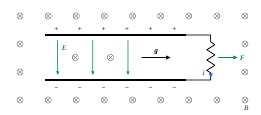

## 这一节要回答的问题

彗星的尘埃尾巴总是背着太阳；两个运动的:term[电荷]{id="physics.electromagnetism.electric-charge"}（electric charge）之间，作用力和反作用力并不总是大小相等、方向相反（见[电场](lesson:physics.electromagnetism.electric-field)第 7 题）。电磁场有没有动量？光照到物体上会不会推它？电荷和场合起来，动量还守恒吗？

## 讲解

### 吸收电磁波得到的动量

一列:term[平面电磁波]{id="physics.electromagnetism.em-wave"}（plane electromagnetic wave）照到物体上，:term[电场]{id="physics.electromagnetism.electric-field"}（electric field）推动物体里的:term[电荷]{id="physics.electromagnetism.electric-charge"}沿电场方向振动，电荷从波里吸收能量；:term[磁场]{id="physics.electromagnetism.magnetic-field"}（magnetic field）对运动电荷的力$q\vb v\times\vb B$却指向传播方向，推着物体往前走。两者之间有一个确定的比例。

::anchor{id="thm-absorbed-momentum"}
定理（吸收电磁波得到的动量）：物体从一列平面电磁波里吸收能量$U$时，沿传播方向得到动量$\frac Uc$；这里设物体里电荷的速度远小于光速，并且垂直于传播方向。

证明思路：平面波里$\vb B=\frac1c\uv n\times\vb E$。电荷$q$的速度$\vb v$垂直于$\uv n$时，$\vb v\times(\uv n\times\vb E)=\uv n(\vb v\cdot\vb E)-\vb E(\vb v\cdot\uv n)=\uv n(\vb v\cdot\vb E)$，所以磁力$q\vb v\times\vb B=\frac{q\vb v\cdot\vb E}{c}\uv n$。$q\vb v\cdot\vb E$正是电场对它做功的功率，即它吸收能量的快慢；两边对时间积分，得到的动量是吸收的能量除以$c$，沿$\uv n$。

::anchor{id="def-radiation-pressure"}
电磁波照在物体表面上，单位面积受到的力叫作:term[辐射压强]{id="physics.electromagnetism.radiation-pressure"}（radiation pressure）；:term[强度]{id="physics.electromagnetism.intensity"}（intensity）为$I$的波垂直照到完全吸收的表面上，辐射压强是$\frac Ic$，照到完全反射的表面上是$\frac{2I}c$。

为什么这样定义：单位时间照到单位面积上的能量是$I$，完全吸收时由上面的定理得到动量$\frac Ic$；完全反射时，波的动量从$\frac Ic$变成反向的$\frac Ic$，表面得到两倍。边界情况：斜着照射时，单位面积上照到的能量少了，表面只受到垂直于它的那部分推力，辐射压强还要乘以入射角余弦的平方（第 5 题）。辐射压强非常小：阳光照在地球附近完全吸收的表面上，只有$\frac{1361}{3.00\times10^8}\,\mathrm{Pa}\approx4.5\times10^{-6}\,\mathrm{Pa}$。

麦克斯韦在他 1873 年的书里就预言了光的压强。1900 年前后，列别捷夫（Pyotr Lebedev）以及尼科尔斯（Ernest Fox Nichols）和赫尔（Gordon Ferrie Hull）先后在实验里测出了它，和预言相符。彗星的尘埃尾巴背着太阳，主要就是阳光把微小的尘埃推开（第 8 题）。2010 年，日本的「伊卡洛斯号」（IKAROS）展开一张边长约$14\,\mathrm m$的方形薄膜，第一次在行星际空间里靠阳光的压强改变了飞行器的运动（例 1）。

### 电磁场的动量密度

上面的定理说，一列波带着能量$U$就带着动量$\frac Uc$：一段长为$c\,\dd t$、横截面积为$A$的波，能量是$uAc\,\dd t$，动量就是$uA\,\dd t$，单位体积的动量是$\frac uc=\frac{S}{c^2}$。这个结论对任意的电磁场都成立。

::anchor{id="thm-momentum-density"}
定理（电磁场的动量）：电磁场带有动量，它的:term[动量密度]{id="physics.electromagnetism.momentum-density"}（momentum density），即单位体积的动量，是$\vb g=\varepsilon_0\vb E\times\vb B=\frac{\vb S}{c^2}$；一个区域里:term[电荷]{id="physics.electromagnetism.electric-charge"}的动量加上场的动量，只因为边界上的场对它施加的力而改变，边界上没有场时，两者之和守恒。

证明思路：区域里电荷受的力密度是$\rho\vb E+\vb J\times\vb B$。用:term[麦克斯韦方程组]{id="physics.electromagnetism.maxwell-equations"}（Maxwell's equations）把$\rho$换成$\varepsilon_0\divg\vb E$、$\vb J$换成$\frac1{\mu_0}\curl\vb B-\varepsilon_0\pdv{\vb E}t$，再用$\pdv{}{t}(\vb E\times\vb B)=\pdv{\vb E}t\times\vb B-\vb E\times(\curl\vb E)$整理，力密度等于$-\pdv{\vb g}t$加上若干项场的空间导数，这些项可以写成一个张量（麦克斯韦应力张量，Maxwell stress tensor）的散度；对区域积分，散度变成边界上的面积分。

$\vb g$和:term[坡印亭矢量]{id="physics.electromagnetism.poynting-vector"}（Poynting vector）只差一个常数$\frac1{c^2}$，所以有能流的地方就有动量。动量和位置的叉乘$\vb r\times\vb g$是场的角动量密度，场也可以储存角动量。狭义相对论里，:term[能量密度]{id="physics.electromagnetism.energy-density"}（energy density）和$\frac{\vb S}{c}$（也就是$c\vb g$）是电磁场的:term[能量-动量张量]{id="physics.special-relativity.stress-energy-tensor"}（stress–energy tensor）的分量，其余的分量由麦克斯韦应力张量给出（见[麦克斯韦方程组的协变形式](lesson:physics.special-relativity.covariant-maxwell)第 8 题）。

### 藏在场里的动量

静止的:term[电荷]{id="physics.electromagnetism.electric-charge"}和磁铁之间，:term[电场]{id="physics.electromagnetism.electric-field"}和:term[磁场]{id="physics.electromagnetism.magnetic-field"}都不随时间变，$\vb E\times\vb B$却可以不为零，场里就储存着动量，只是它不流动、不做功（见[坡印亭定理](lesson:physics.electromagnetism.poynting-theorem)第 8 题）。场一变化，这部分动量就交给电荷，例 2 就是这样。两个运动的电荷之间作用力和反作用力不相等，同样是因为一部分动量暂时存在场里：守恒的是电荷和场合起来的动量。

## 几何图像

图里:term[电容器]{id="physics.electromagnetism.capacitor"}（capacitor）的上板带正电，两板之间:term[电场]{id="physics.electromagnetism.electric-field"}向下；整个电容器放在垂直纸面向里的匀强:term[磁场]{id="physics.electromagnetism.magnetic-field"}里，两板之间$\vb g=\varepsilon_0\vb E\times\vb B$向右。用右边的电阻丝把两板接通，:term[放电电流]{id="physics.electromagnetism.electric-current"}（discharge current）在丝里向下流，受的力$I\vb l\times\vb B$也向右：电容器放电时整个装置被向右推了一下，得到的冲量正是场里原来储存的动量（例 2）。

## 例题

### 例 1　太阳帆

一张边长$14\,\mathrm m$的方形薄膜正对着太阳，在地球附近，阳光的:term[强度]{id="physics.electromagnetism.intensity"}是$1361\,\mathrm{W/m^2}$。设薄膜把光完全反射，求它受到的阳光的推力。

**为什么想到这么做**：完全反射时:term[辐射压强]{id="physics.electromagnetism.radiation-pressure"}是$\frac{2I}{c}$，乘以面积就是推力。

**推导**：$F=\frac{2I}{c}A=\frac{2\times1361}{3.00\times10^8}\times14^2\,\mathrm N\approx1.8\times10^{-3}\,\mathrm N$，相当于一颗约$0.18\,\mathrm g$的小东西受的重力。力很小，可它不用燃料、一直都在，几个月下来能让飞行器的速度改变不少。实际的薄膜不完全反射，也不总是正对太阳，推力还要小一些。

### 例 2　放在磁场里的电容器

面积为$A$、间距为$d$的:term[平行板电容器]{id="physics.electromagnetism.capacitor"}带电$\pm Q$，放在和极板平行的匀强:term[磁场]{id="physics.electromagnetism.magnetic-field"}$B$里，边缘的场不计。（1）求两板之间场的动量；（2）用一根电阻丝把两板接通，:term[电荷]{id="physics.electromagnetism.electric-charge"}全部放掉，求电阻丝受到的磁力的总冲量。

**为什么想到这么做**：两板之间的场是均匀的，:term[动量密度]{id="physics.electromagnetism.momentum-density"}乘以体积就是总动量；:term[放电电流]{id="physics.electromagnetism.electric-current"}流过电阻丝，丝在磁场里受力，把力对时间积分。

**推导**：（1）两板之间$E=\frac{Q}{\varepsilon_0A}$，和$B$垂直，$g=\varepsilon_0EB=\frac{QB}{A}$，乘以体积$Ad$，场的动量是$QBd$，方向沿$\vb E\times\vb B$。（2）电阻丝里沿:term[电场]{id="physics.electromagnetism.electric-field"}方向流过两板之间的距离$d$，电流$I$受力$IdB$，方向也沿$\vb E\times\vb B$；对时间积分，$\int IdB\,\dd t=QBd$，正好等于场里原来的动量。放电以后电场没有了，场的动量也没有了，它变成了装置的动量。

## 常见误区

- 「光没有静止质量，所以没有动量。」:term[电磁波]{id="physics.electromagnetism.em-wave"}带着能量$U$就带着动量$\frac Uc$，照到物体上会推它。
- 「:term[辐射压强]{id="physics.electromagnetism.radiation-pressure"}只由光的:term[强度]{id="physics.electromagnetism.intensity"}决定。」还和表面是吸收还是反射、光是正着还是斜着照有关：完全反射时是完全吸收时的两倍。
- 「光风车（克鲁克斯辐射计）是被光的压强推着转的。」它在稀薄的气体里转，靠的是叶片两面受热不同引起的气体作用，力比光的压强大得多，转的方向也和光压推的方向相反；真空度更高、专门测光压的是尼科尔斯的辐射计。
- 「静止的场里的$\vb E\times\vb B$只是记账用的。」它储存的动量可以交给物体（例 2），不能只看成数学上的方便。
