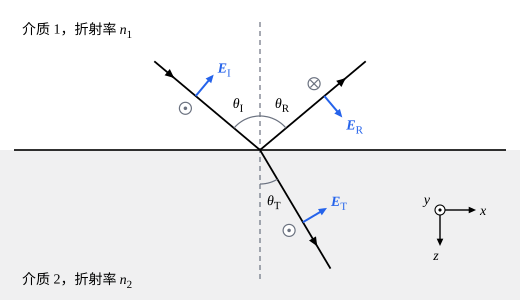

## 这一节要回答的问题

隔着窗玻璃，白天能看清外面，晚上却像在照镜子；站在湖边，远处的湖面映出对岸，脚下却能看到水底。光射到两种介质的界面上，为什么反射角等于入射角？折射的方向由什么决定？反射回来多少、透过去多少，和光的:term[偏振]{id="physics.electromagnetism.wave-polarization"}（polarization）有没有关系？

## 讲解

### 随时间变化的场在界面上的条件

下面考虑两种均匀线性介质的平面交界面，界面上没有:term[自由电荷]{id="physics.electromagnetism.free-charge"}（free charge）和:term[自由电流]{id="physics.electromagnetism.free-current"}（free current）。:term[静电场]{id="physics.electromagnetism.electric-field"}（electrostatic field）和不随时间变化的:term[磁场]{id="physics.electromagnetism.magnetic-field"}（magnetic field）在这样的界面上满足的条件前面已经得到（见[电位移与线性电介质](lesson:physics.electromagnetism.electric-displacement#thm-boundary)和[磁场强度与线性磁介质](lesson:physics.electromagnetism.magnetic-intensity#thm-magnetic-boundary)），它们对随时间变化的场照样成立。

::anchor{id="thm-em-boundary"}
定理（界面上的边界条件）：两种线性介质的交界面上没有自由电荷和自由电流时，即使场随时间变化，$\vb D$和$\vb B$垂直于界面的分量在两侧也相等，$\vb E$和$\vb H$平行于界面的分量在两侧也相等。

证明思路：取跨过界面的扁圆柱面，两个底面紧贴界面，由$\divg\vb D=0$和$\divg\vb B=0$得法向分量相等，和静止时一样。再取跨过界面的扁矩形回路，两条长边紧贴界面：:term[法拉第定律]{id="physics.electromagnetism.faraday-law"}（Faraday's law）和:term[安培-麦克斯韦定律]{id="physics.electromagnetism.ampere-maxwell-law"}（Ampère–Maxwell law）的积分形式比静止时多出$-\dv{}{t}\int\vb B\cdot\dd\vb a$和$\dv{}{t}\int\vb D\cdot\dd\vb a$两项，可回路围住的面积趋于零，场有限时这两项也趋于零，于是$\oint\vb E\cdot\dd\vb l=0$，$\oint\vb H\cdot\dd\vb l=0$，切向分量相等。

### 反射定律和折射定律

取界面为$z=0$平面，$z$轴从介质 1 指向介质 2，介质 1、2 的:term[折射率]{id="physics.electromagnetism.refractive-index"}（refractive index）分别是$n_1$、$n_2$，两种介质都不显磁性，$\mu=\mu_0$。一列平面波从介质 1 射到界面上，分成两列：回到介质 1 的反射波（reflected wave）和进入介质 2 的透射波（transmitted wave）。

::anchor{id="def-incidence"}
入射波的传播方向和界面的法线确定的平面叫作入射面（plane of incidence）；入射波、反射波、透射波的传播方向和法线的夹角分别叫作入射角（angle of incidence）、反射角（angle of reflection）和折射角（angle of refraction），记作$\theta_{\mathrm I}$、$\theta_{\mathrm R}$、$\theta_{\mathrm T}$。

为什么这样定义：界面绕法线转动不变，一列波的方向只要说清它在哪个包含法线的平面里、和法线成多大的角就行了，入射面就是入射波所在的那个平面。下面取入射面为$xz$平面，入射波的波矢是$\vb k_{\mathrm I}=k_1(\sin\theta_{\mathrm I},0,\cos\theta_{\mathrm I})$，$k_1=\frac{n_1\omega}{c}$。边界情况：垂直入射时$\theta_{\mathrm I}=0$，任何包含法线的平面都可以当作入射面。

::anchor{id="thm-reflection-refraction"}
定理（反射定律和折射定律）：平面波射到两种线性介质的平面界面上时，反射波和透射波的频率与入射波相同，传播方向都在入射面内，并且$\theta_{\mathrm R}=\theta_{\mathrm I}$，$n_1\sin\theta_{\mathrm I}=n_2\sin\theta_{\mathrm T}$。

证明思路：三列波的场都按$\cos(\vb k\cdot\vb r-\omega t+\xi)$变化，$\xi$是各自的初相；在界面$z=0$上，它们是$x$、$y$、$t$的余弦函数。边界条件要在界面上每一点、每一时刻都成立，三者的相位只能以同样的方式随$x$、$y$、$t$变，所以三列波的$\omega$相同，波矢的$x$分量、$y$分量也相同。入射波的$k_y=0$，另外两列波的$k_y$也为零，都在入射面内；反射波的波矢和入射波一样长，$k_1\sin\theta_{\mathrm R}=k_1\sin\theta_{\mathrm I}$；透射波的波矢长$k_2=\frac{n_2\omega}{c}$，$k_2\sin\theta_{\mathrm T}=k_1\sin\theta_{\mathrm I}$，即$n_1\sin\theta_{\mathrm I}=n_2\sin\theta_{\mathrm T}$。

这个证明只用到边界条件对界面上每一点、每一时刻都成立，没有用到条件的具体形式，所以声波、水波在界面上也遵守同样的反射定律和折射定律。折射定律最早见于伊本·萨赫勒（Ibn Sahl）984 年前后讨论透镜的著作；1621 年斯涅耳（Willebrord Snell）又发现了它，1637 年笛卡儿（René Descartes）把它发表在《屈光学》里，常说的斯涅耳定律（Snell's law）就是它。1662 年费马（Pierre de Fermat）假定光在介质里更慢，从「光走用时最短的路径」推出了它（见[费马原理](lesson:physics.optics.fermat-principle)）。

### 菲涅耳公式

::anchor{id="def-s-p"}
:term[电场]{id="physics.electromagnetism.electric-field"}垂直于入射面的平面波叫作 :term[s 偏振]{id="physics.electromagnetism.wave-polarization"}（s polarization）的波，电场在入射面内的叫作 p 偏振（p polarization）的波。

为什么这样定义：任何偏振的入射波都可以分解成这两种（见[真空中的电磁波](lesson:physics.electromagnetism.em-waves#def-wave-polarization)），两种分量在界面上各算各的：s 偏振时三列波的电场都沿$y$方向，p 偏振时三列波的:term[磁场]{id="physics.electromagnetism.magnetic-field"}都沿$y$方向，边界条件不会把它们混起来。s 取自德文 senkrecht（垂直），p 取自 parallel（平行）。边界情况：垂直入射时入射面不确定，两种偏振没有区别。

::anchor{id="thm-fresnel"}
定理（菲涅耳公式，Fresnel equations）：两种不显磁性的线性介质的平面界面上没有:term[自由电荷]{id="physics.electromagnetism.free-charge"}和:term[自由电流]{id="physics.electromagnetism.free-current"}时，s 偏振的反射波、透射波和入射波的电场振幅之比是$r_{\mathrm s}=\frac{n_1\cos\theta_{\mathrm I}-n_2\cos\theta_{\mathrm T}}{n_1\cos\theta_{\mathrm I}+n_2\cos\theta_{\mathrm T}}$，$t_{\mathrm s}=\frac{2n_1\cos\theta_{\mathrm I}}{n_1\cos\theta_{\mathrm I}+n_2\cos\theta_{\mathrm T}}$；p 偏振的是$r_{\mathrm p}=\frac{n_1\cos\theta_{\mathrm T}-n_2\cos\theta_{\mathrm I}}{n_1\cos\theta_{\mathrm T}+n_2\cos\theta_{\mathrm I}}$，$t_{\mathrm p}=\frac{2n_1\cos\theta_{\mathrm I}}{n_1\cos\theta_{\mathrm T}+n_2\cos\theta_{\mathrm I}}$。这里 s 偏振的三个电场都以$+y$方向为正，p 偏振的三个电场都以平行于界面的分量沿$+x$方向为正。

证明思路：s 偏振时电场都平行于界面，切向分量相等给出$E_{\mathrm I}+E_{\mathrm R}=E_{\mathrm T}$。磁场由$\vb B=\frac nc\uv k\times\vb E$算出，它的$x$分量对入射波是$-\frac{n_1}{c}E_{\mathrm I}\cos\theta_{\mathrm I}$，对沿$-z$方向走的反射波是$+\frac{n_1}{c}E_{\mathrm R}\cos\theta_{\mathrm I}$，对透射波是$-\frac{n_2}{c}E_{\mathrm T}\cos\theta_{\mathrm T}$；两侧$\mu$相同，$\vb H$的切向分量相等就是$B_x$相等，得$n_1\cos\theta_{\mathrm I}(E_{\mathrm I}-E_{\mathrm R})=n_2\cos\theta_{\mathrm T}E_{\mathrm T}$。两式联立解出$r_{\mathrm s}$、$t_{\mathrm s}$。p 偏振时三列波的磁场都垂直于入射面（下图），同样列出$E_x$相等和$H_y$相等两个方程。

垂直入射时两种偏振的结果相同：$r=\frac{n_1-n_2}{n_1+n_2}$，$t=\frac{2n_1}{n_1+n_2}$，$n_1=1$时就是[介质中的电磁波](lesson:physics.electromagnetism.waves-in-media)动画里反射波和透射波的振幅。$n_2>n_1$时$r<0$，反射波的电场和入射波反向，相当于相位突变了$\pi$；这和[波的反射与透射](lesson:physics.oscillations-waves.reflection-transmission)里波从轻的弦传到重的弦上、反射波倒过来是一回事，:term[折射率]{id="physics.electromagnetism.refractive-index"}大的一侧相当于重的弦。

菲涅耳（Augustin-Jean Fresnel）在 1823 年把光看作以太的横振动，推出了这组公式，那时还没有人知道光是:term[电磁波]{id="physics.electromagnetism.em-wave"}（electromagnetic wave）。1875 年，洛伦兹（Hendrik Lorentz）在博士论文里用麦克斯韦的电磁理论，从边界条件得到了同样的结果。

::anchor{id="def-reflectance"}
单位时间里，反射波、透射波从界面上单位面积带走的能量和入射波带来的能量之比，分别叫作反射率（reflectance）和透射率（transmittance），记作$R$、$T$。

为什么这样定义：$r$、$t$是电场振幅之比，实际测到的却是能量。反射波和入射波在同一种介质里、和法线的夹角相同，$R=r^2$；透射波的:term[强度]{id="physics.electromagnetism.intensity"}（intensity）和$n_2E_{\mathrm T}^2$成正比（见[介质中的电磁波](lesson:physics.electromagnetism.waves-in-media)第 5 题），斜着穿过界面的光束截面也和入射光束不同，所以$T=\frac{n_2\cos\theta_{\mathrm T}}{n_1\cos\theta_{\mathrm I}}t^2$，没有吸收时$R+T=1$（第 5 题）。边界情况：垂直入射时$R=\Bigl(\frac{n_1-n_2}{n_1+n_2}\Bigr)^2$，空气和玻璃（$n=1.50$）之间是$4\%$，空气和水之间约为$2\%$。

斜着入射时两种偏振的反射率不同。光从空气射到玻璃上，s 偏振的反射率随入射角增大一路增大，p 偏振的先降到零、再增大，掠射（grazing incidence）时都趋于$1$（见下面的动画）；在 p 偏振反射率为零的那个角度，反射光里只剩 s 偏振。湖面、路面的反光里 s 偏振占多数，电场基本平行于地面，偏振太阳镜只让电场竖直的光通过，就能挡掉大部分反光（例 2）；这个角度在[反射偏振与布儒斯特角](lesson:physics.optics.brewster-angle)里讲。

### 全反射时的菲涅耳公式

光从:term[折射率]{id="physics.electromagnetism.refractive-index"}大的介质射向折射率小的介质（$n_1>n_2$），入射角大到$\sin\theta_{\mathrm I}>\frac{n_2}{n_1}$时，折射定律要求$\sin\theta_{\mathrm T}>1$，介质 2 里不再有向远处传播的透射波，光全部反射回来，即全反射（total internal reflection，见[全反射与光纤](lesson:physics.optics.total-internal-reflection)）。这时菲涅耳公式照样适用，只是$\cos\theta_{\mathrm T}=\sqrt{1-\sin^2\theta_{\mathrm T}}$成了虚数：两种:term[偏振]{id="physics.electromagnetism.wave-polarization"}的$|r|$都是$1$；介质 2 里仍然有场，它沿界面传播，离开界面按指数衰减，深度和波长相当，不把能量带到远处（第 6 题）。

## 几何图像

图里纸面就是入射面，$x$轴沿界面向右，$z$轴从介质 1 指向介质 2，$y$轴垂直纸面向外。按 :term[p 偏振]{id="physics.electromagnetism.wave-polarization"}的约定，三个:term[电场]{id="physics.electromagnetism.electric-field"}平行于界面的分量都向右时振幅为正；由$\vb B=\frac nc\uv k\times\vb E$，入射波和透射波的:term[磁场]{id="physics.electromagnetism.magnetic-field"}垂直纸面向外，反射波的向里，所以$H_y$相等的条件写成$\frac{n_1}{c}(E_{\mathrm I}-E_{\mathrm R})=\frac{n_2}{c}E_{\mathrm T}$。

:::anim{component="function-plot"}
range: { x: [0, 90], y: [0, 1.05] }
functions:
  - expr: "((cos(x*pi/180) - m*sqrt(max(0, 1 - (sin(x*pi/180)/m)^2)))/(cos(x*pi/180) + m*sqrt(max(0, 1 - (sin(x*pi/180)/m)^2))))^2"
    label: |
      s 偏振的反射率$R_{\mathrm s}$
  - expr: "((sqrt(max(0, 1 - (sin(x*pi/180)/m)^2)) - m*cos(x*pi/180))/(sqrt(max(0, 1 - (sin(x*pi/180)/m)^2)) + m*cos(x*pi/180)))^2"
    label: |
      p 偏振的反射率$R_{\mathrm p}$
points:
  - { x: "atan(m)*180/pi", y: "0" }
sliders:
  - name: m
    min: 0.5
    max: 2.5
    step: 0.1
    default: 1.5
    label: |
      两种介质的折射率之比$\frac{n_2}{n_1}$
:::

横轴是入射角$\theta_{\mathrm I}$，以度为单位，纵轴是反射率。$\frac{n_2}{n_1}>1$时，两条曲线从垂直入射时的同一个值出发，s 偏振的一路增大，p 偏振的先降到零（图上的点）再增大，掠射时都趋于$1$。$\frac{n_2}{n_1}<1$时，入射角超过$\sin\theta_{\mathrm I}=\frac{n_2}{n_1}$对应的角度就全反射，两条曲线都停在$1$；比值越小，开始全反射的角度越小。

## 例题

### 例 1　窗玻璃的反光

阳光垂直照在窗玻璃（$n=1.50$）上。不计吸收和玻璃里的多次反射，每个表面反射多少？透过整块玻璃的光占多少？

**为什么想到这么做**：垂直入射时两种:term[偏振]{id="physics.electromagnetism.wave-polarization"}相同，$R=\Bigl(\frac{n_1-n_2}{n_1+n_2}\Bigr)^2$，交换$n_1$和$n_2$不变，所以两个表面的反射率一样。

**推导**：$R=\Bigl(\frac{1-1.50}{1+1.50}\Bigr)^2=0.04$，每个表面反射$4\%$。第一个表面透过$96\%$，其中又有$96\%$透过第二个表面，整块玻璃透过$0.96^2\approx92\%$。照相机的镜头由好几片透镜组成，十几个表面各反射$4\%$，透过的光就少了三四成，来回反射的光还会在画面上留下杂散的光斑，所以镜片表面都镀了减少反射的膜（见[薄膜干涉](lesson:physics.optics.thin-film-interference)）。

### 例 2　水面的反光

阳光以$45^\circ$的入射角照到平静的水面（$n=1.33$）上。求 :term[s 偏振]{id="physics.electromagnetism.wave-polarization"}和 p 偏振的反射率。

**为什么想到这么做**：先用折射定律求折射角，再代入菲涅耳公式，反射率是$r^2$。

**推导**：$\sin\theta_{\mathrm T}=\frac{\sin45^\circ}{1.33}\approx0.532$，$\cos\theta_{\mathrm T}\approx0.847$，$\cos\theta_{\mathrm I}\approx0.707$。$r_{\mathrm s}=\frac{0.707-1.33\times0.847}{0.707+1.33\times0.847}\approx-0.229$，$R_{\mathrm s}\approx5.2\%$；$r_{\mathrm p}=\frac{0.847-1.33\times0.707}{0.847+1.33\times0.707}\approx-0.052$，$R_{\mathrm p}\approx0.27\%$。阳光里两种偏振各占一半，反射光里 s 偏振约占$95\%$，:term[电场]{id="physics.electromagnetism.electric-field"}基本平行于水面，偏振太阳镜就能把它挡掉大部分。

## 常见误区

- 「光的反射率和:term[偏振]{id="physics.electromagnetism.wave-polarization"}无关。」只有垂直入射时才对；斜着入射时 s 偏振的反射率比 p 偏振的大，在某个角度 p 偏振完全不反射。
- 「透射波的:term[电场]{id="physics.electromagnetism.electric-field"}振幅不会比入射波的大。」光从玻璃（$n=1.5$）垂直射向空气时$t=\frac{2\times1.5}{1.5+1}=1.2$；能量守恒管的是$R+T=1$，透射率里还有因子$\frac{n_2\cos\theta_{\mathrm T}}{n_1\cos\theta_{\mathrm I}}$，这里$T=\frac{1}{1.5}\times1.2^2=0.96$。
- 「全反射时介质 2 里没有场。」介质 2 里有沿界面传播、离开界面按指数衰减的场，只是它不把能量带到远处（第 6 题）。
