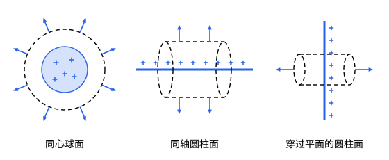

## 这一节要回答的问题

:term[高斯定律]{id="physics.electromagnetism.gauss-law"}（Gauss's law）只给出穿出闭合曲面的:term[电通量]{id="physics.electromagnetism.electric-flux"}（electric flux），并不直接给出每一点的:term[电场]{id="physics.electromagnetism.electric-field"}（electric field）。什么时候能由它反过来求出电场？均匀带电的球、很长的圆柱、很大的平板，它们的电场怎样一步求出来？

## 讲解

### 对称性和高斯面

均匀带电的球体，绕球心怎么转都不变，它的:term[电场]{id="physics.electromagnetism.electric-field"}也必须这样：每一点的电场沿径向，大小只和到球心的距离有关。如果某一点的电场偏离了径向，把整个:term[电荷]{id="physics.electromagnetism.electric-charge"}（electric charge）分布绕过这一点的半径转半圈，电荷分布不变，那一点的电场却转到了另一个方向，矛盾。

::anchor{id="def-gaussian-surface"}
为了用:term[高斯定律]{id="physics.electromagnetism.gauss-law"}求电场而选的闭合曲面，叫作:term[高斯面]{id="physics.electromagnetism.gaussian-surface"}（Gaussian surface）。

为什么这样定义：高斯定律对任何闭合曲面都成立，可只有在选得好的面上，$\oint\vb E\cdot\dd\vb a$才能写成「电场的大小乘面积」，从而解出电场；面上每一部分要么和电场垂直、电场大小处处相同，要么和电场平行、:term[电通量]{id="physics.electromagnetism.electric-flux"}为零。边界情况：高斯面可以穿过带电体，面内的电荷只算被它围住的那一部分；电荷分布不对称时，再巧的面也做不到，例如均匀带电的正方体（p7）。

求对称电场分三步：先由对称性定出电场的方向，以及它只依赖哪个坐标；再选高斯面，让它的每一部分都符合上面的要求；最后算出面内的电荷，由高斯定律解出电场的大小。

### 球对称

::anchor{id="thm-spherical"}
定理（球对称的:term[电荷]{id="physics.electromagnetism.electric-charge"}分布）：电荷分布绕中心球对称时，离中心$r$处的:term[电场]{id="physics.electromagnetism.electric-field"}沿径向，大小是$E=\frac{1}{4\pi\varepsilon_0}\frac{Q(r)}{r^2}$，$Q(r)$是半径为$r$的球里的总电荷。

证明思路：取以中心为球心、半径为$r$的球面作:term[高斯面]{id="physics.electromagnetism.gaussian-surface"}。面上电场沿法线，大小处处相同，:term[电通量]{id="physics.electromagnetism.electric-flux"}是$E\cdot4\pi r^2$，由:term[高斯定律]{id="physics.electromagnetism.gauss-law"}它等于$\frac{Q(r)}{\varepsilon_0}$。

所以球对称的带电体外面，电场就像全部电荷集中在中心的:term[点电荷]{id="physics.electromagnetism.point-charge"}（point charge）；均匀带电的球面里面$Q(r)=0$，电场为零。这两点以前要靠繁琐的积分才能得到（见[连续分布电荷的电场](lesson:physics.electromagnetism.continuous-charge)的 p6），现在一行就够了。

### 轴对称

::anchor{id="thm-cylindrical"}
定理（轴对称的:term[电荷]{id="physics.electromagnetism.electric-charge"}分布）：电荷沿一条无限长的轴均匀、对称地分布时，离轴$s$处的:term[电场]{id="physics.electromagnetism.electric-field"}垂直于轴、沿径向向外（或向内），大小是$E=\frac{1}{2\pi\varepsilon_0}\frac{\lambda(s)}{s}$，$\lambda(s)$是半径为$s$的圆柱里单位长度的电荷。

证明思路：取和轴同轴、半径为$s$、长为$L$的圆柱面作:term[高斯面]{id="physics.electromagnetism.gaussian-surface"}。侧面上电场沿法线、大小处处相同，两个底面和电场平行，:term[电通量]{id="physics.electromagnetism.electric-flux"}是$E\cdot2\pi sL$，面内的电荷是$\lambda(s)L$，由:term[高斯定律]{id="physics.electromagnetism.gauss-law"}解出$E$。

无限长的均匀带电直线就是$\lambda(s)=\lambda$的情形，$E=\frac{\lambda}{2\pi\varepsilon_0s}$，和[连续分布电荷的电场](lesson:physics.electromagnetism.continuous-charge)例 1 取极限得到的一样。

### 面对称

::anchor{id="thm-planar"}
定理（无穷大的均匀带电平面）：:term[面电荷密度]{id="physics.electromagnetism.charge-density"}（surface charge density）为$\sigma$的无穷大均匀带电平面，两侧的:term[电场]{id="physics.electromagnetism.electric-field"}都垂直于平面，$\sigma>0$时背离平面，大小都是$\frac{\sigma}{2\varepsilon_0}$，和到平面的距离无关。

证明思路：按对称性，电场垂直于平面，两侧关于平面对称。取一个垂直穿过平面的圆柱面作:term[高斯面]{id="physics.electromagnetism.gaussian-surface"}，两个底面的面积都是$A$，侧面和电场平行；:term[电通量]{id="physics.electromagnetism.electric-flux"}$2EA$等于$\frac{\sigma A}{\varepsilon_0}$，得$E=\frac{\sigma}{2\varepsilon_0}$。

有厚度的均匀带电平板、几块平行的带电平面，都可以照这样求，也可以把各个平面的电场叠加起来（例 2）。

## 几何图像

三种对称各配一种:term[高斯面]{id="physics.electromagnetism.gaussian-surface"}（虚线）。每一种里，:term[电场]{id="physics.electromagnetism.electric-field"}都垂直穿过高斯面上有:term[电通量]{id="physics.electromagnetism.electric-flux"}的那一部分，大小处处相同；其余部分（圆柱的两个底面、平面两侧圆柱面的侧面）和电场平行，没有电通量。

:::anim{component="function-plot"}
range: { x: [0, 5], y: [0, 1.1] }
functions:
  - expr: "min(x/R^3, 1/x^2)"
    label: |
      均匀带电的球体
  - expr: "(1 + sign(x - R))/2/x^2"
    label: |
      电荷相同的均匀带电球面
sliders:
  - name: R
    min: 1
    max: 2
    step: 0.25
    default: 1.5
    label: |
      半径$R$
:::

动画画的是:term[电荷]{id="physics.electromagnetism.electric-charge"}都为$Q$的均匀带电球体和均匀带电球面，电场随离中心的距离$r$的变化（图上写作$x$，纵轴以$\frac{Q}{4\pi\varepsilon_0}$除以长度单位的平方为单位）。两者在外面完全一样，像:term[点电荷]{id="physics.electromagnetism.point-charge"}；球体里面电场随$r$线性增大，在表面最大，球面里面电场为零，在表面跳上去。

## 例题

### 例 1　均匀带电的球体

半径为$R$的球体均匀带电$Q$，求球里面离球心$r$处的:term[电场]{id="physics.electromagnetism.electric-field"}。

**为什么想到这么做**：:term[电荷]{id="physics.electromagnetism.electric-charge"}分布球对称，取半径为$r$的同心球面作:term[高斯面]{id="physics.electromagnetism.gaussian-surface"}，只要算出它里面的电荷。

**推导**：:term[体电荷密度]{id="physics.electromagnetism.charge-density"}是$\frac{3Q}{4\pi R^3}$，半径为$r$的球里的电荷是$Q(r)=Q\frac{r^3}{R^3}$。由球对称的定理，$E=\frac{1}{4\pi\varepsilon_0}\frac{Q(r)}{r^2}=\frac{1}{4\pi\varepsilon_0}\frac{Qr}{R^3}$，沿径向向外（$Q>0$）。它在球心为零，随$r$线性增大，到表面是$\frac{1}{4\pi\varepsilon_0}\frac{Q}{R^2}$，和外面的:term[点电荷]{id="physics.electromagnetism.point-charge"}公式接上。

### 例 2　两块平行的带电平面

两块平行的无穷大平面，:term[面电荷密度]{id="physics.electromagnetism.charge-density"}分别是$+\sigma$和$-\sigma$。求两板之间和两板外面的:term[电场]{id="physics.electromagnetism.electric-field"}。

**为什么想到这么做**：每一块平面的电场都已经知道，大小$\frac{\sigma}{2\varepsilon_0}$、和距离无关，方向由它在平面的哪一侧决定；把两块的电场叠加起来就行。

**推导**：$+\sigma$的电场背离它，$-\sigma$的电场指向它。在两板之间，两个电场都从正板指向负板，大小相加，$E=\frac{\sigma}{\varepsilon_0}$；在两板外面，两个电场大小相同、方向相反，抵消为零。所以电场全部集中在两板之间，而且是匀强的，平行板电容器（capacitor）就是这样（见[电容器](lesson:physics.electromagnetism.capacitors)）。

## 常见误区

- 「有了:term[高斯定律]{id="physics.electromagnetism.gauss-law"}，任何带电体的:term[电场]{id="physics.electromagnetism.electric-field"}都能求出来。」高斯定律总是成立，但只有:term[电荷]{id="physics.electromagnetism.electric-charge"}分布足够对称时，才能由它解出电场。
- 「均匀带电球体里面，外层的电荷对里面没有作用，是因为它们离得远。」外层电荷的作用不是变小了，而是各部分的作用正好抵消，均匀带电球面里面电场为零就是这样。
- 「有限长的带电圆柱也可以用同轴圆柱面求电场。」两端破坏了对称，底面上的电场不再和底面平行；只有离两端很远、离轴很近时，才近似成立。
- 「:term[高斯面]{id="physics.electromagnetism.gaussian-surface"}一定要取成和带电体一样的形状。」它要和电场的对称性配合，例如无穷大平面用的是圆柱面，不是平面。
