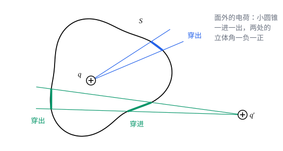

## 这一节要回答的问题

一组:term[电荷]{id="physics.electromagnetism.electric-charge"}（electric charge）的:term[电场线]{id="physics.electromagnetism.field-line"}（electric field line）从正电荷出发，终止在负电荷上。数一数穿出一个闭合曲面的电场线有多少条，能不能知道里面有多少电荷？:term[库仑定律]{id="physics.electromagnetism.coulomb-law"}（Coulomb's law）的平方反比在这里起什么作用？

## 讲解

### 电通量

匀强的:term[电场]{id="physics.electromagnetism.electric-field"}（electric field）$\vb E$垂直穿过面积为$A$的平面，穿过的:term[电场线]{id="physics.electromagnetism.field-line"}条数和$EA$成正比；平面转过一个角$\theta$，穿过的条数就只和$EA\cos\theta$成正比了。一般的曲面上电场各处不同，要一小块一小块地加起来。

::anchor{id="def-electric-flux"}
电场穿过曲面$S$的:term[电通量]{id="physics.electromagnetism.electric-flux"}（electric flux）是曲面积分（surface integral）$\Phi_E=\int_S\vb E\cdot\dd\vb a$，其中面元（area element）$\dd\vb a$的大小是这一小块的面积，方向沿这一小块的法线。闭合曲面上，法线一律取指向外面的方向。

为什么这样定义：$\vb E\cdot\dd\vb a$只计电场垂直于这一小块的分量，和穿过它的电场线条数成正比，穿出为正、穿进为负，所以电通量量的是穿过曲面的电场线的净条数。边界情况：电场平行于曲面时，电通量为零；一条电场线穿进一个闭合曲面又穿出去，两处的贡献一负一正，正好抵消。

### 立体角

要说清一个:term[点电荷]{id="physics.electromagnetism.point-charge"}（point charge）的:term[电场]{id="physics.electromagnetism.electric-field"}穿过一小块曲面的:term[电通量]{id="physics.electromagnetism.electric-flux"}，先要量这一小块从:term[电荷]{id="physics.electromagnetism.electric-charge"}那里「看上去」有多大。

::anchor{id="def-solid-angle"}
一小块面积$\dd a$离点$O$为$r$，它的法线和$O$到它的连线的夹角为$\alpha$，则它对$O$张的:term[立体角]{id="physics.electromagnetism.solid-angle"}（solid angle）是$\dd\Omega=\frac{\dd a\cos\alpha}{r^2}$，单位是球面度（steradian），记作$\mathrm{sr}$；一块曲面对$O$张的立体角是这些$\dd\Omega$之和。

为什么这样定义：$\dd a\cos\alpha$是这一小块在垂直于视线的方向上的投影，除以$r^2$，就是把它投影到以$O$为中心的单位球面上得到的面积，和它离得多远无关，这正是平面角$\dd\theta=\frac{\dd l}{r}$在三维里的推广。整个球面对球心张的立体角是$4\pi$。边界情况：法线背离$O$时$\dd\Omega>0$，朝向$O$时$\dd\Omega<0$；一条视线穿过曲面两次时，两处的立体角正负抵消。

### 高斯定律

这个定理最早由拉格朗日（Joseph-Louis Lagrange）在 1773 年写出，高斯（Carl Friedrich Gauss）在 1835 年也得到了它，两人都是在研究椭球体的引力时用到的。

::anchor{id="thm-gauss-law"}
定理（:term[高斯定律]{id="physics.electromagnetism.gauss-law"}，Gauss's law）：对任意闭合曲面$S$，$\oint_S\vb E\cdot\dd\vb a=\frac{Q_{\text{内}}}{\varepsilon_0}$，$Q_{\text{内}}$是$S$里面的总:term[电荷]{id="physics.electromagnetism.electric-charge"}；$S$外面的电荷对这个:term[电通量]{id="physics.electromagnetism.electric-flux"}没有贡献。

证明思路：先看一个:term[点电荷]{id="physics.electromagnetism.point-charge"}$q$。它的:term[电场]{id="physics.electromagnetism.electric-field"}穿过一小块面积的电通量是$\frac{1}{4\pi\varepsilon_0}\frac{q\,\dd a\cos\alpha}{r^2}=\frac{q}{4\pi\varepsilon_0}\dd\Omega$；$q$在面内时，曲面把它整个围住，:term[立体角]{id="physics.electromagnetism.solid-angle"}加起来是$4\pi$，电通量是$\frac{q}{\varepsilon_0}$，和曲面的形状无关。$q$在面外时，从它出发的每个小圆锥都穿过曲面偶数次，一进一出，立体角正负抵消，电通量为零。一般的电荷分布，由:term[叠加原理]{id="physics.electromagnetism.superposition-principle"}（superposition principle）把各个点电荷的电通量加起来。

关键在平方反比：电场的$\frac{1}{r^2}$正好抵消了面积随距离增长的$r^2$，电通量才和曲面离电荷多远无关。如果电力和距离的$2+\delta$次方成反比，穿过以电荷为中心的球面的电通量会随球的半径变（p5，也可以在几何图像的动画里看）。对静止的电荷，高斯定律和:term[库仑定律]{id="physics.electromagnetism.coulomb-law"}包含同样的内容；但高斯定律对运动的电荷也成立，是:term[麦克斯韦方程组]{id="physics.electromagnetism.maxwell-equations"}（Maxwell's equations）的一部分（见[位移电流与麦克斯韦方程组](lesson:physics.electromagnetism.maxwell-equations)）。

用:term[电场线]{id="physics.electromagnetism.field-line"}的话说：从$q$发出的电场线条数和$q$成正比，它们全都穿出包住$q$的任何闭合曲面；面外的电荷发出的线穿进来又穿出去，净条数为零。所以电场线在没有电荷的地方不会凭空出现或中断（电场为零的个别点除外），这正是上一节没能说明的那一点。

## 几何图像

面内的:term[电荷]{id="physics.electromagnetism.electric-charge"}$q$发出的小圆锥只穿出曲面一次，:term[立体角]{id="physics.electromagnetism.solid-angle"}是正的；面外的电荷$q'$发出的小圆锥穿进、穿出各一次，两小块对$q'$张的立体角一负一正，大小相等。把所有方向的小圆锥都加起来，$q$贡献$\frac{q}{\varepsilon_0}$，$q'$贡献零。

:::anim{component="function-plot"}
range: { x: [0, 5], y: [0, 2] }
functions:
  - expr: "x^(-d)"
    label: |
      力和$\frac{1}{r^{2+\delta}}$成正比时
  - expr: "1"
    label: |
      平方反比
sliders:
  - name: d
    min: -0.3
    max: 0.3
    step: 0.1
    default: 0.1
    label: |
      指数的偏离$\delta$
:::

动画画的是以:term[点电荷]{id="physics.electromagnetism.point-charge"}为中心、半径为$r$的球面上的:term[电通量]{id="physics.electromagnetism.electric-flux"}，横轴是$r$（图上写作$x$），纵轴以$r=1$时的电通量为单位。只有$\delta=0$，也就是平方反比时，电通量才和球的半径无关；$\delta\ne0$时，同一个电荷的电通量随球的大小变，:term[高斯定律]{id="physics.electromagnetism.gauss-law"}就不成立了。

## 例题

### 例 1　立方体中心的点电荷

:term[点电荷]{id="physics.electromagnetism.point-charge"}$q$放在一个立方体的中心。穿过立方体的一个面的:term[电通量]{id="physics.electromagnetism.electric-flux"}是多少？

**为什么想到这么做**：直接对一个面积分很麻烦，而且:term[电场]{id="physics.electromagnetism.electric-field"}在面上处处不同。但整个立方体是包住$q$的闭合曲面，总电通量由:term[高斯定律]{id="physics.electromagnetism.gauss-law"}直接得到；$q$在中心，六个面完全对称。

**推导**：穿出整个立方体的电通量是$\frac{q}{\varepsilon_0}$，六个面的地位相同，每个面分到$\frac{q}{6\varepsilon_0}$。这个结果和立方体的大小无关：大的立方体，面上的电场弱，面积却大，两者正好抵消。

### 例 2　匀强电场中的半球面

匀强:term[电场]{id="physics.electromagnetism.electric-field"}$\vb E$中有一个半径为$R$的半球面，它的底面（一个圆面）和电场垂直，电场从底面那一侧进来。穿出半球面（弯曲的部分）的:term[电通量]{id="physics.electromagnetism.electric-flux"}是多少？

**为什么想到这么做**：弯曲的面上，电场和法线的夹角处处不同，直接积分要用球坐标。添上底面，半球面和底面合起来是一个闭合曲面，里面没有:term[电荷]{id="physics.electromagnetism.electric-charge"}，总电通量是零。

**推导**：底面的法线（向外）和电场方向相反，穿过底面的电通量是$-\pi R^2E$。总电通量为零，所以穿出弯曲部分的电通量是$+\pi R^2E$：进来多少条:term[电场线]{id="physics.electromagnetism.field-line"}，就出去多少条。

## 常见误区

- 「闭合曲面上的:term[电场]{id="physics.electromagnetism.electric-field"}只由面内的:term[电荷]{id="physics.electromagnetism.electric-charge"}决定。」只有总的:term[电通量]{id="physics.electromagnetism.electric-flux"}只由面内电荷决定；面上每一点的电场，面外的电荷也有份。
- 「电通量为零，曲面上的电场就处处为零。」例 2 的闭合曲面电通量为零，曲面上的电场处处是$\vb E$。
- 「:term[高斯定律]{id="physics.electromagnetism.gauss-law"}只对球面成立。」它对任何闭合曲面都成立，只是曲面对称时才容易用它求电场。
- 「面内的电荷越靠近曲面，穿出的电通量越大。」电荷在面内怎样挪，电通量都是$\frac{q}{\varepsilon_0}$，只是在面上分布得不一样。
