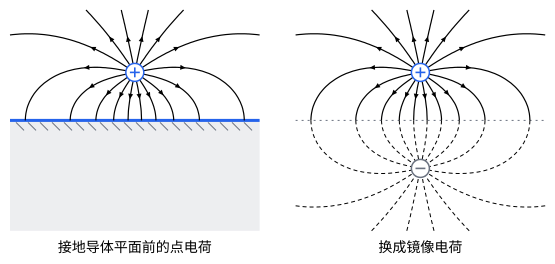

## 这一节要回答的问题

:term[点电荷]{id="physics.electromagnetism.point-charge"}（point charge）放在接地的大:term[导体]{id="physics.electromagnetism.conductor"}（conductor）平面附近，平面上会感应出:term[电荷]{id="physics.electromagnetism.electric-charge"}（electric charge），可:term[感应电荷]{id="physics.electromagnetism.induced-charge"}（induced charge）怎样分布事先不知道，:term[库仑定律]{id="physics.electromagnetism.coulomb-law"}（Coulomb's law）没法直接用。能不能先猜一个满足所有条件的:term[电势]{id="physics.electromagnetism.electric-potential"}（electric potential），再证明它就是要找的那一个？

## 讲解

### 唯一性定理

一个静电问题通常这样给出：在某个区域$V$里，:term[电荷]{id="physics.electromagnetism.electric-charge"}怎样分布是知道的；在$V$的边界上，知道:term[电势]{id="physics.electromagnetism.electric-potential"}（例如边界是接地的:term[导体]{id="physics.electromagnetism.conductor"}，电势为零）。要求的是$V$里的电势，它满足:term[泊松方程]{id="physics.electromagnetism.poisson-equation"}（Poisson's equation）$\nabla^2\varphi=-\frac{\rho}{\varepsilon_0}$。

::anchor{id="thm-uniqueness"}
定理（:term[唯一性定理]{id="physics.electromagnetism.uniqueness-theorem"}，uniqueness theorem）：区域$V$里的电荷分布已知，$V$的边界上各点的电势也已知（区域伸到无穷远时，要求电势在无穷远处趋于零），那么$V$里满足泊松方程的电势只有一个。

证明思路：设$\varphi_1$、$\varphi_2$都满足要求，差$\varphi_3=\varphi_1-\varphi_2$在$V$里满足:term[拉普拉斯方程]{id="physics.electromagnetism.laplace-equation"}（Laplace's equation），在边界上为零。按[泊松方程与拉普拉斯方程](lesson:physics.electromagnetism.poisson-equation#thm-mean-value)里的平均值性质，$\varphi_3$在$V$内部没有极大值和极小值，最大值、最小值都在边界上（或在无穷远处），都是零。所以$\varphi_3$处处为零，两个解是同一个；数学上的说法见[拉普拉斯方程与调和函数](lesson:math.pde.laplace-equation)。

所以解静电问题可以「猜」：不管用什么办法，只要找到一个电势，在区域里满足泊松方程、在边界上取给定的值，它就是唯一的答案。

区域里有:term[导体]{id="physics.electromagnetism.conductor"}，而导体的电势不知道、只知道各自带多少电荷时，也有类似的结论。

::anchor{id="thm-uniqueness-conductors"}
定理（给定导体电荷时的唯一性）：几个导体各自的总电荷已知，导体以外的电荷分布也已知，无穷远处电势为零，那么导体以外的:term[电场]{id="physics.electromagnetism.electric-field"}（electric field）只有一个。

证明思路：两个解的差$\varphi_3$、$\vb E_3=-\nabla\varphi_3$在导体以外满足拉普拉斯方程，在每个导体上是常数$c_k$，每个导体上的总电荷为零。导体以外$\divg\vb E_3=0$，所以$\divg(\varphi_3\vb E_3)=\varphi_3\divg\vb E_3+\vb E_3\cdot\nabla\varphi_3=-E_3^2$；对导体以外的空间积分，用散度定理（divergence theorem）把左边化成导体表面和无穷远处的面积分。第$k$个导体表面上的积分是$c_k$乘以穿过这个表面的:term[电通量]{id="physics.electromagnetism.electric-flux"}（electric flux，差一个符号），而这个电通量等于导体上的总电荷除以$\varepsilon_0$，是零；无穷远处的积分趋于零。所以$\int E_3^2\,\dd V=0$，$\vb E_3$处处为零。

这一条保证了[电容器](lesson:physics.electromagnetism.capacitors)和[导体与静电平衡](lesson:physics.electromagnetism.conductors)里用到的说法：导体带的电荷给定，:term[静电平衡]{id="physics.electromagnetism.electrostatic-equilibrium"}（electrostatic equilibrium）时电荷怎样分布就定了。

### 镜像法

:term[点电荷]{id="physics.electromagnetism.point-charge"}$q$在接地的无穷大:term[导体]{id="physics.electromagnetism.conductor"}平面$z=0$上方$d$处，平面以上（$z>0$）是要求:term[电势]{id="physics.electromagnetism.electric-potential"}的区域。试试在平面下方$d$处放一个$-q$：两者在平面上任一点的电势大小相等、符号相反，平面上处处$\varphi=0$，无穷远处也是零；$-q$在区域以外，不改变区域里的:term[电荷]{id="physics.electromagnetism.electric-charge"}。按:term[唯一性定理]{id="physics.electromagnetism.uniqueness-theorem"}，$z\ge0$处的电势就是$q$和$-q$的电势之和。

::anchor{id="def-method-of-images"}
在求解区域以外放上一些假想的:term[电荷]{id="physics.electromagnetism.electric-charge"}，让它们和区域里的电荷一起，在边界上满足给定的条件，这些假想的电荷叫作:term[镜像电荷]{id="physics.electromagnetism.image-charge"}（image charge）；用它们求区域里的:term[电势]{id="physics.electromagnetism.electric-potential"}的办法，叫作:term[镜像法]{id="physics.electromagnetism.method-of-images"}（method of images）。

为什么这样定义：唯一性定理说，满足边界条件的解只有一个；镜像电荷放在区域以外，不改变区域里的电荷，只用来凑边界条件，凑出来了就是答案。它代替的是导体上真实的:term[感应电荷]{id="physics.electromagnetism.induced-charge"}：在求解区域里，感应电荷产生的:term[电场]{id="physics.electromagnetism.electric-field"}和镜像电荷的一样。边界情况：在区域以外，例如导体平面下方，镜像电荷的电场并不存在，那里实际的电场是零。这个办法是威廉·汤姆孙（William Thomson，后来的开尔文勋爵）在 1848 年发表的。

::anchor{id="thm-plane-image"}
定理（接地导体平面前的点电荷）：点电荷$q$在接地的无穷大导体平面上方$d$处，平面以上的电势是$\varphi=\frac{q}{4\pi\varepsilon_0}\Bigl(\frac{1}{|\vb r-d\uv z|}-\frac{1}{|\vb r+d\uv z|}\Bigr)$；平面上离$q$的垂足为$s$处的感应电荷面密度是$\sigma=-\frac{qd}{2\pi(s^2+d^2)^{3/2}}$，总共是$-q$；$q$受到平面的吸引力，大小是$\frac{1}{4\pi\varepsilon_0}\frac{q^2}{(2d)^2}$。

证明思路：电势由上面的论证给出。紧贴平面上方的:term[电场]{id="physics.electromagnetism.electric-field"}垂直于平面，$E_z=-\frac{1}{4\pi\varepsilon_0}\frac{2qd}{(s^2+d^2)^{3/2}}$，导体表面的:term[面电荷密度]{id="physics.electromagnetism.charge-density"}（surface charge density）是$\varepsilon_0E_z$；对整个平面积分，$\int_0^\infty\sigma\cdot2\pi s\,\dd s=-q$。$q$受的力来自感应电荷，在$z>0$里感应电荷的电场和镜像电荷$-q$的一样，所以力就是$q$和$-q$相距$2d$时的吸引力。

## 几何图像

左图的:term[电场线]{id="physics.electromagnetism.field-line"}（electric field line）从$q$出发，都终止在:term[导体]{id="physics.electromagnetism.conductor"}平面上，在那里和平面垂直，因为平面是:term[等势面]{id="physics.electromagnetism.equipotential-surface"}（equipotential surface）。往上走的电场线绕得很远，落在框外远处的平面上，左图只画了框里的部分。右图把导体去掉，在平面下方$d$处放上:term[镜像电荷]{id="physics.electromagnetism.image-charge"}$-q$：上半部分的电场线和左图一模一样，下半部分（虚线）只在想象中存在。

## 例题

### 例 1　直角墙角里的点电荷

两块接地的无穷大:term[导体]{id="physics.electromagnetism.conductor"}平面互相垂直，组成一个墙角（$x\ge0$、$y\ge0$的区域，$z$方向无限长）。:term[点电荷]{id="physics.electromagnetism.point-charge"}$q$在$(a,b,0)$，$a$、$b>0$。用:term[镜像法]{id="physics.electromagnetism.method-of-images"}求区域里的:term[电势]{id="physics.electromagnetism.electric-potential"}。

**为什么想到这么做**：只对$x=0$这个面取镜像，会在$(-a,b,0)$放$-q$，可这样$y=0$的面上电势不为零；对$y=0$再取镜像，又要给这两个:term[电荷]{id="physics.electromagnetism.electric-charge"}各配一个像。要让两个面上的电势同时为零，:term[镜像电荷]{id="physics.electromagnetism.image-charge"}也得关于两个面都对称。

**推导**：在$(-a,b,0)$放$-q$，$(a,-b,0)$放$-q$，$(-a,-b,0)$放$+q$。$x=0$的面上，$(a,b)$和$(-a,b)$的两个电荷等距、异号，$(a,-b)$和$(-a,-b)$也一样，电势为零；$y=0$的面同理。三个镜像电荷都在区域以外，按:term[唯一性定理]{id="physics.electromagnetism.uniqueness-theorem"}，区域里的电势就是这四个:term[点电荷]{id="physics.electromagnetism.point-charge"}的电势之和。

### 例 2　接地导体球外的点电荷

半径为$R$的接地:term[导体]{id="physics.electromagnetism.conductor"}球，球心在原点，:term[点电荷]{id="physics.electromagnetism.point-charge"}$q$在$z$轴上$z=a$处，$a>R$。求球外的:term[电势]{id="physics.electromagnetism.electric-potential"}和球上的:term[感应电荷]{id="physics.electromagnetism.induced-charge"}总量。

**为什么想到这么做**：平面的镜像在对称的位置上，球面不是平面，但仍可以试试在球里$z$轴上某处$z=b$放一个$q'$，选$q'$和$b$，让球面上的电势处处为零。

**推导**：球面上一点和$q$的距离、和$q'$的距离分别是$\sqrt{R^2+a^2-2Ra\cos\theta}$和$\sqrt{R^2+b^2-2Rb\cos\theta}$。取$b=\frac{R^2}{a}$，后者等于前者乘以$\frac Ra$，对所有$\theta$都成立；再取$q'=-\frac Raq$，两个:term[电荷]{id="physics.electromagnetism.electric-charge"}在球面上的电势处处抵消。$q'$在球里，按:term[唯一性定理]{id="physics.electromagnetism.uniqueness-theorem"}，球外的电势是$q$和$q'$的电势之和；在包住导体球的闭合曲面上用:term[高斯定律]{id="physics.electromagnetism.gauss-law"}（Gauss's law），球外的:term[电场]{id="physics.electromagnetism.electric-field"}和这两个电荷的一样，所以球上的:term[感应电荷]{id="physics.electromagnetism.induced-charge"}总共是$q'=-\frac Raq$，比$-q$少。

## 常见误区

- 「:term[镜像电荷]{id="physics.electromagnetism.image-charge"}真的在:term[导体]{id="physics.electromagnetism.conductor"}里面。」它是假想的，只在求解区域里代替:term[感应电荷]{id="physics.electromagnetism.induced-charge"}的效果；导体里面（平面下方）实际的:term[电场]{id="physics.electromagnetism.electric-field"}是零。
- 「平面上感应的:term[电荷]{id="physics.electromagnetism.electric-charge"}均匀分布。」正对着$q$的地方最多，越远越少，按$\frac{d}{(s^2+d^2)^{3/2}}$衰减。
- 「接地导体上感应的电荷总是$-q$。」平面上是，接地的导体球上只有$-\frac Raq$：$q$发出的:term[电场线]{id="physics.electromagnetism.field-line"}有一部分跑到无穷远去了。
- 「两个解都满足:term[拉普拉斯方程]{id="physics.electromagnetism.laplace-equation"}，就是同一个解。」还要在边界上取同样的值，:term[唯一性定理]{id="physics.electromagnetism.uniqueness-theorem"}才保证它们相同。
