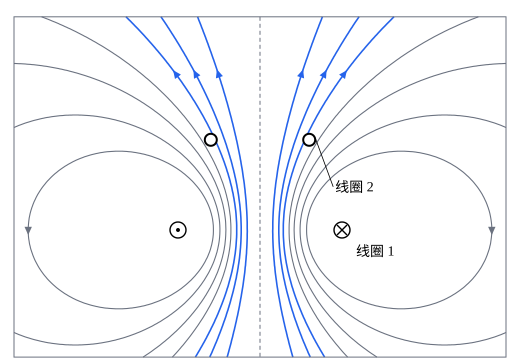

## 这一节要回答的问题

两个靠近的线圈，一个线圈里的:term[电流]{id="physics.electromagnetism.electric-current"}（electric current）变化时，另一个线圈里出现:term[感应电动势]{id="physics.electromagnetism.induced-emf"}（induced electromotive force），它有多大？一个线圈自己的电流变化，也会在自己身上产生感应电动势，阻碍这个变化。把电流从零建立起来，要克服这个:term[电动势]{id="physics.electromagnetism.electromotive-force"}（electromotive force）做功，这些能量存到哪里去了？

## 讲解

### 互感

线圈 1 通有:term[电流]{id="physics.electromagnetism.electric-current"}$I_1$，它的:term[磁场]{id="physics.electromagnetism.magnetic-field"}（magnetic field）由:term[毕奥-萨伐尔定律]{id="physics.electromagnetism.biot-savart-law"}（Biot–Savart law）给出，处处和$I_1$成正比，所以穿过线圈 2 的:term[磁通量]{id="physics.electromagnetism.magnetic-flux"}（magnetic flux）$\Phi_{21}$也和$I_1$成正比。线圈有$N$匝时，「穿过线圈的磁通量」指各匝的磁通量之和。

::anchor{id="def-mutual"}
$\Phi_{21}=M_{21}I_1$，比例系数$M_{21}$叫作线圈 1 对线圈 2 的:term[互感]{id="physics.electromagnetism.mutual-inductance"}（mutual inductance），单位是亨利（henry），记作$\mathrm H$，$1\,\mathrm H=1\,\mathrm{Wb/A}=1\,\mathrm{V\,s/A}$。

为什么这样定义：$M_{21}$只由两个线圈的形状、大小、相对位置和周围的物质决定，和电流多大无关。线圈 1 的电流变化时，由:term[法拉第定律]{id="physics.electromagnetism.faraday-law"}（Faraday's law of induction），线圈 2 里的:term[感应电动势]{id="physics.electromagnetism.induced-emf"}是$\mathcal E_2=-M_{21}\dv{I_1}t$：互感量的是一个线圈的电流变化在另一个线圈里引起:term[电动势]{id="physics.electromagnetism.electromotive-force"}的本领。边界情况：两个线圈离得越远，或者一个线圈的平面和另一个的磁场平行，互感越小，可以是零；$M_{21}$也可以是负数，正负取决于两个线圈各自绕行方向的选法。

::anchor{id="thm-neumann"}
定理（诺伊曼公式）：两个线圈由很细的导线绕成、周围是真空时，$M_{21}=\frac{\mu_0}{4\pi}\oint_1\oint_2\frac{\dd\vb l_1\cdot\dd\vb l_2}{|\vb r_1-\vb r_2|}$，两重积分分别沿两个线圈；它对两个线圈对称，所以$M_{12}=M_{21}$，可以只写一个$M$。

证明思路：线圈 1 的:term[磁矢势]{id="physics.electromagnetism.vector-potential"}（magnetic vector potential）是$\vb A_1(\vb r)=\frac{\mu_0I_1}{4\pi}\oint_1\frac{\dd\vb l_1}{|\vb r-\vb r_1|}$（见[磁矢势的积分公式](lesson:physics.electromagnetism.vector-potential#thm-vector-potential-integral)），穿过线圈 2 的磁通量等于$\vb A_1$沿线圈 2 的环量（见[磁矢势的环量](lesson:physics.electromagnetism.vector-potential#thm-flux-circulation)），$\Phi_{21}=\oint_2\vb A_1\cdot\dd\vb l_2$，代入即得。式子里交换 1、2 不变。1845 年，诺伊曼（Franz Neumann）在他的:term[电磁感应]{id="physics.electromagnetism.electromagnetic-induction"}（electromagnetic induction）理论里给出了这个积分。

$M_{12}=M_{21}$并不显然：线圈 1 很大、线圈 2 很小时，算$\Phi_{21}$只要知道大线圈在小线圈处的磁场，算$\Phi_{12}$却要把小线圈的磁场在大线圈围成的面上积分，两种算法完全不同，结果却一样（第 5 题）。

### 自感

::anchor{id="def-self"}
线圈自己的:term[电流]{id="physics.electromagnetism.electric-current"}$I$产生的:term[磁场]{id="physics.electromagnetism.magnetic-field"}穿过它自己的:term[磁通量]{id="physics.electromagnetism.magnetic-flux"}$\Phi$和$I$成正比，$\Phi=LI$，比例系数$L$叫作这个线圈的:term[自感]{id="physics.electromagnetism.self-inductance"}（self-inductance），也常叫电感（inductance）；电流变化时，线圈里的:term[自感电动势]{id="physics.electromagnetism.electromotive-force"}是$\mathcal E=-L\dv It$。

为什么这样定义：$L$越大，电流越难改变：电流增大时，自感电动势和电流反向，阻碍它增大；电流减小时，自感电动势和电流同向，阻碍它减小，这正是:term[楞次定律]{id="physics.electromagnetism.lenz-law"}（Lenz's law）。1832 年，亨利（Joseph Henry）注意到线圈多的电路断开时火花特别大，认出了这是电路对自己的感应；1893 年，电感的单位以他的名字命名。边界情况：极细的导线绕成的线圈，紧挨导线的磁场按$\frac1s$增大，磁通量对数发散，自感是无穷大；真实的导线有一定的粗细，自感才有限。

::anchor{id="thm-solenoid-l"}
定理（长:term[螺线管]{id="physics.electromagnetism.solenoid"}（solenoid）的自感）：长为$l$、横截面积为$A$、共绕$N$匝、管里是真空的长螺线管，每单位长度$n=\frac Nl$匝，它的自感是$L=\mu_0n^2Al=\frac{\mu_0N^2A}{l}$。

证明思路：电流为$I$时，管内磁场是$\mu_0nI$（见[安培环路定理](lesson:physics.electromagnetism.ampere-law#thm-solenoid)），每一匝的磁通量是$\mu_0nIA$，$N=nl$匝一共是$\mu_0n^2AlI$，除以$I$即得。管里填满:term[相对磁导率]{id="physics.electromagnetism.relative-permeability"}（relative permeability）为$\mu_{\mathrm r}$的:term[线性磁介质]{id="physics.electromagnetism.linear-magnetic-material"}（linear magnetic material）时，磁场变成$\mu_{\mathrm r}$倍，自感也变成$\mu_{\mathrm r}$倍（见[磁场强度与线性磁介质](lesson:physics.electromagnetism.magnetic-intensity)），所以线圈常绕在铁芯上。

### 磁场的能量

::anchor{id="thm-energy-li2"}
定理（线圈储存的能量）：把:term[自感]{id="physics.electromagnetism.self-inductance"}为$L$的线圈里的:term[电流]{id="physics.electromagnetism.electric-current"}从零增加到$I$，电源要克服:term[自感电动势]{id="physics.electromagnetism.electromotive-force"}做功$U=\frac12LI^2$；电流减小到零时，这些能量又全部还给电路。

证明思路：电流为$i$、正在增大时，自感电动势是$-L\dv it$，电源要多出$Li\dv it$的功率推动电流（见[电动势与直流电路](lesson:physics.electromagnetism.dc-circuits#thm-power)）。从$0$积到$I$，$\int_0^ILi\,\dd i=\frac12LI^2$。和:term[电阻]{id="physics.electromagnetism.resistance"}（resistance）上的:term[焦耳热]{id="physics.electromagnetism.joule-heating"}（Joule heating）不同，这部分功不会变成热：电流减小时，自感电动势反过来推动电流，把能量还回来。

::anchor{id="thm-magnetic-energy-density"}
定理（:term[磁场]{id="physics.electromagnetism.magnetic-field"}储存的能量）：周围没有:term[磁介质]{id="physics.electromagnetism.magnetic-material"}（magnetic material）时，电流的磁场里储存的能量是$U=\frac{1}{2\mu_0}\int B^2\,\dd V$，积分遍及整个空间；也就是说，磁场的:term[能量密度]{id="physics.electromagnetism.energy-density"}（energy density）是$u=\frac{B^2}{2\mu_0}$。

证明思路：先看长:term[螺线管]{id="physics.electromagnetism.solenoid"}：$\frac12LI^2=\frac12\mu_0n^2AlI^2=\frac{(\mu_0nI)^2}{2\mu_0}Al=\frac{B^2}{2\mu_0}Al$，$Al$正是管里有磁场的体积。一般地，$U=\frac12I\Phi=\frac12I\oint\vb A\cdot\dd\vb l=\frac12\int\vb A\cdot\vb J\,\dd V$；把$\vb J=\frac{1}{\mu_0}\curl\vb B$代进去，由[向量微分恒等式](lesson:math.vector-calculus.vector-identities)，$\vb A\cdot(\curl\vb B)=\vb B\cdot(\curl\vb A)-\divg(\vb A\times\vb B)=B^2-\divg(\vb A\times\vb B)$。最后一项积分后是无穷远处的曲面上的通量，电流局限在有限区域时它趋于零，于是$U=\frac{1}{2\mu_0}\int B^2\,\dd V$。

和[静电场的能量](lesson:physics.electromagnetism.electrostatic-energy)对照：:term[电场]{id="physics.electromagnetism.electric-field"}（electric field）的能量密度是$\frac{\varepsilon_0}{2}E^2$，磁场的是$\frac{B^2}{2\mu_0}$，能量都储存在场里，不在导线里。两个线圈同时有电流时，$U=\frac12L_1I_1^2+MI_1I_2+\frac12L_2I_2^2$，中间一项就是两个线圈的磁场叠加后多出来的交叉项。

[RC 电路](lesson:physics.electromagnetism.rc-circuits)第 8 题说，实际电路的电感会让两个:term[电容器]{id="physics.electromagnetism.capacitor"}（capacitor）之间的:term[电荷]{id="physics.electromagnetism.electric-charge"}（electric charge）来回振荡，现在可以看得更清楚：电容器放电时，电流把电场的能量$\frac{Q^2}{2C}$搬进线圈的磁场$\frac12LI^2$；电容器放完电时电流最大，线圈接着推动电流，给电容器反向充电。能量在电场和磁场之间来回交换，就像弹簧振子的势能和动能，振荡的频率见[交流电路与阻抗](lesson:physics.electromagnetism.ac-circuits)。

## 几何图像

图里是两个同轴的圆线圈过轴线的截面：下面的线圈 1 半径为$1$，通有:term[电流]{id="physics.electromagnetism.electric-current"}，左边的截面电流垂直纸面向外，右边向里；上面的线圈 2 半径为$0.6$，离线圈 1 的距离是$1.1$，只画出两个截面。曲线是线圈 1 的:term[磁场线]{id="physics.electromagnetism.magnetic-field-line"}（magnetic field line），由:term[毕奥-萨伐尔定律]{id="physics.electromagnetism.biot-savart-law"}精确算出。蓝色的磁场线从线圈 2 里穿过，它们带着的:term[磁通量]{id="physics.electromagnetism.magnetic-flux"}合起来就是$\Phi_{21}=MI_1$；灰色的从线圈 2 外面绕过去，不算在里面。把线圈 2 移远、变小，或者转到和:term[磁场]{id="physics.electromagnetism.magnetic-field"}平行的方向，穿过它的蓝线变少，:term[互感]{id="physics.electromagnetism.mutual-inductance"}就变小。

## 例题

### 例 1　同轴电缆的自感

同轴电缆的:term[内导体]{id="physics.electromagnetism.conductor"}（inner conductor）是半径为$a$的薄壁圆筒，外导体是半径为$b$的薄壁圆筒，:term[电流]{id="physics.electromagnetism.electric-current"}$I$沿内导体流去、沿外导体流回。求长为$l$的一段电缆的:term[自感]{id="physics.electromagnetism.self-inductance"}。

**为什么想到这么做**：:term[磁场]{id="physics.electromagnetism.magnetic-field"}只在两个导体之间，可以用两种办法算：数出穿过两个导体之间的矩形的:term[磁通量]{id="physics.electromagnetism.magnetic-flux"}，或者先求磁场的能量，再令它等于$\frac12LI^2$。两种算法应该一致。

**推导**：$a<s<b$时$B=\frac{\mu_0I}{2\pi s}$（见[安培环路定理](lesson:physics.electromagnetism.ampere-law)例 1），别处为零。穿过长$l$、从$s=a$到$s=b$的矩形的磁通量是$\int_a^b\frac{\mu_0I}{2\pi s}l\,\dd s=\frac{\mu_0Il}{2\pi}\ln\frac ba$，所以$L=\frac{\mu_0l}{2\pi}\ln\frac ba$。用能量算：$U=\int_a^b\frac{1}{2\mu_0}\Bigl(\frac{\mu_0I}{2\pi s}\Bigr)^2\cdot2\pi sl\,\dd s=\frac{\mu_0I^2l}{4\pi}\ln\frac ba$，令它等于$\frac12LI^2$，得到同一个$L$。

### 例 2　螺线管和套在外面的线圈

长:term[螺线管]{id="physics.electromagnetism.solenoid"}每单位长度绕$n$匝，横截面积为$A$；在它中段的外面套一个$N$匝的线圈，形状任意。求两者之间的:term[互感]{id="physics.electromagnetism.mutual-inductance"}。

**为什么想到这么做**：直接算外面线圈的:term[磁场]{id="physics.electromagnetism.magnetic-field"}穿过螺线管的:term[磁通量]{id="physics.electromagnetism.magnetic-flux"}很难；可是互感只有一个，先算螺线管的:term[电流]{id="physics.electromagnetism.electric-current"}在外面线圈里产生的磁通量就行了。

**推导**：螺线管通有电流$I$时，管内磁场$\mu_0nI$，管外为零。外面的线圈每一匝都包住整个管，磁通量都是$\mu_0nIA$，和线圈的形状、大小无关；$N$匝一共是$\mu_0nNAI$，所以$M=\mu_0nNA$。反过来，外面的线圈通电流时它的磁场穿过螺线管各匝的磁通量之和，算起来很麻烦，可由$M_{12}=M_{21}$，它一定也是$\mu_0nNAI$。

## 常见误区

- 「:term[电感]{id="physics.electromagnetism.self-inductance"}就是线圈里的:term[磁通量]{id="physics.electromagnetism.magnetic-flux"}。」电感是磁通量和:term[电流]{id="physics.electromagnetism.electric-current"}之比$\frac{\Phi}{I}$，由线圈本身决定，和通不通电流无关。
- 「:term[自感电动势]{id="physics.electromagnetism.electromotive-force"}总和电流方向相反。」它阻碍的是电流的变化：电流减小时，自感电动势和电流同向。
- 「线圈储存的能量在导线里。」能量储存在:term[磁场]{id="physics.electromagnetism.magnetic-field"}里，按$\frac{B^2}{2\mu_0}$分布在整个空间，长:term[螺线管]{id="physics.electromagnetism.solenoid"}的能量几乎全在管里。
- 「两个线圈的:term[互感]{id="physics.electromagnetism.mutual-inductance"}一般不对称，$M_{12}\neq M_{21}$。」诺伊曼公式对两个线圈对称，两者总相等。
