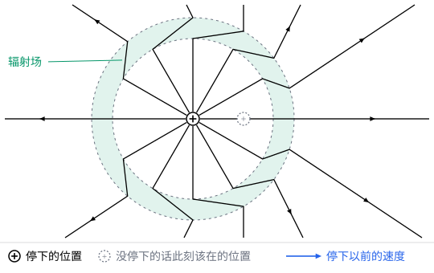

## 这一节要回答的问题

收音机天线里的电子来回振动，向外发射无线电波；X 光管里，高速电子打到金属靶上突然减速，发出 X 射线。加速运动的:term[电荷]{id="physics.electromagnetism.electric-charge"}（electric charge）辐射出多大的功率？朝哪些方向辐射得最强？按经典电磁学，绕原子核转的电子一直在加速，原子为什么没有塌缩？

## 讲解

### 低速电荷的辐射场

运动:term[点电荷]{id="physics.electromagnetism.point-charge"}（point charge）的:term[电场]{id="physics.electromagnetism.electric-field"}（electric field）里，正比于加速度的一项是:term[辐射场]{id="physics.electromagnetism.radiation-field"}（radiation field），它在远处按$\frac1R$减小（见[运动点电荷的场](lesson:physics.electromagnetism.lienard-wiechert#thm-lw-fields)）。:term[电荷]{id="physics.electromagnetism.electric-charge"}的速度远小于光速时，它可以大大化简。

::anchor{id="thm-slow-radiation"}
定理（低速电荷的辐射场）：点电荷$q$的速度远小于$c$、加速度为$\vb a$时，远处的辐射场是$\vb E_{\mathrm{rad}}=\frac{q}{4\pi\varepsilon_0c^2R}\uv R\times(\uv R\times\vb a)$，$\vb B_{\mathrm{rad}}=\frac1c\uv R\times\vb E_{\mathrm{rad}}$，其中$\vb a$取:term[推迟时间]{id="physics.electromagnetism.retarded-time"}（retarded time）的值；电场垂直于$\uv R$，大小是$\frac{qa\sin\theta}{4\pi\varepsilon_0c^2R}$，$\theta$是$\vb a$和$\uv R$的夹角。

证明思路：在运动点电荷的场的定理里令$\vb v\to\vb 0$，$\vb u=c\uv R$，$\vb R\cdot\vb u=cR$，辐射场一项成为$\frac{q}{4\pi\varepsilon_0}\cdot\frac{R}{c^3R^3}\vb R\times(c\uv R\times\vb a)=\frac{q}{4\pi\varepsilon_0c^2R}\uv R\times(\uv R\times\vb a)$。又$\uv R\times(\uv R\times\vb a)=\uv R(\uv R\cdot\vb a)-\vb a$，正是$\vb a$垂直于$\uv R$的那部分反过来，大小是$a\sin\theta$。几何图像里的图给出了它的直观来源（第 6 题）。

### 拉莫尔公式

::anchor{id="thm-larmor"}
定理（:term[拉莫尔公式]{id="physics.electromagnetism.larmor-formula"}，Larmor formula）：速度远小于$c$、加速度为$a$的:term[点电荷]{id="physics.electromagnetism.point-charge"}，单位:term[立体角]{id="physics.electromagnetism.solid-angle"}（solid angle）里辐射出的功率是$\frac{\mu_0q^2a^2}{16\pi^2c}\sin^2\theta$，总的辐射功率是$P=\frac{\mu_0q^2a^2}{6\pi c}=\frac{q^2a^2}{6\pi\varepsilon_0c^3}$。

证明思路：:term[辐射场]{id="physics.electromagnetism.radiation-field"}的:term[电场]{id="physics.electromagnetism.electric-field"}、:term[磁场]{id="physics.electromagnetism.magnetic-field"}（magnetic field）和$\uv R$两两垂直，$B_{\mathrm{rad}}=\frac{E_{\mathrm{rad}}}c$，:term[坡印亭矢量]{id="physics.electromagnetism.poynting-vector"}（Poynting vector）$\vb S=\frac{1}{\mu_0}\vb E_{\mathrm{rad}}\times\vb B_{\mathrm{rad}}=\frac{E_{\mathrm{rad}}^2}{\mu_0c}\uv R=\frac{\mu_0q^2a^2\sin^2\theta}{16\pi^2cR^2}\uv R$，乘以$R^2$就是单位立体角的功率。在半径为$R$的大球面上积分，$\int\sin^2\theta\,\dd\Omega=\frac{8\pi}3$，得$P$。:term[速度场]{id="physics.electromagnetism.velocity-field"}（velocity field）以及它和辐射场的交叉项，能流按$\frac1{R^3}$或更快地减小，在大球面上的积分趋于零，不算辐射。

速度远小于光速时，辐射功率只和加速度有关，和速度无关；匀速运动的:term[电荷]{id="physics.electromagnetism.electric-charge"}不论多快都不辐射（第 7 题）。辐射沿加速度方向为零，垂直于加速度的方向最强，绕着加速度的方向像一个环（下面的动画）。同样的力作用下，质子的加速度只有电子的$\frac1{1836}$，辐射功率只有电子的约$3\times10^{-7}$，辐射主要来自电子（第 4 题）。拉莫尔（Joseph Larmor）在 1897 年得到了这个公式。

速度接近光速时，要用运动点电荷的场的完整形式。加速度和速度在同一直线上时（例如高速电子打到靶上减速），单位立体角的功率正比于$\frac{\sin^2\theta}{(1-\beta\cos\theta)^5}$，$\theta$是辐射方向和速度的夹角，辐射集中到前方；电子在磁场里转弯时也一样，辐射集中在前方一个很窄的锥里。1947 年，美国通用电气公司实验室的一台电子同步加速器上第一次直接看到了这种光，现在的同步辐射（synchrotron radiation）光源就是专门用来产生它的。

### 经典的原子为什么不稳定

按经典的图像，氢原子里的电子绕原子核做圆周运动，有向心加速度，会不断辐射、损失能量，轨道越来越小，最后落到原子核上，辐射的频率也随着轨道缩小而连续变化。按:term[拉莫尔公式]{id="physics.electromagnetism.larmor-formula"}估算，从玻尔半径落到核上只要约$1.6\times10^{-11}\,\mathrm s$（例 2）。可真实的原子是稳定的，发出的光也只有一些分立的频率，经典电磁学和牛顿力学在原子里不再适用。1913 年，玻尔（Niels Bohr）假定电子只在一些特定的轨道上运动，在这些轨道上不辐射，量子力学后来解释了为什么（见[原子光谱与玻尔模型](lesson:physics.quantum-mechanics.bohr-model)）。

## 几何图像

图里一个以$0.5c$向右运动的:term[正电荷]{id="physics.electromagnetism.electric-charge"}在 O 处用很短的时间停下（速度取得大，是为了看得清），画的是停下以后过了一段时间的:term[电场线]{id="physics.electromagnetism.field-line"}（electric field line）。内圈以内已经收到「停下」的消息，电场线从停下的位置沿径向出发；外圈以外还没收到，电场线仍是匀速运动电荷的场，从电荷没停下的话此刻该在的位置出发。两部分的电场线在两圈之间的薄层里拐弯连接，那里的:term[电场]{id="physics.electromagnetism.electric-field"}几乎垂直于半径，就是:term[辐射场]{id="physics.electromagnetism.radiation-field"}，这一层随着消息以光速向外扩张。沿运动方向的电场线不拐弯，垂直于运动方向的拐得最厉害，和$\sin\theta$一致。

:::anim{component="function-plot"}
range: { x: [0, 180], y: [0, 1.1] }
functions:
  - expr: "sin(x*pi/180)^2/(1 - b*cos(x*pi/180))^5*(1 - (sqrt(1 + 15*b^2) - 1)/3)^5/(1 - ((sqrt(1 + 15*b^2) - 1)/(3*b))^2)"
    label: |
      速度为$\beta c$时的辐射
  - expr: "sin(x*pi/180)^2"
    label: |
      低速时的辐射$\sin^2\theta$
points:
  - { x: "acos((sqrt(1 + 15*b^2) - 1)/(3*b))*180/pi", y: "1" }
sliders:
  - name: b
    min: 0.05
    max: 0.9
    step: 0.05
    default: 0.5
    label: |
      电荷的速度和光速之比$\beta$
:::

横轴是辐射方向和速度方向的夹角$\theta$，以度为单位，加速度和速度在同一直线上；纵轴是单位:term[立体角]{id="physics.electromagnetism.solid-angle"}的辐射功率，两条曲线各以自己的最大值为单位。低速时是$\sin^2\theta$，前后对称，垂直于运动方向最强。速度越大，辐射越往前集中，最强的方向（图上的点）越来越靠近运动方向。

## 例题

### 例 1　磁场里转圈的电子

电子在$1.0\,\mathrm T$的匀强:term[磁场]{id="physics.electromagnetism.magnetic-field"}里以$1.0\times10^6\,\mathrm{m/s}$的速率做圆周运动。（1）它的辐射功率是多少？（2）按这个功率，它的动能多久辐射完？取$e=1.602\times10^{-19}\,\mathrm C$，$m=9.109\times10^{-31}\,\mathrm{kg}$，$\varepsilon_0=8.854\times10^{-12}\,\mathrm{F/m}$，$c=3.00\times10^8\,\mathrm{m/s}$。

**为什么想到这么做**：速度远小于光速，用:term[拉莫尔公式]{id="physics.electromagnetism.larmor-formula"}；向心加速度由:term[洛伦兹力]{id="physics.electromagnetism.lorentz-force"}（Lorentz force）给出，$a=\frac{evB}{m}$。

**推导**：（1）$a=\frac{evB}{m}=\frac{1.602\times10^{-19}\times1.0\times10^6\times1.0}{9.109\times10^{-31}}\,\mathrm{m/s^2}\approx1.76\times10^{17}\,\mathrm{m/s^2}$，$P=\frac{e^2a^2}{6\pi\varepsilon_0c^3}\approx1.76\times10^{-19}\,\mathrm W$。（2）动能$\frac12mv^2\approx4.55\times10^{-19}\,\mathrm J$，除以$P$约为$2.6\,\mathrm s$。$a$正比于$v$，$P$正比于$v^2$，这个时间和速率无关，只由磁场决定，等于$\frac{3\pi\varepsilon_0m^3c^3}{e^4B^2}$。电子在磁场里转圈时的这种辐射叫回旋辐射（cyclotron radiation），磁场越强，电子损失能量越快。

### 例 2　经典原子的寿命

按经典的图像，氢原子里的电子绕原子核做圆周运动，起初的半径是$r_0=5.29\times10^{-11}\,\mathrm m$。设它每时每刻都近似在做圆周运动，只是半径因为辐射慢慢变小，估计它落到原子核上要用多久。取$e=1.602\times10^{-19}\,\mathrm C$，$m=9.109\times10^{-31}\,\mathrm{kg}$，$\varepsilon_0=8.854\times10^{-12}\,\mathrm{F/m}$，$c=3.00\times10^8\,\mathrm{m/s}$。

**为什么想到这么做**：在半径为$r$的圆轨道上，电子的能量是$E=-\frac{e^2}{8\pi\varepsilon_0r}$，加速度是$a=\frac{e^2}{4\pi\varepsilon_0mr^2}$；辐射使能量减小，$\dv Et=-P$，由此得到$r$怎样随时间变化。

**推导**：$\dv Et=\frac{e^2}{8\pi\varepsilon_0r^2}\dv rt=-\frac{e^2a^2}{6\pi\varepsilon_0c^3}$，代入$a$整理，得$r^2\dv rt=-\frac{4}{3}r_{\mathrm e}^2c$，其中$r_{\mathrm e}=\frac{e^2}{4\pi\varepsilon_0mc^2}\approx2.81\times10^{-15}\,\mathrm m$。积分，从$r_0$落到$r=0$用的时间是$t=\frac{r_0^3}{4r_{\mathrm e}^2c}=\frac{(5.29\times10^{-11})^3}{4\times(2.81\times10^{-15})^2\times3.00\times10^8}\,\mathrm s\approx1.6\times10^{-11}\,\mathrm s$。快落到核上时电子的速度已经接近光速，这个估计只给出数量级；可不到一纳秒原子就塌缩了，和原子的稳定完全矛盾。

## 常见误区

- 「:term[电荷]{id="physics.electromagnetism.electric-charge"}运动得越快，辐射越强。」低速时辐射功率只和加速度有关；匀速运动的电荷，无论多快都不辐射。
- 「辐射沿加速度方向最强。」恰好相反：沿加速度方向为零，垂直于加速度的方向最强。
- 「加速的电荷周围变化的:term[电场]{id="physics.electromagnetism.electric-field"}都是辐射。」只有按$\frac1R$减小的:term[辐射场]{id="physics.electromagnetism.radiation-field"}能把能量带到远处；按$\frac1{R^2}$减小的:term[速度场]{id="physics.electromagnetism.velocity-field"}跟着电荷走，不算辐射（第 7 题）。
