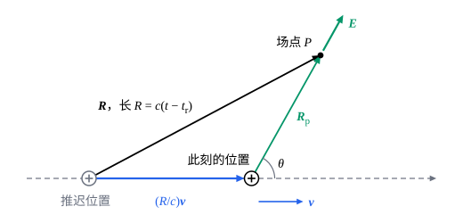

## 这一节要回答的问题

一个电子以接近光速飞过，它周围的:term[电场]{id="physics.electromagnetism.electric-field"}（electric field）是什么样子？[毕奥-萨伐尔定律](lesson:physics.electromagnetism.biot-savart)一节给出的运动:term[点电荷]{id="physics.electromagnetism.point-charge"}（point charge）的:term[磁场]{id="physics.electromagnetism.magnetic-field"}（magnetic field）只在速度远小于光速时成立，速度一大，推迟就不能忽略：远处此刻感受到的，是:term[电荷]{id="physics.electromagnetism.electric-charge"}（electric charge）以前在别处时发出的消息。运动的点电荷的:term[推迟势]{id="physics.electromagnetism.retarded-potentials"}（retarded potentials）是什么？它匀速运动时，电场从它以前的位置出发，还是从此刻的位置出发？

## 讲解

### 推迟位置

:term[点电荷]{id="physics.electromagnetism.point-charge"}$q$沿轨迹$\vb w(t)$运动，速度$\vb v=\dv{\vb w}t$的大小不超过某个小于$c$的值。按:term[推迟势]{id="physics.electromagnetism.retarded-potentials"}，场点$\vb r$在$t$时刻的势只取决于:term[电荷]{id="physics.electromagnetism.electric-charge"}在:term[推迟时间]{id="physics.electromagnetism.retarded-time"}（retarded time）的状态（见[推迟势](lesson:physics.electromagnetism.retarded-potentials#thm-retarded-potentials)）；对点电荷，推迟时间$t_{\mathrm r}$满足$|\vb r-\vb w(t_{\mathrm r})|=c(t-t_{\mathrm r})$：电荷在$t_{\mathrm r}$时刻所在的位置发出的消息，正好在$t$时刻到达场点。

::anchor{id="thm-retarded-time-unique"}
定理（推迟时间只有一个）：电荷的速率不超过某个小于$c$的值时，对每个场点$\vb r$和时刻$t$，满足$|\vb r-\vb w(t_{\mathrm r})|=c(t-t_{\mathrm r})$的$t_{\mathrm r}$恰有一个。

证明思路：看函数$g(t')=c(t-t')-|\vb r-\vb w(t')|$。前一项随$t'$以速率$c$减小，后一项变化的速率不超过电荷的速率，比$c$小，所以$g$严格减小；$g(t)=-|\vb r-\vb w(t)|\le0$，$t'\to-\infty$时$g\to+\infty$，于是$g$恰有一个零点（几何图像里的动画）。

::anchor{id="def-retarded-position"}
$\vb w(t_{\mathrm r})$叫作电荷的推迟位置（retarded position）；记$\vb R=\vb r-\vb w(t_{\mathrm r})$，它的长度$R=c(t-t_{\mathrm r})$，方向$\uv R=\frac{\vb R}{R}$。

为什么这样定义：$t$时刻场点「看到」的电荷在推迟位置上，就像今晚看到的星光，是星星在它发光时的位置上发出的。上面的定理说明，速度小于光速的电荷，在任何时刻只能在一个位置上被「看到」。边界情况：电荷静止时推迟位置就是它的位置；电荷的速度接近光速时，推迟位置可以远远落在此刻位置的后面（例 1）。

### 李纳-维谢尔势

::anchor{id="thm-lienard-wiechert"}
定理（:term[李纳-维谢尔势]{id="physics.electromagnetism.lienard-wiechert-potentials"}，Liénard–Wiechert potentials）：速度小于$c$的:term[点电荷]{id="physics.electromagnetism.point-charge"}$q$产生的:term[推迟势]{id="physics.electromagnetism.retarded-potentials"}是$\varphi(\vb r,t)=\frac{q}{4\pi\varepsilon_0}\cdot\frac{1}{R-\vb R\cdot\vb v/c}$，$\vb A(\vb r,t)=\frac{\vb v}{c^2}\varphi(\vb r,t)$，其中$\vb R$、$R$和$\vb v$都取:term[推迟时间]{id="physics.electromagnetism.retarded-time"}$t_{\mathrm r}$的值。

证明思路：把点电荷看成很小的一团:term[电荷]{id="physics.electromagnetism.electric-charge"}，代入推迟势。各处取的推迟时间不同，离场点远的部分取较早的时刻；电荷团朝场点运动时，在被信号「扫过」的过程中还在前进，扫过的范围比它实际的大小大，所以积分$\int\rho(\vb r',t_{\mathrm r})\dd V'$不等于$q$，而是$\frac{q}{1-\uv R\cdot\vb v/c}$（第 5 题）。电荷团很小，分母里的$|\vb r-\vb r'|$都可以换成$R$，就得到$\varphi$；$\vb A$里的:term[电流密度]{id="physics.electromagnetism.current-density"}（current density）是$\rho\vb v$，做法一样。

和静止的点电荷比，势多了因子$\frac{1}{1-\uv R\cdot\vb v/c}$：电荷朝场点运动时势变大，离场点而去时变小。这两个公式是李纳（Alfred-Marie Liénard）在 1898 年、维谢尔（Emil Wiechert）在 1900 年各自独立得到的，比狭义相对论还早；它们只用到:term[麦克斯韦方程组]{id="physics.electromagnetism.maxwell-equations"}（Maxwell's equations），对接近光速的电荷照样成立。

### 运动点电荷的电场和磁场

::anchor{id="thm-lw-fields"}
定理（运动:term[点电荷]{id="physics.electromagnetism.point-charge"}的场）：记$\vb u=c\uv R-\vb v$，$\vb a$是:term[电荷]{id="physics.electromagnetism.electric-charge"}在:term[推迟时间]{id="physics.electromagnetism.retarded-time"}的加速度，则$\vb E(\vb r,t)=\frac{q}{4\pi\varepsilon_0}\cdot\frac{R}{(\vb R\cdot\vb u)^3}\bigl[(c^2-v^2)\vb u+\vb R\times(\vb u\times\vb a)\bigr]$，$\vb B(\vb r,t)=\frac1c\uv R\times\vb E(\vb r,t)$。

证明思路：把:term[李纳-维谢尔势]{id="physics.electromagnetism.lienard-wiechert-potentials"}代入$\vb E=-\nabla\varphi-\pdv{\vb A}t$、$\vb B=\curl\vb A$。计算很长，要点是$t_{\mathrm r}$随场点和时刻变：对$|\vb r-\vb w(t_{\mathrm r})|=c(t-t_{\mathrm r})$两边求导，得$\pdv{t_{\mathrm r}}t=\frac{cR}{\vb R\cdot\vb u}$、$\nabla t_{\mathrm r}=-\frac{\vb R}{\vb R\cdot\vb u}$；对$\vb v(t_{\mathrm r})$求导时就出现了加速度。

::anchor{id="def-radiation-field"}
运动点电荷的:term[电场]{id="physics.electromagnetism.electric-field"}里，和加速度无关的第一项叫作:term[速度场]{id="physics.electromagnetism.velocity-field"}（velocity field），正比于加速度的第二项叫作:term[辐射场]{id="physics.electromagnetism.radiation-field"}（radiation field）。

为什么这样定义：在远处$\vb R\cdot\vb u=R(c-\uv R\cdot\vb v)$和$R$成正比，速度场按$\frac1{R^2}$减小，和库仑场一样；辐射场只按$\frac1R$减小，它和相应的:term[磁场]{id="physics.electromagnetism.magnetic-field"}的乘积按$\frac1{R^2}$减小，穿过一个大球面的能流不随球面增大而减小，能把能量带到无穷远（见[拉莫尔公式](lesson:physics.electromagnetism.larmor-formula)）。边界情况：电荷匀速运动时没有辐射场，静止时速度场就是库仑场。

### 匀速运动的点电荷

::anchor{id="thm-uniform-charge"}
定理（匀速运动的:term[点电荷]{id="physics.electromagnetism.point-charge"}的场）：:term[电荷]{id="physics.electromagnetism.electric-charge"}以速度$\vb v$匀速运动时，$t$时刻的:term[电场]{id="physics.electromagnetism.electric-field"}从电荷此刻的位置$\vb w(t)$沿径向向外，$\vb E=\frac{q}{4\pi\varepsilon_0}\cdot\frac{1-\beta^2}{(1-\beta^2\sin^2\theta)^{3/2}}\cdot\frac{\uv R_{\mathrm p}}{R_{\mathrm p}^2}$，:term[磁场]{id="physics.electromagnetism.magnetic-field"}$\vb B=\frac{1}{c^2}\vb v\times\vb E$；这里$\vb R_{\mathrm p}=\vb r-\vb w(t)$，$\theta$是它和$\vb v$的夹角，$\beta=\frac vc$。

证明思路：$\vb a=\vb 0$，只剩:term[速度场]{id="physics.electromagnetism.velocity-field"}。电荷从推迟位置走到此刻的位置用了$t-t_{\mathrm r}=\frac Rc$，走过$\frac Rc\vb v$，所以$\vb R_{\mathrm p}=\vb R-\frac Rc\vb v$，$R\vb u=c\vb R-R\vb v=c\vb R_{\mathrm p}$：$\vb u$沿着从此刻的位置指向场点的方向（下图）。由这个三角形还能算出$\vb R\cdot\vb u=cR_{\mathrm p}\sqrt{1-\beta^2\sin^2\theta}$，代入即得$\vb E$（第 6 题）；$\vb B=\frac1c\uv R\times\vb E$里把$\uv R$写成$\frac1R\bigl(\vb R_{\mathrm p}+\frac Rc\vb v\bigr)$，和$\vb E$平行的部分叉乘为零，剩下$\frac1{c^2}\vb v\times\vb E$。

运动方向上（$\theta=0$）电场是静止时的$1-\beta^2$倍，垂直方向上是$\frac{1}{\sqrt{1-\beta^2}}$倍，电场向垂直于运动的方向聚拢；狭义相对论里，这个结果由静止电荷的库仑场经过场的变换直接得到（见[电磁场张量](lesson:physics.special-relativity.field-tensor)例 1）。电场从此刻的位置出发，可电荷并没有办法把此刻的位置告诉远处：场是由推迟时的位置和速度按匀速「外推」出来的，电荷要是中途改变了运动，外推就不对了，差别由:term[辐射场]{id="physics.electromagnetism.radiation-field"}补上（第 7 题）。速度远小于光速时，$\vb E$就是此刻位置的库仑场，$\vb B=\frac{1}{c^2}\vb v\times\vb E=\frac{\mu_0}{4\pi}\frac{q\vb v\times\uv R_{\mathrm p}}{R_{\mathrm p}^2}$，正是[毕奥-萨伐尔定律](lesson:physics.electromagnetism.biot-savart)一节里运动电荷的磁场。

## 几何图像

:term[电荷]{id="physics.electromagnetism.electric-charge"}匀速向右运动。$t_{\mathrm r}$时刻它在推迟位置，从那里发出的消息走过$R=c(t-t_{\mathrm r})$，在$t$时刻到达场点$P$；这段时间里电荷走了$\frac Rc\vb v$，到了此刻的位置。三角形的第三条边$\vb R_{\mathrm p}=\vb R-\frac Rc\vb v$从此刻的位置指向场点，匀速运动时$P$处的:term[电场]{id="physics.electromagnetism.electric-field"}正沿着它。

:::anim{component="function-plot"}
range: { x: [-6, 1], y: [0, 6] }
functions:
  - expr: "-x"
    label: |
      $c(t-t')$：$t'$时刻发出的消息到$t$时刻走过的距离
  - expr: "sqrt(1 + b^2*x^2)"
    label: |
      $t'$时刻电荷到场点的距离
points:
  - { x: "-1/sqrt(1 - b^2)", y: "1/sqrt(1 - b^2)" }
sliders:
  - name: b
    min: 0
    max: 0.95
    step: 0.05
    default: 0.6
    label: |
      电荷的速度和光速之比$\beta$
:::

电荷沿直线匀速运动，$t'=0$时经过离场点最近的点，最近距离是$d$；我们问的是场点在$t=0$时刻的场。横轴是时刻$t'$，以$\frac dc$为单位；纵轴是距离，以$d$为单位。斜线是$t'$时刻发出的消息到$t=0$时能走多远，曲线是$t'$时刻电荷到场点的距离，两者的交点（图上的点）就是:term[推迟时间]{id="physics.electromagnetism.retarded-time"}。曲线升降得总比斜线慢，所以只有一个交点；$\beta$越大，交点越往左，推迟位置落得越远，交点在$t'=-\frac{1}{\sqrt{1-\beta^2}}$处（例 1）。

## 例题

### 例 1　飞过的电子

一个电子以$0.80c$沿直线匀速飞行，离场点最近时相距$d=3.0\,\mathrm m$，取这一时刻为$t=0$。求场点在$t=0$时刻的:term[推迟时间]{id="physics.electromagnetism.retarded-time"}和推迟位置，以及这一时刻场点处的:term[电场]{id="physics.electromagnetism.electric-field"}是静止时同样距离上库仑场的几倍。

**为什么想到这么做**：推迟时间由$|\vb r-\vb w(t_{\mathrm r})|=c(0-t_{\mathrm r})$定；电场用匀速运动的定理，此刻的位置就是离场点最近的点，$\theta=90^\circ$。

**推导**：取电子沿$x$轴运动、$t=0$时在原点，场点在$(0,d,0)$。由$\sqrt{(vt_{\mathrm r})^2+d^2}=-ct_{\mathrm r}$平方得$t_{\mathrm r}^2(c^2-v^2)=d^2$，取负根，$t_{\mathrm r}=-\frac{d}{c\sqrt{1-\beta^2}}=-\frac{3.0}{3.00\times10^8\times0.60}\,\mathrm s\approx-1.67\times10^{-8}\,\mathrm s$。推迟位置$x=vt_{\mathrm r}=-4.0\,\mathrm m$，到场点的距离$\sqrt{4.0^2+3.0^2}\,\mathrm m=5.0\,\mathrm m$，正是光在$16.7\,\mathrm{ns}$里走过的距离。$\theta=90^\circ$时电场是库仑场的$\frac{1}{\sqrt{1-\beta^2}}=\frac53\approx1.67$倍，方向从此刻的位置（原点）指向场点，而不是从推迟位置指向场点。

### 例 2　绕核运动的电子产生的磁场

按玻尔模型的经典图像，氢原子里的电子以$2.19\times10^6\,\mathrm{m/s}$的速率绕原子核做半径为$5.29\times10^{-11}\,\mathrm m$的圆周运动。估计它在原子核处产生的:term[磁场]{id="physics.electromagnetism.magnetic-field"}。

**为什么想到这么做**：$\beta\approx0.0073$，远小于$1$，:term[速度场]{id="physics.electromagnetism.velocity-field"}对应的磁场就是低速时的结果$B=\frac{\mu_0}{4\pi}\frac{qv}{R^2}$（速度和半径垂直）。电子做圆周运动，有加速度，可在原子核处加速度沿着$\uv R$，:term[辐射场]{id="physics.electromagnetism.radiation-field"}带来的磁场只有上面这个磁场的约$\beta^2$倍，可以不计。

**推导**：$B\approx\frac{\mu_0}{4\pi}\frac{ev}{R^2}=10^{-7}\times\frac{1.602\times10^{-19}\times2.19\times10^6}{(5.29\times10^{-11})^2}\,\mathrm T\approx12.5\,\mathrm T$，方向垂直于轨道平面。铁芯电磁铁的磁场受铁的磁饱和限制，只有约$2\,\mathrm T$，原子内部的磁场比它强得多。真实的氢原子要用量子力学描述，这个经典估计给出的是数量级（见[原子光谱与玻尔模型](lesson:physics.quantum-mechanics.bohr-model)）。

## 常见误区

- 「运动:term[电荷]{id="physics.electromagnetism.electric-charge"}的:term[电场]{id="physics.electromagnetism.electric-field"}从它推迟时的位置出发。」匀速运动时电场从此刻的位置出发；推迟位置只决定用哪个时刻的速度和加速度（例 1）。
- 「:term[李纳-维谢尔势]{id="physics.electromagnetism.lienard-wiechert-potentials"}只是低速时的近似。」它是:term[推迟势]{id="physics.electromagnetism.retarded-potentials"}对:term[点电荷]{id="physics.electromagnetism.point-charge"}的精确结果，只用到:term[麦克斯韦方程组]{id="physics.electromagnetism.maxwell-equations"}，速度接近光速时照样成立。
- 「点电荷的推迟势就是把库仑势里的距离换成推迟时的距离。」还要乘以$\frac{1}{1-\uv R\cdot\vb v/c}$：电荷朝场点运动时势更大，离场点而去时更小。
