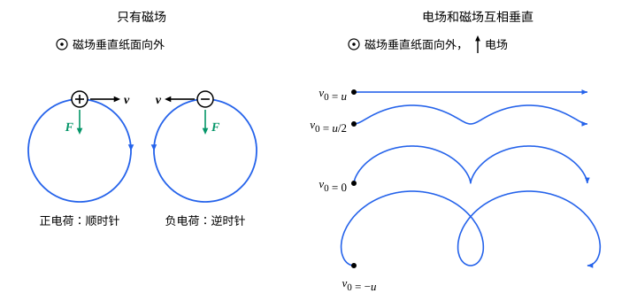

## 这一节要回答的问题

[库仑定律](lesson:physics.electromagnetism.coulomb-law)只管静止的:term[电荷]{id="physics.electromagnetism.electric-charge"}（electric charge）。磁铁能吸引铁钉、让指南针转向，通电的导线旁边的小磁针也会偏转；运动的电荷在磁铁附近会受到一种和速度有关的力。这个力有多大、朝哪个方向？带电粒子在它的作用下怎样运动？

## 讲解

### 磁场

1820 年 7 月，奥斯特（Hans Christian Ørsted）发表了一个实验：导线里通电时，旁边的小磁针会偏转，电和磁之间有联系。后来的实验表明，运动的:term[电荷]{id="physics.electromagnetism.electric-charge"}在磁铁或:term[电流]{id="physics.electromagnetism.electric-current"}（electric current）附近会受到额外的力；1897 年，汤姆孙（J. J. Thomson）就是用磁铁和:term[电场]{id="physics.electromagnetism.electric-field"}（electric field）使阴极射线偏转，测出了电子的荷质比。这种力有三个特点：和电荷$q$成正比；总和速度垂直；在空间的每一点有一个特殊的方向，速度沿这个方向时力为零，速度和它成$\theta$角时，力和$v\sin\theta$成正比。

::anchor{id="def-magnetic-field"}
以速度$\vb v$运动的:term[点电荷]{id="physics.electromagnetism.point-charge"}（point charge）$q$，在没有电场的地方受力$\vb F=q\vb v\times\vb B$，这里的矢量场$\vb B$叫作:term[磁场]{id="physics.electromagnetism.magnetic-field"}（magnetic field），也叫磁感应强度（magnetic flux density）。磁场的单位是特斯拉（tesla），记作$\mathrm T$，$1\,\mathrm T=1\,\mathrm{N/(A\,m)}$。

为什么这样定义：[叉积](lesson:math.linear-algebra.cross-product)（cross product）$q\vb v\times\vb B$恰好具备上面三个特点：它和$q$成正比，和$\vb v$垂直，$\vb v$平行于$\vb B$时为零，大小是$qvB\sin\theta$。磁场的方向就是那个特殊的方向，指向是小磁针静止时 N 极所指的一边。边界情况：磁场对静止的电荷没有力，这和电场不同。

地面附近地球磁场的大小在$25$到$65\,\mu\mathrm T$之间；医院里磁共振成像（magnetic resonance imaging，MRI）的磁体，常见的是$1.5\,\mathrm T$和$3\,\mathrm T$。

::anchor{id="def-magnetic-field-line"}
和:term[电场线]{id="physics.electromagnetism.field-line"}（electric field line）一样，处处和磁场方向相切、按磁场方向标上箭头的曲线，叫作:term[磁场线]{id="physics.electromagnetism.magnetic-field-line"}（magnetic field line），也叫磁感线；磁场强的地方画得密。

为什么这样定义：把铁屑撒在磁铁周围的纸上，轻敲几下，铁屑排成的曲线就是磁场线的样子。边界情况：以后会看到，磁场线不会在任何地方开始或终止（见[安培环路定理](lesson:physics.electromagnetism.ampere-law)），这和从正电荷出发的电场线不同。

### 洛伦兹力

::anchor{id="def-lorentz-force"}
:term[电荷]{id="physics.electromagnetism.electric-charge"}$q$以速度$\vb v$在:term[电场]{id="physics.electromagnetism.electric-field"}$\vb E$和:term[磁场]{id="physics.electromagnetism.magnetic-field"}$\vb B$里运动时，受的力是$\vb F=q(\vb E+\vb v\times\vb B)$，叫作:term[洛伦兹力]{id="physics.electromagnetism.lorentz-force"}（Lorentz force）。

为什么这样定义：电场力$q\vb E$和磁力$q\vb v\times\vb B$同时作用时直接相加。1889 年亥维赛（Oliver Heaviside）得出运动电荷受的磁力是$q\vb v\times\vb B$，1895 年洛伦兹（Hendrik Lorentz）把电力和磁力合在一起写成这个式子。中学物理常把磁场部分单独叫作洛伦兹力，这里按通行的说法，把电场部分也算进去。

边界情况：$\vb v$是在测量$\vb E$、$\vb B$的那个参考系里的速度，换一个参考系，电场和磁场都会变（见狭义相对论的[电磁场张量](lesson:physics.special-relativity.field-tensor)）。两个电荷都在运动时，彼此之间除了电力还有磁力，速度远小于光速时，磁力约是电力的$\frac{v^2}{c^2}$倍（第 7 题；运动电荷的磁场见[毕奥-萨伐尔定律](lesson:physics.electromagnetism.biot-savart)）。

::anchor{id="thm-magnetic-no-work"}
定理（磁力不做功）：磁力$q\vb v\times\vb B$总和速度垂直，它的功率$\vb F\cdot\vb v$为零。只受磁力的带电粒子，速率和动能都不变，磁力只改变速度的方向。

证明思路：$\vb v\times\vb B$和$\vb v$垂直，所以$(q\vb v\times\vb B)\cdot\vb v=0$。由[动能定理](lesson:physics.newtonian-mechanics.work-energy)（work-energy theorem），动能的变化率等于合力的功率，$\dv{}{t}\bigl(\frac12mv^2\bigr)=\vb F\cdot\vb v=0$。

### 匀强磁场里的运动

::anchor{id="thm-cyclotron"}
定理（回旋运动）：质量为$m$、:term[电荷]{id="physics.electromagnetism.electric-charge"}为$q$的粒子在匀强:term[磁场]{id="physics.electromagnetism.magnetic-field"}$\vb B$里以垂直于$\vb B$的速度$v$运动，它做匀速圆周运动，半径是$R=\frac{mv}{|q|B}$，转一圈的时间是$T=\frac{2\pi m}{|q|B}$，和速率无关。$R$叫作回旋半径（cyclotron radius），$f_{\mathrm c}=\frac1T=\frac{|q|B}{2\pi m}$叫作:term[回旋频率]{id="physics.electromagnetism.cyclotron-frequency"}（cyclotron frequency），对应的角频率是$\omega_{\mathrm c}=\frac{|q|B}{m}$。

证明思路：取$\vb B=B\uv z$，记$\omega=\frac{qB}{m}$。牛顿第二定律给出$\dv{v_x}t=\omega v_y$，$\dv{v_y}t=-\omega v_x$，$v_z$不变（这里为$0$）。设开始时速度沿$x$方向，满足它的是$v_x=v\cos\omega t$，$v_y=-v\sin\omega t$：速度的方向匀速转动，大小不变；再积分一次，位置在一个半径为$\frac{v}{|\omega|}=\frac{mv}{|q|B}$的圆上。

核对一下：磁力$|q|vB$正好提供[圆周运动](lesson:physics.newtonian-mechanics.circular-dynamics)需要的向心力（centripetal force）$\frac{mv^2}{R}$。速率越大半径越大，周长也按比例增大，所以一圈的时间不变。$q>0$时，从磁场指向的那一侧看去，粒子顺时针转；$q<0$时逆时针转。

速度有平行于$\vb B$的分量时，这个分量不受影响，粒子一边绕圈一边沿磁场方向匀速前进，轨道是一条螺旋线（helix）。粒子的速度接近光速时，要把$m$换成$\gamma m$（$\gamma=\frac{1}{\sqrt{1-v^2/c^2}}$），回旋频率随能量升高而降低（见[四维力与相对论动力学](lesson:physics.special-relativity.four-force)）。

1932 年，劳伦斯（Ernest Lawrence）和利文斯顿（M. Stanley Livingston）发表了回旋加速器（cyclotron）的工作：利用回旋频率和速率无关，用频率固定的交变:term[电场]{id="physics.electromagnetism.electric-field"}在粒子每转半圈时推它一次，把质子加速到$1.22\,\mathrm{MeV}$，却不需要上百万伏的高压。

### 电场和磁场互相垂直

::anchor{id="thm-crossed-fields"}
定理（互相垂直的:term[电场]{id="physics.electromagnetism.electric-field"}和:term[磁场]{id="physics.electromagnetism.magnetic-field"}里的运动）：匀强电场$\vb E$和匀强磁场$\vb B$互相垂直，$E\ll cB$。带电粒子在垂直于$\vb B$的平面里的运动，是一个匀速圆周运动，加上整体以速度$\vb u=\frac{\vb E\times\vb B}{B^2}$的匀速平移；$\vb u$和粒子的:term[电荷]{id="physics.electromagnetism.electric-charge"}、质量都无关。

证明思路：换到以$\vb u$匀速运动的参考系里，粒子的速度变成$\vb v'=\vb v-\vb u$，加速度不变（见[参考系与相对运动](lesson:physics.newtonian-mechanics.relative-motion)）。:term[洛伦兹力]{id="physics.electromagnetism.lorentz-force"}$q(\vb E+\vb v\times\vb B)=q(\vb E+\vb u\times\vb B)+q\vb v'\times\vb B$，而$\vb u\times\vb B=\frac{(\vb E\times\vb B)\times\vb B}{B^2}=-\vb E$（取$\vb E=E\uv y$、$\vb B=B\uv z$核对：$(\vb E\times\vb B)\times\vb B=EB\uv x\times B\uv z=-B^2E\uv y$），第一项为零。所以在新的参考系里粒子只受磁力，做匀速圆周运动；回到原来的参考系，再加上平移$\vb u$。条件$E\ll cB$保证$u\ll c$，伽利略变换（Galilean transformation）适用。

::anchor{id="def-velocity-selector"}
速度恰好是$\vb u$的粒子，$\vb v'=0$，电力和磁力抵消，沿直线匀速穿过：这就是速度选择器（velocity selector），它只放过速率为$\frac EB$的粒子，和粒子的电荷、质量都无关。汤姆孙在 1897 年测荷质比时，就是先调到这种平衡，求出阴极射线粒子的速度。

## 几何图像

左图里:term[磁场]{id="physics.electromagnetism.magnetic-field"}垂直纸面向外，:term[正电荷]{id="physics.electromagnetism.electric-charge"}和负电荷的质量相同、电荷大小相同，以同样的速率运动，:term[洛伦兹力]{id="physics.electromagnetism.lorentz-force"}$\vb F$总指向圆心，两者转向相反。右图里:term[电场]{id="physics.electromagnetism.electric-field"}竖直向上，磁场仍垂直纸面向外，四条曲线是正电荷从黑点出发、初速度水平时的轨道，$u=\frac EB$；轨道是用计算机数值求解运动方程画出的。

四条轨道都向右漂移，平均速度都是$u$：初速度为$u$时电力和磁力抵消，走直线；初速度为$0$时，在以$u$运动的参考系里看，粒子以速率$u$绕圈，轨道是有尖点的摆线（cycloid）；初速度为$-u$时，绕圈的速率$2u$比平移快，轨道打出小环；初速度为$\frac u2$时，绕圈慢于平移，轨道只是起伏的波浪。

## 例题

### 例 1　电子在磁场里绕圈

电子以$2.0\times10^6\,\mathrm{m/s}$的速度垂直射入$1.0\,\mathrm{mT}$的匀强:term[磁场]{id="physics.electromagnetism.magnetic-field"}。求它的回旋半径和:term[回旋频率]{id="physics.electromagnetism.cyclotron-frequency"}。取$m_{\mathrm e}=9.109\times10^{-31}\,\mathrm{kg}$，$e=1.602\times10^{-19}\,\mathrm C$。

**为什么想到这么做**：速度垂直于磁场，电子做匀速圆周运动，直接用$R=\frac{mv}{|q|B}$和$f_{\mathrm c}=\frac{|q|B}{2\pi m}$。

**推导**：$R=\frac{9.109\times10^{-31}\times2.0\times10^6}{1.602\times10^{-19}\times1.0\times10^{-3}}\,\mathrm m\approx1.14\times10^{-2}\,\mathrm m$，约一厘米。$f_{\mathrm c}=\frac{1.602\times10^{-19}\times1.0\times10^{-3}}{2\pi\times9.109\times10^{-31}}\,\mathrm{Hz}\approx2.80\times10^7\,\mathrm{Hz}$，每秒绕两千八百万圈，和速度无关。电子的回旋频率约为每特斯拉$28\,\mathrm{GHz}$，测出这个频率就能测磁场。

### 例 2　质谱仪

离子先通过速度选择器：那里的:term[电场]{id="physics.electromagnetism.electric-field"}$E$和:term[磁场]{id="physics.electromagnetism.magnetic-field"}$B_1$互相垂直。从出口射出的离子，再垂直射入另一个匀强磁场$B_2$，转过半圈后打在底片上，落点离入口$d$。求离子的荷质比$\frac qm$。

**为什么想到这么做**：能沿直线穿过速度选择器的离子，速率都是$\frac{E}{B_1}$；进入$B_2$后做匀速圆周运动，$d$是直径，由半径公式反推荷质比。

**推导**：$v=\frac{E}{B_1}$，$\frac d2=\frac{mv}{qB_2}=\frac{mE}{qB_1B_2}$，所以$\frac qm=\frac{2E}{B_1B_2d}$。:term[电荷]{id="physics.electromagnetism.electric-charge"}相同时，落点的距离和质量成正比：同一种元素的几种同位素（isotope）打在底片上的不同位置，质谱仪（mass spectrometer）就是这样把它们分开、称出它们的质量的。

## 常见误区

- 「:term[磁场]{id="physics.electromagnetism.magnetic-field"}能使带电粒子加速或减速。」磁力总和速度垂直，不做功，只改变速度的方向；改变速率要靠:term[电场]{id="physics.electromagnetism.electric-field"}。
- 「速度越大，粒子回旋一圈的时间越长。」半径和速率成正比，周长也是，一圈的时间不变；只有速度接近光速时，一圈的时间才变长。
- 「磁场的方向就是运动:term[电荷]{id="physics.electromagnetism.electric-charge"}受力的方向。」受力$q\vb v\times\vb B$和磁场垂直，也和速度垂直。
- 「正电荷在磁场里总是逆时针转。」转向取决于从哪一侧看；从磁场指向的那一侧看，正电荷顺时针转，负电荷逆时针转。
