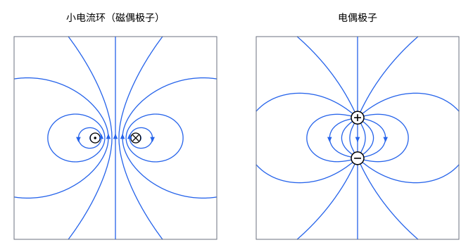

## 这一节要回答的问题

指南针的磁针、条形磁铁、地球、电子和原子核，都像一个小磁体，有 N 极和 S 极。从远处看，一个小电流环（current loop）产生的:term[磁场]{id="physics.electromagnetism.magnetic-field"}（magnetic field）是什么样子？它和:term[电偶极子]{id="physics.electromagnetism.electric-dipole"}（electric dipole）的:term[电场]{id="physics.electromagnetism.electric-field"}（electric field）有什么相同、有什么不同？

## 讲解

### 小电流环的磁矢势

:term[电流]{id="physics.electromagnetism.electric-current"}（electric current）$I$沿一个小的闭合回路流动，取回路附近的一点为原点，回路上的点$\vb r'$都满足$|\vb r'|\ll r$。:term[磁矢势]{id="physics.electromagnetism.vector-potential"}（magnetic vector potential）是$\vb A=\frac{\mu_0I}{4\pi}\oint\frac{\dd\vb l'}{|\vb r-\vb r'|}$，用和[电偶极子的电势](lesson:physics.electromagnetism.electric-dipole#thm-dipole-potential)同样的泰勒展开，$\frac{1}{|\vb r-\vb r'|}\approx\frac1r+\frac{\uv r\cdot\vb r'}{r^2}$，于是$\vb A\approx\frac{\mu_0I}{4\pi}\Bigl(\frac1r\oint\dd\vb l'+\frac{1}{r^2}\oint(\uv r\cdot\vb r')\,\dd\vb l'\Bigr)$。

第一项里$\oint\dd\vb l'=0$：闭合回路的位移之和为零。这一项对应:term[电荷]{id="physics.electromagnetism.electric-charge"}（electric charge）分布展开里的「总电荷」，它恒为零，正是[磁单极子](lesson:physics.electromagnetism.ampere-law#def-monopole)不存在的另一种说法。第二项要用到下面的恒等式。

::anchor{id="thm-loop-identity"}
定理（平面回路的一个积分）：对平面闭合回路和任一常矢量$\vb c$，$\oint(\vb c\cdot\vb r')\,\dd\vb l'=\vb a\times\vb c$，$\vb a$是回路的面积矢量（area vector）：大小是回路围成的面积，方向垂直于回路平面，和绕行方向按右手定则对应。

证明思路：取回路平面为$xy$平面，绕行方向为逆时针，$\vb a=a\uv z$。由[格林公式](lesson:math.vector-calculus.greens-theorem)（Green's theorem），$\oint x'\,\dd x'=\oint y'\,\dd y'=0$，$\oint x'\,\dd y'=a$，$\oint y'\,\dd x'=-a$。所以积分的$x$分量是$c_x\oint x'\,\dd x'+c_y\oint y'\,\dd x'=-ac_y$，$y$分量是$ac_x$，$z$分量是零，正是$a\uv z\times\vb c$。

::anchor{id="def-magnetic-dipole"}
从比电流回路的大小远得多的地方看的小电流环，叫作:term[磁偶极子]{id="physics.electromagnetism.magnetic-dipole"}（magnetic dipole）。那里的磁矢势近似为$\vb A=\frac{\mu_0}{4\pi}\frac{\vb m\times\uv r}{r^2}$，$\vb m=I\vb a$是回路的:term[磁矩]{id="physics.electromagnetism.magnetic-moment"}（magnetic dipole moment）。

为什么这样定义：把恒等式里的$\vb c$取成$\uv r$，第二项就是$\frac{\mu_0I}{4\pi r^2}\vb a\times\uv r$。远处的:term[磁场]{id="physics.electromagnetism.magnetic-field"}只由磁矩决定：回路是圆是方、大是小、电流是多少，只要$I\vb a$相同，远处的磁场就相同，这和:term[电偶极子]{id="physics.electromagnetism.electric-dipole"}只由$\vb p$决定一样。边界情况：离回路不够远时，展开里更高阶的项不能忽略，磁场就不只由磁矩决定（例 2）。

::anchor{id="def-vector-area"}
对任一闭合回路，$\frac12\oint\vb r'\times\dd\vb l'$叫作它的矢量面积（vector area）。$\frac12\vb r'\times\dd\vb l'$是原点和$\dd\vb l'$围成的小三角形的面积矢量，所以平面回路的矢量面积就是上面的面积矢量。回路不在一个平面上时，把$\vb a$换成矢量面积，恒等式和上面的结论都还成立。

### 磁偶极子的磁场

::anchor{id="thm-dipole-field"}
定理（:term[磁偶极子]{id="physics.electromagnetism.magnetic-dipole"}的:term[磁场]{id="physics.electromagnetism.magnetic-field"}）：磁偶极子在远处产生的磁场是$\vb B=\frac{\mu_0}{4\pi}\frac{3(\vb m\cdot\uv r)\uv r-\vb m}{r^3}$；取$\vb m$沿$z$轴，沿径向的分量是$B_r=\frac{\mu_0}{4\pi}\frac{2m\cos\theta}{r^3}$，沿$\theta$增大方向的分量是$B_\theta=\frac{\mu_0}{4\pi}\frac{m\sin\theta}{r^3}$。

证明思路：取$\vb m=m\uv z$，$\vb A=\frac{\mu_0m}{4\pi}\frac{(-y,x,0)}{r^3}$。直接求旋度：$B_x=-\partial_zA_y=\frac{\mu_0m}{4\pi}\frac{3xz}{r^5}$，$B_y=\partial_zA_x=\frac{\mu_0m}{4\pi}\frac{3yz}{r^5}$，$B_z=\partial_xA_y-\partial_yA_x=\frac{\mu_0m}{4\pi}\Bigl(\frac{2}{r^3}-\frac{3(x^2+y^2)}{r^5}\Bigr)=\frac{\mu_0m}{4\pi}\frac{3z^2-r^2}{r^5}$。三个分量合起来正是$\frac{\mu_0}{4\pi}\frac{3(\vb m\cdot\vb r)\vb r-r^2\vb m}{r^5}$，再分解到$\uv r$、$\uv\theta$方向得两个分量。

和[电偶极子的电场](lesson:physics.electromagnetism.electric-dipole#thm-dipole-field)$\vb E=\frac{1}{4\pi\varepsilon_0}\frac{3(\vb p\cdot\uv r)\uv r-\vb p}{r^3}$对照，把$\frac{\vb p}{\varepsilon_0}$换成$\mu_0\vb m$，两者一模一样：在轴上和$\vb m$同向、大小$\frac{\mu_0}{4\pi}\frac{2m}{r^3}$，在中垂面上和$\vb m$反向、大小是轴上的一半。它也和[圆线圈轴线上的磁场](lesson:physics.electromagnetism.biot-savart#thm-loop-axis)在远处的极限一致。

地球的磁场在地面附近很接近磁偶极子的磁场。1600 年，吉尔伯特（William Gilbert）在《论磁》（De Magnete）里就把地球看成一块大磁铁。地球的:term[磁偶极矩]{id="physics.electromagnetism.magnetic-moment"}约为$8\times10^{22}\,\mathrm{A\,m^2}$（例 1），方向大致指向地理南极，所以地磁场在地面附近从南半球指向北半球，指南针的 N 极指向北方。

### 和电偶极子的不同

远处两者形状一样，近处却不同。:term[电偶极子]{id="physics.electromagnetism.electric-dipole"}的:term[电场线]{id="physics.electromagnetism.field-line"}（electric field line）从$+q$出发、终止在$-q$上，两个:term[电荷]{id="physics.electromagnetism.electric-charge"}之间的:term[电场]{id="physics.electromagnetism.electric-field"}和$\vb p$反向；:term[磁偶极子]{id="physics.electromagnetism.magnetic-dipole"}没有「磁荷」（magnetic charge），:term[磁场线]{id="physics.electromagnetism.magnetic-field-line"}（magnetic field line）从电流环中间穿过去，绕到外面再回来，连成闭合的曲线，环里的:term[磁场]{id="physics.electromagnetism.magnetic-field"}和$\vb m$同向（几何图像）。

把整个源包在一个球里，球内电场的平均值和$\vb p$反向，磁场的平均值却和$\vb m$同向（第 5 题算磁场的这个平均值的一个例子）。这一点能用实验检验：原子核的:term[磁矩]{id="physics.electromagnetism.magnetic-moment"}和电子之间的相互作用，按「电流环」算和按「一对磁荷」算结果不同，原子能级的超精细结构（hyperfine structure）支持电流环的图像。安培在 1820 年代就猜想，磁铁的磁性来自物质内部大量微小的:term[环形电流]{id="physics.electromagnetism.electric-current"}；今天知道，原子的磁矩来自电子的轨道运动和自旋（spin）。

磁偶极子在外磁场里的行为也和电偶极子对应：在匀强磁场里只受力矩$\vb m\times\vb B$（见[电流受到的磁力](lesson:physics.electromagnetism.magnetic-force-on-currents#thm-torque)），在不均匀的磁场里还受合力，磁矩和磁场同向时被拉向磁场强的地方（第 6 题）。

## 几何图像

左图是半径为$0.4$的小电流环过轴线的截面上的:term[磁场线]{id="physics.electromagnetism.magnetic-field-line"}，:term[磁矩]{id="physics.electromagnetism.magnetic-moment"}向上；右图是相距$0.8$的:term[电偶极子]{id="physics.electromagnetism.electric-dipole"}的:term[电场线]{id="physics.electromagnetism.field-line"}，:term[电偶极矩]{id="physics.electromagnetism.dipole-moment"}（electric dipole moment）也向上，两图的单位相同，都是精确计算后画出的。离源远的地方，两边的线形状相同，都是从上方出来、绕到下方回去。中间完全不同：环里的:term[磁场]{id="physics.electromagnetism.magnetic-field"}向上，磁场线穿过电流环，自己闭合；两个:term[电荷]{id="physics.electromagnetism.electric-charge"}之间的:term[电场]{id="physics.electromagnetism.electric-field"}向下，电场线从$+q$出发，终止在$-q$上。

:::anim{component="function-plot"}
range: { x: [0, 4], y: [0, 3] }
functions:
  - expr: "1/(R^2 + x^2)^1.5"
    label: |
      圆电流环轴线上的磁场
  - expr: "1/x^3"
    label: |
      磁偶极子的近似
sliders:
  - name: R
    min: 0.25
    max: 1.5
    step: 0.25
    default: 0.5
    label: |
      电流环的半径$R$
:::

动画比较磁矩$m$相同、半径不同的圆电流环在轴线上的:term[磁场]{id="physics.electromagnetism.magnetic-field"}和:term[磁偶极子]{id="physics.electromagnetism.magnetic-dipole"}的近似，纵轴以$\frac{\mu_0m}{2\pi}$为单位，横轴是到环心的距离$z$（图上写作$x$）。精确的值是$\frac{\mu_0IR^2}{2(R^2+z^2)^{3/2}}=\frac{\mu_0m}{2\pi(R^2+z^2)^{3/2}}$，近似值是$\frac{\mu_0m}{2\pi z^3}$。离环心只有一两个半径时，近似值偏大很多；$z$超过几个半径以后，两条曲线几乎重合（例 2）。半径越小，近似成立的范围越大。

## 例题

### 例 1　地球的磁偶极矩

在赤道附近的地面上，:term[地磁场]{id="physics.electromagnetism.magnetic-field"}中:term[磁偶极子]{id="physics.electromagnetism.magnetic-dipole"}的那一部分约为$3.0\times10^{-5}\,\mathrm T$，地球的半径是$6.37\times10^6\,\mathrm m$。把地磁场看成地心处一个:term[磁偶极子]{id="physics.electromagnetism.magnetic-dipole"}的磁场，求它的:term[磁矩]{id="physics.electromagnetism.magnetic-moment"}，以及两极地面附近的磁场。

**为什么想到这么做**：赤道在磁偶极子的中垂面上，那里的磁场大小是$\frac{\mu_0}{4\pi}\frac{m}{r^3}$；两极在轴上，是它的$2$倍。

**推导**：$m=\frac{4\pi}{\mu_0}Br^3=10^7\times3.0\times10^{-5}\times(6.37\times10^6)^3\,\mathrm{A\,m^2}\approx7.8\times10^{22}\,\mathrm{A\,m^2}$。两极附近的磁场约为$6.0\times10^{-5}\,\mathrm T$，和地面附近地磁场在$25$到$65\,\mu\mathrm T$之间的实测范围相符；磁偶极子以外的高阶部分和地壳里的磁性岩石，使各地的实际值偏离这个简单的图像。

### 例 2　多远才算远

半径为$R$的圆电流环，在轴线上离环心$z$处，:term[磁偶极子]{id="physics.electromagnetism.magnetic-dipole"}的近似和精确值差多少？分别取$z=2R$、$5R$、$10R$。

**为什么想到这么做**：轴线上的精确:term[磁场]{id="physics.electromagnetism.magnetic-field"}已经知道（见[毕奥-萨伐尔定律](lesson:physics.electromagnetism.biot-savart#thm-loop-axis)），和近似值$\frac{\mu_0m}{2\pi z^3}$相除，比值只和$\frac Rz$有关。

**推导**：精确值和近似值之比是$\frac{z^3}{(R^2+z^2)^{3/2}}=\Bigl(1+\frac{R^2}{z^2}\Bigr)^{-3/2}$。$z=2R$时是$0.716$，近似值偏大约$40\%$；$z=5R$时是$0.943$，偏大约$6\%$；$z=10R$时是$0.985$，偏大约$1.5\%$。误差大约是$\frac{3R^2}{2z^2}$，离开的距离加倍，误差变成原来的$\frac14$。

## 常见误区

- 「:term[磁偶极子]{id="physics.electromagnetism.magnetic-dipole"}就是一对 N、S 磁荷。」没有磁荷；用一对磁荷算，远处的:term[磁场]{id="physics.electromagnetism.magnetic-field"}和电流环一样，近处和里面却不对，环里的磁场和:term[磁矩]{id="physics.electromagnetism.magnetic-moment"}同向，一对磁荷之间的却是反向的。
- 「磁偶极子的磁场在任何地方都和:term[电偶极子]{id="physics.electromagnetism.electric-dipole"}的:term[电场]{id="physics.electromagnetism.electric-field"}形状相同。」只在远处相同；在源的附近和内部，两者方向相反。
- 「远处的磁场和电流环的形状有关。」只要磁矩相同，形状不同的小电流环在远处的磁场相同，形状的影响随距离衰减得更快。
- 「磁偶极子在匀强磁场里会被拉向某个方向。」匀强磁场里只有力矩、没有合力；磁场不均匀时才有合力。
