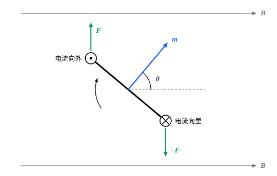

## 这一节要回答的问题

通电的导线放在磁铁旁边会被推动，电动机就是靠这个转起来的。导线里的:term[电荷]{id="physics.electromagnetism.electric-charge"}（electric charge）在运动，:term[磁场]{id="physics.electromagnetism.magnetic-field"}（magnetic field）推动的是这些电荷，整根导线受的力有多大？一个通电的线圈放在磁场里会怎样转？描述它的转动倾向，要用什么量？

## 讲解

### 载流导线受的力

导线里的:term[载流子]{id="physics.electromagnetism.charge-carrier"}（charge carrier）以:term[漂移速度]{id="physics.electromagnetism.drift-velocity"}（drift velocity）$\vb v_{\mathrm d}$运动，每个受磁力$q\vb v_{\mathrm d}\times\vb B$。单位体积里有$n$个，合起来是$nq\vb v_{\mathrm d}\times\vb B=\vb J\times\vb B$，$\vb J$是:term[电流密度]{id="physics.electromagnetism.current-density"}（current density）。

::anchor{id="thm-force-current"}
定理（导线受的磁力）：电流密度为$\vb J$的:term[导体]{id="physics.electromagnetism.conductor"}（conductor），单位体积受磁力$\vb J\times\vb B$。通有:term[电流]{id="physics.electromagnetism.electric-current"}（electric current）$I$的细导线，它的一小段$\dd\vb l$（方向和电流相同）受力$\dd\vb F=I\,\dd\vb l\times\vb B$，$I\,\dd\vb l$叫作:term[电流元]{id="physics.electromagnetism.current-element"}（current element）；匀强:term[磁场]{id="physics.electromagnetism.magnetic-field"}里长为$L$的一段直导线受力$\vb F=I\vb L\times\vb B$。导线受的这种磁力，中文教材常叫作安培力（Ampère force）。

证明思路：上面一段已经算出单位体积的力。细导线横截面积为$A$，一小段的体积是$A\,\dd l$，$\vb J$沿着导线，$\vb JA\,\dd l=I\,\dd\vb l$，所以$\dd\vb F=I\,\dd\vb l\times\vb B$。直导线在匀强磁场里，各段的力方向相同，加起来是$I\vb L\times\vb B$。

磁力作用在运动的载流子上，载流子被推向导线的一侧，那里积累的:term[电荷]{id="physics.electromagnetism.electric-charge"}产生横向的:term[电场]{id="physics.electromagnetism.electric-field"}（electric field），把力传给不动的金属晶格（lattice，见第 7 题），所以整根导线被推动。

::anchor{id="thm-closed-loop-force"}
定理（匀强磁场里的闭合线圈）：匀强磁场里，通有电流$I$的任一闭合线圈受的合力为零；一段弯曲导线受的力，等于连接它两端的直导线（通同样的电流）受的力，$\vb F=I\,\overrightarrow{PQ}\times\vb B$，$P$、$Q$是电流的起点和终点。

证明思路：$\vb F=\int I\,\dd\vb l\times\vb B=I\Bigl(\int\dd\vb l\Bigr)\times\vb B$，$\vb B$是常矢量，可以提到积分号外。$\int_P^Q\dd\vb l$是从$P$到$Q$的位移$\overrightarrow{PQ}$，和路径无关；闭合线圈的$P$、$Q$重合，位移为零。

### 线圈受的力矩与磁矩

合力为零不等于没有作用。线圈各段受的力作用在不同的地方，一般组成力偶（couple），产生力矩（torque），让线圈转起来；指南针在:term[地磁场]{id="physics.electromagnetism.magnetic-field"}里转向，电动机的线圈在磁铁之间转动，都是这个力矩。

::anchor{id="def-magnetic-moment"}
通有:term[电流]{id="physics.electromagnetism.electric-current"}$I$、围成面积$a$的平面线圈，它的:term[磁矩]{id="physics.electromagnetism.magnetic-moment"}（magnetic dipole moment）是$\vb m=I\vb a$：$\vb a$的大小是$a$，方向垂直于线圈平面，按右手定则（right-hand rule），右手四指沿电流的方向弯曲时，拇指所指的就是$\vb a$的方向。$N$匝同样的线圈，磁矩是$NI\vb a$；磁矩的单位是$\mathrm{A\,m^2}$。

为什么这样定义：下面的定理说明，匀强磁场里线圈受的力矩只由$\vb m$和$\vb B$决定，线圈是圆的还是方的、电流和面积怎样分配都无关紧要。$\vb m$和[电偶极矩](lesson:physics.electromagnetism.electric-dipole#def-electric-dipole)$\vb p$在匀强:term[电场]{id="physics.electromagnetism.electric-field"}里的作用一模一样，所以叫磁偶极矩。边界情况：线圈不在一个平面上时，没有确定的线圈平面，$\vb a$怎样取留到[磁偶极子](lesson:physics.electromagnetism.magnetic-dipole#def-vector-area)一节讲。

::anchor{id="thm-torque"}
定理（线圈受的磁力矩）：磁矩为$\vb m$的平面线圈在匀强磁场$\vb B$里，受的合力为零，受的力矩是$\boldsymbol\tau=\vb m\times\vb B$，大小$mB\sin\theta$，$\theta$是$\vb m$和$\vb B$的夹角；对哪一点取力矩，结果都一样。

证明思路：先看边长为$a$、$b$的矩形线圈，转轴平行于$b$边，$\vb B$垂直于转轴。两条$a$边受的力大小相等、方向相反，在同一条直线上，合力和力矩都为零；两条$b$边和$\vb B$垂直，受的力大小都是$IbB$，方向相反，都垂直于$\vb B$，两条作用线相距$a\sin\theta$，组成力偶，力矩是$IbB\cdot a\sin\theta=mB\sin\theta$，方向和$\vb m\times\vb B$相同。力偶的力矩和对哪一点取无关（见[力矩与角动量](lesson:physics.newtonian-mechanics.angular-momentum)）。任意平面线圈可以分成许多小矩形，相邻两个小矩形的公共边上电流方向相反，力和力矩都抵消，只剩下外边界的作用，各个小矩形的磁矩相加正是$I\vb a$。

::anchor{id="thm-magnetic-energy"}
定理（磁矩在磁场里的势能）：把磁矩$\vb m$从和$\vb B$垂直的方向转到和$\vb B$成$\theta$角，磁力矩做功$mB\cos\theta$，所以可以定义势能$U=-\vb m\cdot\vb B=-mB\cos\theta$。$\vb m$和$\vb B$同向时势能最低，是稳定的平衡位置；反向时最高，是不稳定的平衡位置。

证明思路：力矩$mB\sin\theta$总是使$\theta$减小，转过$\dd\theta$做功$-mB\sin\theta\,\dd\theta$，从$\frac\pi2$积到$\theta$得$mB\cos\theta$。势能取$-mB\cos\theta$，势能的减少恰好等于力矩做的功。

所以磁矩总想转到和磁场同向，小磁针就是一个磁矩，它的 N 极指向磁场的方向。直流电动机里的线圈转过和磁场垂直的位置时，换向器（commutator）把线圈里的电流反向，力矩就一直朝同一个方向转。

### 霍尔效应

::anchor{id="thm-hall"}
定理（:term[霍尔效应]{id="physics.electromagnetism.hall-effect"}，Hall effect）：宽为$w$、厚为$t$的:term[导体]{id="physics.electromagnetism.conductor"}薄片里，:term[电流]{id="physics.electromagnetism.electric-current"}$I$沿长度方向流动，匀强:term[磁场]{id="physics.electromagnetism.magnetic-field"}$B$垂直于薄片。:term[载流子]{id="physics.electromagnetism.charge-carrier"}在磁场里被推向薄片的一侧，两侧之间出现:term[电势差]{id="physics.electromagnetism.potential-difference"}（potential difference），大小是$\frac{IB}{n|q|t}$；它的正负取决于载流子:term[电荷]{id="physics.electromagnetism.electric-charge"}$q$的正负，$n$是单位体积里载流子的个数。

证明思路：载流子受磁力$qv_{\mathrm d}B$，偏向一侧，在那里积累，另一侧留下相反的电荷，两侧之间的横向:term[电场]{id="physics.electromagnetism.electric-field"}$E_{\mathrm H}$越来越强，直到电力和磁力抵消，$qE_{\mathrm H}=qv_{\mathrm d}B$。两侧的电势差是$E_{\mathrm H}w=v_{\mathrm d}Bw$；由$I=nqv_{\mathrm d}wt$，$v_{\mathrm d}=\frac{I}{nqwt}$，代入即得。正、负载流子沿相反的方向漂移，受的磁力却朝同一侧，积累的电荷符号相反，电势差也就反号。

1879 年，霍尔（Edwin Hall）在约翰斯·霍普金斯大学做研究生时，在金箔里发现了这个效应。后来的测量表明，多数金属里的载流子带负电；也有一些金属和许多半导体，电势差的符号像是正电荷在导电，这要用量子力学的能带理论（band theory）解释。$n$越小，电势差越大，所以用半导体做的霍尔元件（Hall sensor）能灵敏地测量磁场。

## 几何图像

图里:term[磁场]{id="physics.electromagnetism.magnetic-field"}向右，矩形线圈的平面垂直于纸面，从侧面看是一条线段，:term[磁矩]{id="physics.electromagnetism.magnetic-moment"}$\vb m$垂直于它，和磁场成$\theta$角。左上那条边里的:term[电流]{id="physics.electromagnetism.electric-current"}垂直纸面向外，右下那条边向里，两条边受的力一上一下，大小相同，组成力偶，使$\vb m$顺时针转向$\vb B$；另外两条边受的力在同一条直线上，互相抵消。这和[电偶极子](lesson:physics.electromagnetism.electric-dipole)在匀强:term[电场]{id="physics.electromagnetism.electric-field"}里受的力矩完全对应。

:::anim{component="function-plot"}
range: { x: [-180, 180], y: [-1.3, 1.3] }
functions:
  - expr: "-sin(x*pi/180)"
    label: |
      使$\theta$增大方向的力矩，以$mB$为单位
  - expr: "-cos(x*pi/180)"
    label: |
      势能，以$mB$为单位
:::

动画的横轴是$\vb m$和$\vb B$的夹角$\theta$（以度为单位，图上写作$x$）。力矩总是指向势能降低的方向：$\theta>0$时力矩为负，使$\theta$减小。$\theta=0$处势能最低，偏开一点，力矩把它拉回来，是稳定平衡；$\theta=\pm180^\circ$处势能最高，偏开一点，力矩使它越偏越远，是不稳定平衡。

## 例题

### 例 1　半圆形导线受的力

半径为$R$的半圆形导线通有:term[电流]{id="physics.electromagnetism.electric-current"}$I$，放在匀强:term[磁场]{id="physics.electromagnetism.magnetic-field"}$\vb B$里，$\vb B$垂直于半圆所在的平面。求导线受的合力。

**为什么想到这么做**：直接积分要把每一小段的力分解再相加；用匀强磁场里「弯曲导线受的力等于连接两端的直导线受的力」，一步就能得到。

**推导**：半圆两端相距$2R$，连接两端的直导线受力$I\cdot2R\cdot B$，方向垂直于直径、在半圆平面里。所以半圆形导线受的合力大小是$2IRB$。直接积分核对：取直径沿$x$轴，用半圆上一点和$x$轴的夹角$\psi$作参数，$\dd\vb l\times\vb B$的$x$分量在对称的两侧抵消，$y$分量是$IB\,R\sin\psi\,\dd\psi$，从$0$积到$\pi$得$2IRB$，一致。

### 例 2　电子轨道的磁矩

把氢原子里的电子看成以速率$v$在半径为$r$的圆周上运动。求它的:term[磁矩]{id="physics.electromagnetism.magnetic-moment"}和角动量（angular momentum）$\vb L$之间的关系。

**为什么想到这么做**：绕圈的电子相当于一个小电流环：:term[电流]{id="physics.electromagnetism.electric-current"}是每秒经过圆周上某一点的:term[电荷]{id="physics.electromagnetism.electric-charge"}。

**推导**：电子转一圈的时间是$\frac{2\pi r}{v}$，等效电流$I=\frac{ev}{2\pi r}$，磁矩的大小$m=I\pi r^2=\frac{evr}{2}$。角动量的大小$L=m_{\mathrm e}vr$，所以$m=\frac{e}{2m_{\mathrm e}}L$；电子带负电，电流和它的运动方向相反，$\vb m=-\frac{e}{2m_{\mathrm e}}\vb L$，和半径、速率都无关。按玻尔（Niels Bohr）的原子模型，最低的轨道上$L=\hbar$（$\hbar$是约化普朗克常量，reduced Planck constant），磁矩是$\frac{e\hbar}{2m_{\mathrm e}}\approx9.274\times10^{-24}\,\mathrm{J/T}$，这个量叫作玻尔磁子（Bohr magneton），是原子磁矩的天然单位。

## 常见误区

- 「闭合线圈在匀强:term[磁场]{id="physics.electromagnetism.magnetic-field"}里会被拉向某个方向。」匀强磁场里闭合线圈受的合力为零，只受力矩；磁场不均匀时才有合力（见[磁偶极子](lesson:physics.electromagnetism.magnetic-dipole)）。
- 「:term[磁矩]{id="physics.electromagnetism.magnetic-moment"}的方向就是:term[电流]{id="physics.electromagnetism.electric-current"}的方向。」磁矩垂直于线圈平面，由电流的绕向按右手定则确定。
- 「线圈在磁场里最终会转到线圈平面和磁场平行。」力矩使磁矩转向磁场的方向，稳定时线圈平面和磁场垂直。
- 「:term[霍尔效应]{id="physics.electromagnetism.hall-effect"}的:term[电势差]{id="physics.electromagnetism.potential-difference"}只由电流和磁场的方向决定。」电流和磁场的方向相同时，带正电和带负电的:term[载流子]{id="physics.electromagnetism.charge-carrier"}被推向同一侧，积累的:term[电荷]{id="physics.electromagnetism.electric-charge"}符号相反，电势差也反号；正是这一点让人能分辨载流子的正负。
