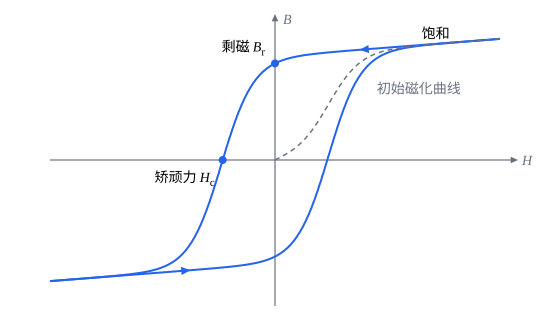

## 这一节要回答的问题

有:term[磁介质]{id="physics.electromagnetism.magnetic-material"}（magnetic material）时，:term[安培环路定理]{id="physics.electromagnetism.ampere-law"}（Ampère's circuital law）右边的:term[电流]{id="physics.electromagnetism.electric-current"}（electric current）包括:term[束缚电流]{id="physics.electromagnetism.bound-current"}（bound current），可束缚电流由磁化决定，磁化又由:term[磁场]{id="physics.electromagnetism.magnetic-field"}（magnetic field）决定，事先不知道。能不能只用我们接上电源、能控制的:term[自由电流]{id="physics.electromagnetism.free-current"}（free current）写安培环路定理？在通电的:term[螺线管]{id="physics.electromagnetism.solenoid"}（solenoid）里插进一根铁芯，管里的磁场变成多少？

## 讲解

### 磁场强度

有:term[磁介质]{id="physics.electromagnetism.magnetic-material"}时，:term[电流]{id="physics.electromagnetism.electric-current"}分成:term[自由电流]{id="physics.electromagnetism.free-current"}$\vb J_{\mathrm f}$和:term[束缚电流]{id="physics.electromagnetism.bound-current"}$\vb J_{\mathrm b}=\curl\vb M$，$\vb M$是:term[磁化强度]{id="physics.electromagnetism.magnetization"}（magnetization）。[静磁场的散度和旋度](lesson:physics.electromagnetism.ampere-law#thm-ampere-differential)说$\curl\vb B=\mu_0(\vb J_{\mathrm f}+\vb J_{\mathrm b})=\mu_0\vb J_{\mathrm f}+\mu_0\curl\vb M$，把含$\vb M$的一项移到左边，$\curl\Bigl(\frac{\vb B}{\mu_0}-\vb M\Bigr)=\vb J_{\mathrm f}$。

::anchor{id="def-h"}
$\vb H=\frac{\vb B}{\mu_0}-\vb M$叫作:term[磁场强度]{id="physics.electromagnetism.magnetic-field-strength"}（magnetic field strength），单位是$\mathrm{A/m}$。

为什么这样定义：它的旋度只由自由电流决定，束缚电流的影响被吸收进了$\vb H$，和[电位移](lesson:physics.electromagnetism.electric-displacement#def-displacement)（electric displacement）吸收:term[束缚电荷]{id="physics.electromagnetism.bound-charge"}（bound charge）是同一个办法。边界情况：真空里$\vb M=\vb 0$，$\vb H=\frac{\vb B}{\mu_0}$。名字容易让人误会：这门课里「:term[磁场]{id="physics.electromagnetism.magnetic-field"}」一律指出现在:term[洛伦兹力]{id="physics.electromagnetism.lorentz-force"}（Lorentz force）里的$\vb B$，$\vb H$只叫磁场强度；19 世纪的人多把磁铁看成一对对:term[磁荷]{id="physics.electromagnetism.magnetic-monopole"}（magnetic charge），以为$\vb H$才是和:term[电场]{id="physics.electromagnetism.electric-field"}（electric field）对应的基本的场，这个名字就是那时留下的。

::anchor{id="thm-ampere-h"}
定理（有磁介质时的:term[安培环路定理]{id="physics.electromagnetism.ampere-law"}）：电流恒定、场不随时间变时，$\curl\vb H=\vb J_{\mathrm f}$；积分形式是$\oint_C\vb H\cdot\dd\vb l=I_{\mathrm f,\text{穿}}$，右边是穿过以$C$为边界的曲面的自由电流。

证明思路：微分形式是上面的推导。在任一以$C$为边界的曲面$S$上积分，用斯托克斯公式（Stokes' theorem）$\oint_C\vb H\cdot\dd\vb l=\int_S(\curl\vb H)\cdot\dd\vb a=\int_S\vb J_{\mathrm f}\cdot\dd\vb a$，就得到积分形式。

要小心：$\curl\vb H$只由自由电流决定，$\vb H$本身却不一定。由$\divg\vb B=0$，$\divg\vb H=-\divg\vb M$，一般不为零；一块永磁铁周围没有自由电流，$\vb H$照样不为零（第 7 题）。只有对称性足够好时（长直导线、:term[螺线管]{id="physics.electromagnetism.solenoid"}、:term[螺绕环]{id="physics.electromagnetism.toroid"}（toroid）），才能像以前用安培环路定理求磁场那样，由自由电流直接求出$\vb H$。

### 线性磁介质

::anchor{id="def-linear-magnetic"}
很多:term[磁介质]{id="physics.electromagnetism.magnetic-material"}里，:term[磁场]{id="physics.electromagnetism.magnetic-field"}不太强时:term[磁化强度]{id="physics.electromagnetism.magnetization"}和$\vb H$成正比，$\vb M=\chi_{\mathrm m}\vb H$，这样的磁介质叫作:term[线性磁介质]{id="physics.electromagnetism.linear-magnetic-material"}（linear magnetic material），无量纲的比例系数$\chi_{\mathrm m}$叫作:term[磁化率]{id="physics.electromagnetism.magnetic-susceptibility"}（magnetic susceptibility）；:term[顺磁性]{id="physics.electromagnetism.paramagnetism"}（paramagnetism）的物质$\chi_{\mathrm m}>0$，:term[抗磁性]{id="physics.electromagnetism.diamagnetism"}（diamagnetism）的物质$\chi_{\mathrm m}<0$。

为什么这样定义：每个原子转向磁场的程度、新产生的:term[磁矩]{id="physics.electromagnetism.magnetic-moment"}（magnetic dipole moment）都和磁场成正比，单位体积的总和也就和磁场成正比。写成和$\vb H$成正比，是因为$\vb H$常常能由我们控制的:term[自由电流]{id="physics.electromagnetism.free-current"}直接求出；$|\chi_{\mathrm m}|\ll1$时，$\vb H$和$\frac{\vb B}{\mu_0}$几乎没有差别。边界情况：:term[铁磁性]{id="physics.electromagnetism.ferromagnetism"}（ferromagnetism）的物质不是线性的，$\vb M$还和它以前经历过的磁场有关（见下面一小节）。

::anchor{id="def-permeability"}
线性磁介质里$\vb B=\mu_0(\vb H+\vb M)=\mu_0(1+\chi_{\mathrm m})\vb H=\mu\vb H$，$\mu=\mu_0(1+\chi_{\mathrm m})$叫作这种磁介质的:term[磁导率]{id="physics.electromagnetism.permeability"}（permeability），$\mu_{\mathrm r}=1+\chi_{\mathrm m}=\frac{\mu}{\mu_0}$叫作:term[相对磁导率]{id="physics.electromagnetism.relative-permeability"}（relative permeability）。

为什么这样定义：真空里$\mu_{\mathrm r}=1$，$\mu$就是真空磁导率（vacuum permeability）$\mu_0$（见[毕奥-萨伐尔定律](lesson:physics.electromagnetism.biot-savart#def-biot-savart)）；磁介质里把$\mu_0$换成$\mu$，很多公式形式不变，和[电介质](lesson:physics.electromagnetism.electric-displacement#def-permittivity)（dielectric）里把$\varepsilon_0$换成$\varepsilon$一样。边界情况：顺磁性、抗磁性的物质$\mu_{\mathrm r}$和$1$只差一点点，室温下铝的$\chi_{\mathrm m}$约为$2.2\times10^{-5}$，水约为$-9.0\times10^{-6}$，铋约为$-1.7\times10^{-4}$。

::anchor{id="thm-filled-solenoid"}
定理（填满线性磁介质的:term[螺线管]{id="physics.electromagnetism.solenoid"}）：长螺线管每单位长度绕$n$匝，通有:term[电流]{id="physics.electromagnetism.electric-current"}$I$，管里填满相对磁导率为$\mu_{\mathrm r}$的线性磁介质，那么管内$H=nI$，$B=\mu_{\mathrm r}\mu_0nI$，是真空时的$\mu_{\mathrm r}$倍。

证明思路：取一个矩形回路，两条边平行于轴、长为$l$，一条在管内、一条在管外。管外$\vb B=\vb 0$、$\vb M=\vb 0$，所以$\vb H=\vb 0$；由有磁介质时的:term[安培环路定理]{id="physics.electromagnetism.ampere-law"}，$Hl=nlI$，$H=nI$，和有没有磁介质无关。于是$B=\mu H=\mu_{\mathrm r}\mu_0nI$。

多出来的磁场来自磁介质表面的:term[束缚电流]{id="physics.electromagnetism.bound-current"}：$\vb K_{\mathrm b}=\vb M\times\uv n$，大小是$\chi_{\mathrm m}nI$。$\chi_{\mathrm m}>0$时它和线圈里的电流同向，加强了磁场；$\chi_{\mathrm m}<0$时反向，削弱了磁场。

### 铁磁性物质和磁滞

::anchor{id="def-hysteresis"}
:term[铁磁性]{id="physics.electromagnetism.ferromagnetism"}物质的磁化不只由现在的$\vb H$决定，还和它以前经历过的$\vb H$有关，这种现象叫作:term[磁滞]{id="physics.electromagnetism.hysteresis"}（hysteresis）；$H$在正负之间往复变化时，$B$随$H$画出的闭合曲线叫作磁滞回线（hysteresis loop）。$H$回到零时剩下的$B$叫作剩磁（remanence），把$B$减到零要加的反向的$H$叫作矫顽力（coercivity）。

为什么这样定义：:term[磁畴]{id="physics.electromagnetism.magnetic-domain"}（magnetic domain）的边界移动时要越过晶体里杂质、缺陷造成的「障碍」，撤去:term[外磁场]{id="physics.electromagnetism.magnetic-field"}后不能完全退回原样，于是留下剩磁（见[磁化与束缚电流](lesson:physics.electromagnetism.magnetization#def-ferromagnetism)）。$\frac{B}{\mu_0H}$也不是常数，纯铁里最大可以到几千，所以插进铁芯的:term[螺线管]{id="physics.electromagnetism.solenoid"}，管里的磁场能增强几千倍。边界情况：软铁的磁滞回线窄、矫顽力小，容易磁化也容易退磁，适合做电磁铁和:term[变压器]{id="physics.electromagnetism.transformer"}（transformer）的铁芯；钢、钕铁硼这类材料矫顽力大，适合做永磁铁。

### 界面上的条件

::anchor{id="thm-magnetic-boundary"}
定理（:term[磁介质]{id="physics.electromagnetism.magnetic-material"}界面上的条件）：两种磁介质的交界面上没有:term[自由电流]{id="physics.electromagnetism.free-current"}时，$\vb B$垂直于界面的分量连续，$\vb H$平行于界面的分量连续。

证明思路：取跨过界面的扁圆柱面，两个底面紧贴界面，由$\divg\vb B=0$，$\oint\vb B\cdot\dd\vb a=0$，两侧$B$的法向分量相等。取跨过界面的扁矩形回路，两条长边紧贴界面，没有自由电流穿过，$\oint\vb H\cdot\dd\vb l=0$，两侧$H$的切向分量相等。

和[电介质的界面条件](lesson:physics.electromagnetism.electric-displacement#thm-boundary)对照：$\vb B$对应$\vb D$，$\vb H$对应$\vb E$。两个条件合起来，:term[磁场线]{id="physics.electromagnetism.magnetic-field-line"}（magnetic field line）穿过界面时会改变方向；$\mu_{\mathrm r}$很大的铁和空气的界面上，空气一侧的磁场线几乎垂直于铁的表面（第 3 题）。

## 几何图像

:::anim{component="function-plot"}
range: { x: [0, 3], y: [0, 2.2] }
functions:
  - expr: "1"
    label: |
      磁场$B$
  - expr: "1 - (1 + sign(x - 1))/2 * (1 - sign(x - 2))/2 * (1 - 1/k)"
    label: |
      $\mu_0H$
sliders:
  - name: k
    min: 0.5
    max: 5
    step: 0.5
    default: 2
    label: |
      相对磁导率$\mu_{\mathrm r}$
:::

动画画的是匀强:term[磁场]{id="physics.electromagnetism.magnetic-field"}里垂直于磁场放着的一块:term[线性磁介质]{id="physics.electromagnetism.linear-magnetic-material"}板，横轴是沿磁场方向的位置（图上写作$x$），$1<x<2$是板，纵轴以板外的磁场为单位。$\vb B$垂直于板面，法向分量连续，板里板外一样；$\mu_0\vb H$在板里变成$\frac{B}{\mu_{\mathrm r}}$，在两个表面上跳变。这块板的$\vb M$垂直于板面，$\vb M\times\uv n=\vb 0$，表面上没有:term[束缚电流]{id="physics.electromagnetism.bound-current"}，所以板没有改变磁场。真实物质的$\mu_{\mathrm r}$和$1$差得极少，滑块把它放大了，$\mu_{\mathrm r}<1$模拟:term[抗磁性]{id="physics.electromagnetism.diamagnetism"}。

图里是:term[铁磁性]{id="physics.electromagnetism.ferromagnetism"}物质的磁滞回线。没有磁化的样品从原点出发，沿虚线磁化到接近饱和；之后让$H$在正负之间往复变化，$B$不再沿原路返回，而是沿两条分支绕圈：$H$减到零时还剩下剩磁$B_{\mathrm r}$，要加反向的$H_{\mathrm c}$（矫顽力）才把$B$减到零。曲线是用一个简单的模型算出的示意图，没有标刻度。

## 例题

### 例 1　带铁芯的螺绕环

$N=500$匝导线均匀地绕在一个铁环上，通有:term[电流]{id="physics.electromagnetism.electric-current"}$I=0.20\,\mathrm A$，环的平均半径$s=10\,\mathrm{cm}$，截面比$s$小得多。把铁当作:term[相对磁导率]{id="physics.electromagnetism.relative-permeability"}为$\mu_{\mathrm r}=1000$的:term[线性磁介质]{id="physics.electromagnetism.linear-magnetic-material"}，求环里的$H$、$B$和铁的:term[磁化强度]{id="physics.electromagnetism.magnetization"}。

**为什么想到这么做**：电流分布绕对称轴转动不变，以对称轴为心的圆是合适的回路；有:term[磁介质]{id="physics.electromagnetism.magnetic-material"}时的:term[安培环路定理]{id="physics.electromagnetism.ampere-law"}只要:term[自由电流]{id="physics.electromagnetism.free-current"}就能求出$H$，再由$B=\mu H$得:term[磁场]{id="physics.electromagnetism.magnetic-field"}。

**推导**：半径为$s$的圆穿过$N$匝导线，$2\pi sH=NI$，$H=\frac{NI}{2\pi s}=\frac{500\times0.20}{2\pi\times0.10}\,\mathrm{A/m}\approx159\,\mathrm{A/m}$。$B=\mu_{\mathrm r}\mu_0H\approx1000\times4\pi\times10^{-7}\times159\,\mathrm T\approx0.20\,\mathrm T$，是没有铁芯时的$1000$倍。$M=(\mu_{\mathrm r}-1)H\approx1.59\times10^5\,\mathrm{A/m}$：铁环表面的:term[束缚电流]{id="physics.electromagnetism.bound-current"}沿环的方向每单位长度约为$1.6\times10^5\,\mathrm A$，是线圈里每单位长度电流的$999$倍，磁场几乎全由它产生。

### 例 2　包着磁介质的长直导线

半径为$a$的长直导线通有:term[电流]{id="physics.electromagnetism.electric-current"}$I$，外面包着一层内半径$a$、外半径$b$、:term[磁化率]{id="physics.electromagnetism.magnetic-susceptibility"}为$\chi_{\mathrm m}$的:term[线性磁介质]{id="physics.electromagnetism.linear-magnetic-material"}。求各处的$\vb H$、$\vb B$和:term[磁介质]{id="physics.electromagnetism.magnetic-material"}里的:term[束缚电流]{id="physics.electromagnetism.bound-current"}。

**为什么想到这么做**：电流和磁介质都有轴对称，$\vb H$沿$\uv\psi$，大小只和$s$有关；用以轴为心的圆作回路，只数:term[自由电流]{id="physics.electromagnetism.free-current"}就能求出$\vb H$。

**推导**：$s>a$时$2\pi sH=I$，$\vb H=\frac{I}{2\pi s}\uv\psi$，在磁介质里和外面都一样。磁介质里$\vb B=\mu_0(1+\chi_{\mathrm m})\frac{I}{2\pi s}\uv\psi$，$\vb M=\chi_{\mathrm m}\frac{I}{2\pi s}\uv\psi$；外面$\vb B=\frac{\mu_0I}{2\pi s}\uv\psi$，和没有磁介质时一样。$\curl\vb M=\vb 0$（$\frac1s\uv\psi$是长直导线外的:term[磁场]{id="physics.electromagnetism.magnetic-field"}的样子，旋度为零），体内没有束缚电流；内表面上$\vb K_{\mathrm b}=\vb M\times(-\uv s)=\frac{\chi_{\mathrm m}I}{2\pi a}\uv z$，沿导线一共$\chi_{\mathrm m}I$，外表面上一共$-\chi_{\mathrm m}I$。所以磁介质里穿过以轴为心的圆的总电流是$(1+\chi_{\mathrm m})I$，和$\vb B$的结果一致；外面正负抵消。

## 常见误区

- 「$\vb H$才是:term[磁场]{id="physics.electromagnetism.magnetic-field"}，$\vb B$只是磁感应强度。」带电粒子受的力是$q\vb v\times\vb B$，基本的场是$\vb B$；$\vb H$是处理:term[磁介质]{id="physics.electromagnetism.magnetic-material"}时为了方便定义的量，名字是历史留下的。
- 「:term[磁场强度]{id="physics.electromagnetism.magnetic-field-strength"}$\vb H$只由:term[自由电流]{id="physics.electromagnetism.free-current"}决定。」只有它的旋度是；它的散度是$-\divg\vb M$，没有自由电流的永磁铁周围$\vb H$也不为零。
- 「铁芯的:term[相对磁导率]{id="physics.electromagnetism.relative-permeability"}是一个确定的常数。」:term[铁磁性]{id="physics.electromagnetism.ferromagnetism"}物质不是线性的，$\frac{B}{\mu_0H}$随$H$变，还和以前的磁化有关。
- 「:term[抗磁性]{id="physics.electromagnetism.diamagnetism"}的物质能挡住磁场。」它的$\chi_{\mathrm m}$只有$10^{-5}$量级，几乎不改变磁场；挡磁场要用$\mu_{\mathrm r}$很大的软磁材料，把:term[磁场线]{id="physics.electromagnetism.magnetic-field-line"}引进材料里绕过去。
