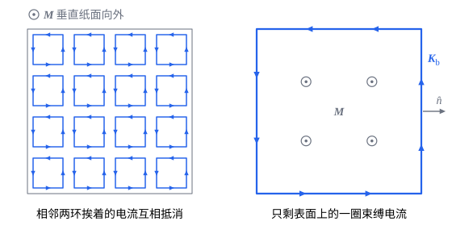

## 这一节要回答的问题

磁铁能吸起铁钉，却吸不动铜片和木块；把一根铁棒插进通电的:term[螺线管]{id="physics.electromagnetism.solenoid"}（solenoid），管里的:term[磁场]{id="physics.electromagnetism.magnetic-field"}（magnetic field）会增强几百上千倍。物质放进磁场里发生了什么？能不能像描述:term[电介质]{id="physics.electromagnetism.dielectric"}（dielectric）的极化那样，用一个量描述物质对磁场的影响？铁为什么和别的物质差这么多？

## 讲解

### 磁介质和磁化

原子里的电子绕核运动，相当于一个小电流环；电子本身还有自旋（spin），也带着:term[磁矩]{id="physics.electromagnetism.magnetic-moment"}（magnetic dipole moment）。所以许多原子、分子带着一个磁矩，大小和玻尔磁子（Bohr magneton）$\mu_{\mathrm B}\approx9.27\times10^{-24}\,\mathrm{J/T}$同一个量级（见[电流受到的磁力](lesson:physics.electromagnetism.magnetic-force-on-currents)例 2）。没有:term[外磁场]{id="physics.electromagnetism.magnetic-field"}时，这些磁矩的方向杂乱，平均起来抵消。

放进磁场以后，原子的磁矩受力矩$\vb m\times\vb B$，倾向于转到顺着磁场的方向（见[电流受到的磁力](lesson:physics.electromagnetism.magnetic-force-on-currents#thm-torque)）。另一方面，加上磁场的过程中，每个原子里电子的轨道运动都会稍稍改变，多出一个和磁场反向的小磁矩，这要用到:term[电磁感应]{id="physics.electromagnetism.electromagnetic-induction"}（electromagnetic induction，见[感生电场](lesson:physics.electromagnetism.induced-electric-field)）。两种情形，结果都是一块物质里出现了磁矩。

::anchor{id="def-magnetic-material"}
物质放进磁场里，原子的磁矩转向磁场或者产生新的磁矩，这种现象叫作磁化（magnetization）；从磁化的角度看，物质叫作:term[磁介质]{id="physics.electromagnetism.magnetic-material"}（magnetic material）。

为什么这样定义：任何物质都会被磁化，只是程度相差极大，所以磁介质不是一类特殊的物质，而是看物质的一个角度。边界情况：:term[电介质]{id="physics.electromagnetism.dielectric"}只指:term[绝缘体]{id="physics.electromagnetism.insulator"}（insulator），磁介质却包括:term[导体]{id="physics.electromagnetism.conductor"}（conductor），铜、铝也会被磁化；真空不会被磁化。

::anchor{id="def-magnetization"}
磁介质里一小块体积$\Delta V$中所有原子的磁矩之和，除以$\Delta V$，叫作那里的:term[磁化强度]{id="physics.electromagnetism.magnetization"}（magnetization）$\vb M$，单位是$\mathrm{A/m}$。

为什么这样定义：和:term[极化强度]{id="physics.electromagnetism.polarization"}（polarization density）一样，在比原子大得多、又比我们关心的尺度小得多的体积上平均，$\vb M\,\dd V$就是这一小块的磁矩，不必逐个原子去算。边界情况：每立方米有$n$个原子、每个的磁矩都是$\vb m$时，$\vb M=n\vb m$；没有磁化时$\vb M=\vb 0$。磁化强度的单位$\mathrm{A\,m^2/m^3}=\mathrm{A/m}$和:term[面电流密度]{id="physics.electromagnetism.current-density"}（surface current density）的单位相同，下面会看到这不是巧合。

### 束缚电流

把磁化的:term[磁介质]{id="physics.electromagnetism.magnetic-material"}分成许多小块，每一小块的:term[磁矩]{id="physics.electromagnetism.magnetic-moment"}$\vb M\,\dd V$可以看成一个小电流环。$\vb M$均匀时，相邻两个小电流环挨着的那一段，:term[电流]{id="physics.electromagnetism.electric-current"}（electric current）一个朝这边、一个朝那边，正好抵消，只在表面上剩下没有抵消的一圈（几何图像）；$\vb M$不均匀时，相邻两环的电流大小不同，体内也剩下一些。这些电流在原子尺度上流动，不能用导线引出来，可它们产生:term[磁场]{id="physics.electromagnetism.magnetic-field"}，和导线里的电流一样。

::anchor{id="def-bound-current"}
磁化的磁介质里，由原子的磁矩合起来、在体内或表面上流动的电流，叫作:term[束缚电流]{id="physics.electromagnetism.bound-current"}（bound current），:term[体电流密度]{id="physics.electromagnetism.current-density"}记作$\vb J_{\mathrm b}$，面电流密度记作$\vb K_{\mathrm b}$；除此以外的电流，例如导线里传导的电流，叫作:term[自由电流]{id="physics.electromagnetism.free-current"}（free current），记作$\vb J_{\mathrm f}$、$\vb K_{\mathrm f}$、$I_{\mathrm f}$。

::anchor{id="thm-bound-current"}
定理（束缚电流与:term[磁化强度]{id="physics.electromagnetism.magnetization"}）：磁化强度为$\vb M$的磁介质，体内的束缚电流密度是$\vb J_{\mathrm b}=\curl\vb M$，表面上的束缚面电流密度是$\vb K_{\mathrm b}=\vb M\times\uv n$，$\uv n$是表面向外的法线方向；磁介质在外面和里面（在比原子大的尺度上平均）产生的磁场，就是这些束缚电流的磁场。

证明思路：体积$\dd V'$里的磁矩$\vb M\,\dd V'$在$\vb r$处的:term[磁矢势]{id="physics.electromagnetism.vector-potential"}（magnetic vector potential）是$\frac{\mu_0}{4\pi}\frac{\vb M\times(\vb r-\vb r')}{|\vb r-\vb r'|^3}\dd V'$（见[磁偶极子](lesson:physics.electromagnetism.magnetic-dipole#def-magnetic-dipole)），而$\frac{\vb r-\vb r'}{|\vb r-\vb r'|^3}=\nabla'\frac{1}{|\vb r-\vb r'|}$，$\nabla'$对$\vb r'$求导。由[向量微分恒等式](lesson:math.vector-calculus.vector-identities)，$\vb M\times\nabla'\frac{1}{|\vb r-\vb r'|}=\frac{\nabla'\times\vb M}{|\vb r-\vb r'|}-\nabla'\times\frac{\vb M}{|\vb r-\vb r'|}$。

对整块磁介质积分。第一项正是电流密度为$\nabla'\times\vb M$的体电流产生的磁矢势（见[磁矢势的积分公式](lesson:physics.electromagnetism.vector-potential#thm-vector-potential-integral)）。第二项用高斯公式（divergence theorem）的推论$\int_V\curl\vb F\,\dd V=\oint_S\uv n\times\vb F\,\dd a$（对任一常矢量$\vb c$，$\vb c\cdot\curl\vb F=\divg(\vb F\times\vb c)$），变成$\oint_S\frac{\vb M\times\uv n'}{|\vb r-\vb r'|}\dd a'$，正是面电流密度为$\vb M\times\uv n$的面电流产生的磁矢势。

束缚电流是闭合的：$\divg\vb J_{\mathrm b}=\divg(\curl\vb M)=0$，体电流和表面上的电流接成一个个闭合的圈，不在哪里积累:term[电荷]{id="physics.electromagnetism.electric-charge"}（electric charge）。和:term[电介质]{id="physics.electromagnetism.dielectric"}对照：$\vb P$对应$\vb M$，$\rho_{\mathrm b}=-\divg\vb P$对应$\vb J_{\mathrm b}=\curl\vb M$，$\sigma_{\mathrm b}=\vb P\cdot\uv n$对应$\vb K_{\mathrm b}=\vb M\times\uv n$（见[电介质与极化](lesson:physics.electromagnetism.polarization#thm-bound-charge)）。:term[电偶极子]{id="physics.electromagnetism.electric-dipole"}（electric dipole）挨着排起来，表面上露出电荷；电流环挨着排起来，表面上露出电流。

### 顺磁性、抗磁性和铁磁性

::anchor{id="def-para-dia"}
放进:term[磁场]{id="physics.electromagnetism.magnetic-field"}以后:term[磁化强度]{id="physics.electromagnetism.magnetization"}和磁场同向、磁场撤去后磁化随即消失的性质，叫作:term[顺磁性]{id="physics.electromagnetism.paramagnetism"}（paramagnetism）；磁化强度和磁场反向的，叫作:term[抗磁性]{id="physics.electromagnetism.diamagnetism"}（diamagnetism）。

为什么这样定义：两者的来源不同。顺磁性来自原子原有的:term[磁矩]{id="physics.electromagnetism.magnetic-moment"}转向磁场，热运动又不断把它们打乱，所以磁化很弱，温度越高越弱：1895 年，居里（Pierre Curie）在博士论文里测出，许多顺磁的物质的磁化和绝对温度成反比。抗磁性来自磁场改变电子的轨道运动，每种物质都有，在有原子磁矩的物质里被顺磁性盖过。边界情况：两者都极弱，在$1\,\mathrm T$的磁场里，铝的磁化强度约为$18\,\mathrm{A/m}$，水约为$-7\,\mathrm{A/m}$，铋约为$-130\,\mathrm{A/m}$。

抗磁的物质在不均匀的磁场里被推向磁场弱的地方，和顺磁的物质相反（磁矩和磁场同向时被拉向磁场强的地方，见[磁偶极子](lesson:physics.electromagnetism.magnetic-dipole)）。1845 年，法拉第（Michael Faraday）发现一块重玻璃（heavy glass）挂在强电磁铁的两极之间会被推开，铋也一样。磁场足够强时，这个推力能托住整个物体：1997 年，盖姆（Andre Geim）等人在约$16\,\mathrm T$的磁场里让一只活青蛙悬浮了起来。

::anchor{id="def-ferromagnetism"}
铁、钴、镍和它们的许多合金里，相邻原子的磁矩会自发地排成同一个方向，在不太强的磁场里就磁化到接近饱和，撤去磁场后还能保留很强的磁化，这种性质叫作:term[铁磁性]{id="physics.electromagnetism.ferromagnetism"}（ferromagnetism）。磁矩排齐的一个个小区域叫作:term[磁畴]{id="physics.electromagnetism.magnetic-domain"}（magnetic domain）；温度超过一定值，热运动把自发的排列打乱，铁磁性消失、变成顺磁性，这个温度叫作居里温度（Curie temperature）。

为什么这样定义：铁磁性的磁化比顺磁性强得多，铁磁化到饱和时$M\approx1.7\times10^6\,\mathrm{A/m}$，大约是上面铝的十万倍。相邻磁矩排齐的原因不是它们之间的磁力（那太弱了），而是量子力学的交换作用（exchange interaction）。1907 年，外斯（Pierre Weiss）提出：没有磁化的铁分成许多磁畴，方向各不相同，平均起来抵消；加上磁场时，顺着磁场的磁畴长大，别的磁畴转向。边界情况：铁的居里温度约为$1043\,\mathrm K$（$770\,^\circ\mathrm C$），加热到这个温度以上的铁不再被磁铁吸引。

铁磁性物质的磁化不只取决于现在的磁场，还和它以前经历过的磁场有关，所以能做成永磁铁；怎样描述这种「记忆」，见[磁场强度与线性磁介质](lesson:physics.electromagnetism.magnetic-intensity)。

## 几何图像

左图是一块均匀磁化的:term[磁介质]{id="physics.electromagnetism.magnetic-material"}的横截面，$\vb M$垂直纸面向外，每个小方块代表一小块体积的:term[磁矩]{id="physics.electromagnetism.magnetic-moment"}，画成一个逆时针的小电流环。相邻两个方块挨着的边上，两股:term[电流]{id="physics.electromagnetism.electric-current"}大小相等、方向相反，互相抵消；只有沿外边界的电流没有伙伴，连成一圈，这就是右图里的:term[束缚电流]{id="physics.electromagnetism.bound-current"}$\vb K_{\mathrm b}=\vb M\times\uv n$。右手四指沿这圈电流弯曲，拇指指向$\vb M$，和电流环的磁矩一样。

## 例题

### 例 1　条形磁铁

长为$L$、半径为$a$的圆柱形磁铁沿轴均匀磁化，:term[磁化强度]{id="physics.electromagnetism.magnetization"}为$\vb M=M\uv z$，$L\gg a$。求:term[束缚电流]{id="physics.electromagnetism.bound-current"}，以及磁铁中段里的:term[磁场]{id="physics.electromagnetism.magnetic-field"}。

**为什么想到这么做**：$\vb M$均匀，$\curl\vb M=\vb 0$，体内没有束缚电流，只有:term[表面电流]{id="physics.electromagnetism.electric-current"}；侧面的法线是$\uv s$，两个端面的法线是$\pm\uv z$，分别算$\vb M\times\uv n$。

**推导**：侧面上$\vb K_{\mathrm b}=M\uv z\times\uv s=M\uv\psi$，两个端面上$M\uv z\times(\pm\uv z)=\vb 0$。所以这块磁铁等于一个绕着侧面流动、每单位长度电流为$M$的长:term[螺线管]{id="physics.electromagnetism.solenoid"}（相当于$nI=M$），中段的磁场沿轴，大小是$\mu_0M$（见[安培环路定理](lesson:physics.electromagnetism.ampere-law#thm-solenoid)）。$M=1.0\times10^6\,\mathrm{A/m}$（强的永磁铁是这个量级）时，$\mu_0M\approx1.3\,\mathrm T$；:term[磁场线]{id="physics.electromagnetism.magnetic-field-line"}（magnetic field line）从$\vb M$指向的那一端（N 极）出来，在外面绕到另一端（S 极）进去。

### 例 2　均匀磁化的球

半径为$R$的球均匀磁化，$\vb M=M\uv z$。求:term[束缚电流]{id="physics.electromagnetism.bound-current"}、球的总:term[磁矩]{id="physics.electromagnetism.magnetic-moment"}和球心的:term[磁场]{id="physics.electromagnetism.magnetic-field"}。

**为什么想到这么做**：$\vb M$均匀，只有:term[表面电流]{id="physics.electromagnetism.electric-current"}$\vb K_{\mathrm b}=\vb M\times\uv r$。它绕着$z$轴流动，可以分成许多同轴的圆电流，各自在轴上的磁场用[圆线圈轴线上的磁场](lesson:physics.electromagnetism.biot-savart#thm-loop-axis)求出，再相加。

**推导**：$\vb K_{\mathrm b}=M\uv z\times\uv r=M\sin\theta\,\uv\psi$，$\theta$是极角。纬度$\theta$到$\theta+\dd\theta$的一圈宽$R\,\dd\theta$，电流$\dd I=MR\sin\theta\,\dd\theta$，半径$R\sin\theta$，圆心离球心$R\cos\theta$，在球心产生$\frac{\mu_0\,\dd I\,R^2\sin^2\theta}{2R^3}=\frac{\mu_0M}{2}\sin^3\theta\,\dd\theta$，积分得$\frac{\mu_0M}{2}\cdot\frac43=\frac23\mu_0M$，沿$\vb M$。总磁矩是各小块的磁矩之和$\frac43\pi R^3\vb M$，所以球外远处是这个:term[磁偶极子]{id="physics.electromagnetism.magnetic-dipole"}（magnetic dipole）的磁场；实际上球外处处如此，球里的磁场处处都是$\frac23\mu_0\vb M$（第 5 题）。

## 常见误区

- 「:term[束缚电流]{id="physics.electromagnetism.bound-current"}是假想的，不产生:term[磁场]{id="physics.electromagnetism.magnetic-field"}。」它们是原子里电子的轨道运动和自旋合起来的效果，产生的磁场和导线里的:term[电流]{id="physics.electromagnetism.electric-current"}一样真实，只是不能用导线引出来。
- 「均匀磁化的物体里没有电流，所以它不产生磁场。」体内的束缚电流确实抵消了，表面上却有一圈，条形磁铁的磁场就来自它（例 1）。
- 「所有物质都会被磁铁吸引。」:term[抗磁性]{id="physics.electromagnetism.diamagnetism"}的物质被推开，只是推力通常极小；:term[顺磁性]{id="physics.electromagnetism.paramagnetism"}的物质被吸引的力也很小，能被明显吸起来的只有:term[铁磁性]{id="physics.electromagnetism.ferromagnetism"}的物质。
- 「:term[磁化强度]{id="physics.electromagnetism.magnetization"}的单位和磁场一样。」$\vb M$的单位是$\mathrm{A/m}$，和:term[面电流密度]{id="physics.electromagnetism.current-density"}相同；$\mu_0\vb M$才和磁场同单位（例 1）。
