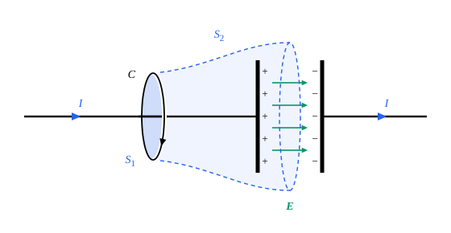

## 这一节要回答的问题

给:term[电容器]{id="physics.electromagnetism.capacitor"}（capacitor）充电时，导线里有:term[电流]{id="physics.electromagnetism.electric-current"}（electric current），两块极板之间却是真空，没有:term[电荷]{id="physics.electromagnetism.electric-charge"}（electric charge）流过。:term[安培环路定理]{id="physics.electromagnetism.ampere-law"}（Ampère's circuital law）用绕着导线的同一个回路、取两个不同的曲面，算出的:term[磁场]{id="physics.electromagnetism.magnetic-field"}（magnetic field）不一样（见[安培环路定理](lesson:physics.electromagnetism.ampere-law#thm-ampere)）。问题出在哪里，怎样改？改好以后，:term[电场]{id="physics.electromagnetism.electric-field"}（electric field）和磁场满足的全部方程是什么？

## 讲解

### 安培环路定理的矛盾

回路$C$绕着给:term[电容器]{id="physics.electromagnetism.capacitor"}充电的导线，导线里的:term[电流]{id="physics.electromagnetism.electric-current"}是$I$。以$C$为边界取平面$S_1$，导线从它中间穿过，穿过它的电流是$I$；再取一个口袋形的曲面$S_2$，同样以$C$为边界，兜住左边的极板，底面在两块极板之间，没有电流穿过它（见几何图像里的图）。:term[安培环路定理]{id="physics.electromagnetism.ampere-law"}说$\oint_C\vb B\cdot\dd\vb l$等于$\mu_0$乘以穿过以$C$为边界的任意曲面的电流，用$S_1$算是$\mu_0I$，用$S_2$算是零，同一个积分不能有两个值。

矛盾的根子在:term[电荷守恒]{id="physics.electromagnetism.charge-conservation"}（conservation of charge）。$S_1$和$S_2$合起来是一个闭合曲面，从$S_1$穿进去的电流是$I$，从$S_2$穿出来的是零，里面极板上的:term[电荷]{id="physics.electromagnetism.electric-charge"}以$\dv Qt=I$的速率增加；安培环路定理要求穿过这两个曲面的电流相同，也就是穿出任何闭合曲面的净电流都是零，这只对:term[恒定电流]{id="physics.electromagnetism.steady-current"}（steady current）成立。微分形式看得更清楚：对$\curl\vb B=\mu_0\vb J$两边求散度，左边恒为零（旋度的散度恒为零，见[向量微分恒等式](lesson:math.vector-calculus.vector-identities)），所以它要求$\divg\vb J=0$；可是由:term[连续性方程]{id="physics.electromagnetism.continuity-equation"}（continuity equation）$\divg\vb J=-\pdv\rho t$，电荷在某处积累时$\divg\vb J\ne0$。

### 位移电流

::anchor{id="def-displacement-current"}
麦克斯韦（James Clerk Maxwell）的办法是给:term[电流密度]{id="physics.electromagnetism.current-density"}（current density）$\vb J$加上一项$\vb J_{\mathrm d}=\varepsilon_0\pdv{\vb E}t$：它穿过曲面$S$的通量$\varepsilon_0\dv{}{t}\int_S\vb E\cdot\dd\vb a$叫作穿过$S$的:term[位移电流]{id="physics.electromagnetism.displacement-current"}（displacement current），$\vb J_{\mathrm d}$是位移电流的密度；为了区分，:term[电荷]{id="physics.electromagnetism.electric-charge"}运动形成的:term[电流]{id="physics.electromagnetism.electric-current"}也叫作传导电流（conduction current）。

为什么这样定义：由:term[高斯定律]{id="physics.electromagnetism.gauss-law"}（Gauss's law）的微分形式$\divg\vb E=\frac{\rho}{\varepsilon_0}$（见[高斯定律的微分形式](lesson:physics.electromagnetism.gauss-differential#thm-gauss-differential)），$\divg\vb J_{\mathrm d}=\pdv\rho t$，正好抵消:term[连续性方程]{id="physics.electromagnetism.continuity-equation"}里的$\divg\vb J=-\pdv\rho t$：$\divg(\vb J+\vb J_{\mathrm d})=0$处处成立，不管电流恒定不恒定。所以把:term[安培环路定理]{id="physics.electromagnetism.ampere-law"}里的$\vb J$换成$\vb J+\vb J_{\mathrm d}$，前面的矛盾就消失了。边界情况：:term[电场]{id="physics.electromagnetism.electric-field"}不随时间变时位移电流为零，回到原来的安培环路定理；真空里的位移电流不是任何电荷的运动，只是电场的变化率乘以$\varepsilon_0$，叫它「电流」，是因为它在方程里和电流的地位一样。

::anchor{id="thm-ampere-maxwell"}
定理（:term[安培-麦克斯韦定律]{id="physics.electromagnetism.ampere-maxwell-law"}，Ampère–Maxwell law）：$\curl\vb B=\mu_0\vb J+\mu_0\varepsilon_0\pdv{\vb E}t$；积分形式是$\oint_C\vb B\cdot\dd\vb l=\mu_0I_{\text{穿}}+\mu_0\varepsilon_0\dv{}{t}\int_S\vb E\cdot\dd\vb a$，$S$是以$C$为边界的任意曲面，$I_{\text{穿}}$是穿过$S$的传导电流。

依据：这条定律不是由前面的定律推出来的，是麦克斯韦的假设。$\curl\vb B$的散度恒为零，右边的散度也必须是零，上面看到$\vb J+\varepsilon_0\pdv{\vb E}t$正好满足；这是和:term[电荷守恒]{id="physics.electromagnetism.charge-conservation"}相容的最简单的改法，对不对要由实验判断（见下一小节）。积分形式由斯托克斯公式（Stokes' theorem）得到，右边用以$C$为边界的不同曲面算出来都一样，因为$\vb J+\vb J_{\mathrm d}$穿出任何闭合曲面的通量都是零。

回到开头的:term[电容器]{id="physics.electromagnetism.capacitor"}。平行板之间的电场是$E=\frac{Q}{\varepsilon_0A}$（$A$是极板面积，边缘的电场不计），穿过$S_2$的位移电流是$\varepsilon_0A\dv Et=\dv Qt=I$，正好等于穿过$S_1$的传导电流，两个曲面给出同样的$\oint_C\vb B\cdot\dd\vb l=\mu_0I$。导线里的电流在极板上停下，由两板之间的位移电流接上，电路里的「电流」就连续了（见[RC 电路](lesson:physics.electromagnetism.rc-circuits)第 7 题）。

### 麦克斯韦方程组

::anchor{id="def-maxwell-equations"}
:term[电荷密度]{id="physics.electromagnetism.charge-density"}（charge density）为$\rho$、:term[电流密度]{id="physics.electromagnetism.current-density"}为$\vb J$时（一切:term[电荷]{id="physics.electromagnetism.electric-charge"}和:term[电流]{id="physics.electromagnetism.electric-current"}都算在内），:term[电场]{id="physics.electromagnetism.electric-field"}和:term[磁场]{id="physics.electromagnetism.magnetic-field"}满足四个方程：:term[高斯定律]{id="physics.electromagnetism.gauss-law"}$\divg\vb E=\frac{\rho}{\varepsilon_0}$，$\divg\vb B=0$，:term[法拉第定律]{id="physics.electromagnetism.faraday-law"}（Faraday's law of induction）$\curl\vb E=-\pdv{\vb B}t$，:term[安培-麦克斯韦定律]{id="physics.electromagnetism.ampere-maxwell-law"}$\curl\vb B=\mu_0\vb J+\mu_0\varepsilon_0\pdv{\vb E}t$；这四个方程合起来叫作:term[麦克斯韦方程组]{id="physics.electromagnetism.maxwell-equations"}（Maxwell's equations）。

为什么这样定义：给定电荷、电流和开始时的场，这四个方程决定以后的电场和磁场；再加上电荷受的:term[洛伦兹力]{id="physics.electromagnetism.lorentz-force"}（Lorentz force）$\vb F=q(\vb E+\vb v\times\vb B)$，经典电磁学的现象都可以由它们推出。两个散度方程说场从哪里发出（:term[电场线]{id="physics.electromagnetism.field-line"}（electric field line）从电荷出发，:term[磁场线]{id="physics.electromagnetism.magnetic-field-line"}（magnetic field line）没有起点），两个旋度方程说场怎样随时间变：变化的磁场产生绕圈的电场（见[感生电场](lesson:physics.electromagnetism.induced-electric-field#thm-faraday-differential)），变化的电场产生绕圈的磁场。边界情况：电荷静止、电流恒定时，时间导数都是零，方程组分成静电场的$\divg\vb E=\frac\rho{\varepsilon_0}$、$\curl\vb E=\vb 0$和静磁场的$\divg\vb B=0$、$\curl\vb B=\mu_0\vb J$两组，电和磁互不相干。

由高斯公式（divergence theorem）和斯托克斯公式，得到积分形式（$S$是任意闭合曲面，$Q_{\text{内}}$是它里面的电荷；$C$是任意闭合曲线，$S'$是以$C$为边界的曲面）：

$$
\begin{aligned}
\oint_S\vb E\cdot\dd\vb a&=\frac{Q_{\text{内}}}{\varepsilon_0},\\
\oint_S\vb B\cdot\dd\vb a&=0,\\
\oint_C\vb E\cdot\dd\vb l&=-\dv{}{t}\int_{S'}\vb B\cdot\dd\vb a,\\
\oint_C\vb B\cdot\dd\vb l&=\mu_0I_{\text{穿}}+\mu_0\varepsilon_0\dv{}{t}\int_{S'}\vb E\cdot\dd\vb a.
\end{aligned}
$$

::anchor{id="thm-maxwell-conservation"}
定理（方程组蕴含:term[电荷守恒]{id="physics.electromagnetism.charge-conservation"}）：电场和磁场满足麦克斯韦方程组时，电荷密度和电流密度一定满足:term[连续性方程]{id="physics.electromagnetism.continuity-equation"}$\pdv\rho t+\divg\vb J=0$。

证明思路：对安培-麦克斯韦定律两边求散度，左边$\divg(\curl\vb B)=0$；右边用高斯定律，是$\mu_0\divg\vb J+\mu_0\varepsilon_0\pdv{}{t}\divg\vb E=\mu_0\Bigl(\divg\vb J+\pdv\rho t\Bigr)$，所以它为零。

去掉:term[位移电流]{id="physics.electromagnetism.displacement-current"}，同样的推理只给出$\divg\vb J=0$，只有:term[恒定电流]{id="physics.electromagnetism.steady-current"}才满足，电荷积累的情形就和方程矛盾；加上位移电流，电荷守恒不用另外假设，已经包含在方程组里了。狭义相对论把方程组写成四维的形式，这一点看得更直接（见[麦克斯韦方程组的协变形式](lesson:physics.special-relativity.covariant-maxwell)）。

两个旋度方程把电场和磁场连在一起。没有电荷和电流的地方，变化的电场产生磁场，变化的磁场又产生电场，场可以离开电荷和电流独自传播，形成:term[电磁波]{id="physics.electromagnetism.em-wave"}（electromagnetic wave），速度是$\frac{1}{\sqrt{\mu_0\varepsilon_0}}\approx3.00\times10^8\,\mathrm{m/s}$（见[真空中的电磁波](lesson:physics.electromagnetism.em-waves)）。1862 年，麦克斯韦用韦伯（Wilhelm Weber）和科尔劳施（Rudolf Kohlrausch）的电学测量数据算出这个速度，发现它和菲佐（Hippolyte Fizeau）测出的光速非常接近，推断光就是电磁波；1887 年到 1888 年，赫兹（Heinrich Hertz）在实验室里产生并检测到了电磁波，证实了麦克斯韦的理论。麦克斯韦当年写出的方程有二十个，现在通用的四个矢量方程是亥维赛（Oliver Heaviside）在 1884 年前后整理出来的。

### 位移电流和电位移

::anchor{id="def-polarization-current"}
:term[电介质]{id="physics.electromagnetism.dielectric"}（dielectric）里，:term[电场]{id="physics.electromagnetism.electric-field"}变化时:term[束缚电荷]{id="physics.electromagnetism.bound-charge"}（bound charge）跟着挪动：$\vb J_{\mathrm p}=\pdv{\vb P}t$是束缚电荷挪动形成的:term[电流密度]{id="physics.electromagnetism.current-density"}，$\vb P$是:term[极化强度]{id="physics.electromagnetism.polarization"}（polarization density），这种:term[电流]{id="physics.electromagnetism.electric-current"}叫作极化电流（polarization current）。

为什么这样定义：极化强度是单位体积里的:term[电偶极矩]{id="physics.electromagnetism.dipole-moment"}（electric dipole moment），每立方米有$n$个由相距$\vb d$的$\pm q$组成的:term[电偶极子]{id="physics.electromagnetism.electric-dipole"}（electric dipole）时$\vb P=nq\vb d$，$\pdv{\vb P}t=nq\dv{\vb d}t$，正是:term[正电荷]{id="physics.electromagnetism.electric-charge"}相对负电荷挪动形成的电流密度。它也满足束缚电荷的:term[连续性方程]{id="physics.electromagnetism.continuity-equation"}：束缚电荷的密度是$\rho_{\mathrm b}=-\divg\vb P$（见[电介质与极化](lesson:physics.electromagnetism.polarization#thm-bound-charge)），所以$\divg\vb J_{\mathrm p}=-\pdv{\rho_{\mathrm b}}t$。边界情况：极化不随时间变时束缚电荷不动，极化电流为零。

::anchor{id="thm-ampere-maxwell-d"}
定理（电介质里的:term[安培-麦克斯韦定律]{id="physics.electromagnetism.ampere-maxwell-law"}）：电介质里只有:term[自由电荷]{id="physics.electromagnetism.free-charge"}（free charge）的电流$\vb J_{\mathrm f}$和极化电流时，$\curl\vb B=\mu_0\vb J_{\mathrm f}+\mu_0\pdv{\vb D}t$，$\vb D=\varepsilon_0\vb E+\vb P$是:term[电位移]{id="physics.electromagnetism.electric-displacement"}（electric displacement）。

证明思路：电流密度是$\vb J=\vb J_{\mathrm f}+\pdv{\vb P}t$，代入安培-麦克斯韦定律，$\curl\vb B=\mu_0\vb J_{\mathrm f}+\mu_0\pdv{}{t}(\varepsilon_0\vb E+\vb P)$。

这样，:term[位移电流]{id="physics.electromagnetism.displacement-current"}在电介质里换成了$\pdv{\vb D}t$，其中$\pdv{\vb P}t$是束缚电荷真实的挪动，$\varepsilon_0\pdv{\vb E}t$不是。配上$\divg\vb D=\rho_{\mathrm f}$（见[电位移与线性电介质](lesson:physics.electromagnetism.electric-displacement#thm-gauss-d)），方程里就只出现自由电荷和它的电流，这是我们能控制、能测量的量。麦克斯韦说的位移电流是整个$\pdv{\vb D}t$：他设想真空里也充满一种介质，即以太（aether），电场使其中的电荷发生位移，$\vb D$就是这种位移，「电位移」的名字也由此而来；后来知道并没有这样的介质，名字却一直沿用下来。

:term[磁介质]{id="physics.electromagnetism.magnetic-material"}（magnetic material）里还有磁化产生的:term[束缚电流]{id="physics.electromagnetism.bound-current"}（bound current），把它也算进去，可以用:term[磁场强度]{id="physics.electromagnetism.magnetic-field-strength"}（magnetic field strength）$\vb H$写成$\curl\vb H=\vb J_{\mathrm f}+\pdv{\vb D}t$（见[磁场强度与线性磁介质](lesson:physics.electromagnetism.magnetic-intensity)），讲介质中的:term[电磁波]{id="physics.electromagnetism.em-wave"}时要用到它。

## 几何图像

图里$S_1$和$S_2$都以回路$C$为边界，$C$上的箭头是计算$\oint_C\vb B\cdot\dd\vb l$时的绕行方向。穿过$S_1$的是导线里的:term[传导电流]{id="physics.electromagnetism.electric-current"}$I$，穿过$S_2$底面的是两板之间增大的:term[电场]{id="physics.electromagnetism.electric-field"}；按:term[安培-麦克斯韦定律]{id="physics.electromagnetism.ampere-maxwell-law"}，两个曲面算出的$\oint_C\vb B\cdot\dd\vb l$都是$\mu_0I$。

:::anim{component="function-plot"}
range: { x: [0, 4], y: [0, 2.2] }
functions:
  - expr: "min(x/R^2, 1/x)"
    label: |
      两板之间的磁场
  - expr: "1/x"
    label: |
      长直导线周围的磁场
sliders:
  - name: R
    min: 0.5
    max: 2
    step: 0.25
    default: 1
    label: |
      极板半径$R$
:::

动画画的是例 1 那样充电的圆形:term[电容器]{id="physics.electromagnetism.capacitor"}两板之间的:term[磁场]{id="physics.electromagnetism.magnetic-field"}随离中轴的距离$s$（图上写作$x$）的变化，纵轴是磁场乘以$\frac{2\pi}{\mu_0I}$，长度的单位任取；作为对照，也画了同样电流的长直导线周围的磁场。两板之间，磁场从中轴上的零开始线性增大，到极板边缘最大；边缘以外和导线的磁场重合。极板越小，:term[位移电流]{id="physics.electromagnetism.displacement-current"}越集中，边缘的磁场越强。

## 例题

### 例 1　充电的电容器两板之间的磁场

两块半径$R=5.0\,\mathrm{cm}$的圆形极板正对着放，中间是真空，用$I=2.0\,\mathrm A$的:term[恒定电流]{id="physics.electromagnetism.steady-current"}充电，边缘的:term[电场]{id="physics.electromagnetism.electric-field"}不计。求两板之间离中轴$s$处:term[磁场]{id="physics.electromagnetism.magnetic-field"}的大小，以及它的最大值。

**为什么想到这么做**：两板之间没有:term[传导电流]{id="physics.electromagnetism.electric-current"}，只有:term[位移电流]{id="physics.electromagnetism.displacement-current"}；它均匀分布、绕中轴对称，和一根粗导线里的电流一样。所以取以中轴为轴、半径为$s$的圆作回路，以圆面作曲面，用:term[安培-麦克斯韦定律]{id="physics.electromagnetism.ampere-maxwell-law"}的积分形式。

**推导**：两板之间$E=\frac{Q}{\varepsilon_0\pi R^2}$，位移电流的密度$\varepsilon_0\dv Et=\frac{I}{\pi R^2}$，均匀分布。$s<R$时，穿过半径为$s$的圆面的位移电流是$I\frac{s^2}{R^2}$，由对称性，磁场沿着圆周、大小处处相同，$2\pi sB=\mu_0I\frac{s^2}{R^2}$，$B=\frac{\mu_0Is}{2\pi R^2}$；$s>R$时$B=\frac{\mu_0I}{2\pi s}$，和导线周围的磁场一样。最大值在边缘，$B=\frac{\mu_0I}{2\pi R}=\frac{4\pi\times10^{-7}\times2.0}{2\pi\times0.050}\,\mathrm T=8.0\times10^{-6}\,\mathrm T$，比地球的磁场还弱。

### 例 2　漏电的电容器

:term[平行板电容器]{id="physics.electromagnetism.capacitor"}两板之间填满:term[相对介电常量]{id="physics.electromagnetism.relative-permittivity"}（relative permittivity）$\varepsilon_{\mathrm r}=4.0$、:term[电导率]{id="physics.electromagnetism.conductivity"}（electrical conductivity）$\sigma=2.0\times10^{-12}\,\mathrm{S/m}$的材料（这一节里$\sigma$是电导率）。充电以后断开电源，:term[电荷]{id="physics.electromagnetism.electric-charge"}从材料里慢慢漏走。求极板上的电荷怎样随时间减少，并说明两板之间有没有:term[磁场]{id="physics.electromagnetism.magnetic-field"}。

**为什么想到这么做**：由:term[欧姆定律]{id="physics.electromagnetism.ohms-law"}（Ohm's law），材料里有:term[传导电流]{id="physics.electromagnetism.electric-current"}$\sigma\vb E$；电荷减少，:term[电场]{id="physics.electromagnetism.electric-field"}随之变小，又有:term[位移电流]{id="physics.electromagnetism.displacement-current"}。两者都由极板上的电荷决定，比一比方向和大小。

**推导**：极板面积为$A$、:term[自由电荷]{id="physics.electromagnetism.free-charge"}为$Q$时，$D=\frac QA$，$E=\frac{Q}{\varepsilon A}$，$\varepsilon=\varepsilon_{\mathrm r}\varepsilon_0$。从正极板穿过材料流到负极板的电流是$\sigma EA=\frac{\sigma}{\varepsilon}Q$，所以$\dv Qt=-\frac\sigma\varepsilon Q$，$Q=Q_0e^{-t/\tau}$，$\tau=\frac\varepsilon\sigma=\frac{4.0\times8.85\times10^{-12}}{2.0\times10^{-12}}\,\mathrm s\approx18\,\mathrm s$，和[电流与欧姆定律](lesson:physics.electromagnetism.current-density)第 5 题:term[导体]{id="physics.electromagnetism.conductor"}（conductor）里电荷消散的:term[时间常数]{id="physics.electromagnetism.time-constant"}（time constant）是同一个式子。两板之间传导电流的密度是$\sigma E$，从正极板指向负极板，$\pdv Dt=\frac1A\dv Qt=-\sigma E$，大小相等、方向相反，两者相加处处为零。材料里只有自由电荷的电流和极化电流，由:term[电介质]{id="physics.electromagnetism.dielectric"}里的:term[安培-麦克斯韦定律]{id="physics.electromagnetism.ampere-maxwell-law"}，沿任何回路$\oint\vb B\cdot\dd\vb l=0$，再加上对称性，两板之间没有磁场：传导电流的磁场被位移电流的磁场正好抵消。

## 常见误区

- 「:term[位移电流]{id="physics.electromagnetism.displacement-current"}是:term[电荷]{id="physics.electromagnetism.electric-charge"}的移动。」真空里没有电荷移动，位移电流只是:term[电场]{id="physics.electromagnetism.electric-field"}的变化率乘以$\varepsilon_0$；:term[电介质]{id="physics.electromagnetism.dielectric"}里的$\pdv{\vb D}t$包含:term[极化电流]{id="physics.electromagnetism.electric-current"}，只有这一部分是:term[束缚电荷]{id="physics.electromagnetism.bound-charge"}真实的运动。
- 「有了位移电流，:term[安培环路定理]{id="physics.electromagnetism.ampere-law"}就错了。」电荷静止、电流恒定时位移电流为零，安培环路定理照样成立；:term[安培-麦克斯韦定律]{id="physics.electromagnetism.ampere-maxwell-law"}是它在场随时间变化时的推广。
- 「$\divg\vb B=0$是证明出来的，所以:term[磁单极子]{id="physics.electromagnetism.magnetic-monopole"}（magnetic monopole）不可能存在。」它总结的是至今没有发现磁单极子这一实验事实；如果将来发现了，方程组要相应修改（见 p7）。
- 「介质里要换一套:term[麦克斯韦方程组]{id="physics.electromagnetism.maxwell-equations"}。」四个方程对介质同样成立，只要把束缚电荷和它们的电流都算进$\rho$和$\vb J$；用$\vb D$写的形式只是把束缚电荷的部分吸收进去，方便只用:term[自由电荷]{id="physics.electromagnetism.free-charge"}来算。
