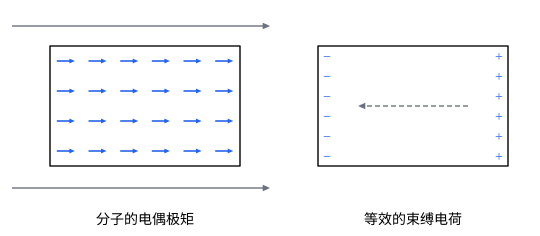

## 这一节要回答的问题

玻璃、塑料、水里的:term[电荷]{id="physics.electromagnetism.electric-charge"}（electric charge）不能自由移动，可放进:term[电场]{id="physics.electromagnetism.electric-field"}（electric field）以后，照样会改变电场：:term[平行板电容器]{id="physics.electromagnetism.capacitor"}（parallel-plate capacitor）的两板之间塞进一块玻璃，板间的电场就变弱了。这些物质里发生了什么？能不能用一两个量描述它们对电场的影响？

## 讲解

### 电介质和极化

原子里的电子云（electron cloud）和原子核受到方向相反的电力，:term[电场]{id="physics.electromagnetism.electric-field"}会把两者稍微拉开，原子就有了一个顺着电场的:term[电偶极矩]{id="physics.electromagnetism.dipole-moment"}（electric dipole moment）。水分子这类极性分子（polar molecule）本来就有电偶极矩（约$6.2\times10^{-30}\,\mathrm{C\,m}$，见[电偶极子](lesson:physics.electromagnetism.electric-dipole)），没有电场时方向杂乱，电场的力矩让它们倾向于转到顺着电场的方向。两种情形，结果都是一块物质里出现了顺着电场的电偶极矩。

::anchor{id="def-dielectric"}
:term[绝缘体]{id="physics.electromagnetism.insulator"}（insulator）放进电场里，分子产生电偶极矩或者电偶极矩转向电场，这种现象叫作极化（polarization）；从极化的角度看，绝缘体叫作:term[电介质]{id="physics.electromagnetism.dielectric"}（dielectric）。

为什么这样定义：电介质里没有能长距离移动的:term[电荷]{id="physics.electromagnetism.electric-charge"}，它对电场的影响全部来自分子尺度上的正负电荷错开，所以要用电偶极矩来描述。边界情况：:term[导体]{id="physics.electromagnetism.conductor"}（conductor）里的电荷能移动到表面，把内部的电场完全抵消；电介质里的电荷只能挪一点点，只能把电场削弱一部分。

::anchor{id="def-polarizability"}
不太强的电场里，原子产生的电偶极矩和电场成正比，$\vb p=\alpha\vb E$，比例系数$\alpha$叫作这种原子的:term[极化率]{id="physics.electromagnetism.polarizability"}（polarizability），单位是$\mathrm{C\,m^2/V}$。

为什么这样定义：电场弱时，电子云被拉开的距离和拉力成正比，像一根弹簧，$\alpha$量的是这根「弹簧」有多软。量子力学算出，基态氢原子的极化率是$\alpha=4.5\times4\pi\varepsilon_0a_0^3\approx7.42\times10^{-41}\,\mathrm{C\,m^2/V}$，$a_0$是玻尔半径（Bohr radius）。边界情况：电场很强时$\vb p$和$\vb E$不再成正比，强到一定程度还会把电子拉走。

### 极化强度和束缚电荷

::anchor{id="def-polarization"}
:term[电介质]{id="physics.electromagnetism.dielectric"}里一小块体积$\Delta V$中所有分子的:term[电偶极矩]{id="physics.electromagnetism.dipole-moment"}之和，除以$\Delta V$，叫作那里的:term[极化强度]{id="physics.electromagnetism.polarization"}（polarization density）$\vb P$，单位是$\mathrm{C/m^2}$。

为什么这样定义：一块电介质里有大量分子，逐个算它们的:term[电场]{id="physics.electromagnetism.electric-field"}既不可能也没必要；在比分子大得多、又比我们关心的尺度小得多的体积上平均，$\vb P\,\dd V$就是这一小块的电偶极矩。边界情况：每立方米有$n$个分子、每个的电偶极矩都是$\vb p$时，$\vb P=n\vb p$；真空里$\vb P=\vb 0$。

把极化想成：:term[正电荷]{id="physics.electromagnetism.electric-charge"}整体相对负电荷挪了一小段$\vb\delta$。设单位体积里可移动的正电荷是$nq$，$\vb P=nq\vb\delta$；从一个面元$\dd\vb a$穿出去的正电荷是$nq\vb\delta\cdot\dd\vb a=\vb P\cdot\dd\vb a$。所以从闭合曲面围住的区域里一共挪出去$\oint\vb P\cdot\dd\vb a$，区域里留下$-\oint\vb P\cdot\dd\vb a=-\int\divg\vb P\,\dd V$；在电介质的表面上，挪出来的电荷堆在那里出不去。

::anchor{id="def-bound-charge"}
极化的电介质里，因为正负电荷错开而在体内或表面积累起来的电荷，叫作:term[束缚电荷]{id="physics.electromagnetism.bound-charge"}（bound charge），记作$\rho_{\mathrm b}$、$\sigma_{\mathrm b}$；除此以外的电荷，例如:term[导体]{id="physics.electromagnetism.conductor"}里能移动的电荷、放到物体上的电荷，叫作:term[自由电荷]{id="physics.electromagnetism.free-charge"}（free charge），记作$\rho_{\mathrm f}$、$\sigma_{\mathrm f}$。

::anchor{id="thm-bound-charge"}
定理（束缚电荷与极化强度）：电介质里的束缚电荷体密度是$\rho_{\mathrm b}=-\divg\vb P$；电介质表面上的束缚电荷面密度是$\sigma_{\mathrm b}=\vb P\cdot\uv n$，$\uv n$是表面向外的法线方向。

证明思路：体密度由上面的论证和散度定理（divergence theorem）得出。表面上，$\uv n\,\dd a$方向穿出的正电荷是$\vb P\cdot\uv n\,\dd a$，它们出不了电介质，堆在表面上，所以面密度是$\vb P\cdot\uv n$。一块原来中性的电介质，$\int\rho_{\mathrm b}\,\dd V+\oint\sigma_{\mathrm b}\,\dd a=-\oint\vb P\cdot\dd\vb a+\oint\vb P\cdot\dd\vb a=0$，束缚电荷总共是零。

束缚电荷是真实的电荷，它们的电场和别的电荷一样按:term[库仑定律]{id="physics.electromagnetism.coulomb-law"}（Coulomb's law）算；极化的电介质在外面和里面（在比分子大的尺度上平均）产生的电场，就是这些束缚电荷的电场（p5）。

### 电介质为什么削弱电场

:term[电介质]{id="physics.electromagnetism.dielectric"}极化后，$\vb P$顺着:term[电场]{id="physics.electromagnetism.electric-field"}。在电场进入电介质的那一面，$\vb P$指向电介质里面，$\vb P\cdot\uv n<0$，那里出现负的:term[束缚电荷]{id="physics.electromagnetism.bound-charge"}；电场离开的那一面出现正的束缚电荷。这两层:term[电荷]{id="physics.electromagnetism.electric-charge"}在电介质里产生的电场，从正的一面指向负的一面，正好和原来的电场相反，所以电介质里的电场变弱了。

这和[导体与静电平衡](lesson:physics.electromagnetism.conductors)里:term[导体]{id="physics.electromagnetism.conductor"}抵消电场是同一个道理，只是电介质里的电荷挪不远，抵消不完。电场不均匀时，电介质被极化后还会被拉向电场强的地方，碎纸屑被带电的梳子吸起来就是这样（见[电偶极子](lesson:physics.electromagnetism.electric-dipole)第 7 题）。

## 几何图像

左图是放在向右的匀强:term[电场]{id="physics.electromagnetism.electric-field"}里的一块:term[电介质]{id="physics.electromagnetism.dielectric"}板，每个小箭头代表一小块的:term[电偶极矩]{id="physics.electromagnetism.dipole-moment"}，:term[极化强度]{id="physics.electromagnetism.polarization"}处处相同。板里面一个分子的正端挨着下一个分子的负端，平均起来抵消，$\divg\vb P=0$，没有:term[体束缚电荷]{id="physics.electromagnetism.bound-charge"}；只在左右两个表面上各剩下一层，就是右图里的:term[束缚电荷]{id="physics.electromagnetism.bound-charge"}。

## 例题

### 例 1　电容器里的电介质板

:term[平行板电容器]{id="physics.electromagnetism.capacitor"}两板上的:term[自由电荷]{id="physics.electromagnetism.free-charge"}面密度是$\pm\sigma_{\mathrm f}$，板间平行地放着一块:term[电介质]{id="physics.electromagnetism.dielectric"}板，它的:term[极化强度]{id="physics.electromagnetism.polarization"}$\vb P$均匀、垂直于板面、大小为$P$。求电介质板里和板外空隙里的:term[电场]{id="physics.electromagnetism.electric-field"}。

**为什么想到这么做**：$\vb P$均匀，体内没有:term[束缚电荷]{id="physics.electromagnetism.bound-charge"}，只在电介质板的两个表面上有$\mp P$。所有:term[电荷]{id="physics.electromagnetism.electric-charge"}都分布在相互平行的大平面上，电场可以由各个带电平面的电场叠加（见[用高斯定律求对称电场](lesson:physics.electromagnetism.gauss-applications)）。

**推导**：两块极板（plate）在板间产生$\frac{\sigma_{\mathrm f}}{\varepsilon_0}$，从正极板指向负极板。电介质板靠正极板的那一面是$-P$，另一面是$+P$，这一对束缚电荷只在电介质板里面产生$\frac{P}{\varepsilon_0}$，方向相反。所以空隙里$E=\frac{\sigma_{\mathrm f}}{\varepsilon_0}$，电介质板里$E=\frac{\sigma_{\mathrm f}-P}{\varepsilon_0}$，变弱了。

### 例 2　径向极化的球

半径为$R$的:term[电介质]{id="physics.electromagnetism.dielectric"}球，:term[极化强度]{id="physics.electromagnetism.polarization"}是$\vb P=k\vb r$，$k$是常量，$\vb r$从球心量起。求:term[束缚电荷]{id="physics.electromagnetism.bound-charge"}，以及球里球外的:term[电场]{id="physics.electromagnetism.electric-field"}。

**为什么想到这么做**：由$\vb P$直接求$\rho_{\mathrm b}=-\divg\vb P$和表面的$\sigma_{\mathrm b}=\vb P\cdot\uv n$；:term[电荷]{id="physics.electromagnetism.electric-charge"}分布球对称，再用:term[高斯定律]{id="physics.electromagnetism.gauss-law"}（Gauss's law）求电场。

**推导**：$\divg(k\vb r)=3k$，$\rho_{\mathrm b}=-3k$；球面上$\vb P\cdot\uv r=kR$，$\sigma_{\mathrm b}=kR$。总束缚电荷$-3k\cdot\frac43\pi R^3+kR\cdot4\pi R^2=0$，所以球外电场为零。球里半径$r$的球面包住$-3k\cdot\frac43\pi r^3$，$E_r=\frac{-4\pi kr^3}{4\pi\varepsilon_0r^2}=-\frac{kr}{\varepsilon_0}$，即$\vb E=-\frac{\vb P}{\varepsilon_0}$，和$\vb P$反向。

## 常见误区

- 「:term[束缚电荷]{id="physics.electromagnetism.bound-charge"}是假想的，不产生:term[电场]{id="physics.electromagnetism.electric-field"}。」它们是真实的:term[电荷]{id="physics.electromagnetism.electric-charge"}，只是被束缚在分子里，它们的电场和别的电荷一样。
- 「均匀极化的:term[电介质]{id="physics.electromagnetism.dielectric"}里没有束缚电荷，所以它对电场没有影响。」体内确实没有，表面上却有，它们的电场削弱了电介质里的电场。
- 「中性的:term[电介质]{id="physics.electromagnetism.dielectric"}在电场里不受力。」匀强电场里合力为零；电场不均匀时，它被拉向电场强的地方。
- 「:term[极化强度]{id="physics.electromagnetism.polarization"}的方向就是:term[电偶极矩]{id="physics.electromagnetism.dipole-moment"}从正电荷指向负电荷的方向。」电偶极矩从负电荷指向正电荷，$\vb P$也一样，顺着让它极化的电场。
