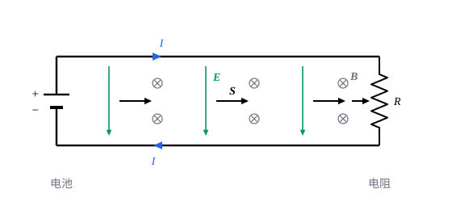

## 这一节要回答的问题

:term[静电场]{id="physics.electromagnetism.electric-field"}（electrostatic field）的:term[能量密度]{id="physics.electromagnetism.energy-density"}（energy density）是$\frac{\varepsilon_0}{2}E^2$（见[静电场的能量](lesson:physics.electromagnetism.electrostatic-energy#def-energy-density)），:term[磁场]{id="physics.electromagnetism.magnetic-field"}（magnetic field）的是$\frac{B^2}{2\mu_0}$（见[自感、互感与磁场的能量](lesson:physics.electromagnetism.inductance#thm-magnetic-energy-density)）。场随时间变化时，这些能量从哪里来、到哪里去？电池接通灯泡，能量是沿着导线里面流过去的吗？

## 讲解

### 电磁场对电荷做功

:term[电荷]{id="physics.electromagnetism.electric-charge"}（electric charge）$q$以速度$\vb v$运动，受:term[洛伦兹力]{id="physics.electromagnetism.lorentz-force"}（Lorentz force）$q(\vb E+\vb v\times\vb B)$；磁力和速度垂直，不做功，所以场对它做功的功率是$q\vb E\cdot\vb v$。连续分布的电荷，单位体积里是$\rho$，$\rho\vb v=\vb J$，单位体积里场做功的功率就是$\vb J\cdot\vb E$。:term[导体]{id="physics.electromagnetism.conductor"}（conductor）里$\vb J=\sigma\vb E$，$\vb J\cdot\vb E=\sigma E^2>0$，这些功变成:term[焦耳热]{id="physics.electromagnetism.joule-heating"}（Joule heating，见[电流与欧姆定律](lesson:physics.electromagnetism.current-density#thm-joule)），这一节里$\sigma$是:term[电导率]{id="physics.electromagnetism.conductivity"}（electrical conductivity）；电源里电荷被非静电力推着逆着:term[电场]{id="physics.electromagnetism.electric-field"}走，$\vb J\cdot\vb E<0$，是电荷把能量交给场。

### 坡印亭定理

::anchor{id="thm-poynting"}
定理（:term[坡印亭定理]{id="physics.electromagnetism.poynting-theorem"}，Poynting's theorem）：记$u=\frac{\varepsilon_0}{2}E^2+\frac{1}{2\mu_0}B^2$、$\vb S=\frac{1}{\mu_0}\vb E\times\vb B$，那么$\pdv ut+\divg\vb S=-\vb J\cdot\vb E$；对任一区域$V$和它的边界$\partial V$，$-\dv{}{t}\int_Vu\,\dd V=\int_V\vb J\cdot\vb E\,\dd V+\oint_{\partial V}\vb S\cdot\dd\vb a$。

证明思路：由:term[安培-麦克斯韦定律]{id="physics.electromagnetism.ampere-maxwell-law"}（Ampère–Maxwell law），$\vb J\cdot\vb E=\frac{1}{\mu_0}\vb E\cdot(\curl\vb B)-\varepsilon_0\vb E\cdot\pdv{\vb E}t$。由向量恒等式$\divg(\vb E\times\vb B)=\vb B\cdot(\curl\vb E)-\vb E\cdot(\curl\vb B)$（见[向量微分恒等式](lesson:math.vector-calculus.vector-identities)）和:term[法拉第定律]{id="physics.electromagnetism.faraday-law"}（Faraday's law of induction），$\vb E\cdot(\curl\vb B)=-\vb B\cdot\pdv{\vb B}t-\divg(\vb E\times\vb B)$。代进去，$\vb J\cdot\vb E=-\pdv{}{t}\Bigl(\frac{\varepsilon_0}{2}E^2+\frac{1}{2\mu_0}B^2\Bigr)-\divg\Bigl(\frac{1}{\mu_0}\vb E\times\vb B\Bigr)$；积分形式由高斯公式（divergence theorem）得到。

::anchor{id="def-poynting-vector"}
$\vb S=\frac{1}{\mu_0}\vb E\times\vb B$叫作:term[坡印亭矢量]{id="physics.electromagnetism.poynting-vector"}（Poynting vector），单位是$\mathrm{W/m^2}$：它穿过一个曲面的通量，是单位时间穿过这个曲面的电磁能量；$u=\frac{\varepsilon_0}{2}E^2+\frac{1}{2\mu_0}B^2$是电磁场的:term[能量密度]{id="physics.electromagnetism.energy-density"}。

为什么这样定义：坡印亭定理和:term[电荷守恒]{id="physics.electromagnetism.charge-conservation"}（conservation of charge）的:term[连续性方程]{id="physics.electromagnetism.continuity-equation"}（continuity equation）形式一样，$u$像:term[电荷密度]{id="physics.electromagnetism.charge-density"}（charge density），$\vb S$像:term[电流密度]{id="physics.electromagnetism.current-density"}（current density），$-\vb J\cdot\vb E$是场的能量变成:term[电荷]{id="physics.electromagnetism.electric-charge"}的动能、热的速率。区域里场的能量减少，一部分对里面的电荷做了功，其余的从边界流了出去，流出去的正是$\vb S$的通量。边界情况：:term[静电场]{id="physics.electromagnetism.electric-field"}和:term[恒定电流]{id="physics.electromagnetism.steady-current"}（steady current）的:term[磁场]{id="physics.electromagnetism.magnetic-field"}叠在一起时$\vb S$也可以不为零，例如带电的:term[电容器]{id="physics.electromagnetism.capacitor"}（capacitor）放在磁铁旁边，可那时$\divg\vb S=0$，任何区域进出的能量都相等，能量哪里也不积累（第 8 题）。

1884 年，坡印亭（John Henry Poynting）发表了这个定理；亥维赛（Oliver Heaviside）几乎同时也独立得到了它。$\vb S$加上任意一个矢量场的旋度，定理照样成立，所以只有穿过闭合曲面的能流有确定的意义；在:term[电磁波]{id="physics.electromagnetism.em-wave"}（electromagnetic wave）里，$\vb S$的意义最清楚（见[电磁波的能量与强度](lesson:physics.electromagnetism.em-wave-energy)）。狭义相对论里，$u$和$\frac{\vb S}{c}$是电磁场的:term[能量-动量张量]{id="physics.special-relativity.stress-energy-tensor"}（stress–energy tensor）的分量（见[麦克斯韦方程组的协变形式](lesson:physics.special-relativity.covariant-maxwell)第 8 题）。

## 几何图像

图里电池的正极接上面的导线，两根导线之间的:term[电场]{id="physics.electromagnetism.electric-field"}从上指向下；两根导线的:term[电流]{id="physics.electromagnetism.electric-current"}（electric current）方向相反，在它们之间产生的:term[磁场]{id="physics.electromagnetism.magnetic-field"}都垂直纸面向里。:term[坡印亭矢量]{id="physics.electromagnetism.poynting-vector"}$\frac1{\mu_0}\vb E\times\vb B$向右：能量在两根导线之间的空间里从电池流向:term[电阻]{id="physics.electromagnetism.resistance"}（resistance），到了电阻那里，从侧面流进去变成热（例 1）。导线本身电阻很小，里面的电场几乎为零，能量几乎不从导线里面走；导线的作用是引导场，让能量沿着它们流过去。开关刚合上时，场的变化以接近光速的速度沿导线传开，所以灯泡几乎立刻就亮（见[电流与欧姆定律](lesson:physics.electromagnetism.current-density)第 8 题）。

## 例题

### 例 1　通有电流的电阻丝

长为$l$、半径为$a$、:term[电阻]{id="physics.electromagnetism.resistance"}为$R$的直导线通有:term[恒定电流]{id="physics.electromagnetism.steady-current"}$I$。求导线表面的:term[坡印亭矢量]{id="physics.electromagnetism.poynting-vector"}，并说明单位时间流进导线的电磁能量等于:term[焦耳热]{id="physics.electromagnetism.joule-heating"}。

**为什么想到这么做**：导线里的:term[电场]{id="physics.electromagnetism.electric-field"}沿着导线，表面上:term[磁场]{id="physics.electromagnetism.magnetic-field"}绕着导线转，两者的叉乘指向导线的中轴，能量从侧面流进去；算出通量和$I^2R$比一比。

**推导**：导线里$E=\frac{IR}{l}$，沿着:term[电流]{id="physics.electromagnetism.electric-current"}方向；电场平行于表面的分量在表面两侧连续，所以紧贴表面外面也是这样。表面上$B=\frac{\mu_0I}{2\pi a}$，绕着导线转。$\vb E\times\vb B$指向中轴，大小$S=\frac{1}{\mu_0}\cdot\frac{IR}{l}\cdot\frac{\mu_0I}{2\pi a}=\frac{I^2R}{2\pi al}$。乘以侧面积$2\pi al$，流进的功率是$I^2R$，正是焦耳热；两个端面上$\vb S$和端面平行，没有能量从那里进出。

### 例 2　充电的电容器

两块半径为$R$的圆形极板相距$d$，正在充电，两板之间的:term[电场]{id="physics.electromagnetism.electric-field"}$E(t)$均匀地增大，边缘的电场不计。求极板边缘处的:term[坡印亭矢量]{id="physics.electromagnetism.poynting-vector"}，说明流进两板之间的能量等于电场能量的增加。

**为什么想到这么做**：两板之间的:term[磁场]{id="physics.electromagnetism.magnetic-field"}由:term[位移电流]{id="physics.electromagnetism.displacement-current"}（displacement current）产生（见[位移电流与麦克斯韦方程组](lesson:physics.electromagnetism.maxwell-equations)例 1），边缘处它绕着中轴转，和电场叉乘以后指向中轴：能量从:term[电容器]{id="physics.electromagnetism.capacitor"}的侧面流进来。

**推导**：边缘处$B=\frac{\mu_0\varepsilon_0R}{2}\dv Et$，$\vb S$指向中轴，大小$S=\frac{1}{\mu_0}E\cdot\frac{\mu_0\varepsilon_0R}{2}\dv Et=\frac{\varepsilon_0R}{2}E\dv Et$。侧面积是$2\pi Rd$，流进的功率是$\varepsilon_0E\dv Et\cdot\pi R^2d=\dv{}{t}\Bigl(\frac{\varepsilon_0}{2}E^2\Bigr)\cdot\pi R^2d$，正是两板之间电场能量的增加率。磁场的能量正比于$\Bigl(\dv Et\Bigr)^2$，充电不太快时小得多，这里不计。

## 常见误区

- 「电能是沿着导线内部从电源流到用电器的。」:term[坡印亭矢量]{id="physics.electromagnetism.poynting-vector"}在导线外的空间里从电源指向用电器，从侧面流进用电器；导线里面的:term[电场]{id="physics.electromagnetism.electric-field"}很小，能量几乎不在导线里流。
- 「只要电场和:term[磁场]{id="physics.electromagnetism.magnetic-field"}都不为零，就有能量在流动。」静电场和静磁场叠在一起时$\vb S$可以不为零，可$\divg\vb S=0$，能量没有在哪里积累，也没有可以观测的能量流动（第 8 题）。
- 「$\vb J\cdot\vb E$总是正的，场只会把能量交给:term[电荷]{id="physics.electromagnetism.electric-charge"}。」电源里电荷逆着电场运动，$\vb J\cdot\vb E<0$，化学能、机械能经过它变成了场的能量。
