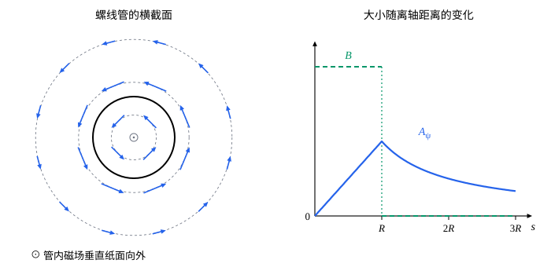

## 这一节要回答的问题

:term[静电场]{id="physics.electromagnetism.electric-field"}（electrostatic field）的旋度为零，可以写成:term[电势]{id="physics.electromagnetism.electric-potential"}（electric potential）的负梯度，用一个标量函数代替三个分量。:term[静磁场]{id="physics.electromagnetism.magnetic-field"}（magnetostatic field）的散度为零：它能不能也由一个「势」导出？这个势唯一吗？磁场为零的地方，它是不是也为零？

## 讲解

### 磁矢势

[安培环路定理](lesson:physics.electromagnetism.ampere-law#thm-ampere-differential)那一节证明了，:term[磁场]{id="physics.electromagnetism.magnetic-field"}处处满足$\divg\vb B=0$。在全空间（或其他足够简单的区域）上，散度为零的矢量场一定是某个矢量场的旋度（见[标量势与矢量势](lesson:math.vector-calculus.potentials)），这就是下面定义的出发点。

::anchor{id="def-vector-potential"}
满足$\vb B=\curl\vb A$的矢量场$\vb A$，叫作磁场的:term[磁矢势]{id="physics.electromagnetism.vector-potential"}（magnetic vector potential），单位是$\mathrm{T\,m}$，也就是$\mathrm{Wb/m}$。

为什么这样定义：用$\vb A$表示磁场，$\divg\vb B=\divg(\curl\vb A)=0$自动成立，剩下的方程只有$\curl\vb B=\mu_0\vb J$。它和:term[电势]{id="physics.electromagnetism.electric-potential"}一样，是一个「势」，只是不再是标量：磁场绕着:term[电流]{id="physics.electromagnetism.electric-current"}（electric current）转，不能写成一个函数的梯度。边界情况：磁矢势有三个分量，并不比磁场本身省事；它的用处在于积分公式简单（下面的定理），以及在带电粒子的:term[拉格朗日量]{id="physics.analytical-mechanics.lagrangian"}（Lagrangian）、量子力学和电磁辐射里直接出场。

::anchor{id="thm-vector-potential-integral"}
定理（磁矢势的积分公式）：:term[恒定电流]{id="physics.electromagnetism.steady-current"}（steady current）的磁场可以取$\vb A(\vb r)=\frac{\mu_0}{4\pi}\int\frac{\vb J(\vb r')}{|\vb r-\vb r'|}\dd V'$作磁矢势，细导线的电流$I$则是$\frac{\mu_0}{4\pi}\oint\frac{I\,\dd\vb l'}{|\vb r-\vb r'|}$；这样取的$\vb A$还满足$\divg\vb A=0$。

证明思路：对场点$\vb r$求梯度，$\nabla\frac{1}{|\vb r-\vb r'|}=-\frac{\vb r-\vb r'}{|\vb r-\vb r'|^3}$。$\vb J(\vb r')$和$\vb r$无关，由[向量微分恒等式](lesson:math.vector-calculus.vector-identities)，$\curl\frac{\vb J(\vb r')}{|\vb r-\vb r'|}=\nabla\frac{1}{|\vb r-\vb r'|}\times\vb J(\vb r')=\frac{\vb J(\vb r')\times(\vb r-\vb r')}{|\vb r-\vb r'|^3}$。场点在电流外面时被积函数光滑，旋度和下面的散度都可以移进积分号（[积分号下求导](lesson:math.analysis.parameter-integrals#thm-leibniz-rule)）；在电流里面时被积函数有奇点，但奇点可积，结论仍然成立，这里不证。把旋度移进积分号、对$\vb r'$积分，右边正是[毕奥-萨伐尔定律](lesson:physics.electromagnetism.biot-savart#def-biot-savart)（Biot–Savart law）给出的$\vb B$。

散度为零：$\divg\frac{\vb J(\vb r')}{|\vb r-\vb r'|}=\vb J\cdot\nabla\frac{1}{|\vb r-\vb r'|}$，它等于$-\vb J\cdot\nabla'\frac{1}{|\vb r-\vb r'|}$（$\nabla'$对$\vb r'$求导），又等于$-\nabla'\cdot\frac{\vb J}{|\vb r-\vb r'|}+\frac{\nabla'\cdot\vb J}{|\vb r-\vb r'|}$。恒定电流$\nabla'\cdot\vb J=0$；第一项对$\vb r'$积分，由高斯公式（divergence theorem）变成包住全部电流的曲面上的通量，那里$\vb J=0$，所以$\divg\vb A=0$。

把这个公式和[连续分布电荷的电势](lesson:physics.electromagnetism.electric-potential#thm-point-potential)$\varphi=\frac{1}{4\pi\varepsilon_0}\int\frac{\rho}{|\vb r-\vb r'|}\dd V'$对照：$\vb A$的每个直角坐标分量，都像把$J_x$、$J_y$或$J_z$当作:term[电荷密度]{id="physics.electromagnetism.charge-density"}（charge density）算出的电势，只是$\frac{1}{\varepsilon_0}$换成了$\mu_0$。所以磁矢势大致沿着电流的方向，电流沿$z$方向流时，$\vb A$只有$z$分量；它的每个分量也满足和电势一样的:term[泊松方程]{id="physics.electromagnetism.poisson-equation"}（Poisson's equation）$\nabla^2A_x=-\mu_0J_x$（见[泊松方程与拉普拉斯方程](lesson:physics.electromagnetism.poisson-equation)）。

### 规范自由度

::anchor{id="thm-gauge"}
定理（:term[规范变换]{id="physics.electromagnetism.gauge-transformation"}，gauge transformation）：任取一个标量函数$\chi$，$\vb A'=\vb A+\nabla\chi$和$\vb A$给出同样的:term[磁场]{id="physics.electromagnetism.magnetic-field"}；反过来，在全空间给出同样磁场的两个:term[磁矢势]{id="physics.electromagnetism.vector-potential"}，相差某个函数的梯度。

证明思路：$\curl\nabla\chi=0$（梯度的旋度为零），所以$\curl\vb A'=\curl\vb A$。反过来，$\curl(\vb A'-\vb A)=0$，旋度为零的场在全空间上是某个函数的梯度（见[标量势与矢量势](lesson:math.vector-calculus.potentials)）。

::anchor{id="def-gauge-freedom"}
磁矢势由磁场决定到可以加上任意一个梯度为止，这种选择的余地叫作规范自由度（gauge freedom）。:term[电势]{id="physics.electromagnetism.electric-potential"}也有类似的余地：加上一个常数，:term[电场]{id="physics.electromagnetism.electric-field"}不变；磁矢势的余地大得多，加上的是一个任意的函数。常用的选法是让$\divg\vb A=0$，叫作:term[库仑规范]{id="physics.electromagnetism.coulomb-gauge"}（Coulomb gauge），上面积分公式给出的磁矢势就满足它；任给一个$\vb A$，解:term[泊松方程]{id="physics.electromagnetism.poisson-equation"}$\nabla^2\chi=-\divg\vb A$，加上$\nabla\chi$就能化成库仑规范。

例如匀强磁场$\vb B=B\uv z$，可以取$\vb A_1=(-By,0,0)$，也可以取对称的$\vb A_2=\frac B2(-y,x,0)=\frac12\vb B\times\vb r$，两者的旋度都是$B\uv z$，相差$\nabla\bigl(\frac B2xy\bigr)$。分析力学里带电粒子的:term[拉格朗日量]{id="physics.analytical-mechanics.lagrangian"}用的就是这两种选法（见[电磁场中带电粒子的拉格朗日量](lesson:physics.analytical-mechanics.charged-particle-lagrangian)）。

### 磁矢势和磁通量

::anchor{id="thm-flux-circulation"}
定理（:term[磁矢势]{id="physics.electromagnetism.vector-potential"}的环量）：沿任一闭合曲线$C$，$\oint_C\vb A\cdot\dd\vb l=\Phi$，$\Phi$是穿过以$C$为边界的曲面的:term[磁通量]{id="physics.electromagnetism.magnetic-flux"}（magnetic flux），曲面的方向和$C$的绕向按右手定则对应。

证明思路：由斯托克斯公式（Stokes' theorem），$\oint_C\vb A\cdot\dd\vb l=\int_S(\curl\vb A)\cdot\dd\vb a=\int_S\vb B\cdot\dd\vb a$。这和:term[安培环路定理]{id="physics.electromagnetism.ampere-law"}（Ampère's circuital law）$\oint\vb B\cdot\dd\vb l=\mu_0I$形式相同：磁矢势对:term[磁场]{id="physics.electromagnetism.magnetic-field"}，就像磁场对:term[电流]{id="physics.electromagnetism.electric-current"}。

所以磁场为零的地方，磁矢势不一定为零。无限长:term[螺线管]{id="physics.electromagnetism.solenoid"}（solenoid）外面没有磁场，可绕螺线管一圈，磁矢势的环量等于管里的磁通量，不是零（例 2）。在管外的任何一个小区域里，都能用:term[规范变换]{id="physics.electromagnetism.gauge-transformation"}把$\vb A$变成零；可是绕管一圈的环量变不掉，没有一个规范能让管外处处$\vb A=0$。

## 几何图像

左图是无限长:term[螺线管]{id="physics.electromagnetism.solenoid"}的横截面，管内的:term[磁场]{id="physics.electromagnetism.magnetic-field"}$B_0$垂直纸面向外，管外没有磁场。:term[磁矢势]{id="physics.electromagnetism.vector-potential"}沿圆周绕着轴转，箭头的长度和它的大小成正比。右图是大小随离轴距离$s$的变化：管内$A_\psi=\frac{B_0s}{2}$，在管壁处最大，管外按$\frac{B_0R^2}{2s}$减小，可是磁场在管外处处为零。磁矢势像绕着螺线管的「涡旋」：磁场不在的地方，磁矢势仍然知道里面有:term[磁通量]{id="physics.electromagnetism.magnetic-flux"}。

:::anim{component="vector-field-2d"}
field: { x: "-(1 - a) * y", y: "a * x" }
range: { x: [-3, 3], y: [-3, 3] }
dt: 0.02
particles: 300
sliders:
  - name: a
    min: 0
    max: 1
    step: 0.25
    default: 0.5
    label: |
      规范的参数$a$
:::

动画画的是匀强:term[磁场]{id="physics.electromagnetism.magnetic-field"}$\vb B=B\uv z$的一族磁矢势$\vb A=B\bigl(-(1-a)y,\ ax,\ 0\bigr)$，以$B$为单位。它们的旋度都是$\partial_xA_y-\partial_yA_x=aB+(1-a)B=B$，给出同一个磁场，和$a=\frac12$的对称形式相差$\nabla\bigl(\frac{(2a-1)B}{2}xy\bigr)$，是一次:term[规范变换]{id="physics.electromagnetism.gauge-transformation"}。$a=0$时$\vb A$沿水平方向，上下两半方向相反；$a=\frac12$时是绕原点转的对称形式；$a=1$时沿竖直方向。粒子流动的样子完全不同，磁场却一样：只看磁矢势本身的样子，看不出磁场。

## 例题

### 例 1　长直导线的磁矢势

无限长直导线沿$z$轴，通有:term[电流]{id="physics.electromagnetism.electric-current"}$I$。求它的:term[磁矢势]{id="physics.electromagnetism.vector-potential"}。

**为什么想到这么做**：磁矢势沿着电流的方向，所以试$\vb A=g(s)\uv z$，$s$是到轴的距离，再要求它的旋度等于已知的:term[磁场]{id="physics.electromagnetism.magnetic-field"}$\frac{\mu_0I}{2\pi s}\uv\psi$。直接用积分公式不行：对无限长导线，$\int\frac{\dd z'}{\sqrt{s^2+z'^2}}$发散，就像无限长带电直线的:term[电势]{id="physics.electromagnetism.electric-potential"}一样。

**推导**：$g$只依赖$s=\sqrt{x^2+y^2}$，$\curl(g\uv z)=(\partial_yg,\,-\partial_xg,\,0)=g'(s)\bigl(\frac ys,-\frac xs,0\bigr)=-g'(s)\uv\psi$。要它等于$\frac{\mu_0I}{2\pi s}\uv\psi$，$g'(s)=-\frac{\mu_0I}{2\pi s}$，所以$\vb A=-\frac{\mu_0I}{2\pi}\ln\frac{s}{s_0}\uv z$，$s_0$是任取的参考距离。换一个$s_0$，只是给$\vb A$加上一个常矢量，它是$\nabla$（常矢量$\cdot\vb r$），也是一次:term[规范变换]{id="physics.electromagnetism.gauge-transformation"}。

### 例 2　螺线管的磁矢势

半径为$R$的无限长:term[螺线管]{id="physics.electromagnetism.solenoid"}，管内的:term[磁场]{id="physics.electromagnetism.magnetic-field"}是均匀的$B_0$，管外为零。求它的:term[磁矢势]{id="physics.electromagnetism.vector-potential"}。

**为什么想到这么做**：:term[电流]{id="physics.electromagnetism.electric-current"}绕着轴转，磁矢势也绕着轴转，按对称性取$\vb A=A_\psi(s)\uv\psi$。用「磁矢势的环量等于:term[磁通量]{id="physics.electromagnetism.magnetic-flux"}」，就像用:term[安培环路定理]{id="physics.electromagnetism.ampere-law"}求磁场一样，取以轴为心、半径为$s$的圆作回路。

**推导**：$\oint\vb A\cdot\dd\vb l=2\pi sA_\psi$。管内回路包住的:term[磁通量]{id="physics.electromagnetism.magnetic-flux"}是$\pi s^2B_0$，所以$A_\psi=\frac{B_0s}{2}$；管外包住整个管里的磁通量$\pi R^2B_0$，所以$A_\psi=\frac{B_0R^2}{2s}$。管内的结果正是$\frac12\vb B\times\vb r$；管外$\vb B=0$，$\vb A$却不为零。

## 常见误区

- 「:term[磁矢势]{id="physics.electromagnetism.vector-potential"}由:term[磁场]{id="physics.electromagnetism.magnetic-field"}唯一确定。」加上任意函数的梯度，磁场不变；同一个磁场有无穷多个磁矢势。
- 「:term[磁场]{id="physics.electromagnetism.magnetic-field"}为零的地方，磁矢势也为零。」:term[螺线管]{id="physics.electromagnetism.solenoid"}外磁场为零，磁矢势的环量却等于管里的:term[磁通量]{id="physics.electromagnetism.magnetic-flux"}，不为零。
- 「磁矢势的方向就是磁场的方向。」磁矢势大致沿着:term[电流]{id="physics.electromagnetism.electric-current"}的方向，磁场绕着电流转，两者一般互相垂直。
- 「磁矢势只是计算用的工具，没有物理意义。」在量子力学里，电子绕螺线管两侧走，相位差等于$\frac{e}{\hbar}\oint\vb A\cdot\dd\vb l$，即使走过的地方没有磁场，干涉条纹也会移动（第 7 题）。
