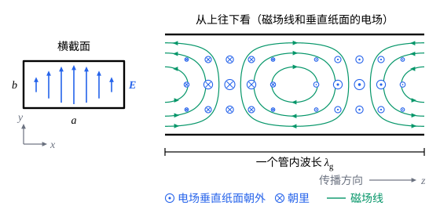

## 这一节要回答的问题

雷达和微波通信设备里，微波常常不用同轴电缆（coaxial cable）传送，而是在空心的矩形金属管里传播。一根空管子怎样引导:term[电磁波]{id="physics.electromagnetism.em-wave"}（electromagnetic wave）？为什么管子太细，频率低的波就传不过去？微波炉门上的金属板布满小孔，为什么挡得住微波，却挡不住光？

## 讲解

### 管里的波和管壁上的条件

取一根沿$z$轴放置的空心金属管，截面的形状和大小处处相同，管里是真空。微波频率下铜的:term[趋肤深度]{id="physics.electromagnetism.skin-depth"}（skin depth）只有微米量级（见[导体中的电磁波与趋肤效应](lesson:physics.electromagnetism.skin-effect#def-skin-depth)），下面把管壁当作:term[电导率]{id="physics.electromagnetism.conductivity"}（conductivity）无穷大的:term[理想导体]{id="physics.electromagnetism.conductor"}（perfect conductor），场进不到管壁里。要找的是沿管传播的波，:term[电场]{id="physics.electromagnetism.electric-field"}（electric field）写成$\vb E=\operatorname{Re}\bigl(\tilde{\vb E}(x,y)e^{i(\omega t-kz)}\bigr)$，:term[磁场]{id="physics.electromagnetism.magnetic-field"}（magnetic field）$\vb B$也一样；和:term[平面电磁波]{id="physics.electromagnetism.em-wave"}不同，:term[复振幅]{id="physics.electromagnetism.complex-amplitude"}（complex amplitude）$\tilde{\vb E}$、$\tilde{\vb B}$随截面上的位置变化。

管壁内表面上的条件来自两条对任何界面都成立的结论：由:term[法拉第定律]{id="physics.electromagnetism.faraday-law"}（Faraday's law）的积分形式，$\vb E$平行于界面的分量在两侧相等；由$\divg\vb B=0$，$\vb B$垂直于界面的分量在两侧相等（推导见[界面上的反射与折射：菲涅耳公式](lesson:physics.electromagnetism.fresnel-equations#thm-em-boundary)，这两条用不到界面上没有:term[电荷]{id="physics.electromagnetism.electric-charge"}（electric charge）、:term[电流]{id="physics.electromagnetism.electric-current"}（electric current）的假设）。理想导体里没有随时间变化的场，所以管壁内表面上$E_\parallel=0$，$B_\perp=0$。$\vb E$垂直于管壁的分量、$\vb B$平行于管壁的分量不必为零，管壁表面的电荷和电流和它们相配。

### 横电波、横磁波和横电磁波

把管里:term[电磁波]{id="physics.electromagnetism.em-wave"}的$\vb E$、$\vb B$代入真空中的:term[麦克斯韦方程组]{id="physics.electromagnetism.maxwell-equations"}（Maxwell's equations），对$z$求导变成乘以$-ik$，对$t$求导变成乘以$i\omega$。这样，横向分量$\tilde E_x$、$\tilde E_y$、$\tilde B_x$、$\tilde B_y$可以全部用纵向分量$\tilde E_z$、$\tilde B_z$在截面上的偏导数（partial derivative）表示出来（$\tilde E_z=0$时的式子见下面的定理，$\tilde B_z=0$时的见第 5 题）。只有$\frac{\omega^2}{c^2}=k^2$时例外，这些式子的分母为零。所以按$E_z$、$B_z$是不是零来分类。

::anchor{id="def-te-tm"}
$E_z=0$的波叫作横电波（transverse electric wave，TE），$B_z=0$的叫作横磁波（transverse magnetic wave，TM），$E_z$、$B_z$都为零的叫作横电磁波（transverse electromagnetic wave，TEM）。

为什么这样定义：「横」指垂直于传播方向。横电波的:term[电场]{id="physics.electromagnetism.electric-field"}全在截面里，:term[磁场]{id="physics.electromagnetism.magnetic-field"}却有沿管的分量；横磁波反过来。真空里的平面电磁波，$\vb E$、$\vb B$都垂直于传播方向，是横电磁波。边界情况：同轴电缆里能传播横电磁波，空心管里却不能。

::anchor{id="thm-no-tem"}
定理（空心管里没有横电磁波）：截面边界是一条闭合曲线的:term[理想导体]{id="physics.electromagnetism.conductor"}空心管里，不能传播横电磁波。

证明思路：设$E_z=B_z=0$。$\divg\vb E=0$给出$\pdv{\tilde E_x}x+\pdv{\tilde E_y}y=0$，法拉第定律的$z$分量给出$\pdv{\tilde E_y}x-\pdv{\tilde E_x}y=-i\omega\tilde B_z=0$。后一式说明截面上的电场是某个函数$V(x,y)$的负梯度（gradient），前一式说明$V$满足二维的:term[拉普拉斯方程]{id="physics.electromagnetism.laplace-equation"}（Laplace's equation）。管壁上$E_\parallel=0$，$V$沿整圈管壁是同一个常数，而拉普拉斯方程的解在内部没有极大值和极小值（见[泊松方程与拉普拉斯方程](lesson:physics.electromagnetism.poisson-equation#thm-mean-value)），所以$V$处处是这个常数，$\vb E=0$，再由法拉第定律得$\vb B=0$。

同轴电缆有内外两个导体，$V$在两个导体上可以取不同的常数，截面上的电场和两个导体之间的:term[静电场]{id="physics.electromagnetism.electric-field"}一样，所以同轴电缆能传播横电磁波，频率多低都行。空心管只有一个导体，下面会看到，能在里面传播的波都有一个最低频率。

### 矩形波导的横电模

取矩形截面$0\le x\le a$，$0\le y\le b$，$a\ge b$。横电波里$E_z=0$，其余分量都由$B_z$决定。

::anchor{id="thm-te-modes"}
定理（矩形波导的横电模）：截面为$a\times b$矩形的:term[理想导体]{id="physics.electromagnetism.conductor"}空心管里，横电波的纵向:term[磁场]{id="physics.electromagnetism.magnetic-field"}是$B_z=\operatorname{Re}\bigl(\tilde B_ze^{i(\omega t-kz)}\bigr)$，$\tilde B_z=B_0\cos\frac{m\pi x}{a}\cos\frac{n\pi y}{b}$，$m$、$n$是不全为零的非负整数，这样的波叫作$\mathrm{TE}_{mn}$模（mode）；$k$满足$c^2k^2=\omega^2-\omega_{mn}^2$，$\omega_{mn}=c\pi\sqrt{\frac{m^2}{a^2}+\frac{n^2}{b^2}}$。横向分量是$\tilde E_x=-\frac{i\omega c^2}{\omega_{mn}^2}\pdv{\tilde B_z}y$，$\tilde E_y=\frac{i\omega c^2}{\omega_{mn}^2}\pdv{\tilde B_z}x$，$\tilde B_x=-\frac k\omega\tilde E_y$，$\tilde B_y=\frac k\omega\tilde E_x$，各自乘以$e^{i(\omega t-kz)}$再取实部。

证明思路：设$E_z=0$。法拉第定律的$x$、$y$分量给出$\tilde B_x=-\frac k\omega\tilde E_y$、$\tilde B_y=\frac k\omega\tilde E_x$，代入:term[安培-麦克斯韦定律]{id="physics.electromagnetism.ampere-maxwell-law"}（Ampère–Maxwell law）的$x$、$y$分量，就解出$\tilde E_x$、$\tilde E_y$用$\pdv{\tilde B_z}y$、$\pdv{\tilde B_z}x$表示的式子，分母是$\frac{\omega^2}{c^2}-k^2$。管壁$y=0$、$y=b$上$\tilde E_x=0$，$x=0$、$x=a$上$\tilde E_y=0$，所以$\tilde B_z$在管壁上沿法向的导数为零。

$\vb B$的每个分量都满足[真空中的电磁波](lesson:physics.electromagnetism.em-waves#thm-em-wave-equation)里的波动方程（wave equation），代入得$\frac{\partial^2\tilde B_z}{\partial x^2}+\frac{\partial^2\tilde B_z}{\partial y^2}+\Bigl(\frac{\omega^2}{c^2}-k^2\Bigr)\tilde B_z=0$。用分离变量法（separation of variables，做法和[矩形与圆盘上的拉普拉斯方程](lesson:math.pde.laplace-separation)里一样）设$\tilde B_z=X(x)Y(y)$，得$X''=-k_x^2X$，$X'(0)=X'(a)=0$，只能$X=\cos\frac{m\pi x}a$，$k_x=\frac{m\pi}a$；$Y$同理，$k_y=\frac{n\pi}b$，于是$\frac{\omega^2}{c^2}-k^2=k_x^2+k_y^2=\frac{\omega_{mn}^2}{c^2}$。$m=n=0$时$\tilde B_z$在截面上处处相同，对沿管壁绕截面一圈的回路用法拉第定律：管壁上$E_\parallel=0$，回路积分为零，穿过截面的:term[磁通量]{id="physics.electromagnetism.magnetic-flux"}（magnetic flux）不随时间变化，只能$B_z=0$，所以$m$、$n$不能全为零。

::anchor{id="def-cutoff-frequency"}
$\omega_{mn}$叫作$\mathrm{TE}_{mn}$模的截止频率（cutoff frequency）：$\omega>\omega_{mn}$时$k$是实数，这个模沿管传播；$\omega<\omega_{mn}$时$k^2<0$，取$k=-i\kappa$，$\kappa=\frac1c\sqrt{\omega_{mn}^2-\omega^2}$，场按$e^{-\kappa z}$沿管衰减，传不出去。

为什么这样定义：$\omega_{mn}$是这个模能不能传播的分界。$a\ge b$时最低的截止频率属于$\mathrm{TE}_{10}$，换成频率是$f_{10}=\frac{\omega_{10}}{2\pi}=\frac c{2a}$，管宽正好是真空中半个波长；频率比它低，什么模都传不过去（横磁模的截止频率更高，见第 5 题）。频率远低于$\omega_{10}$时$\kappa\approx\frac{\omega_{10}}c=\frac\pi a$，每深入一个管宽，振幅就只剩$e^{-\pi}\approx\frac1{23}$。边界情况：$\omega=\omega_{mn}$时$k=0$，场沿管不变，波只在管壁之间来回反射，不向前走（见下面的两列平面波）。

微波炉门上的小孔可以看成一段段很短的管子。孔的直径比微波的波长（约$12\,\mathrm{cm}$，对应微波炉所用的约$2.45\,\mathrm{GHz}$）小得多，截止频率比微波的频率高得多，微波在孔里迅速衰减，金属板把它反射回炉内；可见光的频率比截止频率高得多，照样从孔里穿过（第 7 题是类似的例子）。

1897 年，瑞利（Lord Rayleigh）解出了:term[电磁波]{id="physics.electromagnetism.em-wave"}在空心导体管里传播的问题，发现每个模都有截止频率，频率低于它的波传不过去。这个结果后来被人遗忘。1930 年代，美国贝尔实验室的索思沃思（George Southworth）和麻省理工学院的巴罗（Wilmer Barrow）各自独立地重新发现了波导，1936 年先后公开了结果。

### 场的分布和两列平面波

最常用的是$\mathrm{TE}_{10}$模。取$m=1$，$n=0$，$\frac{\omega_{10}}c=\frac\pi a$，由定理得（取实部）

$$
\begin{aligned}
E_y&=\frac{\omega a}{\pi}B_0\sin\frac{\pi x}{a}\sin(\omega t-kz),\\
B_x&=-\frac{ka}{\pi}B_0\sin\frac{\pi x}{a}\sin(\omega t-kz),\\
B_z&=B_0\cos\frac{\pi x}{a}\cos(\omega t-kz),
\end{aligned}
$$

其余分量为零。

:term[电场]{id="physics.electromagnetism.electric-field"}只有$y$分量，和$y$无关，在两侧窄壁（$x=0$、$x=a$）处为零，中间最强。它垂直于上下两个宽壁，在窄壁处为零，正好满足$E_\parallel=0$。:term[磁场]{id="physics.electromagnetism.magnetic-field"}在$xz$平面里，:term[磁场线]{id="physics.electromagnetism.magnetic-field-line"}（magnetic field line）绕成闭合的圈（见下面的图）。

由$\cos\frac{\pi x}a\cos(\omega t-kz)=\frac12\bigl[\cos(\omega t-kz-\frac{\pi x}a)+\cos(\omega t-kz+\frac{\pi x}a)\bigr]$，$\mathrm{TE}_{10}$模是两列:term[平面电磁波]{id="physics.electromagnetism.em-wave"}的叠加，波矢（wave vector）分别是$\bigl(\frac\pi a,0,k\bigr)$和$\bigl(-\frac\pi a,0,k\bigr)$，大小都是$\frac\omega c$。两列波在两侧窄壁之间来回反射，沿锯齿形的路线前进，传播方向和管轴的夹角$\alpha$满足$\cos\alpha=\frac{ck}\omega$。频率降到截止频率时$k=0$，$\alpha=90^\circ$，波垂直于窄壁来回反射，不再沿管前进；频率越高，$\alpha$越小，波越接近沿管直走。

::anchor{id="thm-guide-velocities"}
定理（波导中的相速度和群速度）：$\mathrm{TE}_{mn}$模的相速度（phase velocity）$v_{\mathrm p}=\frac\omega k=\frac{c}{\sqrt{1-\omega_{mn}^2/\omega^2}}$大于$c$，群速度（group velocity）$v_{\mathrm g}=\dv\omega k=c\sqrt{1-\frac{\omega_{mn}^2}{\omega^2}}$小于$c$，$v_{\mathrm p}v_{\mathrm g}=c^2$；管内波长（guide wavelength）$\lambda_{\mathrm g}=\frac{2\pi}k$比真空中同一频率的波长长。

证明思路：$\omega^2=c^2k^2+\omega_{mn}^2$两边对$k$求导，得$\omega\dv\omega k=c^2k$，所以$v_{\mathrm g}=\frac{c^2k}\omega=\frac{c^2}{v_{\mathrm p}}$，再代入$ck=\sqrt{\omega^2-\omega_{mn}^2}$。用两列平面波看更直观：每列波以$c$沿锯齿形路线走，沿管前进的速度是$c\cos\alpha=\frac{c^2k}\omega$，正是群速度；波峰和管轴的交点移动得比$c$快，速度是$\frac c{\cos\alpha}$，正是相速度。

能量沿管前进的速度等于群速度（第 6 题），信号也以群速度传播（见[波包与群速度](lesson:physics.oscillations-waves.group-velocity)），都小于$c$。实际的管壁不是:term[理想导体]{id="physics.electromagnetism.conductor"}，管壁表面约一个:term[趋肤深度]{id="physics.electromagnetism.skin-depth"}厚的一层里有:term[电流]{id="physics.electromagnetism.electric-current"}，要消耗能量（见[导体中的电磁波与趋肤效应](lesson:physics.electromagnetism.skin-effect#def-skin-effect)），波沿管传播时会慢慢衰减。

## 几何图像

图里是$t=0$时的$\mathrm{TE}_{10}$模。左边是:term[电场]{id="physics.electromagnetism.electric-field"}最强的那个横截面，电场沿$y$方向，中间最强，两侧窄壁处为零。右边从$+y$方向往下看，画出一个管内波长的范围：闭合的曲线是:term[磁场线]{id="physics.electromagnetism.magnetic-field-line"}，相邻两圈转向相反；小圆圈是垂直纸面的电场，⊙ 朝外，⊗ 朝里，在两圈之间最强。整个图样以相速度沿$z$方向移动。

:::anim{component="function-plot"}
range: { x: [0, 4], y: [0, 4.5] }
functions:
  - expr: "sqrt(x^2 + 1)"
    label: |
      $\mathrm{TE}_{10}$
  - expr: "sqrt(x^2 + 4)"
    label: |
      $\mathrm{TE}_{20}$
  - expr: "sqrt(x^2 + 1/r^2)"
    label: |
      $\mathrm{TE}_{01}$
  - expr: "sqrt(x^2 + 1 + 1/r^2)"
    label: |
      $\mathrm{TE}_{11}$
  - expr: "x"
    label: |
      真空中的光，$\omega=ck$
sliders:
  - name: r
    min: 0.25
    max: 1
    step: 0.05
    default: 0.45
    label: |
      窄边和宽边之比$\frac ba$
:::

横轴是$k$，以$\frac\pi a$为单位；纵轴是$\omega$，以$\mathrm{TE}_{10}$的截止频率$\omega_{10}$为单位。每条曲线和纵轴的交点是这个模的截止频率；在某个频率处画一条水平线，和它相交的曲线就是这个频率下能传播的模。曲线上一点的斜率是群速度，这一点和原点连线的斜率是相速度，都以$c$为单位：曲线都在直线$\omega=ck$上方，越来越贴近它，所以相速度总大于$c$，群速度总小于$c$。$\frac ba<\frac12$时$\mathrm{TE}_{20}$先于$\mathrm{TE}_{01}$出现，只有$\mathrm{TE}_{10}$能传播的频率范围是$\omega_{10}$到$2\omega_{10}$；$\frac ba>\frac12$时上限变成$\mathrm{TE}_{01}$的截止频率。

## 例题

### 例 1　X 波段的标准波导

WR-90 是 X 波段（约$8$到$12\,\mathrm{GHz}$）常用的标准矩形波导，内截面$22.86\,\mathrm{mm}\times10.16\,\mathrm{mm}$，推荐的工作频率是$8.2$到$12.4\,\mathrm{GHz}$。求$\mathrm{TE}_{10}$、$\mathrm{TE}_{20}$、$\mathrm{TE}_{01}$模的截止频率，说明推荐范围为什么这样定。取$c=3.00\times10^8\,\mathrm{m/s}$。

解：$f_{10}=\frac c{2a}=\frac{3.00\times10^8}{2\times0.02286}\,\mathrm{Hz}\approx6.56\,\mathrm{GHz}$，$f_{20}=2f_{10}\approx13.1\,\mathrm{GHz}$，$f_{01}=\frac c{2b}\approx14.8\,\mathrm{GHz}$；$\mathrm{TE}_{11}$更高，约$16.2\,\mathrm{GHz}$。所以$6.56$到$13.1\,\mathrm{GHz}$之间只有$\mathrm{TE}_{10}$一个模能传播。

推荐范围的下限比$f_{10}$高约$25\%$：靠近截止频率时群速度趋于零，管壁的损耗变大，不同频率的群速度也相差很大。上限比$f_{20}$低约$0.7\,\mathrm{GHz}$，离第二个模的截止频率留出余量。

### 例 2　管内波长和群速度

上面的 WR-90 传送频率为$10.0\,\mathrm{GHz}$的微波，求管内波长、相速度和群速度。

解：$\frac{f_{10}}f\approx0.6562$，$\sqrt{1-0.6562^2}\approx0.7546$。真空中的波长$\lambda=\frac cf=30.0\,\mathrm{mm}$，管内波长$\lambda_{\mathrm g}=\frac{\lambda}{0.7546}\approx39.8\,\mathrm{mm}$；相速度$v_{\mathrm p}=\frac{c}{0.7546}\approx3.98\times10^8\,\mathrm{m/s}$，群速度$v_{\mathrm g}=0.7546c\approx2.26\times10^8\,\mathrm{m/s}$，两者的乘积正是$c^2$。

管内波长比真空中的长，因为两列平面波的波矢斜着走，沿管轴的分量$k$比$\frac\omega c$小。把管的一端用金属板封住，管里形成驻波（standing wave），相邻两个波节（node）相距$\frac{\lambda_{\mathrm g}}2$，不是$\frac\lambda2$。

## 常见误区

- 「波导里的相速度大于$c$，违反相对论。」相速度是波峰沿管移动的速度，不输送能量，也不传递信号；能量和信号以群速度沿管前进，群速度小于$c$（第 6 题）。
- 「频率低于截止频率的微波进入波导，能量被管壁吸收了。」理想管壁不吸收能量。这时场沿管按指数衰减，平均起来不向前输送能量（第 6 题），送进来的能量被反射回去。
- 「管子越粗，截止频率越低，越好用。」粗了，同一频率下能传播的模也多了；几个模的群速度不同，同一个信号分成几路先后到达，波形就变了。所以一般选尺寸，让工作频率只高于$\mathrm{TE}_{10}$的截止频率（例 1）。
- 「横电波里:term[电场]{id="physics.electromagnetism.electric-field"}和:term[磁场]{id="physics.electromagnetism.magnetic-field"}都垂直于管轴，和平面波一样。」横电波只是电场没有沿管的分量，磁场有$B_z$；空心管里电场、磁场都垂直于管轴的:term[横电磁波]{id="physics.electromagnetism.em-wave"}根本不存在。
