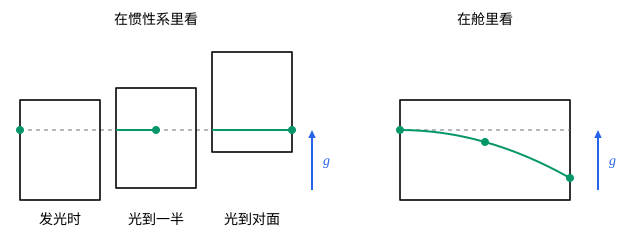
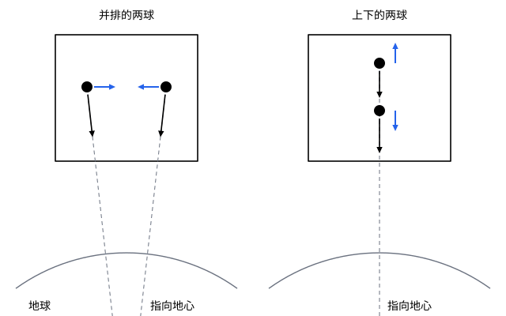

## 这一节要回答的问题

[等效原理](lesson:physics.general-relativity.equivalence-principle)一节只用力学实验说明，:term[均匀引力场]{id="physics.general-relativity.gravitational-field"}（uniform gravitational field）和匀加速的参考系（reference frame）分不出来。换成光和钟呢？真实的引力场不均匀，自由下落的舱还能把引力（gravitation）「消掉」吗？

## 讲解

### 局部惯性系

自由下落的电梯（[平动加速参考系与惯性力](lesson:physics.newtonian-mechanics.accelerating-frames)第 6 题第 3 级提示）、空间站（同一节第 8 题）里，松开的东西停着，推一下就匀速直线运动。牛顿力学说引力被惯性力（inertial force）抵消了；也可以说引力在这里不算力，舱就是惯性系（inertial frame），两种说法预言相同。

::anchor{id="def-local-inertial-frame"}
在:term[引力场]{id="physics.general-relativity.gravitational-field"}里自由下落、不转动的参考系，在足够小的范围、足够短的时间里，只受引力的物体在其中都静止或做匀速直线运动，这样的参考系叫作:term[局部惯性系]{id="physics.general-relativity.local-inertial-frame"}（local inertial frame）。

为什么这样定义：引力不算力，牛顿第一定律（Newton's first law）就在里面成立；「局部」是因为引力场不均匀。边界情况：它不是瞬时静止系（instantaneous rest frame）的别名，后者是某一时刻和质点同速的惯性系；自由下落却在转动的舱也不是。

### 爱因斯坦等效原理

把激光器、原子钟（atomic clock）搬进这样的舱，光还走直线、钟还照狭义相对论走吗？

::anchor{id="def-einstein-equivalence-principle"}
在任意:term[引力场]{id="physics.general-relativity.gravitational-field"}里，在:term[局部惯性系]{id="physics.general-relativity.local-inertial-frame"}中做的一切非引力的实验，结果都和狭义相对论里在惯性系中做的一样，而且和它在哪里、何时、以多大速度下落无关，这叫作:term[爱因斯坦等效原理]{id="physics.general-relativity.einstein-equivalence-principle"}（Einstein equivalence principle）。

为什么这样定义：:term[弱等效原理]{id="physics.general-relativity.weak-equivalence-principle"}（weak equivalence principle）只管物体下落得一样快，这里还管光、钟等一切非引力的实验；:term[等效原理]{id="physics.general-relativity.equivalence-principle"}（equivalence principle）只说均匀引力场，这里说任意引力场，代价是只在局部成立。边界情况：地面上静止的实验室不是局部惯性系，那里光会弯（例 1）。国内有的教材叫它强等效原理（strong equivalence principle），本站不这样叫：这个英文名多指连引力实验也管的更强的原理。

### 地面参考系

::anchor{id="thm-ground-frame"}
定理：静止在:term[均匀引力场]{id="physics.general-relativity.gravitational-field"}$\vb g$里的实验室（如地面上的），每一时刻都相对那一刻和它同速、开始自由下落的:term[局部惯性系]{id="physics.general-relativity.local-inertial-frame"}以$g$竖直向上加速，所以它的固有加速度（proper acceleration）$\alpha=g$。

证明思路：只受引力的物体在那个局部惯性系里没有加速度，按引力场的定义，它们相对实验室却以$g$向下加速。由:term[爱因斯坦等效原理]{id="physics.general-relativity.einstein-equivalence-principle"}，这个局部惯性系就相当于加速飞船的[瞬时静止系](lesson:physics.special-relativity.four-force#def-instantaneous-rest-frame)。

说地面近似是[惯性系](lesson:physics.newtonian-mechanics.newtons-laws#def-inertial-frame)，是把引力算作力，照样对；引力不算力时，地面相对局部惯性系向上加速，和以$\alpha=g$做双曲运动（hyperbolic motion）的火箭分不出来，钟的快慢见[引力红移](lesson:physics.general-relativity.gravitational-redshift)。用火箭算高$h$处钟的快慢，只准到$\frac{gh}{c^2}$的一阶：刚性的火箭长$h$，后端的固有加速度$g$是前端的$1+\frac{gh}{c^2}$倍（[四维力与相对论动力学](lesson:physics.special-relativity.four-force)第 8 题），均匀引力场里却处处是$g$；这点差别要到$\bigl(\frac{gh}{c^2}\bigr)^2$才影响钟的快慢。

### 潮汐力

很大的舱朝地球自由下落：并排两球都朝地心落，越来越近；上下两球，下面的被拉得更狠，越来越远。

::anchor{id="thm-tidal-estimate"}
定理：把质量为$M$、半径为$R$的天体当作球心处的质点，只算它的引力，$g=\frac{GM}{R^2}$；在它表面附近自由下落、不转动的舱里，水平相距$d$的两球相对加速度约为$\frac{gd}R$、互相靠拢，竖直相距$h$的约为$\frac{2gh}R$、互相分开（$d$、$h$远小于$R$）。

证明思路：相对加速度是两球加速度之差，两者都指向球心。并排时由相似三角形，每个球朝对方的分量约为$g\cdot\frac{d/2}R$；上下时$\frac{GM}{R^2}-\frac{GM}{(R+h)^2}=\frac{GMh(2R+h)}{R^2(R+h)^2}\approx\frac{2gh}R$。

::anchor{id="def-tidal-force"}
:term[引力场]{id="physics.general-relativity.gravitational-field"}不均匀时，自由下落的参考系里抵消不掉、使各处物体有相对加速度的那部分引力，叫作:term[潮汐力]{id="physics.general-relativity.tidal-force"}（tidal force）。

为什么这样定义：一个平动的参考系只能给各处的物体同一个加速度，抵消不了加速度的差别。名字来自海水的潮汐（tide）。边界情况：均匀引力场里没有潮汐力；真实的引力场里，范围够小、时间够短，潮汐力的效应才测不出来，所以:term[等效原理]{id="physics.general-relativity.equivalence-principle"}只在局部成立。潮汐力和时空弯曲（spacetime curvature）的关系见[潮汐力与测地偏离](lesson:physics.general-relativity.geodesic-deviation)。

## 几何图像

左图是在发光时和舱同速的惯性系里看到的三个时刻，舱并不左右移动；右图在舱里看。弯曲夸大了很多倍。

长箭头是两球的加速度，都指向地心；彩色短箭头是相对舱的加速度。长短不按比例，倾斜也夸大了。

## 例题

### 例 1　加速舱里横穿的光

远离天体的火箭以固有加速度$g$加速，舱宽$L=10\,\mathrm m$，一束光从一侧舱壁水平射向对面。在舱里看，光到对面时比出发处低多少？地面上同样宽的实验室里呢？$g$取$9.8\,\mathrm{m/s^2}$，$c$取$3.00\times10^8\,\mathrm{m/s}$。

**为什么想到这么做**：在发光时和舱同速的惯性系里，由光速不变原理（constancy of the speed of light），光沿直线以$c$前进，舱加速上升；舱升高多少，舱里看光就低多少。地面上的再用「地面参考系」的定理。

**推导**：光走过舱宽用时$t=\frac Lc$，舱的速度只增加约$3\times10^{-7}\,\mathrm{m/s}$，照牛顿力学算：舱升高$\frac12gt^2=\frac{gL^2}{2c^2}\approx5.4\times10^{-15}\,\mathrm m$，舱里看光就落了这么多。地面上的实验室也相对:term[局部惯性系]{id="physics.general-relativity.local-inertial-frame"}以$g$向上加速，由:term[爱因斯坦等效原理]{id="physics.general-relativity.einstein-equivalence-principle"}，光同样低这么多，所以光在:term[引力场]{id="physics.general-relativity.gravitational-field"}里会弯。:term[弱等效原理]{id="physics.general-relativity.weak-equivalence-principle"}只管物体下落，推不出这一条。

## 常见误区

- 「自由下落时引力消失了。」牛顿力学说引力被惯性力抵消；把舱看作:term[局部惯性系]{id="physics.general-relativity.local-inertial-frame"}时引力不算力，可:term[引力场]{id="physics.general-relativity.gravitational-field"}还在：舱大一些、时间长一些，:term[潮汐力]{id="physics.general-relativity.tidal-force"}就显出来了。
- 「光在引力场里会弯，是因为光有质量。」光是[无质量粒子](lesson:physics.special-relativity.four-momentum#def-massless-particle)（massless particle）；光会弯，是由:term[爱因斯坦等效原理]{id="physics.general-relativity.einstein-equivalence-principle"}推出来的（例 1）。
