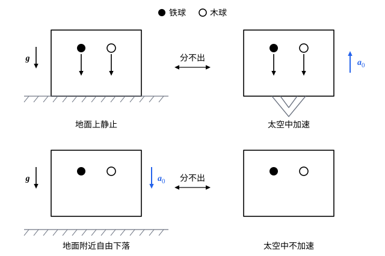

## 这一节要回答的问题

[平动加速参考系与惯性力](lesson:physics.newtonian-mechanics.accelerating-frames)第 7 题里，密封舱里松开的小球以$9.8\,\mathrm{m/s^2}$落向地板，舱可能停在地面上，也可能在远离天体的太空里加速。惯性力（inertial force）为什么冒充得了引力（gravitation）？这是力学里的巧合，还是一条普遍的原理？

## 讲解

### 惯性质量和引力质量

[万有引力定律](lesson:physics.newtonian-mechanics.gravitation)里，由$ma=\frac{GMm}{r^2}$，物体的质量（mass）$m$约掉了，各种物体下落得一样快。可这两个$m$量的东西不同：左边的量惯性（inertia），右边的量被吸引得多强。

::anchor{id="def-inertial-gravitational-mass"}
牛顿第二定律（Newton's second law）$\vb F=m\vb a$里的[质量](lesson:physics.newtonian-mechanics.newtons-laws#def-mass)叫作惯性质量（inertial mass），记作$m_{\text{惯}}$；受另一物体的引力$F=\frac{GMm_{\text{引}}}{r^2}$时，物体自己的那个质量叫作引力质量（gravitational mass），记作$m_{\text{引}}$。

为什么这样定义：只受引力时$m_{\text{惯}}a=\frac{GMm_{\text{引}}}{r^2}$，$a=\frac{m_{\text{引}}}{m_{\text{惯}}}\cdot\frac{GM}{r^2}$，各种物体下落得一样快，要靠这个比值对一切物体都相同。反例：电场（electric field）里的加速度大小是$\frac{|q|}mE$，同一处电子的加速度约是质子的$1836$倍。

::anchor{id="def-weak-equivalence-principle"}
同一处只受引力的物体，不论质量、成分如何，加速度都相同，这叫作:term[弱等效原理]{id="physics.general-relativity.weak-equivalence-principle"}（weak equivalence principle），也叫自由落体的普适性（universality of free fall）。即一切物体的$\frac{m_{\text{引}}}{m_{\text{惯}}}$都相同；取好$G$的值，就能让$m_{\text{引}}=m_{\text{惯}}$。

为什么这样定义：这是实验事实。伽利略（Galileo Galilei）发现轻重不同的物体下落得一样快；牛顿（Isaac Newton）用金、银、木头等做摆球，同样长的单摆周期相同，精度约千分之一。厄缶（Loránd Eötvös）用扭秤（torsion balance）把两种材料加速度的相对差$\frac{|a_1-a_2|}a$限到几乘$10^{-9}$，MICROSCOPE 卫星 2022 年的结果约$10^{-15}$。

牛顿力学把它当作实验事实来用：同一条轨道上大卫星和小卫星跑得一样快（见[万有引力定律](lesson:physics.newtonian-mechanics.gravitation#thm-circular-orbit)），由自由下落得出重力（weight）$m\vb g$（见[常见的力](lesson:physics.newtonian-mechanics.common-forces#def-weight)），那里的$m$都是惯性质量。边界情况：只受引力时才这样，有空气时，大小、形状相同的物体重的落得快（见[与速度有关的阻力](lesson:physics.newtonian-mechanics.drag)）。

### 引力场

由:term[弱等效原理]{id="physics.general-relativity.weak-equivalence-principle"}，只受引力的物体在某处的加速度只由地点决定：地面附近都约$9.8\,\mathrm{m/s^2}$、竖直向下，离地面$400\,\mathrm{km}$处只有地面的$88\%$。

::anchor{id="def-gravitational-field"}
空间每一点上，只受引力的物体相对惯性系（inertial frame）的加速度$\vb g$，叫作那里的:term[引力场]{id="physics.general-relativity.gravitational-field"}（gravitational field）；各处$\vb g$都相同的叫作均匀引力场（uniform gravitational field）。

为什么这样定义：$\vb g$和放的是什么物体无关，描述的是引力本身，单位$\mathrm{m/s^2}$也就是$\mathrm{N/kg}$。边界情况：在一间实验室里，地面附近的引力场近似均匀（不计地球自转）；范围大了，方向（指向地心）和大小都在变。

### 等效原理

以加速度$\vb a_0$平动的参考系（reference frame）里，每个物体都受[惯性力](lesson:physics.newtonian-mechanics.accelerating-frames#def-inertial-force)$-m_{\text{惯}}\vb a_0$；:term[均匀引力场]{id="physics.general-relativity.gravitational-field"}里的引力$m_{\text{引}}\vb g$也和质量成正比。由:term[弱等效原理]{id="physics.general-relativity.weak-equivalence-principle"}，两者都给一切物体同样的加速度，舱里的力学实验分不出它们；弹簧的弹力（elastic force）和质量无关，就冒充不了引力。匀速的船舱里分辨不出船动没动（[参考系与相对运动](lesson:physics.newtonian-mechanics.relative-motion)第 7 题），没有窗的舱里连匀加速和均匀引力场也分辨不出（几何图像）。

::anchor{id="def-equivalence-principle"}
静止在均匀引力场$\vb g$里的实验室（如地面上的），和远离天体、以加速度$\vb a_0=-\vb g$平动的实验室，在里面做同样的实验，结果都一样，分不出是哪一个，这叫作:term[等效原理]{id="physics.general-relativity.equivalence-principle"}（equivalence principle）。

为什么这样定义：1907 年，爱因斯坦（Albert Einstein）把力学里的这件事推广成对一切实验都成立的原理，就能由加速的参考系推出引力场里的新现象。在均匀引力场里让舱自由下落，$\vb a_0=\vb g$，惯性力正好抵消引力，舱里完全[失重](lesson:physics.newtonian-mechanics.accelerating-frames#def-weightlessness)，重力却没有变；这和远离天体、不加速的舱也分不出来。边界情况：真实的引力场不均匀，这样的等效只在小范围里近似成立。本节只举力学的例子，光和钟也一样，场不均匀时怎样，见[爱因斯坦等效原理与局部惯性系](lesson:physics.general-relativity.einstein-equivalence-principle)。

## 几何图像

实心的是铁球，空心的是木球。上面两个舱里两球以同样的加速度落向地板，下面两个舱里两球都飘着；只做力学实验，分不出同一行的两个舱。

## 例题

### 例 1　落体能把两种质量检验到多精确

两种材料的小球在竖直的真空管里，从$h=50\,\mathrm m$高处同时由静止落下，管里的:term[引力场]{id="physics.general-relativity.gravitational-field"}看作均匀的，球 1 的加速度$a_1$比球 2 的$a_2$大。球 1 着地时，球 2 离管底多高？要是它离管底有$1\,\mathrm{mm}$就看得出来，实验里却没看出来，$\frac{a_1-a_2}{a_1}$最多多大？

**为什么想到这么做**：均匀场里两球都从静止开始、以不变的加速度下落，比较同一时刻各落了多少。

**推导**：球 1 着地用时$t_1=\sqrt{\frac{2h}{a_1}}$，这时球 2 落了$\frac12a_2t_1^2=h\frac{a_2}{a_1}$，离管底$h\frac{a_1-a_2}{a_1}$，这个结果是精确的。没看出差别，说明$\frac{a_1-a_2}{a_1}<\frac{1\,\mathrm{mm}}{50\,\mathrm m}=2\times10^{-5}$，比牛顿的摆（约$10^{-3}$）好，比厄缶的扭秤（几乘$10^{-9}$）差得远，比 MICROSCOPE 卫星（约$10^{-15}$）差十个数量级。

## 常见误区

- 「惯性质量和引力质量相等是定义规定的，用不着实验。」两者由不同的实验定出，一个比加速度，一个比同一处受的引力；比值对一切物体都相同是实验事实，定义只把这个共同的比值吸收进了$G$。
- 「有了:term[等效原理]{id="physics.general-relativity.equivalence-principle"}，任何:term[引力场]{id="physics.general-relativity.gravitational-field"}都能在加速的参考系里消掉。」地球的引力场处处指向地心，一个平动参考系只有一个加速度，消不掉一大片地方的引力。
