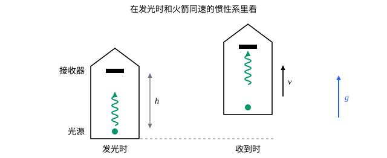

## 这一节要回答的问题

由:term[爱因斯坦等效原理]{id="physics.general-relativity.einstein-equivalence-principle"}（Einstein equivalence principle），自由下落、不转动的小舱里光和钟都照狭义相对论。地面上从楼下射到楼上的光，频率变不变？楼上楼下的钟走得一样快吗？

## 讲解

### 加速火箭里的频移

远离天体的火箭以固有加速度（proper acceleration）$\alpha=g$加速，底部发出频率为$f_0$（用底部的钟量）的光，射向高$h$处的顶部。在发光时和火箭同速的惯性系（inertial frame）里看，光约经$\frac hc$到顶部，那时顶部以约$v=\frac{gh}c$背着发光处退开。

::anchor{id="thm-rocket-shift"}
定理：远离天体、固有加速度$\alpha=g$的火箭里，从低处静止的光源发出、发出处的钟量出频率为$f_0$的光，到高$h$处静止的接收器时，那里的钟量出$f\approx f_0\bigl(1-\frac{gh}{c^2}\bigr)$，从高处往下发时$f\approx f_0\bigl(1+\frac{gh}{c^2}\bigr)$（$gh\ll c^2$，只保留一阶）。

证明思路：按时钟假设（clock hypothesis），加速的钟和此刻同速的惯性系里的钟走得一样快，多普勒公式照样只看相对速度。由纵向多普勒效应（longitudinal Doppler effect，见[相对论多普勒效应](lesson:physics.special-relativity.relativistic-doppler#def-doppler-types)），$\omega=\omega_0\sqrt{\frac{1-\beta}{1+\beta}}\approx\omega_0(1-\beta)$，$\beta=\frac vc=\frac{gh}{c^2}$，频率和角频率差$2\pi$，比值相同；往下发时底部迎着光赶来，$f\approx f_0(1+\beta)$。光飞行时火箭的位移、$\beta^2$项、两端固有加速度的差，都是更高阶的小量。

### 引力红移

由:term[爱因斯坦等效原理]{id="physics.general-relativity.einstein-equivalence-principle"}，地面上静止的实验室相对:term[局部惯性系]{id="physics.general-relativity.local-inertial-frame"}（local inertial frame）以$g$向上加速（见[地面参考系](lesson:physics.general-relativity.einstein-equivalence-principle#thm-ground-frame)的定理），和火箭一样。

::anchor{id="def-gravitational-redshift"}
在:term[引力场]{id="physics.general-relativity.gravitational-field"}（gravitational field）里，光从低处静止的光源传到高处静止的接收器，接收处的钟量出的频率比发出处的钟量出的低，这叫作:term[引力红移]{id="physics.general-relativity.gravitational-redshift"}（gravitational redshift）；从高处传到低处时频率变高，叫作引力蓝移（gravitational blueshift）。均匀引力场里升高$h$，$\frac{\Delta f}{f_0}\approx-\frac{gh}{c^2}$，$\Delta f=f-f_0$。

为什么这样定义：名字借自[多普勒效应](lesson:physics.oscillations-waves.doppler-effect#def-doppler)（Doppler effect）的红移（redshift）、蓝移（blueshift），可这里光源和接收器都静止，不是谁在动。相对频移（relative frequency shift）每升高$1\,\mathrm m$约$1.1\times10^{-16}$。边界情况：光源和接收器一样高时，没有引力红移。

### 引力时间延缓

:term[引力场]{id="physics.general-relativity.gravitational-field"}不随时间变（静态，static）时，路上的波峰不会越积越多：低处发出$N$个，高处就收到$N$个。低处的钟记下发出用了$\Delta\tau_{\text{下}}=\frac N{f_0}$，高处的钟记下收到用了$\Delta\tau_{\text{上}}=\frac Nf$，$\frac{\Delta\tau_{\text{上}}}{\Delta\tau_{\text{下}}}=\frac{f_0}f\approx1+\frac{gh}{c^2}$，高处的钟走得多。[多普勒效应](lesson:physics.oscillations-waves.doppler-effect)里波源和观察者都相对介质静止时也是这样，只是那里各处的「每秒」相同，这里由各处自己的钟来计。

::anchor{id="def-gravitational-time-dilation"}
静态的引力场里，静止在低处的钟比静止在高处的钟走得慢，这叫作:term[引力时间延缓]{id="physics.general-relativity.gravitational-time-dilation"}（gravitational time dilation）；均匀引力场里，高处和低处的钟快慢之比约为$1+\frac{gh}{c^2}$。

为什么这样定义：它和:term[引力红移]{id="physics.general-relativity.gravitational-redshift"}是同一件事。由:term[爱因斯坦等效原理]{id="physics.general-relativity.einstein-equivalence-principle"}，原子钟（atomic clock）、心跳……一切钟都一样慢，慢的是时间本身。边界情况：这和时钟假设相容，上下两只钟都静止、固有加速度都是$g$，快慢不同来自高度差，不是加速度让钟变慢；[同时的相对性](lesson:physics.special-relativity.relativity-of-simultaneity)里「钟的构造相同，走得一样快」，说的是同一个惯性系里静止的钟；静止在引力场里不同高度的钟就走得不一样快。

### 引力势

:term[引力场]{id="physics.general-relativity.gravitational-field"}随高度变时，把天体当作中心处质量为$M$的质点，$g=\frac{GM}{r^2}$。光沿半径从$r_{\text{发}}$传到$r_{\text{收}}$，分成许多小段，第$i$段长$\Delta r_i$、近似均匀，取段里一点$\xi_i$处的$g(\xi_i)$，频率乘以$1-\frac{g(\xi_i)\Delta r_i}{c^2}$；只保留一阶，$\frac f{f_0}\approx1-\frac1{c^2}\sum g(\xi_i)\Delta r_i$，这是黎曼和（Riemann sum）。分得越来越细时，

$$
\frac f{f_0}\approx1-\frac1{c^2}\int_{r_{\text{发}}}^{r_{\text{收}}}\frac{GM}{r^2}\,\dd r=1-\frac{GM}{c^2}\Bigl(\frac1{r_{\text{发}}}-\frac1{r_{\text{收}}}\Bigr) .
$$

::anchor{id="def-gravitational-potential"}
单位质量的引力势能（gravitational potential energy，见[引力势能与逃逸速度](lesson:physics.newtonian-mechanics.gravitational-potential#def-gravitational-potential)）叫作:term[引力势]{id="physics.general-relativity.gravitational-potential"}（gravitational potential），记作$\Phi$，引力势能$U=m\Phi$。把天体当作中心处的质点，取无穷远处为零，$\Phi=-\frac{GM}r$；均匀引力场里升高$h$，$\Phi$增加$gh$。

为什么这样定义：上式括号乘以$GM$正是$\Phi(r_{\text{收}})-\Phi(r_{\text{发}})$，频移只看引力势之差；$\Phi$的梯度（gradient）是$-\vb g$。边界情况：$\Phi$的零点可以随便取；取无穷远处为零时，$\Phi$处处为负，越往下越负，钟越慢。

::anchor{id="thm-redshift-potential"}
定理：静态的弱引力场（weak gravitational field，$|\Phi|\ll c^2$）里，光从引力势为$\Phi_{\text{发}}$处静止的光源传到$\Phi_{\text{收}}$处静止的接收器，$\frac f{f_0}\approx1-\frac{\Phi_{\text{收}}-\Phi_{\text{发}}}{c^2}$；静止在$\Phi$处的钟和离天体很远处（$\Phi=0$）静止的钟相比，快慢之比$\dv{\tau}{t}\approx1+\frac{\Phi}{c^2}$，$t$是远处那只钟的读数。

证明思路：前一半沿半径就是上面的黎曼和，别的路、别的场分成小段，每段乘以$1-\frac{\Delta\Phi_i}{c^2}$，也只看两头的$\Phi$。把接收处放到很远处，照上面数波峰的办法，得后一半。

## 几何图像

两个时刻的火箭左右错开画，其实没有左右移动。这个惯性系里光的波长不变，接收器却背着光退开，量出的频率就低了；升高和速度都夸大了。

:::anim{component="function-plot"}
range: { x: [1, 4], y: [0, 1.2] }
functions:
  - expr: "1 - 1/x"
    label: |
      引力势之差$\Phi(r)-\Phi(R)$
  - expr: "x - 1"
    label: |
      按$gh$算（$h=r-R$）
:::

横轴是到地心的距离$r$和地球半径$R$之比，图上写作 x；纵轴以$\frac{GM}R$为单位。蓝线按:term[引力势]{id="physics.general-relativity.gravitational-potential"}算，橙线把$g$当作不变、按$gh$算，两条线在$x=1$相切：高度比$R$小得多时用$gh$就够了，再高就偏大。

## 例题

### 例 1　庞德-雷布卡实验

1960 年发表的庞德-雷布卡实验（Pound–Rebka experiment）里，伽马射线（gamma ray）在塔里竖直向下走过$22.5\,\mathrm m$。塔底的钟量出的频率比塔顶的高多少（相对量）？要用多普勒效应抵消它，塔顶的源应以多大速度朝哪边动？$g$取$9.8\,\mathrm{m/s^2}$，$c$取$3.00\times10^8\,\mathrm{m/s}$。

**为什么想到这么做**：塔高比地球半径小得多，按:term[均匀引力场]{id="physics.general-relativity.gravitational-field"}算；往下走是引力蓝移，让源向上运动，用多普勒红移抵消。

**推导**：$\frac{\Delta f}{f_0}\approx\frac{gh}{c^2}=\frac{9.8\times22.5}{(3.00\times10^8)^2}\approx2.45\times10^{-15}$。源以$v$向上运动，塔底收到的频率再乘以约$1-\frac vc$，令$\frac vc=\frac{gh}{c^2}$，得$v=\frac{gh}c\approx7.4\times10^{-7}\,\mathrm{m/s}$。这么小的频移，当时靠穆斯堡尔效应（Mössbauer effect）才分辨得出；结果和预言符合到约$10\%$，后来改进到约$1\%$。

## 常见误区

- 「摆钟搬到高山上走得慢，可见高处的钟走得慢。」摆钟变慢是$g$变小、受力变了（[单摆与复摆](lesson:physics.oscillations-waves.pendulums)第 2 题），高处的原子钟其实走得快。
- 「天体光谱的红移都是:term[引力红移]{id="physics.general-relativity.gravitational-redshift"}。」远离的天体有多普勒红移（[相对论多普勒效应](lesson:physics.special-relativity.relativistic-doppler)第 3 题），远方星系的红移主要是[宇宙学红移](lesson:physics.general-relativity.cosmological-redshift)（cosmological redshift），[诺特定理](lesson:physics.analytical-mechanics.noether-theorem)第 8 题说的就是它。
