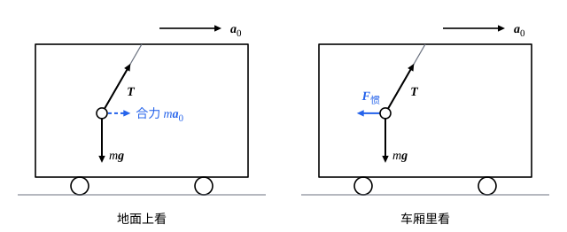

## 这一节要回答的问题

公交车急刹车时，乘客向前倾，好像被什么推了一把；在水平加速的车厢里，吊在车顶的小球向后偏，相对车厢静止。在车厢里看，小球受的:term[力]{id="physics.newtonian-mechanics.force"}（force）明明不平衡，它却不动。在车厢里还能不能用牛顿定律？

## 讲解

### 平动加速的参考系

::anchor{id="def-noninertial-frame"}
相对:term[惯性系]{id="physics.newtonian-mechanics.inertial-frame"}（inertial frame）做加速运动的:term[参考系]{id="physics.newtonian-mechanics.reference-frame"}（reference frame），叫作:term[非惯性系]{id="physics.newtonian-mechanics.noninertial-frame"}（non-inertial frame）。

为什么这样定义：在非惯性系里，不受:term[力]{id="physics.newtonian-mechanics.force"}的质点也会有:term[加速度]{id="physics.newtonian-mechanics.acceleration"}（acceleration），:term[牛顿第一定律]{id="physics.newtonian-mechanics.newtons-first-law"}（Newton's first law）不成立，要单独对待。刹车的公交车里，没有谁推乘客，乘客相对车厢却向前加速。边界情况：相对惯性系做匀速直线运动的参考系仍是惯性系（见[参考系与相对运动](lesson:physics.newtonian-mechanics.relative-motion)）；这一节只讲坐标轴始终和惯性系的平行、整体做平动的非惯性系，转动的参考系见[转动参考系：离心力与科里奥利力](lesson:physics.newtonian-mechanics.rotating-frames)。

::anchor{id="thm-translating-frame"}
定理：参考系$S'$相对惯性系$S$平动，$S'$的原点相对$S$的加速度是$\vb a_0$（可以随时间变化），则同一个质点在两个参考系里的加速度满足$\vb a=\vb a_0+\vb a'$。

证明思路：两个参考系的坐标轴平行，$S'$的原点在$S$里的位置是$\vb r_0(t)$，质点的位置满足$\vb r=\vb r_0+\vb r'$，对$t$求两次导数即得。[参考系与相对运动](lesson:physics.newtonian-mechanics.relative-motion#thm-galilean)里$S'$匀速运动，$\vb a_0=\vb 0$，是这里的特例。

### 惯性力

::anchor{id="def-inertial-force"}
在:term[非惯性系]{id="physics.newtonian-mechanics.noninertial-frame"}里，为了照用:term[牛顿第二定律]{id="physics.newtonian-mechanics.newtons-second-law"}（Newton's second law）而给质点加上的:term[力]{id="physics.newtonian-mechanics.force"}，叫作:term[惯性力]{id="physics.newtonian-mechanics.inertial-force"}（inertial force）。在平动的$S'$里，它是$\vb F_{\text{惯}}=-m\vb a_0$，$m$是质点的:term[质量]{id="physics.newtonian-mechanics.mass"}（mass）；这样$m\vb a'=\vb F+\vb F_{\text{惯}}$，$\vb F$是质点受的真实的力的:term[合力]{id="physics.newtonian-mechanics.net-force"}（net force）。

为什么这样定义：由上面的定理，$m\vb a'=m\vb a-m\vb a_0=\vb F-m\vb a_0$。把$-m\vb a_0$看成一个力，就能在车厢里照常画:term[受力图]{id="physics.newtonian-mechanics.free-body-diagram"}（free-body diagram）、列方程，不必换到地面上去。平动的$S'$里，惯性力和质量成正比，对所有物体方向相同，像一个额外的、均匀的:term[重力]{id="physics.newtonian-mechanics.weight"}（weight）。边界情况：惯性力不是别的物体施加的，没有反作用力，:term[牛顿第三定律]{id="physics.newtonian-mechanics.newtons-third-law"}（Newton's third law）对它不适用；在:term[惯性系]{id="physics.newtonian-mechanics.inertial-frame"}里分析时，不能再加惯性力。

两个旁白。:term[质心系]{id="physics.newtonian-mechanics.center-of-mass-frame"}（center-of-mass frame）的原点有:term[加速度]{id="physics.newtonian-mechanics.acceleration"}时，它就是这样一个平动的非惯性系（见[质心系](lesson:physics.newtonian-mechanics.center-of-mass-frame)）。分析力学的[虚功原理与达朗贝尔原理](lesson:physics.analytical-mechanics.virtual-work#def-inertial-force)把每个质点的$-m_i\vb a_i$叫作达朗贝尔惯性力，也简称惯性力：它是跟着这个质点一起平动的:term[参考系]{id="physics.newtonian-mechanics.reference-frame"}里的惯性力，在那个参考系里质点静止，真实的力和它平衡。

### 超重和失重

地面附近，在$S'$里质点受:term[重力]{id="physics.newtonian-mechanics.weight"}$m\vb g$和:term[惯性力]{id="physics.newtonian-mechanics.inertial-force"}$-m\vb a_0$，两者合起来是$m(\vb g-\vb a_0)$，就像在一个:term[重力加速度]{id="physics.newtonian-mechanics.gravitational-acceleration"}（gravitational acceleration）为$\vb g-\vb a_0$的地方。

::anchor{id="def-weightlessness"}
物体对支持物的:term[压力]{id="physics.newtonian-mechanics.force"}或对悬挂物的:term[拉力]{id="physics.newtonian-mechanics.tension"}（tension）大于它受的重力，叫作超重（overweight）；小于重力，叫作失重（weightlessness）；等于零，叫作完全失重。

为什么这样定义：体重秤量的是人对秤的压力。电梯加速上升时，$\vb g-\vb a_0$的大小是$g+a_0$，读数变大，人觉得变重了；加速下降时读数变小；自由下落时$\vb a_0=\vb g$，人对秤没有压力。边界情况：超重、失重时重力并没有变，变的只是压力或拉力；绕地球运行的空间站只受地球的吸引，它的:term[加速度]{id="physics.newtonian-mechanics.acceleration"}就是那里的重力加速度，站里的人完全失重，所以飘着（见[万有引力定律](lesson:physics.newtonian-mechanics.gravitation)）。

## 几何图像

同一个情景有两种看法：地面上看，小球和车厢一起以$\vb a_0$向右加速，:term[拉力]{id="physics.newtonian-mechanics.tension"}$\vb T$和:term[重力]{id="physics.newtonian-mechanics.weight"}$m\vb g$的:term[合力]{id="physics.newtonian-mechanics.net-force"}水平向右，大小是$ma_0$。车厢里看，小球静止，要再加上向左的:term[惯性力]{id="physics.newtonian-mechanics.inertial-force"}$\vb F_{\text{惯}}=-m\vb a_0$，三个:term[力]{id="physics.newtonian-mechanics.force"}平衡。绳子沿着$\vb g-\vb a_0$的方向，就像在一个斜着的重力里。图里车厢的:term[加速度]{id="physics.newtonian-mechanics.acceleration"}取得比较大，$a_0=g\tan30^\circ$。

## 例题

### 例 1　车厢里的单摆

车厢在水平路面上以$2.0\,\mathrm{m/s^2}$的:term[加速度]{id="physics.newtonian-mechanics.acceleration"}加速，车顶用细绳吊着一个:term[质量]{id="physics.newtonian-mechanics.mass"}$0.50\,\mathrm{kg}$的小球，小球相对车厢静止。绳子和竖直方向成多大的角？绳子的:term[拉力]{id="physics.newtonian-mechanics.tension"}多大？$g$取$9.8\,\mathrm{m/s^2}$。

**为什么想到这么做**：在车厢里小球静止，它受:term[重力]{id="physics.newtonian-mechanics.weight"}、拉力，再加上:term[惯性力]{id="physics.newtonian-mechanics.inertial-force"}，三个:term[力]{id="physics.newtonian-mechanics.force"}平衡。

**推导**：惯性力水平向后，大小$ma_0$。水平方向$T\sin\theta=ma_0$，竖直方向$T\cos\theta=mg$，所以$\tan\theta=\frac{a_0}g=\frac{2.0}{9.8}$，$\theta\approx11.5^\circ$，绳子向后偏；$T=m\sqrt{g^2+a_0^2}=0.50\times\sqrt{9.8^2+2.0^2}\approx5.00\,\mathrm N$。在地面上看，$T\sin\theta=ma_0$是小球加速需要的:term[合力]{id="physics.newtonian-mechanics.net-force"}，方程完全一样，只是解释不同。

### 例 2　电梯里的体重秤

:term[质量]{id="physics.newtonian-mechanics.mass"}$60\,\mathrm{kg}$的人站在电梯里的体重秤上，秤按$g=9.8\,\mathrm{m/s^2}$把:term[压力]{id="physics.newtonian-mechanics.force"}换算成「千克」显示。电梯以$1.5\,\mathrm{m/s^2}$的:term[加速度]{id="physics.newtonian-mechanics.acceleration"}加速上升时，秤显示多少？以同样大小的加速度加速下降时呢？

**为什么想到这么做**：在电梯里人静止，受:term[重力]{id="physics.newtonian-mechanics.weight"}、秤的:term[支持力]{id="physics.newtonian-mechanics.normal-force"}（normal force）和:term[惯性力]{id="physics.newtonian-mechanics.inertial-force"}；秤显示的是人对秤的压力，由:term[牛顿第三定律]{id="physics.newtonian-mechanics.newtons-third-law"}，它等于支持力。

**推导**：加速上升时，惯性力向下，大小$ma_0$，$N=m(g+a_0)=60\times11.3=678\,\mathrm N$，秤显示$\frac{678}{9.8}\approx69.2\,\mathrm{kg}$，超重。加速下降时惯性力向上，$N=m(g-a_0)=60\times8.3=498\,\mathrm N$，显示约$50.8\,\mathrm{kg}$，失重。人的质量和重力都没有变。

## 常见误区

- 「:term[惯性力]{id="physics.newtonian-mechanics.inertial-force"}是物体的:term[惯性]{id="physics.newtonian-mechanics.inertia"}（inertia）产生的一种真实的:term[力]{id="physics.newtonian-mechanics.force"}。」它不是哪个物体施加的，没有反作用力，只是为了在:term[非惯性系]{id="physics.newtonian-mechanics.noninertial-frame"}里照用:term[牛顿第二定律]{id="physics.newtonian-mechanics.newtons-second-law"}而加上的；在:term[惯性系]{id="physics.newtonian-mechanics.inertial-frame"}里它不存在。
- 「失重时物体受的:term[重力]{id="physics.newtonian-mechanics.weight"}变小了。」重力没有变，变的是物体对支持物的压力。
- 「电梯向上运动时，人总是超重。」超重、失重看:term[加速度]{id="physics.newtonian-mechanics.acceleration"}的方向，不看:term[速度]{id="physics.newtonian-mechanics.velocity"}（velocity）的方向：电梯向上运动、正在减速时，加速度向下，人是失重的。
