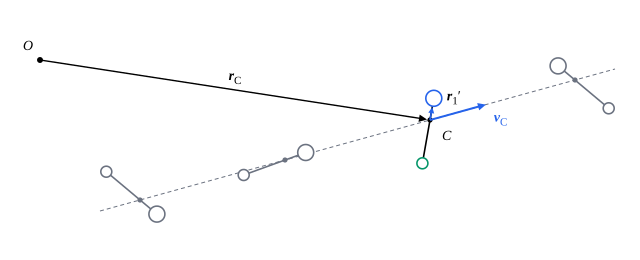

## 这一节要回答的问题

在太空里，两个宇航员抓着一根绳子的两端，绕绳子的中点转。两人沿绳子把彼此拉近，会转得更快还是更慢？溜冰的人收拢手臂转得更快，这时整个人的:term[角动量]{id="physics.newtonian-mechanics.angular-momentum"}（angular momentum）该怎样算？

## 讲解

### 质点系的角动量定理

::anchor{id="def-system-angular-momentum"}
:term[质点系]{id="physics.newtonian-mechanics.system-of-particles"}（system of particles）里各个质点对同一点$O$的:term[角动量]{id="physics.newtonian-mechanics.angular-momentum"}之和$\vb L=\sum_i\vb r_i\times m_i\vb v_i$，叫作质点系对$O$的角动量。

为什么这样定义：和总:term[动量]{id="physics.newtonian-mechanics.momentum"}（momentum）一样，质点之间相互作用的效果，在求和时两两抵消（见下面的定理），质点系整体的转动就由这个和来刻画。边界情况：同一个质点系对不同的点，角动量一般不同；总动量为零时，对哪一点都一样（第 5 题）。

::anchor{id="thm-system-angular-momentum"}
定理：在:term[惯性系]{id="physics.newtonian-mechanics.inertial-frame"}（inertial frame）里，对固定点$O$，质点系角动量的变化率等于所有:term[外力]{id="physics.newtonian-mechanics.external-force"}（external force）对$O$的:term[力矩]{id="physics.newtonian-mechanics.torque"}（torque）之和：$\dv{\vb L}t=\boldsymbol\tau_{\text{外}}$。

证明思路：对每个质点用[力矩与角动量](lesson:physics.newtonian-mechanics.angular-momentum#thm-angular-momentum)里的定理再相加，$\dv{\vb L}t=\sum_i\vb r_i\times\vb F_i+\sum_{i\ne j}\vb r_i\times\vb f_{ij}$，$\vb F_i$是第$i$个质点受的外力，$\vb f_{ij}$是第$j$个质点对它的:term[内力]{id="physics.newtonian-mechanics.internal-force"}（internal force）。由:term[牛顿第三定律]{id="physics.newtonian-mechanics.newtons-third-law"}（Newton's third law），$\vb f_{ji}=-\vb f_{ij}$，而且两者在同一条直线上，就是两个质点的连线，所以一对内力的力矩之和$\vb r_i\times\vb f_{ij}+\vb r_j\times\vb f_{ji}=(\vb r_i-\vb r_j)\times\vb f_{ij}=\vb 0$。

::anchor{id="thm-system-conservation"}
推论：外力对$O$的力矩之和一直为零时，质点系对$O$的角动量不变，这就是质点系的:term[角动量守恒]{id="physics.newtonian-mechanics.conservation-of-angular-momentum"}（conservation of angular momentum）。

内力可以在各部分之间转移角动量，却改变不了总数。溜冰的人收拢手臂，手臂和身体之间的:term[力]{id="physics.newtonian-mechanics.force"}（force）是内力，总角动量不变；手臂离转轴近了，就得转得更快。

### 角动量的分解

::anchor{id="thm-decomposition"}
定理：设:term[质点系]{id="physics.newtonian-mechanics.system-of-particles"}的总:term[质量]{id="physics.newtonian-mechanics.mass"}（mass）是$M$，:term[质心]{id="physics.newtonian-mechanics.center-of-mass"}（center of mass）的位置和:term[速度]{id="physics.newtonian-mechanics.velocity"}（velocity）是$\vb r_{\mathrm C}$、$\vb v_{\mathrm C}$，第$i$个质点相对质心的位置和速度是$\vb r_i'=\vb r_i-\vb r_{\mathrm C}$、$\vb v_i'=\vb v_i-\vb v_{\mathrm C}$。则质点系对$O$的:term[角动量]{id="physics.newtonian-mechanics.angular-momentum"}$\vb L=\vb r_{\mathrm C}\times M\vb v_{\mathrm C}+\vb L'$，其中$\vb L'=\sum_i\vb r_i'\times m_i\vb v_i'$叫作对质心的角动量。

证明思路：把$\vb r_i=\vb r_{\mathrm C}+\vb r_i'$、$\vb v_i=\vb v_{\mathrm C}+\vb v_i'$代入$\sum_i\vb r_i\times m_i\vb v_i$展开，得四项：$M\vb r_{\mathrm C}\times\vb v_{\mathrm C}$、$\vb r_{\mathrm C}\times\sum_im_i\vb v_i'$、$\Bigl(\sum_im_i\vb r_i'\Bigr)\times\vb v_{\mathrm C}$和$\vb L'$。由质心的定义，$\sum_im_i\vb r_i'=\vb 0$，对时间求导，$\sum_im_i\vb v_i'=\vb 0$，中间两项都是零。

第一项好像把全部质量集中在质心，第二项只和各质点绕质心的运动有关。地球绕太阳公转的角动量是第一项，自转的角动量是第二项。

### 对质心的角动量定理

::anchor{id="thm-cm-torque"}
定理：不论:term[质心]{id="physics.newtonian-mechanics.center-of-mass"}是否加速，对质心的:term[角动量]{id="physics.newtonian-mechanics.angular-momentum"}的变化率都等于:term[外力]{id="physics.newtonian-mechanics.external-force"}对质心的:term[力矩]{id="physics.newtonian-mechanics.torque"}之和：$\dv{\vb L'}t=\sum_i\vb r_i'\times\vb F_i$。

证明思路：由上面两个定理，$\dv{\vb L}t=\sum_i(\vb r_{\mathrm C}+\vb r_i')\times\vb F_i=\vb r_{\mathrm C}\times\vb F_{\text{外}}+\sum_i\vb r_i'\times\vb F_i$。另一方面，$\dv{}t(\vb r_{\mathrm C}\times M\vb v_{\mathrm C})=\vb v_{\mathrm C}\times M\vb v_{\mathrm C}+\vb r_{\mathrm C}\times M\vb a_{\mathrm C}$，第一项是零，由[质心与动量守恒](lesson:physics.newtonian-mechanics.momentum-conservation#thm-cm-motion)里的:term[质心运动定理]{id="physics.newtonian-mechanics.center-of-mass-theorem"}（center-of-mass theorem），第二项是$\vb r_{\mathrm C}\times\vb F_{\text{外}}$。两式相减即得。

所以质心的运动和绕质心的转动可以分开处理：质心像一个受全部外力的质点那样运动，绕质心的转动只由外力对质心的力矩决定，就像质心不动一样。别的加速运动的点没有这样的性质。:term[动能]{id="physics.newtonian-mechanics.kinetic-energy"}（kinetic energy）也能这样分成两部分，见[质心系](lesson:physics.newtonian-mechanics.center-of-mass-frame)里的:term[柯尼希定理]{id="physics.newtonian-mechanics.koenigs-theorem"}（König's theorem）。

## 几何图像

哑铃不受:term[外力]{id="physics.newtonian-mechanics.external-force"}，:term[质心]{id="physics.newtonian-mechanics.center-of-mass"}$C$沿直线匀速前进，哑铃绕$C$匀速转动。对固定点$O$，总:term[角动量]{id="physics.newtonian-mechanics.angular-momentum"}是两部分之和：$\vb r_{\mathrm C}\times M\vb v_{\mathrm C}$好像全部:term[质量]{id="physics.newtonian-mechanics.mass"}集中在$C$，$\vb L'$只看两个球绕$C$的转动。两部分各自不变：$\vb r_{\mathrm C}$沿$\vb v_{\mathrm C}$的方向变化，不改变叉积（cross product）；没有外力矩，$\vb L'$也不变。

## 例题

### 例 1　拉近的宇航员

太空中，两个:term[质量]{id="physics.newtonian-mechanics.mass"}都是$70\,\mathrm{kg}$的宇航员各抓着一根长$10\,\mathrm m$、质量不计的绳子的一端，绕绳子的中点转动，:term[速率]{id="physics.newtonian-mechanics.speed"}（speed）都是$2.0\,\mathrm{m/s}$。两人沿绳子把彼此拉到相距$5.0\,\mathrm m$，这时各自的速率是多少？两人一共做了多少:term[功]{id="physics.newtonian-mechanics.work"}（work）？

**为什么想到这么做**：两人之间的作用沿着绳子，是:term[内力]{id="physics.newtonian-mechanics.internal-force"}，又没有:term[外力]{id="physics.newtonian-mechanics.external-force"}，:term[质心]{id="physics.newtonian-mechanics.center-of-mass"}就是绳子的中点，一直不动，两人对中点的总:term[角动量]{id="physics.newtonian-mechanics.angular-momentum"}守恒；两人的:term[速度]{id="physics.newtonian-mechanics.velocity"}都垂直于绳子。

**推导**：开始时总角动量$2\times70\times5.0\times2.0=1.4\times10^3\,\mathrm{kg\cdot m^2/s}$；拉近后$2\times70\times2.5\times v'$，所以$v'=4.0\,\mathrm{m/s}$，转得更快。总:term[动能]{id="physics.newtonian-mechanics.kinetic-energy"}从$2\times\frac12\times70\times2.0^2=280\,\mathrm J$变成$1120\,\mathrm J$，增加的$840\,\mathrm J$是两人拉绳时肌肉做的功。内力改变不了总角动量，却可以做功。

### 例 2　撞上哑铃的油泥

太空中静止着一个哑铃：两个$1.0\,\mathrm{kg}$的小球装在一根长$1.0\,\mathrm m$的轻杆两端。一团$0.50\,\mathrm{kg}$的油泥以$6.0\,\mathrm{m/s}$的:term[速度]{id="physics.newtonian-mechanics.velocity"}垂直于杆飞来，撞上一端的小球并粘在上面。之后整体的:term[质心]{id="physics.newtonian-mechanics.center-of-mass"}怎样运动，绕质心转动的:term[角速度]{id="physics.newtonian-mechanics.angular-velocity"}（angular velocity）是多少？

**为什么想到这么做**：撞击时只有:term[内力]{id="physics.newtonian-mechanics.internal-force"}，总:term[动量]{id="physics.newtonian-mechanics.momentum"}守恒，由它定出质心的速度；总:term[角动量]{id="physics.newtonian-mechanics.angular-momentum"}也守恒，对撞击时质心所在的那一点算最方便，这时$\vb r_{\mathrm C}=\vb 0$，总角动量就是对质心的角动量。

**推导**：质心的速度$v_{\mathrm C}=\frac{0.50\times6.0}{2.5}=1.2\,\mathrm{m/s}$，沿油泥原来的方向。粘上以后，一端是$1.5\,\mathrm{kg}$，另一端是$1.0\,\mathrm{kg}$，质心离油泥那端$0.40\,\mathrm m$、离另一端$0.60\,\mathrm m$；撞前对这一点的角动量只有油泥的$0.50\times6.0\times0.40=1.2\,\mathrm{kg\cdot m^2/s}$。撞后两端绕质心以角速度$\omega$转，角动量$(1.5\times0.40^2+1.0\times0.60^2)\omega=0.60\omega$，所以$\omega=2.0\,\mathrm{rad/s}$。之后质心以$1.2\,\mathrm{m/s}$匀速前进，哑铃绕质心匀速转动。

## 常见误区

- 「:term[内力]{id="physics.newtonian-mechanics.internal-force"}能改变:term[质点系]{id="physics.newtonian-mechanics.system-of-particles"}的总:term[角动量]{id="physics.newtonian-mechanics.angular-momentum"}。」一对内力等大反向、在同一条直线上，:term[力矩]{id="physics.newtonian-mechanics.torque"}之和为零；内力只能在各部分之间转移角动量。
- 「质点系的:term[角动量守恒]{id="physics.newtonian-mechanics.conservation-of-angular-momentum"}，转动的:term[角速度]{id="physics.newtonian-mechanics.angular-velocity"}也就不变。」:term[质量]{id="physics.newtonian-mechanics.mass"}的分布会变：例 1 里两人拉近，总角动量不变，转得却快了一倍。
- 「对加速运动的点，不能用角动量定理。」对:term[质心]{id="physics.newtonian-mechanics.center-of-mass"}可以：不论质心是否加速，对质心的角动量的变化率都等于:term[外力]{id="physics.newtonian-mechanics.external-force"}对质心的力矩之和。
