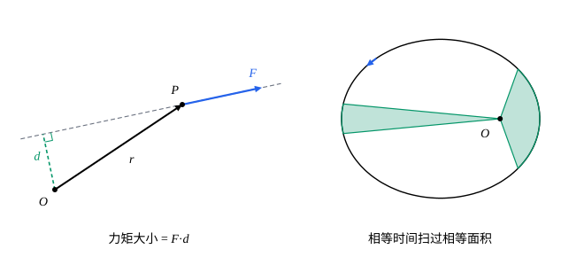

## 这一节要回答的问题

用扳手拧螺母，握得离螺母越远越省劲；可要是顺着扳手的方向推，用多大的:term[力]{id="physics.newtonian-mechanics.force"}（force）也拧不动。转动的效果由什么决定？溜冰的人收拢手臂，为什么会越转越快？

## 讲解

### 力矩

::anchor{id="def-torque"}
:term[力]{id="physics.newtonian-mechanics.force"}$\vb F$作用在质点上，质点相对参考点$O$的位置是$\vb r$，叉积（cross product）$\boldsymbol\tau=\vb r\times\vb F$叫作这个力对$O$点的:term[力矩]{id="physics.newtonian-mechanics.torque"}（torque）。它的大小是$\tau=rF\sin\varphi=Fd$，$\varphi$是$\vb r$和$\vb F$的夹角，$d=r\sin\varphi$是$O$到力的作用线的距离，叫作:term[力臂]{id="physics.newtonian-mechanics.moment-arm"}（moment arm）。

为什么这样定义：扳手的经验正是这样，力越大、力臂越长，转动的效果越强；力的作用线通过$O$时力臂为零，怎么推都拧不动。力矩的方向沿着转轴，按右手定则（right-hand rule）确定：从力矩指向的那一侧看过去，这个力使质点绕$O$逆时针转。边界情况：同一个力对不同的点力矩不同，说力矩时一定要说明是对哪一点。

::anchor{id="def-couple"}
大小相等、方向相反、作用线不重合的两个力叫作:term[力偶]{id="physics.newtonian-mechanics.couple"}（couple）。

为什么这样定义：力偶的两个力相加为零，不会让物体整体加速，却能让它转动，双手转方向盘时两只手的力大致就是这样。设$\vb F$作用在$\vb r_1$处，$-\vb F$作用在$\vb r_2$处，两个力矩之和是$\vb r_1\times\vb F-\vb r_2\times\vb F=(\vb r_1-\vb r_2)\times\vb F$，只和两个作用点的相对位置有关：力偶的力矩和对哪一点取无关，大小等于$F$乘两条作用线之间的距离。边界情况：两个力的作用线重合时，力矩之和为零，这一对力既不让物体加速，也不让它转动。

### 角动量

::anchor{id="def-angular-momentum"}
:term[质量]{id="physics.newtonian-mechanics.mass"}（mass）为$m$、:term[速度]{id="physics.newtonian-mechanics.velocity"}（velocity）为$\vb v$的质点，叉积$\vb L=\vb r\times m\vb v$叫作它对$O$点的:term[角动量]{id="physics.newtonian-mechanics.angular-momentum"}（angular momentum）。

为什么这样定义：绕$O$做圆周运动的质点，$\vb r$和$\vb v$垂直，$L=mrv=mr^2\omega$，转得越快、离得越远、质量越大，$L$越大，方向沿着转轴，它刻画的是绕$O$转动的「多少」。边界情况：沿直线匀速运动的质点，对直线外的点$O$也有角动量，大小$mvd$（$d$是$O$到直线的距离）一直不变；对直线上的点，角动量是零。

### 角动量定理与守恒

::anchor{id="thm-angular-momentum"}
定理（角动量定理）：在:term[惯性系]{id="physics.newtonian-mechanics.inertial-frame"}（inertial frame）里，对一个固定点$O$，质点:term[角动量]{id="physics.newtonian-mechanics.angular-momentum"}的变化率等于它受的:term[合力]{id="physics.newtonian-mechanics.net-force"}（net force）对$O$的:term[力矩]{id="physics.newtonian-mechanics.torque"}：$\dv{\vb L}t=\boldsymbol\tau$。

证明思路：叉积的分量是乘积之差，求导时可以用乘积法则（product rule）：$\dv{}t(\vb r\times m\vb v)=\vb v\times m\vb v+\vb r\times m\vb a$。第一项是两个平行矢量的叉积，等于零；由:term[牛顿第二定律]{id="physics.newtonian-mechanics.newtons-second-law"}（Newton's second law），第二项是$\vb r\times\vb F=\boldsymbol\tau$。

::anchor{id="thm-conservation"}
推论（:term[角动量守恒]{id="physics.newtonian-mechanics.conservation-of-angular-momentum"}，conservation of angular momentum）：合力对$O$的力矩一直为零时，质点对$O$的角动量不变。合力总沿着质点和$O$的连线时就是这样，这样的:term[力]{id="physics.newtonian-mechanics.force"}叫作:term[有心力]{id="physics.newtonian-mechanics.central-force"}（central force），$O$叫作力心（center of force）。

角动量守恒有两个直接的后果。$\vb L$的方向不变，而$\vb r$总垂直于$\vb L$，所以质点始终在过$O$、垂直于$\vb L$的平面里运动。$\vb L$的大小不变，而$\vb r$在$\Delta t$里扫过的面积约为$\frac12|\vb r\times\vb v\Delta t|$，所以扫过面积的快慢$\frac L{2m}$不变：相等的时间扫过相等的面积，这正是:term[开普勒第二定律]{id="physics.newtonian-mechanics.keplers-second-law"}（Kepler's second law）。

## 几何图像

左图：:term[力]{id="physics.newtonian-mechanics.force"}$\vb F$的作用线（虚线）到$O$的距离$d$就是:term[力臂]{id="physics.newtonian-mechanics.moment-arm"}，:term[力矩]{id="physics.newtonian-mechanics.torque"}的大小是$Fd$，和力作用在作用线上的哪一点无关。右图：质点受:term[有心力]{id="physics.newtonian-mechanics.central-force"}绕$O$运动，相等的时间里位置矢量扫过的两块面积相等，离$O$近时走得快，远时走得慢。

## 例题

### 例 1　用叉积算力矩

在$xy$平面里，:term[力]{id="physics.newtonian-mechanics.force"}$\vb F=(10,30,0)\,\mathrm N$作用在相对$O$点位于$\vb r=(0.20,0.10,0)\,\mathrm m$的质点上。求这个力对$O$的:term[力矩]{id="physics.newtonian-mechanics.torque"}和:term[力臂]{id="physics.newtonian-mechanics.moment-arm"}。

**为什么想到这么做**：直接按定义算叉积；力臂等于力矩的大小除以力的大小。

**推导**：力矩是

$$
\boldsymbol\tau=\vb r\times\vb F=(0,0,0.20\times30-0.10\times10)=(0,0,5.0)\,\mathrm{N\cdot m} ,
$$

沿$+z$方向，从$+z$那一侧看，这个力使质点绕$O$逆时针转。$F=\sqrt{10^2+30^2}\approx31.6\,\mathrm N$，力臂$d=\frac{5.0}{31.6}\approx0.158\,\mathrm m$，比$r\approx0.224\,\mathrm m$短，因为力不垂直于$\vb r$。

### 例 2　拉短绳子，越转越快

光滑水平桌面中央有一个小孔，细绳穿过小孔，一端拴着小球。小球在桌面上以$2.0\,\mathrm{m/s}$绕小孔做半径$0.50\,\mathrm m$的圆周运动，在桌下慢慢拉绳，把半径拉到$0.25\,\mathrm m$。这时小球的:term[速率]{id="physics.newtonian-mechanics.speed"}（speed）多大，:term[角速度]{id="physics.newtonian-mechanics.angular-velocity"}（angular velocity）变成原来的几倍？

**为什么想到这么做**：在水平方向，小球只受绳子对它沿绳指向小孔的:term[力]{id="physics.newtonian-mechanics.force"}，这是以小孔为力心的:term[有心力]{id="physics.newtonian-mechanics.central-force"}，所以小球对小孔的:term[角动量守恒]{id="physics.newtonian-mechanics.conservation-of-angular-momentum"}。

**推导**：拉绳很慢，小球一直近似做圆周运动，$\vb v$和$\vb r$垂直，:term[角动量]{id="physics.newtonian-mechanics.angular-momentum"}$L=mrv$不变：$0.50\times2.0=0.25\,v$，$v=4.0\,\mathrm{m/s}$。角速度$\frac vr$从$4.0\,\mathrm{rad/s}$变成$16\,\mathrm{rad/s}$，是原来的$4$倍。速率翻了一倍，增加的那部分来自拉绳的人，到[功与动能定理](lesson:physics.newtonian-mechanics.work-energy)再算。

## 常见误区

- 「:term[力]{id="physics.newtonian-mechanics.force"}越大，:term[力矩]{id="physics.newtonian-mechanics.torque"}越大。」还要看:term[力臂]{id="physics.newtonian-mechanics.moment-arm"}：力的作用线过参考点时，再大的力力矩也是零。
- 「:term[角动量]{id="physics.newtonian-mechanics.angular-momentum"}不变，:term[速度]{id="physics.newtonian-mechanics.velocity"}也就不变。」例 2 里:term[角动量守恒]{id="physics.newtonian-mechanics.conservation-of-angular-momentum"}，:term[速率]{id="physics.newtonian-mechanics.speed"}却翻了一倍。
- 「角动量是质点自己的属性。」它和参考点有关，同一个运动对不同的点，角动量不同。
