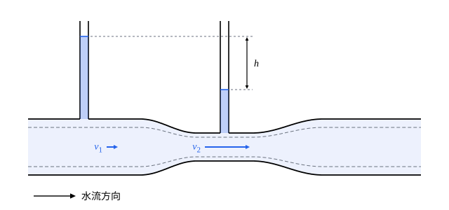

## 这一节要回答的问题

用手指按住水管口，水就喷得更远；河道变窄的地方，水流得更急。往两张平行下垂的纸中间吹气，两张纸不是被吹开，反而贴到了一起。流体（fluid）流动时，流速和:term[压强]{id="physics.newtonian-mechanics.pressure"}（pressure）之间有什么关系？

## 讲解

### 理想流体与定常流动

::anchor{id="def-ideal-fluid"}
不可压缩、没有黏性（viscosity）的流体叫作:term[理想流体]{id="physics.newtonian-mechanics.ideal-fluid"}（ideal fluid）。黏性是流体里相邻两层相对滑动时互相拖拽的性质，蜂蜜的黏性大，水和空气的黏性小。

为什么这样定义：水很难压缩，空气在流速远小于声速时体积也几乎不变；黏性小的流体，流动时因拖拽损失的能量很少。去掉这两样，流体的运动就只由:term[压强]{id="physics.newtonian-mechanics.pressure"}和:term[重力]{id="physics.newtonian-mechanics.weight"}（weight）决定。边界情况：蜂蜜在细管里缓缓流动、陨石冲进大气，都不能当作理想流体。

::anchor{id="def-steady-flow"}
流体里每一点的流速都不随时间变化的流动，叫作定常流动（steady flow）。这时每一小块流体都沿着一条固定的曲线运动，这条曲线叫作流线（streamline），流线上每一点的切线（tangent line）方向就是那里的:term[速度]{id="physics.newtonian-mechanics.velocity"}（velocity）方向。

为什么这样定义：河水平稳地流过桥墩，每一滴水都在动，流动的样子却不变，一张流线图就画出了整个流动。边界情况：刚拧开水龙头的那一会儿，流动在变，不是定常流动。流线不会相交，否则交点处的流速就有两个方向。

### 连续性方程

::anchor{id="thm-continuity"}
定理（:term[连续性方程]{id="physics.newtonian-mechanics.continuity-equation"}，continuity equation）：:term[理想流体]{id="physics.newtonian-mechanics.ideal-fluid"}在管子里定常流动时，单位时间流过各个截面的体积$Sv$相同，即$S_1v_1=S_2v_2$；$S$是截面的面积，$v$是那里的流速，$Sv$叫作体积流量（volume flow rate）。

证明思路：$\Delta t$时间里，流进截面 1 的流体体积是$S_1v_1\Delta t$，流出截面 2 的是$S_2v_2\Delta t$。两个截面之间的那段管子一直装满流体，流体又不可压缩，进出的体积必须相等。

管子细的地方流得快：按住水管口，出口变小，水的:term[速度]{id="physics.newtonian-mechanics.velocity"}就变大。边界情况：气体流得很快时会被压缩，这时不变的是单位时间流过的:term[质量]{id="physics.newtonian-mechanics.mass"}（mass）$\rho Sv$，不再是体积。

### 伯努利方程

::anchor{id="thm-bernoulli"}
定理（:term[伯努利方程]{id="physics.newtonian-mechanics.bernoullis-equation"}，Bernoulli's equation）：:term[理想流体]{id="physics.newtonian-mechanics.ideal-fluid"}定常流动时，沿同一条流线，$p+\frac12\rho v^2+\rho gz$处处相等，$z$是这一点的高度。

证明思路：沿流线取一个长$\Delta s$、截面积$\Delta S$的小圆柱形流体块，体积$\Delta V$，:term[质量]{id="physics.newtonian-mechanics.mass"}$\rho\Delta V$，它沿流线从点 1 流到点 2。侧面受到的:term[力]{id="physics.newtonian-mechanics.force"}（force）都是垂直于侧面的压力，垂直于流线，也就垂直于:term[速度]{id="physics.newtonian-mechanics.velocity"}，不做:term[功]{id="physics.newtonian-mechanics.work"}（work）；两个底面上的压力之差是$\bigl(p(s)-p(s+\Delta s)\bigr)\Delta S\approx-\dv ps\Delta V$，和[静止流体中的压强](lesson:physics.newtonian-mechanics.fluid-statics#thm-depth)里竖直方向的推导一样。流体不可压缩，$\Delta V$不变，由微积分基本定理（fundamental theorem of calculus），这个力从点 1 到点 2 做的功是$-\Delta V\int_{s_1}^{s_2}\dv ps\,\dd s=(p_1-p_2)\Delta V$。

没有黏性，此外只有:term[重力]{id="physics.newtonian-mechanics.weight"}做功。照[势能与机械能守恒](lesson:physics.newtonian-mechanics.potential-energy#thm-mechanical-energy)里$\Delta E=W'$的推理，:term[机械能]{id="physics.newtonian-mechanics.mechanical-energy"}（mechanical energy）的增加等于压力做的功：$\frac12\rho\Delta V(v_2^2-v_1^2)+\rho\Delta Vg(z_2-z_1)=(p_1-p_2)\Delta V$。两边除以$\Delta V$，移项即得。

三项都有能量的意思：$\frac12\rho v^2$是单位体积流体的:term[动能]{id="physics.newtonian-mechanics.kinetic-energy"}（kinetic energy），$\rho gz$是单位体积的:term[重力势能]{id="physics.newtonian-mechanics.gravitational-potential-energy"}（gravitational potential energy），$p$的差是压力对单位体积做的功。流体静止时，方程变成$p+\rho gz$不变，正是静止流体的结果；同样高度上流速大的地方:term[压强]{id="physics.newtonian-mechanics.pressure"}小，初中学过的「流速大的地方压强小」就是它的特例。边界情况：方程只沿同一条流线成立，从静止的大水池里流出的水，各条流线上的这个量才都一样（第 7 题）。

## 几何图像

水平的管子中间变细，流线在细处挤到一起。由:term[连续性方程]{id="physics.newtonian-mechanics.continuity-equation"}，细处流得快；由:term[伯努利方程]{id="physics.newtonian-mechanics.bernoullis-equation"}，同样高度上流得快的地方:term[压强]{id="physics.newtonian-mechanics.pressure"}小，所以细处上方竖管里的水柱低。两根竖管的水柱相差$h$，两处的压强就相差$\rho gh$，再用这两个方程就能算出流速（例 2）。

## 例题

### 例 1　从小孔流出的水

大水箱的侧壁上、水面下$h$处开了一个小孔，水从孔里流出。水箱很大，水面下降得很慢，水的黏性不计。水从小孔流出的:term[速率]{id="physics.newtonian-mechanics.speed"}（speed）是多少？

**为什么想到这么做**：从水面到小孔取一条流线，两端都和空气接触，:term[压强]{id="physics.newtonian-mechanics.pressure"}都是:term[大气压]{id="physics.newtonian-mechanics.atmospheric-pressure"}（atmospheric pressure）$p_0$；水面下降得很慢，那里的流速可以当作零。

**推导**：以小孔的高度为$z=0$，$p_0+0+\rho gh=p_0+\frac12\rho v^2+0$，所以$v=\sqrt{2gh}$，这叫托里拆利定理（Torricelli's theorem）。它正是物体从$h$高处自由落下时的速率：两端的压强一样，水就像从水面「掉」到了小孔。

### 例 2　文丘里流量计

文丘里流量计（Venturi meter）是一段中间变细的水平管子，粗处的截面积是$S_1=20\,\mathrm{cm^2}$，细处是$S_2=5.0\,\mathrm{cm^2}$，两处上方竖管里的水柱相差$h=15\,\mathrm{cm}$，$g$取$9.8\,\mathrm{m/s^2}$。粗处的流速和每秒流过的水的体积各是多少？

**为什么想到这么做**：管子水平，:term[伯努利方程]{id="physics.newtonian-mechanics.bernoullis-equation"}里两处的$\rho gz$相同；两处的:term[压强]{id="physics.newtonian-mechanics.pressure"}差由水柱的高度差得到，两处的流速由:term[连续性方程]{id="physics.newtonian-mechanics.continuity-equation"}联系起来，两个方程解两个未知数。

**推导**：$p_1-p_2=\rho gh=\frac12\rho(v_2^2-v_1^2)$，又$v_2=\frac{S_1}{S_2}v_1=4v_1$，所以$15v_1^2=2gh$，$v_1=\sqrt{\frac{2\times9.8\times0.15}{15}}\approx0.443\,\mathrm{m/s}$。每秒流过的体积是$S_1v_1\approx20\times10^{-4}\times0.443\approx8.9\times10^{-4}\,\mathrm{m^3}$，约$0.89\,\mathrm L$。

## 常见误区

- 「流速大的地方:term[压强]{id="physics.newtonian-mechanics.pressure"}一定小。」:term[伯努利方程]{id="physics.newtonian-mechanics.bernoullis-equation"}说的是同一条流线上的两点；高度不同要把$\rho gz$算进去，有黏性的流体、不定常的流动也不能直接用。
- 「水流过管子细处时被挤压，压强变大。」恰恰相反：细处流得快，压强小，例 2 里细处上方的水柱就低。
- 「伯努利方程是一条新的力学定律。」它是把:term[机械能]{id="physics.newtonian-mechanics.mechanical-energy"}的推理用在一小块:term[理想流体]{id="physics.newtonian-mechanics.ideal-fluid"}上得到的。
