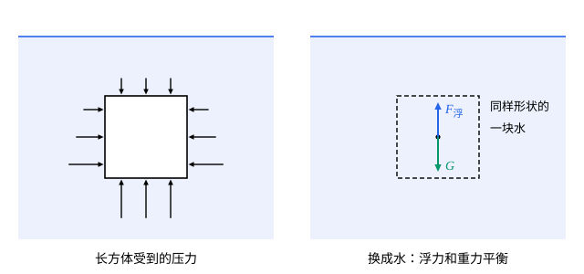

## 这一节要回答的问题

一小块铁放进水里就沉到底，几万吨钢铁造的轮船却能浮在海面上。把石块挂在弹簧测力计（spring scale）下慢慢浸进水里，读数越来越小；完全浸没以后再往下放，读数就不再变了。水托着物体的这个:term[力]{id="physics.newtonian-mechanics.force"}（force）从哪里来，有多大？

## 讲解

### 浮力

::anchor{id="def-buoyant-force"}
浸在流体（fluid）里的物体，表面各处都受到流体垂直于表面的:term[力]{id="physics.newtonian-mechanics.force"}，也就是压力；这些压力的:term[合力]{id="physics.newtonian-mechanics.net-force"}（net force）叫作:term[浮力]{id="physics.newtonian-mechanics.buoyant-force"}（buoyant force）。

为什么这样定义：:term[压强]{id="physics.newtonian-mechanics.pressure"}（pressure）随深度增加，物体下面受到的向上的压力比上面受到的向下的压力大，合起来是向上的，正是托着物体的那个力。拿竖直放在液体里的长方体来看：侧面上的压力两两抵消；上下底面的面积都是$S$，分别在液面下$h_1$、$h_2$处，浮力是$(p_0+\rho gh_2)S-(p_0+\rho gh_1)S=\rho g(h_2-h_1)S=\rho gV$，$V$是长方体的体积，液面上的压强$p_0$在差里消掉了。边界情况：物体下面没有液体，就没有向上的压力：露出水面、底部埋在河床里的桥墩只有侧面受压，左右抵消，浮力是零；整个浸在水里、底面紧贴容器底的物体，压力的合力反而向下。

::anchor{id="thm-archimedes"}
定理（:term[阿基米德原理]{id="physics.newtonian-mechanics.archimedes-principle"}，Archimedes' principle）：物体浸在静止流体里，浸入的那部分表面处处都和流体接触时，受到的浮力竖直向上，大小等于它排开的那部分流体受到的:term[重力]{id="physics.newtonian-mechanics.weight"}（weight），$F_{\text{浮}}=\rho gV_{\text{排}}$，$\rho$是流体的密度，$V_{\text{排}}$是物体浸在流体里那部分的体积。

证明思路：设想把物体拿走，换成和它浸在流体里那部分形状一样的一块同种流体。这块流体和周围的流体一起静止，合力为零，所以周围流体对它的压力的合力竖直向上，等于它的重力$\rho gV_{\text{排}}$。周围流体的压强只由深度决定，不管被包着的是什么，所以原来那个物体受到的压力的合力也是这么大。

长方体的$\rho gV$只是一个特例。浮力只看排开了多少流体，和物体本身的密度、形状、浸没的深度都无关。空气也是流体，地面上的物体都受到空气的浮力，只是空气的密度只有水的约$\frac1{800}$，平时可以不计。

### 浮与沉

::anchor{id="thm-float-sink"}
推论：完全浸没在液体里、只受:term[重力]{id="physics.newtonian-mechanics.weight"}和:term[浮力]{id="physics.newtonian-mechanics.buoyant-force"}的物体，平均密度$\rho_{\text{物}}$小于液体的密度$\rho$就上浮，大于就下沉，相等就能停在液体里任何深度，叫作悬浮（neutral buoyancy）。上浮的物体最后浮在液面上，叫作漂浮（floating），这时浮力等于重力，浸在液体里的体积是总体积的$\frac{\rho_{\text{物}}}\rho$。

证明思路：浸没时浮力是$\rho gV$，重力是$\rho_{\text{物}}gV$，比较两者就知道:term[合力]{id="physics.newtonian-mechanics.net-force"}向上还是向下。漂浮时$\rho gV_{\text{排}}=\rho_{\text{物}}gV$，即$\frac{V_{\text{排}}}V=\frac{\rho_{\text{物}}}\rho$。

钢铁的密度约是水的$8$倍，轮船却做成空心的，平均密度比水小，能排开足够多的水。潜水艇往水舱里灌水或者把水排出去，改变自己的平均密度，就能下潜、悬浮或上浮。

## 几何图像

左图：长方体的下表面在更深处，受到的向上的:term[压力]{id="physics.newtonian-mechanics.force"}比上表面受到的向下的压力大，侧面的压力左右抵消，合起来是向上的:term[浮力]{id="physics.newtonian-mechanics.buoyant-force"}。右图：把长方体换成同样形状的一块水，周围的水对它的压力和原来一样；这块水静止，所以压力的:term[合力]{id="physics.newtonian-mechanics.net-force"}正好托住它受的:term[重力]{id="physics.newtonian-mechanics.weight"}，这就是:term[阿基米德原理]{id="physics.newtonian-mechanics.archimedes-principle"}。表示压力的箭头，长短和那里的:term[压强]{id="physics.newtonian-mechanics.pressure"}成正比；液面上的:term[大气压]{id="physics.newtonian-mechanics.atmospheric-pressure"}（atmospheric pressure）对各处都一样，没有算进去。

## 例题

### 例 1　冰山

冰的密度是$0.917\times10^3\,\mathrm{kg/m^3}$，海水的密度是$1.025\times10^3\,\mathrm{kg/m^3}$。浮在海面上的冰山，露出海面的部分占总体积的多少？

**为什么想到这么做**：冰山漂浮，:term[浮力]{id="physics.newtonian-mechanics.buoyant-force"}等于:term[重力]{id="physics.newtonian-mechanics.weight"}，而浮力由浸在水里的体积决定。

**推导**：浸在水里的体积占$\frac{0.917}{1.025}\approx0.895$，露出海面的只占约$10.5\%$。「冰山一角」说的正是这个：看得见的只有约一成，近九成都在水下。

### 例 2　王冠是不是纯金

传说阿基米德为国王检验过一顶王冠是不是纯金的。用弹簧测力计称一顶王冠，在空气里读数是$4.90\,\mathrm N$，完全浸没在水里时读数是$4.60\,\mathrm N$。$g$取$9.8\,\mathrm{m/s^2}$，水的密度是$1.0\times10^3\,\mathrm{kg/m^3}$，金的密度是$19.3\times10^3\,\mathrm{kg/m^3}$，空气的:term[浮力]{id="physics.newtonian-mechanics.buoyant-force"}不计。王冠的平均密度是多少，是纯金的吗？

**为什么想到这么做**：王冠静止，测力计的:term[拉力]{id="physics.newtonian-mechanics.tension"}（tension）加上浮力等于:term[重力]{id="physics.newtonian-mechanics.weight"}，浸没后读数减少的部分就是浮力，由它算出王冠的体积；:term[质量]{id="physics.newtonian-mechanics.mass"}（mass）由在空气里的读数得到。

**推导**：浮力$F=4.90-4.60=0.30\,\mathrm N$，体积$V=\frac F{\rho g}=\frac{0.30}{1.0\times10^3\times9.8}\approx3.06\times10^{-5}\,\mathrm{m^3}$。质量$m=\frac{4.90}{9.8}=0.500\,\mathrm{kg}$，平均密度$\frac mV\approx1.63\times10^4\,\mathrm{kg/m^3}$，比金小得多，里面掺了别的金属。王冠的形状再复杂，它排开的水的体积都等于它自己的体积，这正是这个办法的妙处。

## 常见误区

- 「物体浸得越深，受的:term[浮力]{id="physics.newtonian-mechanics.buoyant-force"}越大。」完全浸没以后，排开的液体体积不变，浮力就不变：上下表面的:term[压强]{id="physics.newtonian-mechanics.pressure"}都增大了，差却不变。
- 「重的物体沉，轻的物体浮。」浮沉看平均密度：几万吨的轮船浮着，一枚铁钉却沉下去。
- 「漂浮的物体受的浮力大于:term[重力]{id="physics.newtonian-mechanics.weight"}。」漂浮的物体静止，浮力正好等于重力；浮力大于重力的物体会加速上浮，露出水面以后排开的水变少，直到浮力等于重力。
