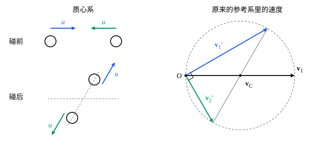

## 这一节要回答的问题

两辆同样的车各以$15\,\mathrm{m/s}$迎面相撞，和一辆以$30\,\mathrm{m/s}$撞上停着的另一辆，撞得一样狠吗？台球斜着撞上静止的球，两个球朝不同的方向飞开，看起来没有什么规律。换一个:term[参考系]{id="physics.newtonian-mechanics.reference-frame"}（reference frame），碰撞能不能变得简单些？

## 讲解

### 质心系

::anchor{id="def-cm-frame"}
原点随:term[质心]{id="physics.newtonian-mechanics.center-of-mass"}（center of mass）运动、坐标轴方向不变的:term[参考系]{id="physics.newtonian-mechanics.reference-frame"}，叫作:term[质心系]{id="physics.newtonian-mechanics.center-of-mass-frame"}（center-of-mass frame）。在质心系里，:term[质点系]{id="physics.newtonian-mechanics.system-of-particles"}（system of particles）的总:term[动量]{id="physics.newtonian-mechanics.momentum"}（momentum）为零。

为什么这样定义：不受:term[外力]{id="physics.newtonian-mechanics.external-force"}（external force）时，质心做匀速直线运动，质心系相对:term[惯性系]{id="physics.newtonian-mechanics.inertial-frame"}（inertial frame）匀速平动，也是惯性系。在质心系里总动量为零，两个物体的动量总是等大反向，碰撞看起来最对称。边界情况：外力之和不为零时，质心在加速，质心系就不是惯性系了，见[平动加速参考系与惯性力](lesson:physics.newtonian-mechanics.accelerating-frames)。

### 柯尼希定理

::anchor{id="thm-koenig"}
定理（:term[柯尼希定理]{id="physics.newtonian-mechanics.koenigs-theorem"}，König's theorem）：:term[质点系]{id="physics.newtonian-mechanics.system-of-particles"}的总:term[动能]{id="physics.newtonian-mechanics.kinetic-energy"}（kinetic energy）等于:term[质心]{id="physics.newtonian-mechanics.center-of-mass"}的动能$\frac12Mv_{\mathrm C}^2$加上它在:term[质心系]{id="physics.newtonian-mechanics.center-of-mass-frame"}里的动能$K'$，即$K=\frac12Mv_{\mathrm C}^2+K'$。

证明思路：由:term[伽利略变换]{id="physics.newtonian-mechanics.galilean-transformation"}（Galilean transformation），第$i$个质点的:term[速度]{id="physics.newtonian-mechanics.velocity"}（velocity）是$\vb v_i=\vb v_{\mathrm C}+\vb u_i$，$\vb u_i$是它在质心系里的速度。代入$K=\sum\frac12m_iv_i^2$展开，交叉项是$\vb v_{\mathrm C}\cdot\sum m_i\vb u_i$，质心系里总:term[动量]{id="physics.newtonian-mechanics.momentum"}为零，交叉项就是零，剩下的两项正是定理。

两个质点时，$\vb u_1=\frac{m_2}{m_1+m_2}(\vb v_1-\vb v_2)$，$\vb u_2=-\frac{m_1}{m_1+m_2}(\vb v_1-\vb v_2)$，代入得$K'=\frac{m_1m_2}{2(m_1+m_2)}|\vb v_1-\vb v_2|^2$，只和相对速度有关。不受:term[外力]{id="physics.newtonian-mechanics.external-force"}时$\vb v_{\mathrm C}$不变，碰撞能改变的只有$K'$；:term[完全非弹性碰撞]{id="physics.newtonian-mechanics.perfectly-inelastic-collision"}（perfectly inelastic collision）后两者在质心系里都静止，$K'$全部损失，这正是[碰撞](lesson:physics.newtonian-mechanics.collisions)里$\Delta K$的来历，也是同样的:term[质量]{id="physics.newtonian-mechanics.mass"}（mass）和相对速度下能损失的最多的动能。

### 在质心系里看碰撞

::anchor{id="thm-cm-collision"}
定理：两个物体发生:term[弹性碰撞]{id="physics.newtonian-mechanics.elastic-collision"}（elastic collision）时，在:term[质心系]{id="physics.newtonian-mechanics.center-of-mass-frame"}里看，每个物体碰后的:term[速率]{id="physics.newtonian-mechanics.speed"}（speed）和碰前相同，两者的:term[速度]{id="physics.newtonian-mechanics.velocity"}一起转过同一个角度，仍然方向相反；一维时速度反向，换回原来的:term[参考系]{id="physics.newtonian-mechanics.reference-frame"}就是$v'=2v_{\mathrm C}-v$。

证明思路：质心系里碰撞前后总:term[动量]{id="physics.newtonian-mechanics.momentum"}都为零，两个物体的动量等大反向，大小记为$p$，则$K'=\frac{p^2}{2m_1}+\frac{p^2}{2m_2}$。弹性碰撞前后$K$不变，$\frac12Mv_{\mathrm C}^2$也不变，所以$K'$不变，$p$不变，每个物体的速率都不变。一维时速度不变就等于没有碰，只能反向，$u'=-u$，于是$v'=v_{\mathrm C}+u'=2v_{\mathrm C}-v$，这就是[碰撞](lesson:physics.newtonian-mechanics.collisions#thm-elastic-1d)里的末速度公式。

## 几何图像

左图：:term[质心系]{id="physics.newtonian-mechanics.center-of-mass-frame"}里，两个:term[质量]{id="physics.newtonian-mechanics.mass"}相等的球碰撞前后:term[速率]{id="physics.newtonian-mechanics.speed"}都是$u$，只是方向转了。右图：被撞的球原来静止，所以$\vb v_{\mathrm C}=\frac12\vb v_1$，$u=\frac12v_1$；碰后的:term[速度]{id="physics.newtonian-mechanics.velocity"}$\vb v_{\mathrm C}\pm u\,\uv n$从$O$指向圆的一条直径的两端，而$O$也在圆上，直径所对的圆周角是直角，所以两者互相垂直。

## 例题

### 例 1　两种撞法

两辆:term[质量]{id="physics.newtonian-mechanics.mass"}都是$1000\,\mathrm{kg}$的车，一种情况是各以$15\,\mathrm{m/s}$迎面相撞，另一种是一辆以$30\,\mathrm{m/s}$撞上停着的另一辆，两种情况下两车都卡在一起。各损失多少:term[动能]{id="physics.newtonian-mechanics.kinetic-energy"}？

**为什么想到这么做**：由:term[柯尼希定理]{id="physics.newtonian-mechanics.koenigs-theorem"}，卡在一起以后$K'$全部损失，而$K'$只和:term[相对速度]{id="physics.newtonian-mechanics.velocity"}有关；两种情况的相对速度都是$30\,\mathrm{m/s}$。

**推导**：$K'=\frac{1000\times1000}{2\times2000}\times30^2=2.25\times10^5\,\mathrm J$，两种情况都损失这么多。迎面相撞时:term[质心]{id="physics.newtonian-mechanics.center-of-mass"}静止，原来的动能全部损失；追撞时质心以$15\,\mathrm{m/s}$运动，原来的动能是$4.5\times10^5\,\mathrm J$，损失一半，另一半是质心的动能，留了下来。两种撞法损失的能量一样，车的变形也差不多。

### 例 2　台球的斜碰

台球以$4.0\,\mathrm{m/s}$斜着撞上一个静止的同样的球，碰撞是:term[弹性碰撞]{id="physics.newtonian-mechanics.elastic-collision"}，撞上去的球偏离原来的方向$30^\circ$。碰后两个球的:term[速率]{id="physics.newtonian-mechanics.speed"}各是多少，被撞的球朝哪个方向运动？

**为什么想到这么做**：由几何图像，:term[质量]{id="physics.newtonian-mechanics.mass"}相等、被撞的球原来静止时，碰后两个:term[速度]{id="physics.newtonian-mechanics.velocity"}互相垂直；两个速度相加又等于原来的速度，构成一个直角三角形。

**推导**：:term[动量守恒]{id="physics.newtonian-mechanics.conservation-of-momentum"}（conservation of momentum）给出$\vb v_1=\vb v_1'+\vb v_2'$，两者垂直，所以$v_1'=4.0\cos30^\circ\approx3.46\,\mathrm{m/s}$，$v_2'=4.0\sin30^\circ=2.0\,\mathrm{m/s}$，被撞的球在原方向的另一侧，偏离$60^\circ$。验算：$3.46^2+2.0^2\approx16$，:term[动能]{id="physics.newtonian-mechanics.kinetic-energy"}守恒。不用:term[质心系]{id="physics.newtonian-mechanics.center-of-mass-frame"}也能看出垂直：动能守恒给出$v_1^2=v_1'^2+v_2'^2$，正是勾股定理。

## 常见误区

- 「:term[质心系]{id="physics.newtonian-mechanics.center-of-mass-frame"}里的:term[动能]{id="physics.newtonian-mechanics.kinetic-energy"}和原来:term[参考系]{id="physics.newtonian-mechanics.reference-frame"}里的一样。」两者差了:term[质心]{id="physics.newtonian-mechanics.center-of-mass"}的动能$\frac12Mv_{\mathrm C}^2$，只有质心静止时才相等。
- 「:term[质量]{id="physics.newtonian-mechanics.mass"}相等的两个球发生:term[弹性碰撞]{id="physics.newtonian-mechanics.elastic-collision"}，总是互相垂直地飞开。」要求被撞的球原来静止；正碰时撞上去的球停了下来，谈不上夹角。
- 「:term[完全非弹性碰撞]{id="physics.newtonian-mechanics.perfectly-inelastic-collision"}后，系统的动能全部损失了。」损失的只是$K'$，质心的动能留了下来，例 1 的追撞就留下了一半。
