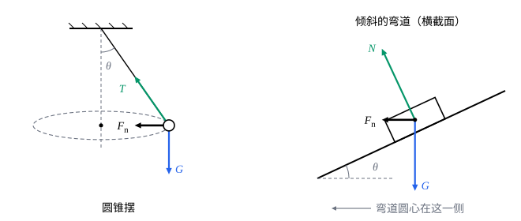

## 这一节要回答的问题

用绳子拴着小球在水平面里转圈，绳子总是斜着的，转得越快越接近水平；汽车在向外侧抬高的弯道上转弯，:term[速度]{id="physics.newtonian-mechanics.velocity"}（velocity）合适时，即使路面结了冰也不会滑出去。做圆周运动的物体需要什么样的:term[力]{id="physics.newtonian-mechanics.force"}（force），这个力由谁来提供？

## 讲解

### 向心力

物体以:term[速率]{id="physics.newtonian-mechanics.speed"}（speed）$v$沿半径为$r$的圆运动时，有指向圆心、大小为$\frac{v^2}r$的:term[向心加速度]{id="physics.newtonian-mechanics.centripetal-acceleration"}（centripetal acceleration）。由:term[牛顿第二定律]{id="physics.newtonian-mechanics.newtons-second-law"}（Newton's second law），在:term[惯性系]{id="physics.newtonian-mechanics.inertial-frame"}（inertial frame）里，:term[合力]{id="physics.newtonian-mechanics.net-force"}（net force）也必须有指向圆心的分量。

::anchor{id="def-centripetal-force"}
物体做圆周运动时，它受的合力沿半径指向圆心的分量$F_{\mathrm n}=\frac{mv^2}r=m\omega^2r$，叫作:term[向心力]{id="physics.newtonian-mechanics.centripetal-force"}（centripetal force）。

为什么这样定义：要让物体沿圆周走，就得有这么大的指向圆心的合力，起个名字，解题时就知道该凑出多大的:term[力]{id="physics.newtonian-mechanics.force"}。它不是一种新的力，而是:term[重力]{id="physics.newtonian-mechanics.weight"}（weight）、:term[拉力]{id="physics.newtonian-mechanics.tension"}（tension）、:term[支持力]{id="physics.newtonian-mechanics.normal-force"}（normal force）这些力的合力的一个分量，按效果起的名字。边界情况：速率在变时，合力还有沿切线（tangent line）的分量$ma_{\mathrm t}$；合力指向圆心的分量比$\frac{mv^2}r$小，物体就离开原来的圆，越走越远，例如转动的伞上甩出去的水滴。

### 解题的办法

分析圆周运动的问题，按下面的顺序：先找出圆周所在的平面、圆心和半径；再画出物体受的每一个:term[力]{id="physics.newtonian-mechanics.force"}，不要另画一个「:term[向心力]{id="physics.newtonian-mechanics.centripetal-force"}」；然后沿指向圆心的方向和垂直于它的方向分解；最后指向圆心的方向列$\sum F_{\mathrm n}=\frac{mv^2}r$，垂直的方向按有没有:term[加速度]{id="physics.newtonian-mechanics.acceleration"}（acceleration）列方程。

## 几何图像

左图是圆锥摆（conical pendulum）：小球受:term[重力]{id="physics.newtonian-mechanics.weight"}$\vb G$和:term[拉力]{id="physics.newtonian-mechanics.tension"}$\vb T$，两者的:term[合力]{id="physics.newtonian-mechanics.net-force"}水平指向圆心，就是:term[向心力]{id="physics.newtonian-mechanics.centripetal-force"}$\vb F_{\mathrm n}$（例 1）。右图是倾斜弯道的横截面：汽车受重力和垂直于路面的:term[支持力]{id="physics.newtonian-mechanics.normal-force"}$\vb N$，路面倾斜时，支持力的水平分量正好指向弯道的圆心（例 2）。

## 例题

### 例 1　圆锥摆

长$L=1.0\,\mathrm m$的细绳上端固定，下端拴一个小球，让小球在水平面内做:term[匀速圆周运动]{id="physics.newtonian-mechanics.uniform-circular-motion"}（uniform circular motion），绳子和竖直方向成$\theta=30^\circ$。小球转一圈要多久？$g$取$9.8\,\mathrm{m/s^2}$。

**为什么想到这么做**：圆心在悬点正下方，半径$L\sin\theta$。小球受:term[重力]{id="physics.newtonian-mechanics.weight"}和:term[拉力]{id="physics.newtonian-mechanics.tension"}，竖直方向没有:term[加速度]{id="physics.newtonian-mechanics.acceleration"}，水平方向的:term[合力]{id="physics.newtonian-mechanics.net-force"}就是:term[向心力]{id="physics.newtonian-mechanics.centripetal-force"}。

**推导**：竖直方向$T\cos\theta=mg$，水平方向$T\sin\theta=m\omega^2L\sin\theta$，两式相除得$\omega^2=\frac g{L\cos\theta}$。周期$2\pi\sqrt{\frac{L\cos\theta}g}=2\pi\sqrt{\frac{0.866}{9.8}}\approx1.87\,\mathrm s$，和小球的:term[质量]{id="physics.newtonian-mechanics.mass"}（mass）无关。转得越快，$\cos\theta$越小，绳子越接近水平。

### 例 2　倾斜的弯道

公路弯道的半径是$100\,\mathrm m$，路面向外侧抬高，和水平面成$10^\circ$。汽车以多大的:term[速率]{id="physics.newtonian-mechanics.speed"}通过时，即使路面结冰、光滑无比，也不会向内或向外滑？

**为什么想到这么做**：路面光滑，汽车只受:term[重力]{id="physics.newtonian-mechanics.weight"}和垂直于路面的:term[支持力]{id="physics.newtonian-mechanics.normal-force"}。汽车在水平面内转弯，竖直方向:term[合力]{id="physics.newtonian-mechanics.net-force"}为零，水平方向的合力要正好等于所需的:term[向心力]{id="physics.newtonian-mechanics.centripetal-force"}。

**推导**：竖直方向$N\cos\theta=mg$，水平方向$N\sin\theta=\frac{mv^2}R$，相除得$v^2=gR\tan\theta$，$v=\sqrt{9.8\times100\times\tan10^\circ}\approx13.1\,\mathrm{m/s}$，约$47\,\mathrm{km/h}$。开得更快，所需的向心力比支持力的水平分量大，汽车会向外滑；开得更慢则向内滑，要靠路面的摩擦才能稳住（见[摩擦力](lesson:physics.newtonian-mechanics.friction)）。

## 常见误区

- 「做圆周运动的物体，除了:term[重力]{id="physics.newtonian-mechanics.weight"}、:term[拉力]{id="physics.newtonian-mechanics.tension"}等，还受一个:term[向心力]{id="physics.newtonian-mechanics.centripetal-force"}。」向心力是这些:term[力]{id="physics.newtonian-mechanics.force"}的:term[合力]{id="physics.newtonian-mechanics.net-force"}的一个分量，受力分析时不能另外再画一个。
- 「物体做圆周运动，是因为向心力和离心力（centrifugal force）平衡了。」在:term[惯性系]{id="physics.newtonian-mechanics.inertial-frame"}里没有离心力；指向圆心的合力不为零，正是它提供了:term[向心加速度]{id="physics.newtonian-mechanics.centripetal-acceleration"}。
- 「圆锥摆转得越快，绳子越接近竖直。」恰好相反，例 1 里转得越快，绳子越接近水平。
