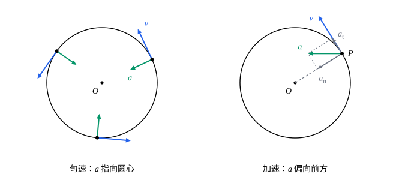

## 这一节要回答的问题

转盘匀速转动时，坐在上面的人:term[速率]{id="physics.newtonian-mechanics.speed"}（speed）不变，可:term[速度]{id="physics.newtonian-mechanics.velocity"}（velocity）的方向一直在变，所以:term[加速度]{id="physics.newtonian-mechanics.acceleration"}（acceleration）并不是零。这个加速度指向哪里、有多大？转盘加速或减速时，加速度又是什么样子？

## 讲解

### 角速度

质点在半径为$r$的圆上运动，以圆心为原点，它的位置由从$x$轴转过的角$\theta(t)$确定：$\vb r=r(\cos\theta,\sin\theta)$，走过的弧长是$s=r\theta$。

::anchor{id="def-angular-velocity"}
角$\theta$对时间的导数（derivative）$\omega=\dv\theta t$叫作:term[角速度]{id="physics.newtonian-mechanics.angular-velocity"}（angular velocity），单位是$\mathrm{rad/s}$；$\omega$不变的圆周运动叫作:term[匀速圆周运动]{id="physics.newtonian-mechanics.uniform-circular-motion"}（uniform circular motion），转一圈用的时间是周期$T=\frac{2\pi}{|\omega|}$。

为什么这样定义：转盘上各点转过的角度相同，一个$\omega$就说清了整个转盘转得多快；离圆心$r$处的:term[速率]{id="physics.newtonian-mechanics.speed"}是$v=\left|\dv st\right|=r|\omega|$，越靠外越快。$\omega$的正负表示转向，逆时针为正。边界情况：「匀速」说的只是速率不变，:term[速度]{id="physics.newtonian-mechanics.velocity"}的方向一直在变，所以匀速圆周运动并不是匀速运动。

### 向心加速度

::anchor{id="thm-centripetal"}
定理（:term[匀速圆周运动]{id="physics.newtonian-mechanics.uniform-circular-motion"}的:term[加速度]{id="physics.newtonian-mechanics.acceleration"}）：匀速圆周运动的加速度指向圆心，大小是$a=\omega^2r=\frac{v^2}r$，这个加速度叫作:term[向心加速度]{id="physics.newtonian-mechanics.centripetal-acceleration"}（centripetal acceleration）。

证明思路：取$\theta=\omega t$，$\vb r=r(\cos\omega t,\sin\omega t)$。由链式法则（chain rule），$\vb v=r\omega(-\sin\omega t,\cos\omega t)$，它和$\vb r$垂直，沿着切线（tangent line）；再求一次导数，$\vb a=-r\omega^2(\cos\omega t,\sin\omega t)=-\omega^2\vb r$，方向和$\vb r$相反，指向圆心。

直观地看，:term[速度]{id="physics.newtonian-mechanics.velocity"}矢量的长度不变，方向和半径一起以$\omega$转动，在$\Delta t$里转过$\omega\Delta t$，改变量约为$v\omega\Delta t$，方向垂直于速度、指向圆心，所以$a=v\omega=\frac{v^2}r$。

### 变速圆周运动

::anchor{id="thm-tangential"}
定理（变速圆周运动的:term[加速度]{id="physics.newtonian-mechanics.acceleration"}）：质点逆时针转动、$\omega$随时间变化时，加速度分成两部分。沿切线、指向前进方向的分量$a_{\mathrm t}=\dv vt=r\alpha$叫作:term[切向加速度]{id="physics.newtonian-mechanics.tangential-acceleration"}（tangential acceleration），其中$\alpha=\dv\omega t$叫作:term[角加速度]{id="physics.newtonian-mechanics.angular-acceleration"}（angular acceleration）；指向圆心的分量$a_{\mathrm n}=\frac{v^2}r$仍是:term[向心加速度]{id="physics.newtonian-mechanics.centripetal-acceleration"}。合加速度的大小是$\sqrt{a_{\mathrm t}^2+a_{\mathrm n}^2}$。

证明思路：$\theta$是$t$的函数，由链式法则$\vb v=r\omega(-\sin\theta,\cos\theta)$。再求导，用乘积法则（product rule），$\vb a=r\alpha(-\sin\theta,\cos\theta)+r\omega^2(-\cos\theta,-\sin\theta)$，前一项沿切线，后一项指向圆心。

切向加速度改变:term[速率]{id="physics.newtonian-mechanics.speed"}，向心加速度改变方向，两者互相垂直。速率增大时合加速度偏向前方，减小时偏向后方；只有速率不变时，加速度才正好指向圆心。

## 几何图像

左图是:term[匀速圆周运动]{id="physics.newtonian-mechanics.uniform-circular-motion"}：三个位置上的:term[速度]{id="physics.newtonian-mechanics.velocity"}都沿切线，:term[加速度]{id="physics.newtonian-mechanics.acceleration"}都指向圆心，大小相同。右图是加速转动，在点$P$，:term[切向加速度]{id="physics.newtonian-mechanics.tangential-acceleration"}$a_{\mathrm t}$和速度同向，:term[向心加速度]{id="physics.newtonian-mechanics.centripetal-acceleration"}$a_{\mathrm n}$指向圆心，合加速度$\vb a$偏向前方；减速时$a_{\mathrm t}$和速度反向，$\vb a$就偏向后方。

## 例题

### 例 1　赤道上一点的向心加速度

地球相对恒星自转一周约$86164\,\mathrm s$，赤道半径约$6.38\times10^6\,\mathrm m$。赤道上一点随地球自转的:term[速率]{id="physics.newtonian-mechanics.speed"}和:term[向心加速度]{id="physics.newtonian-mechanics.centripetal-acceleration"}各是多少？

**为什么想到这么做**：赤道上的点绕地轴做:term[匀速圆周运动]{id="physics.newtonian-mechanics.uniform-circular-motion"}，先求:term[角速度]{id="physics.newtonian-mechanics.angular-velocity"}，再用$v=r\omega$、$a=\omega^2r$。

**推导**：$\omega=\frac{2\pi}{86164}\approx7.29\times10^{-5}\,\mathrm{rad/s}$，$v=r\omega\approx465\,\mathrm{m/s}$，$a=\omega^2r\approx3.39\times10^{-2}\,\mathrm{m/s^2}$，约为$g$的$0.35\%$。在地面上量:term[重力加速度]{id="physics.newtonian-mechanics.gravitational-acceleration"}（gravitational acceleration），赤道比两极小，这是原因之一。

### 例 2　弯道上加速的汽车

汽车在半径$50\,\mathrm m$的圆弧弯道上行驶，:term[速率]{id="physics.newtonian-mechanics.speed"}在$5\,\mathrm s$内从$10\,\mathrm{m/s}$均匀地增大到$20\,\mathrm{m/s}$。速率为$15\,\mathrm{m/s}$时，:term[加速度]{id="physics.newtonian-mechanics.acceleration"}多大，和:term[速度]{id="physics.newtonian-mechanics.velocity"}成多大角？

**为什么想到这么做**：速率均匀增大，:term[切向加速度]{id="physics.newtonian-mechanics.tangential-acceleration"}不变；:term[向心加速度]{id="physics.newtonian-mechanics.centripetal-acceleration"}由当时的速率决定。两者互相垂直，合起来求大小和方向。

**推导**：$a_{\mathrm t}=\frac{20-10}5=2\,\mathrm{m/s^2}$，$a_{\mathrm n}=\frac{15^2}{50}=4.5\,\mathrm{m/s^2}$，$a=\sqrt{2^2+4.5^2}\approx4.92\,\mathrm{m/s^2}$。和速度的夹角$\varphi$满足$\tan\varphi=\frac{4.5}2$，$\varphi\approx66^\circ$：加速度偏向弯道内侧，又略微向前。

## 常见误区

- 「:term[速率]{id="physics.newtonian-mechanics.speed"}越大，:term[向心加速度]{id="physics.newtonian-mechanics.centripetal-acceleration"}一定越大。」还要看半径：速率相同时，半径越大，$\frac{v^2}r$越小，所以高速公路的弯道都修得很缓。
- 「圆周运动的:term[加速度]{id="physics.newtonian-mechanics.acceleration"}总指向圆心。」只有速率不变时才是；速率在变时还有切向分量（例 2）。
- 「转盘上各点的向心加速度相同。」各点的:term[角速度]{id="physics.newtonian-mechanics.angular-velocity"}相同，向心加速度$\omega^2r$和到轴的距离成正比。
