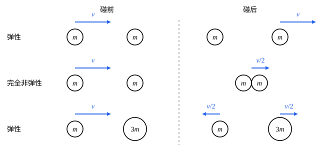

## 这一节要回答的问题

台球正面撞上另一个静止的同样的球，自己停下，被撞的球以原来的:term[速度]{id="physics.newtonian-mechanics.velocity"}（velocity）走开；两团同样的橡皮泥撞上以后粘在一起，速度却只剩原来的一半。两次碰撞前后:term[动量]{id="physics.newtonian-mechanics.momentum"}（momentum）都守恒，结果为什么不同？少了的:term[动能]{id="physics.newtonian-mechanics.kinetic-energy"}（kinetic energy）到哪里去了？

## 讲解

### 碰撞和它的分类

::anchor{id="def-collision"}
两个物体在很短的时间里相互作用、:term[速度]{id="physics.newtonian-mechanics.velocity"}发生明显改变的过程叫作碰撞（collision）。碰撞前后系统的总:term[动能]{id="physics.newtonian-mechanics.kinetic-energy"}不变的，叫作:term[弹性碰撞]{id="physics.newtonian-mechanics.elastic-collision"}（elastic collision）；总动能减少的，叫作:term[非弹性碰撞]{id="physics.newtonian-mechanics.inelastic-collision"}（inelastic collision）；碰后两个物体粘在一起、以相同的速度运动的，叫作:term[完全非弹性碰撞]{id="physics.newtonian-mechanics.perfectly-inelastic-collision"}（perfectly inelastic collision）。

为什么这样定义：碰撞的时间很短，物体之间的:term[内力]{id="physics.newtonian-mechanics.internal-force"}（internal force）很大，:term[外力]{id="physics.newtonian-mechanics.external-force"}（external force）的:term[冲量]{id="physics.newtonian-mechanics.impulse"}（impulse）和它相比可以忽略，所以碰撞前后总:term[动量]{id="physics.newtonian-mechanics.momentum"}守恒。一维碰撞有两个未知的末速度，:term[动量守恒]{id="physics.newtonian-mechanics.conservation-of-momentum"}（conservation of momentum）只给出一个方程，按动能变不变来分类，正好补上缺的那个条件。钢球、台球的碰撞接近弹性碰撞；形变不能完全恢复时，一部分动能变成了内能（internal energy）和声音。边界情况：两辆小车之间夹着压缩的弹簧，碰上时弹簧被放开，碰后的总动能反而比碰前大。

### 一维弹性碰撞

::anchor{id="thm-elastic-1d"}
定理：:term[质量]{id="physics.newtonian-mechanics.mass"}（mass）为$m_1$、$m_2$的两个物体沿同一直线做:term[弹性碰撞]{id="physics.newtonian-mechanics.elastic-collision"}，碰前的:term[速度]{id="physics.newtonian-mechanics.velocity"}（velocity）是$v_1$、$v_2$，碰后的速度$v_1'$、$v_2'$满足$v_2'-v_1'=-(v_2-v_1)$，即相对速度大小不变、方向相反；解出来是$v_1'=\frac{(m_1-m_2)v_1+2m_2v_2}{m_1+m_2}$，$v_2'=\frac{(m_2-m_1)v_2+2m_1v_1}{m_1+m_2}$。

证明思路：:term[动量守恒]{id="physics.newtonian-mechanics.conservation-of-momentum"}写成$m_1(v_1-v_1')=m_2(v_2'-v_2)$，:term[动能]{id="physics.newtonian-mechanics.kinetic-energy"}守恒写成$m_1(v_1^2-v_1'^2)=m_2(v_2'^2-v_2^2)$。速度有改变时，后式除以前式得$v_1+v_1'=v_2+v_2'$，这就是相对速度反向；它和动量守恒联立，解出两个末速度。

几个特例：两者质量相等时，碰后交换速度，台球就是这样；静止的物体很重（$m_2\gg m_1$）时，撞上去的物体几乎以原来的:term[速率]{id="physics.newtonian-mechanics.speed"}（speed）弹回；静止的物体很轻（$m_2\ll m_1$）时，它被撞出去的速度接近$2v_1$。

### 完全非弹性碰撞损失的动能

::anchor{id="thm-perfectly-inelastic"}
定理：两个物体沿同一直线做:term[完全非弹性碰撞]{id="physics.newtonian-mechanics.perfectly-inelastic-collision"}，碰后的共同:term[速度]{id="physics.newtonian-mechanics.velocity"}是$v'=\frac{m_1v_1+m_2v_2}{m_1+m_2}$，损失的:term[动能]{id="physics.newtonian-mechanics.kinetic-energy"}是$\Delta K=\frac{m_1m_2}{2(m_1+m_2)}(v_1-v_2)^2$。

证明思路：共同速度由:term[动量守恒]{id="physics.newtonian-mechanics.conservation-of-momentum"}得出。碰前的动能$\frac12m_1v_1^2+\frac12m_2v_2^2$减去碰后的$\frac12(m_1+m_2)v'^2$，代入$v'$通分，分子正好是$m_1m_2(v_1-v_2)^2$。

损失的动能只和两个:term[质量]{id="physics.newtonian-mechanics.mass"}、碰前的相对速度有关。换一个以速度$u$运动的:term[惯性系]{id="physics.newtonian-mechanics.inertial-frame"}（inertial frame），每个速度都减去$u$，动量守恒照样成立，相对速度不变，损失的动能也不变。质量和相对速度一定时，完全非弹性碰撞损失的动能最多，道理见[质心系](lesson:physics.newtonian-mechanics.center-of-mass-frame)。

## 几何图像

三行碰撞前后的:term[动量]{id="physics.newtonian-mechanics.momentum"}都守恒。第一行和第三行是:term[弹性碰撞]{id="physics.newtonian-mechanics.elastic-collision"}，碰前碰后的:term[动能]{id="physics.newtonian-mechanics.kinetic-energy"}相同，第三行碰后是$\frac12m\bigl(\frac v2\bigr)^2+\frac12(3m)\bigl(\frac v2\bigr)^2=\frac12mv^2$。第二行是:term[完全非弹性碰撞]{id="physics.newtonian-mechanics.perfectly-inelastic-collision"}，碰后的动能只剩$\frac12(2m)\bigl(\frac v2\bigr)^2$，正好损失了一半。

## 例题

### 例 1　中子撞碳核

反应堆里要让快中子慢下来。中子以:term[速度]{id="physics.newtonian-mechanics.velocity"}$v$正面撞上静止的碳原子核，碳核的:term[质量]{id="physics.newtonian-mechanics.mass"}约是中子的$12$倍，碰撞是:term[弹性碰撞]{id="physics.newtonian-mechanics.elastic-collision"}。中子的:term[动能]{id="physics.newtonian-mechanics.kinetic-energy"}有百分之几交给了碳核？

**为什么想到这么做**：这是一维弹性碰撞，直接用定理里的末速度公式，$v_2=0$。

**推导**：取$m_1=m$、$m_2=12m$，碳核的末速度$v_2'=\frac{2m}{13m}v=\frac2{13}v$，它的动能是$\frac12\cdot12m\cdot\frac4{169}v^2=\frac{48}{169}\cdot\frac12mv^2$，约是中子原来动能的$28\%$。中子留下$72\%$，要撞很多次才能慢下来；换成质量和中子几乎相等的氢原子核，一次正面碰撞就能交出几乎全部动能，所以水也是常用的减速剂（moderator）。

### 例 2　追尾

:term[质量]{id="physics.newtonian-mechanics.mass"}$1000\,\mathrm{kg}$的汽车以$20\,\mathrm{m/s}$追尾前面质量$1500\,\mathrm{kg}$、:term[速度]{id="physics.newtonian-mechanics.velocity"}$10\,\mathrm{m/s}$的汽车，两车卡在一起。碰后的速度多大？损失了多少:term[动能]{id="physics.newtonian-mechanics.kinetic-energy"}，占原来总动能的百分之几？

**为什么想到这么做**：碰撞时间很短，路面对车的水平作用的:term[冲量]{id="physics.newtonian-mechanics.impulse"}可以忽略；两车卡在一起，是:term[完全非弹性碰撞]{id="physics.newtonian-mechanics.perfectly-inelastic-collision"}，用上面的定理。

**推导**：$v'=\frac{1000\times20+1500\times10}{2500}=14\,\mathrm{m/s}$。损失的动能$\Delta K=\frac{1000\times1500}{2\times2500}\times(20-10)^2=3.0\times10^4\,\mathrm J$，原来的总动能是$2.0\times10^5+7.5\times10^4=2.75\times10^5\,\mathrm J$，只损失了约$11\%$。两车同向行驶，相对速度只有$10\,\mathrm{m/s}$，所以损失不多；在随前车运动的:term[参考系]{id="physics.newtonian-mechanics.reference-frame"}（reference frame）里算，损失的也是$3.0\times10^4\,\mathrm J$。

## 常见误区

- 「碰撞中:term[动量]{id="physics.newtonian-mechanics.momentum"}守恒，:term[动能]{id="physics.newtonian-mechanics.kinetic-energy"}也就守恒。」只有:term[弹性碰撞]{id="physics.newtonian-mechanics.elastic-collision"}的动能才守恒；两团橡皮泥粘在一起时:term[动量守恒]{id="physics.newtonian-mechanics.conservation-of-momentum"}，动能却少了。
- 「弹性碰撞中，两个物体各自的动能都不变。」不变的是总动能；台球正碰以后，一个球的动能全部交给了另一个。
- 「被撞的物体，:term[速度]{id="physics.newtonian-mechanics.velocity"}不会超过撞它的物体原来的速度。」很轻的物体被弹性碰撞撞出去，速度接近$2v_1$，见讲解里的特例。
